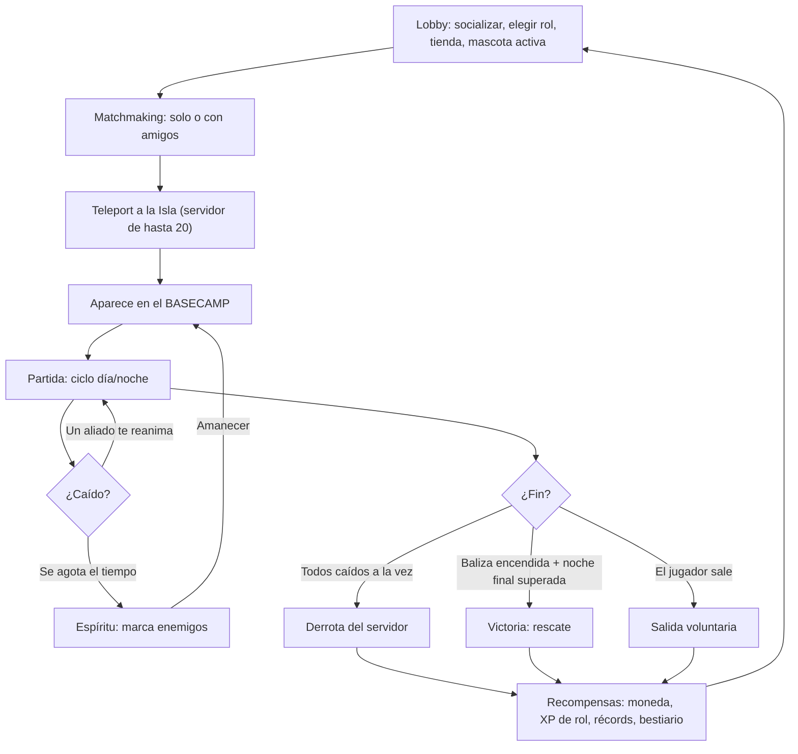
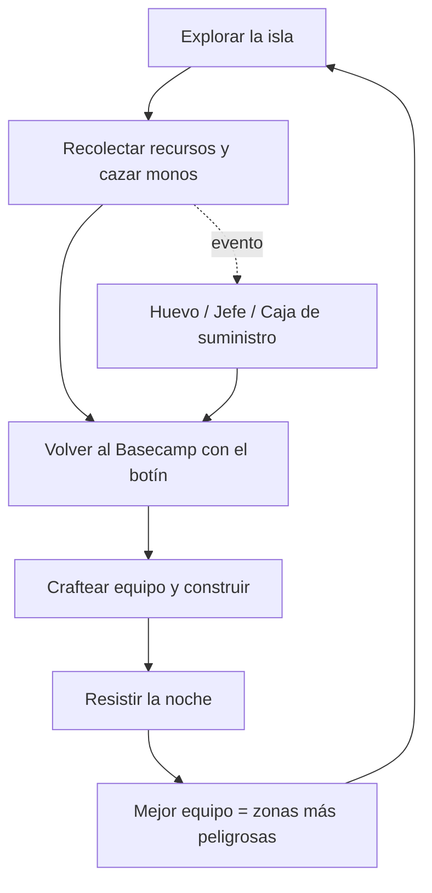
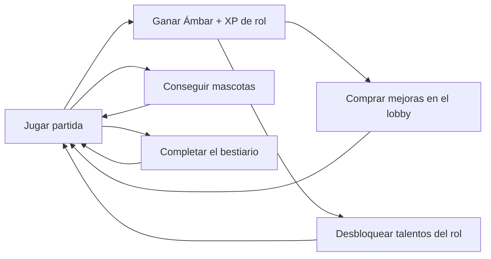
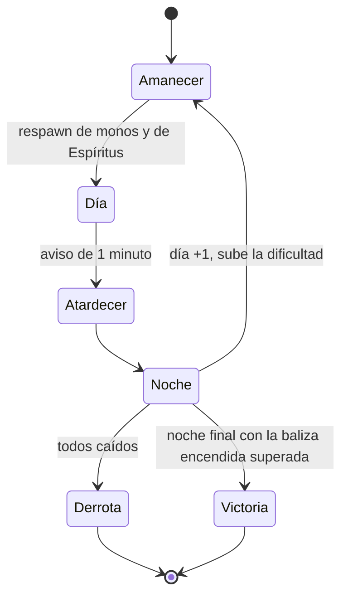
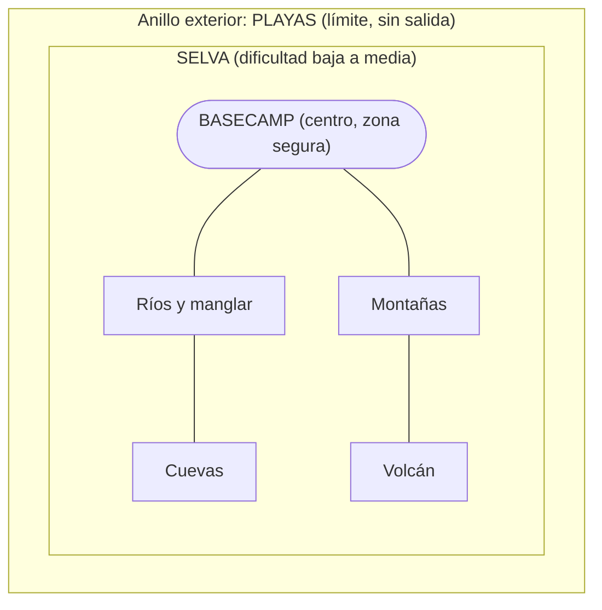
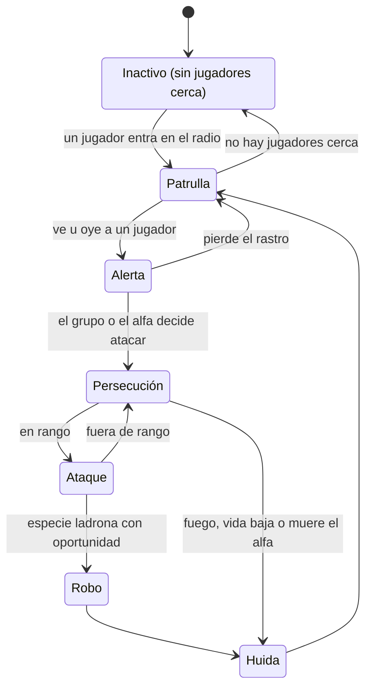
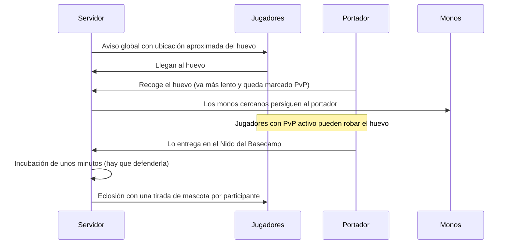

# Primal Banana Island: Monkey Survival — Documento de Diseño del Juego (GDD) v0.2

> **Estado:** diseño base confirmado tras la entrevista (v0.2: todas las propuestas de la v0.1 confirmadas).
> **Nombre:** **Primal Banana Island: Monkey Survival** (ver [§15](#15-nombre)). El repositorio conserva el nombre `monkey_island_2026`.

---

## 1. Visión

**Pitch:** *Naufragas en una isla tropical infestada de monos que comen carne humana. Con hasta 19 jugadores más, especialízate como médico, cazador o recolector, fortifica el Basecamp, sobrevive noches cada vez más feroces y derrota a los jefes de la isla para encender la baliza de rescate.*

### Pilares de diseño

1. **Cooperar por necesidad.** Los roles se complementan, un compañero te puede reanimar y el núcleo del Basecamp es de todos.
2. **La isla está viva.** Los monos tienen comportamiento social (tropas, alfas, ladrones). Hay ciclo día/noche, clima y eventos.
3. **Tú eliges el riesgo.** Cuanto más lejos del Basecamp, mejor botín. El PvP es *opt-in*.
4. **Siempre progresas.** Moneda, talentos de rol, mascotas, bestiario y récords. Incluso una mala partida deja algo.

### Público y plataformas

- **Público:** jugadores de Roblox (≈10–16+ años) a los que les gustan los juegos de supervivencia, exploración y coleccionables.
- **Plataformas:** **Móvil + PC** desde el día 1 (controles táctiles, UI escalable y rendimiento en gama baja). Consola más adelante.
- **Estilo visual:** **low-poly estilizado** y colorido. El tono es de aventura con tensión. La violencia es estilizada, **sin sangre ni gore**.
- **Referentes del género en Roblox:** juegos de supervivencia de día/noche como *99 Nights in the Forest*. Nuestros diferenciadores son el **ecosistema de monos con bestiario**, el **huevo y las mascotas coleccionables**, el **objetivo de rescate**, el **Basecamp compartido de 20 jugadores** y el **PvP por eventos**.

---

## 2. Decisiones tomadas en la entrevista

| Tema | Decisión |
|---|---|
| Muerte | **Caído + reanimación.** Si nadie te reanima, pasas a ser *Espíritu* un rato (más largo con cada caída del día) y pierdes parte del inventario. |
| Fin de partida | **Infinita + objetivo de rescate.** Se sobrevive el máximo de días posible, pero se puede **ganar** construyendo la baliza de rescate. |
| PvP | **Opt-in en eventos y zonas.** El Basecamp es seguro. El PvP ocurre en cajas de suministro, el huevo y jefes disputados. |
| Monetización | **Moneda del juego** para las mejoras. **Robux solo para cosméticos y comodidad.** Nada de pay-to-win. |
| Equipo | Desarrollador en solitario (experiencia **básica** en Studio/Luau). **Claude escribe el código** en el repo. |
| Plataforma | **Móvil + PC.** |
| Combate | **3ª persona**, cuerpo a cuerpo + distancia (machete, lanza, honda, arco) con esquiva. |
| Arte | **Low-poly estilizado.** |
| Basecamp | **Núcleo compartido** (nido, baliza, defensas, estaciones grandes) **+ parcela personal** por jugador. |
| Ciclo día/noche | **Configurable.** Se empieza con **10 min de día + 7 min de noche** y se ajusta con playtests. |
| Roles | **Fijo por partida** (se elige en el lobby) + **árbol de talentos** que progresa entre partidas. |
| Mascotas | **Persistentes.** Cada participante del rescate del huevo recibe una tirada. Se coleccionan y se lleva 1 activa. |
| Huevo | **Evento PvP opt-in.** El portador queda marcado y los jugadores con PvP activo pueden robárselo. |
| Servidor | Máximo **20 jugadores**. Se puede entrar a una partida en curso si hay hueco. |
| Asedio nocturno | **Sí.** El Basecamp es seguro **mientras resistan las defensas**. |
| Fiebre del mono | **Sí.** Infección por mordiscos que cura el médico. |
| Lore | **Santuario-laboratorio** abandonado (Proyecto PRIMAL). |
| Jefes | **Uno cada 2 días**, rotando por los 4 biomas. |
| Baliza de rescate | Se puede encender desde el **día 8**, cuando ya es posible tener las 4 piezas. |
| Especies | Se añade la **marteja** (mono nocturno) a la categoría 1. |
| PvP en playas | **Cajas de suministro** que llegan por mar = zonas de PvP. |
| Nombre | **Primal Banana Island: Monkey Survival.** |

---

## 3. Flujo del jugador

---

## 4. Bucles de juego

### Bucle principal (dentro de la partida)

### Bucle meta (entre partidas)

---

## 5. La partida

### 5.1 Ciclo día/noche

- Duración **configurable** (`Config.DayLength`, `Config.NightLength`). Valor inicial: **10 min de día + 7 min de noche**.
- **Amanecer:** los monos **reaparecen** (respawn diario), los Espíritus reviven en el Basecamp y el contador de días sube.
- **Día:** especies diurnas. Es el momento de explorar y recolectar.
- **Atardecer:** aviso un minuto antes de la noche para volver a la base.
- **Noche:** especies nocturnas, menos visibilidad (antorchas) y **asedio al Basecamp** (§10).

### 5.2 Escalado de dificultad

Cada día aumentan la cantidad de monos, la proporción de especies de categoría alta y la fuerza del asedio nocturno. Así una partida infinita tiene un final natural y el récord de días tiene valor.

### 5.3 Condiciones de fin

- **Derrota:** todos los jugadores del servidor están caídos o son Espíritus a la vez. Se muestran los resultados y se vuelve al lobby.
- **Victoria (rescate):** se construye la **baliza de rescate** con piezas de los 4 jefes de bioma. Al encenderla empieza la **noche final** ("La Gran Tropa"). Si alguien sigue en pie al amanecer, llega el rescate.
  - La baliza solo se puede encender desde el **día 8** (configurable). Como aparece un jefe cada 2 días (días 2, 4, 6 y 8), antes no se pueden tener las 4 piezas.
- **Entrar a mitad de partida:** se permite mientras haya hueco y no esté en curso la noche final. Las recompensas dependen de la **contribución** mientras estuviste presente.

---

## 6. El jugador

### 6.1 Estadísticas

| Estadística | Función |
|---|---|
| Vida | Al llegar a 0 quedas **Caído**. |
| Hambre | Baja con el tiempo (unos 20 min de lleno a vacío). Se recupera comiendo: carne cruda (poco), plátanos de los arbustos, carne asada y brochetas de la hoguera. |
| Sed | Baja más rápido (unos 14 min). Se recupera bebiendo agua del río. *Más adelante: hervirla, cocos o lluvia.* |
| Estamina | Se gasta al correr y esquivar. Con hambre o sed bajas se recupera más despacio. |

A 0 de hambre o de sed se pierde vida y se puede acabar **caído**. La vida solo se regenera con hambre y sed por encima de la mitad.
| Fiebre del mono | Sube con mordiscos de monos. A tope causa pérdida lenta de vida y visión borrosa. La cura el **médico** con antídotos. |

### 6.2 Muerte: caído y Espíritu

1. **Caído (30 s):** te arrastras lento. Cualquier aliado puede reanimarte; el médico lo hace mucho más rápido.
2. **Espíritu:** si se acaba el tiempo, dejas una **mochila** con parte de tu inventario en el sitio donde caíste (se puede recuperar). Como Espíritu puedes moverte y **marcar enemigos** para tu equipo, así que sigues aportando.
3. **Reaparición:** vuelves al Basecamp tras **45 s** como Espíritu. Cada caída del mismo día suma 30 s más (máximo 3 min) y al amanecer reaparecen todos. Así morir pronto no te deja sin jugar, pero caer una y otra vez sí cuesta.

### 6.3 Roles

El rol se elige en el lobby y es **fijo durante la partida**. Cada rol tiene su propia **XP** que desbloquea talentos de forma permanente.

| Rol | Pasiva | Habilidad activa | Ejemplos de talentos |
|---|---|---|---|
| **Médico** | Ve la vida de todos. Reanima 2× más rápido. | **Ungüento:** curación en área | Reanimar a corta distancia, antídotos mejorados, aura de regeneración en el Basecamp |
| **Cazador** | Ve huellas y **marca** monos para el equipo. +daño a distancia. | **Trampa** de captura | Crítico contra monos marcados, señuelo de carne, trampas que aturden |
| **Recolector** | +espacio de inventario, recolecta más rápido y ve recursos raros. | **Carga pesada:** el huevo y los cofres le ralentizan menos | Más botín por recurso, herramientas más duraderas, cofre portátil |

Las sinergias son intencionadas: el cazador **marca**, el recolector **transporta** y el médico **mantiene vivo** al grupo.

---

## 7. La isla

La isla no tiene salida. Su borde exterior es un anillo de **playas**, en el centro está el **Basecamp** y los biomas peligrosos se reparten entre ambos.

| Zona | Dificultad | Recursos destacados | Particularidad |
|---|---|---|---|
| **Basecamp** | Segura | Ninguno | Spawn, construcción y crafteo. |
| **Selva** | Baja a media | Madera, fibra, frutas y plantas medicinales | La zona más grande. Monos de categoría baja. |
| **Playas** | Media | Cocos, conchas, restos de naufragio (metal) | Llegan **cajas de suministro** por el mar, que son zonas de PvP (§12). |
| **Ríos y manglar** | Media a alta | Agua, arcilla, peces | Jefe: Orangután del Manglar. |
| **Montañas** | Alta | Piedra, hierro y cristal | Jefe: Chimpancé Caudillo. |
| **Cuevas** | Alta | Cristales y minerales raros | Oscuridad: se necesitan antorchas. Jefe: Gorila Albino. |
| **Volcán** | Muy alta | Obsidiana, azufre y núcleos de magma | Erupciones periódicas. Jefe: Gorila de Ceniza. |

---

## 8. Los monos

### 8.1 Comportamiento (IA)

Todos los monos comparten la misma máquina de estados. Cada especie cambia los parámetros y añade mecánicas propias.

- **Tropas:** muchas especies van en grupo con un **alfa**. Si muere el alfa, la tropa se dispersa.
- **Miedo al fuego:** antorchas y hogueras ahuyentan a las especies de categoría baja y media.
- **Repoblación:** cada amanecer se llenan todos los grupos y, durante el día y la noche, un grupo con bajas recupera un mono cada 45 s si no hay jugadores cerca de su zona. La selva nunca se vacía, pero un grupo recién barrido tarda en volver.
- **Rendimiento:** los monos lejos de cualquier jugador "duermen" (no calculan rutas) y hay un límite de monos activos por servidor.

### 8.2 Bestiario

#### Categoría 1: dificultad baja

| Especie | Horario | Zona | Mecánica propia | Botín de ejemplo |
|---|---|---|---|---|
| Mono aullador rojo | Día y noche | Selva | Su **grito atrae** a los monos cercanos; si no lo callas rápido llegan refuerzos | Pelaje rojo, colmillo pequeño |
| Marimonda del Chocó | Día | Copas de árboles, ríos | Se mueve por los árboles, **cae desde arriba** y vuelve a subir | Pelaje negro, liana resistente |
| Mono maicero capuchino (grupos) | Día | Selva, cerca del Basecamp | **Ladrón:** roba un ítem y huye. Lanza piedras. | Lo robado, semillas, piedra pulida |
| Tití del Chocó | Día | Selva densa | **Enjambre** de muchos individuos débiles y rápidos | Pelusa, diente diminuto |
| Mono ardilla | Día | Selva, ríos | Grupos grandes y veloces que **rodean** | Pelaje dorado |
| Marteja (mono nocturno) | **Noche** | Selva | Solo de noche, con ojos brillantes. Ataca a quien **no lleva antorcha**. Es una especie colombiana real. | Bigotes de marteja |

#### Categoría 2: dificultad media

| Especie | Horario | Zona | Mecánica propia | Botín de ejemplo |
|---|---|---|---|---|
| Mandril | Día | Selva profunda | Tanque. Su **rugido intimidante** reduce el daño de los jugadores cercanos. | Colmillo de mandril, pelaje colorido |
| Macaco | **Noche** | Alrededores del Basecamp | Inteligente: **abre cofres y desactiva trampas** simples | Pelaje gris, tarjeta de laboratorio (lore) |
| Gibón | Día | Copas de árboles, montañas | **Balanceo** muy rápido entre árboles y ataques en picada | Liana resistente, pelaje |
| Babuino | **Noche** | Montañas bajas | Tropas grandes con **alfa**: matarlo dispersa la tropa | Colmillo grande, cuero |
| Mono de cola larga | Día y noche | Playas y manglar | Nada y **roba comida**. Ronda las cajas de suministro. | Concha, pelaje |

#### Categoría 3: dificultad difícil

| Especie | Horario | Zona | Mecánica propia | Botín de ejemplo |
|---|---|---|---|---|
| Chimpancé | Día | Montañas, selva profunda | **Emboscadas coordinadas**: lanza piedras y usa palos | Hueso grueso, pelaje negro |
| Orangután | Día | Manglar, árboles altos | Lento, pero su **agarre inmoviliza** y un compañero tiene que liberarte | Pelaje naranja, fibra resistente |
| Gorila | Día y noche | Montañas, volcán | Tanque: **carga** y golpe de pecho que **aturde en área** | Pelaje plateado, hueso de gorila |

#### Categoría 4: jefes (uno por bioma)

Son versiones **gigantes y con aspecto distinto** de las especies difíciles. Pegan más, tienen fases y sueltan botín especial. **Cada jefe suelta siempre una pieza de la baliza de rescate.**

| Día de aparición | Jefe | Bioma | Mecánicas | Botín especial |
|---|---|---|---|---|
| 2, 10, 18… | **Orangután del Manglar** | Ríos | Atrapa jugadores en el agua y crece la marea en la arena | Perla del río |
| 4, 12, 20… | **Chimpancé Caudillo** | Montañas | Invoca tropas, lanza troncos y ataca desde posiciones elevadas | Corona del caudillo |
| 6, 14, 22… | **Gorila Albino** | Cuevas | Pelea en la oscuridad: apaga antorchas y su rugido hace eco y aturde | Cristal de cueva |
| 8, 16, 24… | **Gorila de Ceniza** | Volcán | Cargas, lluvia de rocas volcánicas. Se enfurece durante las erupciones. | Núcleo de magma (forja de nivel alto) |

**Reglas de aparición:**

- Aparece **un jefe cada 2 días**, rotando por los biomas de menor a mayor dificultad. El orden y el intervalo son configurables.
- El jefe se queda en su guarida **hasta que lo derrotan o hasta que aparece el siguiente**. Así el equipo tiene unos 2 días para prepararse.
- Si un jefe se escapa, su pieza se puede conseguir en la **siguiente rotación** (8 días después).
- Las piezas de baliza van al **núcleo compartido**: pertenecen al servidor, no a un jugador.

---

## 9. Botín y crafteo

### 9.1 Rarezas

| Rareza | Probabilidad orientativa | Origen típico |
|---|---|---|
| Común | 60–70 % | Cualquier mono y recurso |
| Poco común | 20–25 % | Categoría 1–2 |
| Raro | 5–10 % | Categoría 2–3 |
| Épico | 1–3 % | Categoría 3 y jefes |
| Legendario | < 1 % | Solo jefes |

Todas las tablas de botín, recetas y estadísticas son **datos en módulos de configuración**. Se pueden balancear sin tocar la lógica.

### 9.2 Progresión de equipo

`Madera y piedra` → `Hueso y colmillo` → `Metal de naufragio` → `Obsidiana y magma` → `Piezas de jefe`

### 9.3 Estaciones de crafteo (Basecamp)

| Estación | Desbloquea |
|---|---|
| Mesa de trabajo | Herramientas y armas básicas, antorchas |
| Hoguera y cocina | Comida cocinada, agua hervida |
| Taller del curandero | Vendas, ungüentos y antídotos (bonus para el médico) |
| Forja de piedra | Armas y armaduras de hueso y metal |
| Forja volcánica | Equipo de obsidiana y magma (requiere núcleo de magma) |
| Nido | Incubar huevos |
| Baliza de rescate | Victoria (requiere las 4 piezas de jefe) |

---

## 10. El Basecamp

- **Núcleo compartido:** nido, baliza, defensas perimetrales y estaciones grandes. Cualquiera puede aportar recursos, pero solo se puede **desmontar con votación o por el constructor original** (evita el sabotaje).
- **Parcela personal:** una tienda o espacio pequeño para cofre, cama y estaciones propias. Solo la modifica su dueño.
- **Construcción:** por **cuadrícula**, cómoda en móvil y en PC.
- **Sin recursos dentro**, como en el diseño original: hay que salir a buscarlos.
- **Asedio nocturno:** de noche, oleadas de monos intentan entrar desde varias direcciones. El interior es seguro **mientras resistan las defensas** (muros, trampas y antorchas). Esto da sentido a construir y une a los 20 jugadores en un objetivo común cada noche.
  - Las oleadas crecen con el número de día y con el número de jugadores.
  - Las defensas dañadas se reparan de día con recursos.
  - Si los monos rompen el perímetro, atacan estructuras y jugadores dentro, pero **el nido y la baliza tienen su propia defensa**: es lo último que cae.
  - La noche del encendido de la baliza es la **noche final** ("La Gran Tropa"), el asedio más fuerte de la partida.

---

## 11. El huevo y las mascotas

- **Aparición:** probabilidad baja cada cierto tiempo en un punto aleatorio de la isla. Hay un **aviso global** con ubicación aproximada.
- **Transporte:** el portador va **más lento**, atrae monos y queda **marcado para PvP**. Los jugadores con PvP activo pueden robarle el huevo; el recolector lo carga mejor.
- **Nido:** hay que tenerlo construido en el núcleo del Basecamp. La incubación dura unos minutos y hay que defenderla.
- **Eclosión:** cada jugador que **participó** en el rescate recibe una **tirada de mascota persistente**.

### Mascotas

- **Colección persistente.** Se equipa **1 mascota activa** desde el lobby.
- **Tipos de ayuda:** combate, carga (+inventario), rastreo (detecta recursos y monos), curación y apoyo.
- **Rarezas:** de común a legendaria. Fauna tropical (tucán, guacamaya, tortuga, jaguarundí…) y criaturas "experimentales" legendarias del laboratorio (ver Lore).
- **Importante:** los huevos **solo se consiguen jugando**, nunca con Robux. Así se evitan las normas de Roblox sobre objetos aleatorios de pago.

---

## 12. PvP opt-in

- **Basecamp:** PvP desactivado siempre.
- **Activar PvP:** en un tótem del Basecamp. Los jugadores con PvP activo llevan un **indicador visible** y solo pueden atacar a otros jugadores con PvP activo.
- **Desactivar PvP:** hay una espera (por ejemplo 3 minutos) para evitar abusos.
- **Activación automática:** al **cargar el huevo** o al abrir una **caja de suministro** disputada.
- **Recompensa por cabeza:** quien acumula derribos PvP tiene una recompensa visible para los demás jugadores con PvP activo.

---

## 13. Lore

Hace décadas, un millonario excéntrico construyó en la isla un **santuario-laboratorio privado** con primates de todo el mundo. Eso explica que convivan especies de América, África y Asia. Para alimentarlos plantó enormes cultivos de banano, y la isla acabó conocida como **Banana Island**.

En secreto, el laboratorio desarrolló el **Proyecto PRIMAL**: un suero mezclado en bananas modificadas para hacer a los primates más fuertes e inteligentes. Salió mal. Los primates se volvieron agresivos y carnívoros, y los que comieron más **bananas primales** crecieron hasta tamaños imposibles (los jefes). El laboratorio quedó abandonado tras una erupción del volcán.

Los jugadores son **náufragos**. La **baliza de rescate** es la antigua radio del laboratorio. Hay **notas, ruinas y tarjetas de acceso** repartidas por la isla, lo que da pie a **actualizaciones narrativas por temporadas**.

**Ganchos de lore para el juego:**
- Las **bananas primales** (brillantes) pueden ser un objeto raro: consumible con mejora temporal, ingrediente de crafteo o lo que "despierta" a los jefes.
- Los **macacos** sueltan tarjetas de laboratorio que abren puertas de ruinas con botín y notas.
- Las criaturas **experimentales** del laboratorio son las mascotas legendarias de los huevos.

---

## 14. Economía y monetización

- **Moneda del juego: Ámbar** (nombre provisional). Se gana por días sobrevividos, contribución (recolectar, reanimar, defender), jefes y rescates.
- **Se gasta en:** mejoras permanentes **moderadas** (huecos de inventario, kit inicial por rol), cosméticos básicos y reroll de talentos.
- **Talentos:** se desbloquean con la **XP del rol**, no con dinero.
- **Robux (solo cosmético y comodidad):** skins de personaje y armas, skins de mascota, emotes, efectos, servidores privados y un posible pase de temporada cosmético.
- **Nunca con Robux:** poder, huevos y objetos aleatorios.

---

## 15. Nombre

**Primal Banana Island: Monkey Survival**

- **Primal Banana Island** es el título y conecta con el lore (Proyecto PRIMAL y las bananas primales).
- **Monkey Survival** es el subtítulo con palabras clave, para que el juego aparezca en las búsquedas de Roblox.
- Evita el riesgo de propiedad intelectual de "Monkey Island" (LucasArts/Disney).
- **Pendiente antes de publicar:** buscar el nombre en Roblox (que no haya otro juego igual) y en registros de marcas.

---

## 16. Riesgos y políticas de Roblox

| Riesgo | Mitigación |
|---|---|
| **Alcance enorme** para una sola persona | Construir por fases, con un *vertical slice* jugable antes de producir contenido. Datos de configuración en lugar de código duplicado. |
| **Rendimiento** (20 jugadores y muchos NPC, en móvil) | IA en servidor con "sueño" lejos de jugadores, límite de monos activos, StreamingEnabled y pruebas en móviles de gama baja. |
| **Moderación** ("comen carne humana") | Sin sangre ni gore. Derrotas con animaciones estilizadas. La amenaza se transmite con lore y tono. Completar el cuestionario de madurez de contenido. |
| **Propiedad intelectual** del nombre | Nombre propio: *Primal Banana Island* (§15). |
| **Objetos aleatorios de pago** | Huevos solo por juego. Si algún día se venden, mostrar probabilidades según las normas de Roblox. |
| **Exploits y trampas** | Servidor autoritativo: todo daño, botín y crafteo se valida en el servidor. |
| **Griefing** | PvP opt-in, Basecamp seguro, permisos de construcción y núcleo protegido. |

---

## 17. Preguntas abiertas

Las preguntas de la v0.1 están resueltas (ver §2). Quedan detalles para decidir con los playtests:

1. ¿El orden de los jefes es **fijo** (de menor a mayor dificultad, propuesta actual) o **aleatorio** en cada partida?
2. ¿Nombre final de la moneda? ("Ámbar" es provisional; ¿quizá **Bananas doradas**, por el nombre del juego?)
3. ¿Qué hacen exactamente las **bananas primales**: mejora temporal, ingrediente o las dos cosas?
4. Duraciones finales del día y de la noche (se empieza con 10+7 y se ajusta en la Fase 1).
