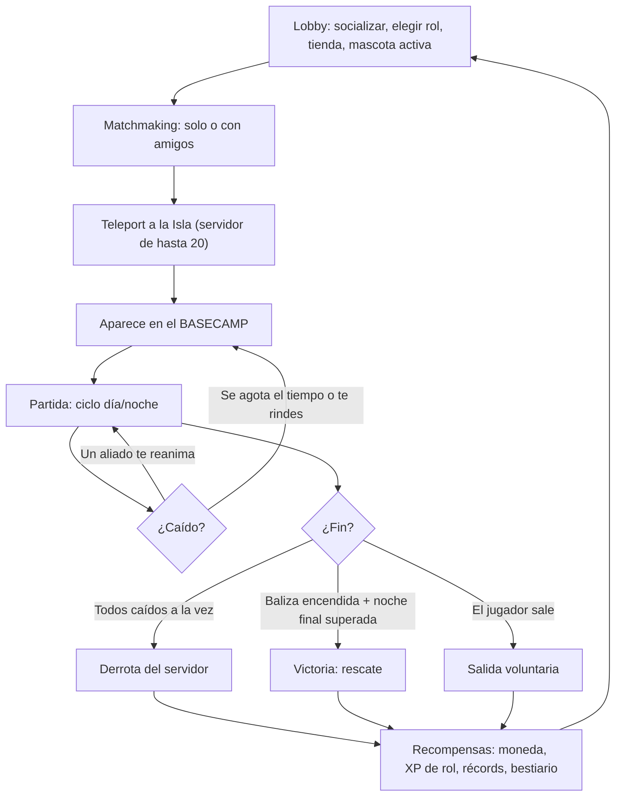
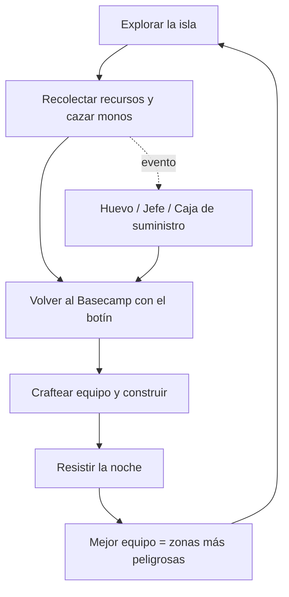
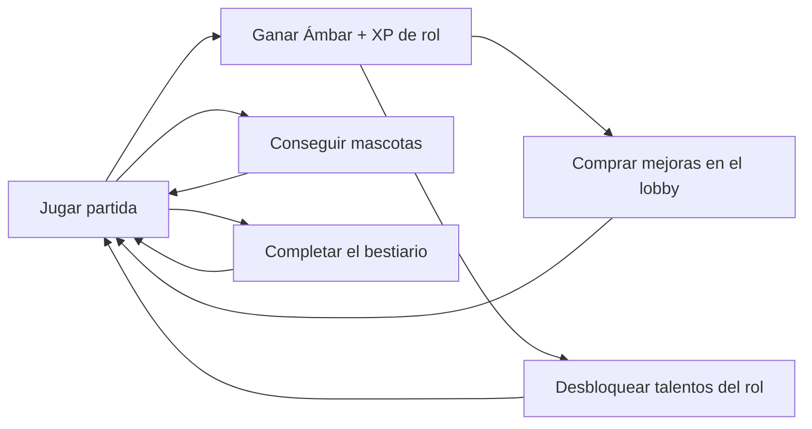
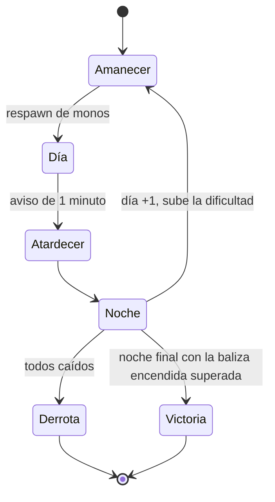
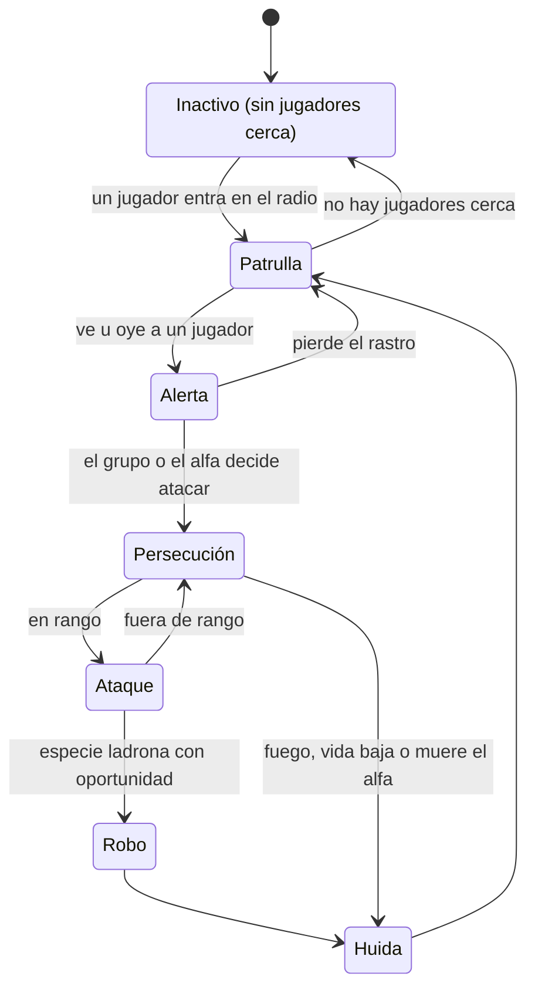
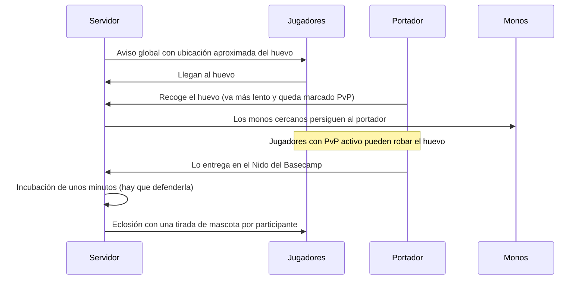

# Primal Banana Islands: Monkey Survival — Documento de Diseño del Juego (GDD) v0.2

> **Estado:** diseño base confirmado tras la entrevista (v0.2: todas las propuestas de la v0.1 confirmadas).
> **Nombre:** **Primal Banana Islands: Monkey Survival** (ver [§15](#15-nombre)). El repositorio conserva el nombre `monkey_island_2026`.

---

## 1. Visión

**Pitch:** *Naufragas en una isla tropical llena de monos salvajes y traviesos que te roban la comida. Con hasta 19 jugadores más, especialízate como guerrero, cazador, mago o médico, fortifica el Basecamp, sobrevive noches cada vez más feroces y derrota a los jefes de la isla para encender la baliza de rescate.*

### Pilares de diseño

1. **Cooperar por necesidad.** Los roles se complementan, un compañero te puede reanimar y el núcleo del Basecamp es de todos.
2. **La isla está viva.** Los monos tienen comportamiento social (tropas, alfas, ladrones). Hay ciclo día/noche, clima y eventos.
3. **Tú eliges el riesgo.** Cuanto más lejos del Basecamp, mejor botín. El PvP es *opt-in*.
4. **Siempre progresas.** Moneda, talentos de rol, mascotas, bestiario y récords. Incluso una mala partida deja algo.

### Público y plataformas

- **Público:** jugadores de Roblox (≈10–16+ años) a los que les gustan los juegos de supervivencia, exploración y coleccionables.
- **Plataformas:** **Móvil + PC** desde el día 1 (controles táctiles, UI escalable y rendimiento en gama baja). Consola más adelante.
- **Estilo visual:** **low-poly estilizado** y colorido. El tono es de aventura con tensión. La violencia es estilizada, **sin sangre ni gore**.
- **Referentes del género en Roblox:** juegos de supervivencia de día/noche como *99 Nights in the Forest*. Nuestros diferenciadores son el **ecosistema de monos con bestiario**, el **huevo y las mascotas coleccionables**, el **objetivo de rescate**, el **Basecamp compartido de 20 jugadores** y el **PvP por eventos**.

---

## 2. Decisiones tomadas en la entrevista

| Tema | Decisión |
|---|---|
| Muerte | **Caído + reanimación.** Si nadie te reanima en 1 minuto (o te rindes), reapareces en tu cama o en el Basecamp y pierdes parte del inventario, que queda en una mochila donde caíste. |
| Fin de partida | **Infinita + objetivo de rescate.** Se sobrevive el máximo de días posible, pero se puede **ganar** construyendo la baliza de rescate. |
| PvP | **Opt-in en eventos y zonas.** El Basecamp es seguro. El PvP ocurre en cajas de suministro, el huevo y jefes disputados. |
| Monetización | **Moneda del juego** para las mejoras. **Robux solo para cosméticos y comodidad.** Nada de pay-to-win. |
| Equipo | Desarrollador en solitario (experiencia **básica** en Studio/Luau). **Claude escribe el código** en el repo. |
| Plataforma | **Móvil + PC.** |
| Combate | **3ª persona**, cuerpo a cuerpo + distancia (machete, lanza, honda, arco) con esquiva. |
| Arte | **Low-poly estilizado.** |
| Basecamp | **Núcleo compartido** (nido, baliza, defensas, estaciones grandes) **+ parcela personal** por jugador. |
| Ciclo día/noche | **Configurable.** Se empieza con **10 min de día + 7 min de noche** y se ajusta con playtests. |
| Roles | **Fijo por partida** (se elige en el lobby) + **árbol de talentos** que progresa entre partidas. |
| Mascotas | **Persistentes.** Cada participante del rescate del huevo recibe una tirada. Se coleccionan y se lleva 1 activa. |
| Huevo | **Evento PvP opt-in.** El portador queda marcado y los jugadores con PvP activo pueden robárselo. |
| Servidor | Máximo **20 jugadores**. Se puede entrar a una partida en curso si hay hueco. |
| Asedio nocturno | **Sí.** El Basecamp es seguro **mientras resistan las defensas**. |
| Fiebre del mono | **Sí.** Infección por mordiscos que cura el médico. |
| Lore | **Santuario-laboratorio** abandonado (Proyecto PRIMAL). |
| Jefes | **Uno cada 2 días**, rotando por los 4 biomas. |
| Baliza de rescate | Se puede encender desde el **día 8**, cuando ya es posible tener las 4 piezas. |
| Especies | Se añade la **marteja** (mono nocturno) a la categoría 1. |
| PvP en playas | **Cajas de suministro** que llegan por mar = zonas de PvP. |
| Nombre | **Primal Banana Islands: Monkey Survival.** |

---

## 3. Flujo del jugador

---

## 4. Bucles de juego

### Bucle principal (dentro de la partida)

### Bucle meta (entre partidas)

---

## 5. La partida

### 5.1 Ciclo día/noche

- Duración **configurable** (`Config.DayLength`, `Config.NightLength`). Valor inicial: **10 min de día + 7 min de noche**.
- **Amanecer:** los monos **reaparecen** (respawn diario), y el contador de días sube.
- **Día:** especies diurnas. Es el momento de explorar y recolectar.
- **Atardecer:** aviso un minuto antes de la noche para volver a la base.
- **Noche:** especies nocturnas, menos visibilidad (antorchas) y **asedio al Basecamp** (§10).

### 5.2 Escalado de dificultad

Cada día aumentan la cantidad de monos, la proporción de especies de categoría alta y la fuerza del asedio nocturno. Así una partida infinita tiene un final natural y el récord de días tiene valor.

### 5.3 Condiciones de fin

- **Derrota:** todos los jugadores del servidor están caídos a la vez (10 s seguidos de noche). Se muestran los resultados y se vuelve al lobby.
- **Victoria (rescate):** se construye la **baliza de rescate** con piezas de los 4 jefes de bioma. Al encenderla empieza la **noche final** ("La Gran Tropa"). Si alguien sigue en pie al amanecer, llega el rescate.
  - La baliza solo se puede encender desde el **día 8** (configurable). Como aparece un jefe cada 2 días (días 2, 4, 6 y 8), antes no se pueden tener las 4 piezas.
- **Entrar a mitad de partida:** se permite mientras haya hueco y no esté en curso la noche final. Las recompensas dependen de la **contribución** mientras estuviste presente.

---

## 6. El jugador

### 6.1 Estadísticas

| Estadística | Función |
|---|---|
| Vida | Al llegar a 0 quedas **Caído**. |
| Hambre | Baja con el tiempo (unos 20 min de lleno a vacío). Se recupera comiendo: carne cruda (poco), bananos de los arbustos y de los cultivos, plátanos (mejor asados), carne asada y brochetas de la hoguera. |
| Sed | Baja más rápido (unos 14 min). Se recupera bebiendo agua del río. *Más adelante: hervirla, cocos o lluvia.* |
| Estamina | Se gasta al correr y esquivar. Con hambre o sed bajas se recupera más despacio. |

A 0 de hambre o de sed se pierde vida y se puede acabar **caído**. La vida solo se regenera con hambre y sed por encima de la mitad.
| Fiebre del mono | Sube con los **mordiscos** de los monos según el daño que entra tras la armadura (+20 por cada barra de vida entera perdida a mordiscos; un mono básico, +1) y con la carne cruda (+12). Piedras, pisotones, jefes y peligros no la suben. Desde 60, tinte morado y **oleadas** cortas de vista borrosa (cada 16 s a 60, cada 7 s a 100); entre oleadas se ve bien. A 100 además quita vida poco a poco. Baja sola 4 por minuto (15 por minuto descansando en el Basecamp); el **antídoto** del taller del curandero la quita de golpe y el remate del combo del médico la baja 9. Ritmo buscado: síntomas tras unos 10 minutos de pelea continua sin curarse. |

### 6.2 Muerte: caído y reaparición

1. **Caído (1 minuto):** te arrastras lento. Cualquier aliado puede reanimarte; el médico lo hace mucho más rápido.
2. **Rendirse:** si nadie va a llegar (jugando solo, por ejemplo), mantén pulsado **Rendirse** (F, X en mando o el botón táctil) para no esperar el minuto entero. Vale a partir de los 3 s de caer.
3. **Reaparición:** si se acaba el tiempo o te rindes, dejas una **mochila** con la mitad de cada material en el sitio donde caíste (solo tú puedes recuperarla; el equipo, como la antorcha, no se pierde) y reapareces al momento en tu cama o en el Basecamp, con toda la vida. *(Antes había una fase de Espíritu de 45 s a 3 min; se quitó el 19-10-2026.)*

### 6.3 Roles

El rol se elige en el lobby y es **fijo durante la partida**. Cada rol tiene su propia **XP** que desbloquea talentos de forma permanente.

Cada rol tiene una **pasiva**, sus **armas iniciales** (además del hacha y el pico) y **5 habilidades**: 4 activas (**Z, X, C, R**) y una **definitiva** (**V**) con un tiempo de espera largo. Con mando se mantiene **R1** y se pulsa **A, B, X, Y o L1**; en móvil son 5 botones junto al salto. La cuarta activa va en la **R** y no en la E porque la E es la tecla de los avisos (recoger, reanimar, fabricar…). Solo gastan tiempo de espera. Con el PvP activo también afectan a otros jugadores, con la mitad de daño y aturdimientos de la mitad de tiempo. Los números están en `Config.Abilities`.

| Rol | Pasiva | Armas iniciales | Activas (Z · X · C · R) | Definitiva (V) |
|---|---|---|---|---|
| ⚔️ **Guerrero** | +25 % daño cuerpo a cuerpo, +20 de vida. Lleva mejor el huevo. | Garrote de piedra, honda | **Torbellino** (golpes alrededor 2 s) · **Embestida** (carga de 20 studs que empuja) · **Grito de guerra** (atrae a los monos y −40 % de daño 4 s) · **Rompehuesos** (golpe de 24 al cono de delante que tumba 0,5 s; 8 s) | **Pisotón:** 150 de daño en área y aturde 2 s |
| 🏹 **Cazador** | +25 % daño a distancia. | Arco (gasta flechas), machete | **Disparo múltiple** (abanico de 5) · **Marcar presas** · **Cepo** (cuando un mono lo pisa, atrapa unos 2 s a todos los que estén a 8 studs) · **Flecha perforante** (16 a cada mono que atraviesa en línea; 8 s) | **Lluvia de proyectiles:** zona con 160 de daño en 4 s |
| 🔮 **Mago** | +25 % daño de hechizos, habilidades un 15 % más rápidas. | Bastón mágico (sin munición), machete | **Bola de fuego** (explota en área) · **Nova de hielo** (congela 1,2 s y ralentiza) · **Parpadeo** (teletransporte de 25 studs) · **Meteoro** (cae donde apuntas tras 0,8 s de aviso: 24 en 9 studs; 10 s) | **Rayo encadenado:** salta entre 5 monos, −25 % por salto |
| ⛑️ **Médico** | Ve la vida de todos. Reanima 2× más rápido. +15 de vida máxima. **Savia protectora:** al curar a un aliado gana un escudo de 10 durante 5 s (como mucho uno cada 8 s; no pisa un escudo mayor). | Cerbatana (sin munición; cada dardo que acierta cura un poco al aliado más herido cerca y **envenena** al mono: 5 de daño por segundo durante 4 s, números morados y vapor morado; no se acumula, cada acierto lo renueva), machete | **Ungüento en área** · **Dardo curativo** (cura a distancia) · **Escudo de hojas** (absorbe 24) · **Polvo somnífero** (nube donde apuntas: 1 s de sueño lento y luego duermen 1,5 s; los jefes no se duermen; 12 s) | **Tótem sanador:** se planta donde apuntas (hasta 40 studs) y cura a quien esté cerca durante 10 s |

**Armas de rol y sus mejoras** (forja de piedra; solo las ve su rol): garrote de piedra → maza de hueso → mazo de hueso grueso (guerrero); arco → arco reforzado → arco de liana (cazador); bastón mágico → bastón dorado → bastón de plata (mago); cerbatana → cerbatana de hueso → cerbatana del chamán (médico: 14 → 17 → 22 de daño base, veneno de 5 → 7 → 9 por segundo durante 4 s y +2 → +3 → +5 de curación por acierto, a menos de 40 studs). Desde el 19-10-2026 el médico hace ~60 % del daño de un rol de daño contra un mono (antes ~36 % con la cerbatana básica), casi todo con la cerbatana y su veneno; medido con la calculadora `ServerStorage.Tools.Equilibrio`.

Los **talentos** (5 por rol) mejoran cada uno una habilidad: más duración, más daño, más proyectiles o más saltos. Los de las cuartas activas: **Mazazo** (+20 % de daño del Rompehuesos por rango), **Punta de obsidiana** (+20 % de la Flecha perforante), **Polvo de estrellas** (el Meteoro ralentiza 1 s por rango; con más daño valía demasiado) y **Sueño profundo** (+0,3 s de sueño). Las ventajas de recolección (recoger más rápido, +1 material, hacha y pico más fuertes) son **mejoras de la tienda** para cualquier rol.

**Armaduras por rol** (octubre de 2026): las tres armaduras (chaleco de pelaje 25 %, hueso 40 %, plata 55 %) tienen los mismos números y recetas para todos, pero cada rol las lleva con su propio aspecto y nombre (`Data/Armor` "roleNames", modelos en `Combat/ArmorModels`). Cazador: **capa de rastreador** (jubón de cuero claro y esclavina parda con un abanico de hojas en la espalda), **armadura de cazador** (cuero oscuro con botones y hombrera de hueso, manto de hojas y carcaj de hueso con flechas de plumas rojas) y **manto de cazador plateado** (capa de pelaje plateado con hojas oscuras, capucha con orejas, garras de hueso en los hombros y carcaj negro con aros de plata). Todas con la capucha bajada y el carcaj cruzado a la espalda. Mago (de chamán; brillan en azul, porque el morado es del veneno y el verde de las curaciones): **manto de amuletos** (poncho de fibra con flecos, collar de cuentas y un atrapasueños en la espalda), **túnica de runas** (túnica añil con cráneos de ojos encendidos en los hombros y un círculo de runas de neón en la espalda) y **manto de cristal** (capa de pelaje plateado con una corona de cristales que asoma por encima de los hombros). Médico (de curandero; lo que brilla, en verde, el color de las curaciones): **bandolera de curandero** (túnica de lino con bolsitas de hierbas y un manojo de hierbas en la espalda), **peto de curandero** (peto de hueso blanco con una cruz de hojas y una mochila con frascos de poción en la espalda) y **manto de sanador** (manto plateado con frascos que brillan y un tótem sanador pequeño en la espalda, como el de la definitiva).

Las sinergias son intencionadas: el guerrero **aguanta** y agrupa a los monos, el mago y el cazador los **castigan** en área y el médico **mantiene vivo** al grupo.

*Cambio de octubre de 2026:* el Recolector se sustituyó por el Mago. Su XP pasó al Mago y los puntos de sus talentos quedaron libres para repartirlos de nuevo.

*Cambio de octubre de 2026 (ritmo):* las activas (Z, X, C) se recargan un **40 % antes** y sus daños, curaciones, escudos y duraciones bajan un **40 %**: el daño por segundo es el mismo, pero se usan casi el doble y se enlazan en **combos** (§6.4). Las definitivas no cambian. "Golpe sísmico" pasa a llamarse **Pisotón**.

| Rol | Recargas Z · X · C (antes → ahora) |
|---|---|
| Guerrero | Torbellino 12 → 7 s · Embestida 10 → 6 s · Grito 25 → 15 s (→ 12 s, ver §6.4) |
| Cazador | Disparo múltiple 8 → 5 s · Marcar 30 → 18 s (→ 15 s, ver §6.4) · Cepo 15 → 9 s |
| Mago | Bola de fuego 10 → 6 s · Nova 18 → 11 s · Parpadeo 12 → 7 s |
| Médico | Ungüento 40 → 24 s (→ 15 s, ver §6.4) · Dardo 10 → 6 s · Escudo 20 → 12 s |

*Armas a distancia (animación):* con una honda, un arco, un bastón o una cerbatana en la mano, el brazo derecho cuelga junto al cuerpo; al disparar, el personaje hace el movimiento de su arma (estirar la goma, tensar y soltar la cuerda, alzar y lanzar el bastón con un destello, llevarse la cerbatana a la boca y soplar). Son animaciones de Roblox (R15) que genera `ServerStorage.Tools.WeaponAnimationBuilder` y se publican con sus ids en `Data/WeaponAnimations`.

### 6.4 Críticos, combos y números de combate

**Críticos** (`Config.Crit`, `Shared/Crit`): hacen **×1,35** (+35 %) y su número sale un **25 % más grande**, con "!" y un temblor.

| Quién | Probabilidad |
|---|---|
| Armas del jugador | 5 % el arma básica, 10 % la primera mejora de la forja, 15 % la segunda (`critChance` en `Data/Weapons`). Las habilidades usan la del arma de la mano o, si no es un arma, la de la mejor que lleves. |
| Curaciones del médico | 10 % + la del arma; +30 % si el aliado tiene menos del 35 % de vida ("salvada"). Vendas, ungüentos y reanimar nunca. |
| Mascotas | 10 % en sus golpes y curaciones. |
| Monos de categoría 2 / 3 | 15 % / 20 % (categoría 1: nunca). |
| Jefes | 25 % en las fases 1 y 2; 28 % en la fase 3 (furia). |

**Combos** (`Data/Combos`, `ComboService`): cada rol tiene **dos**, de tres habilidades **en orden**, con 6 s como mucho entre una y otra (si la siguiente aún se está recargando, los 6 s cuentan desde que esté lista). Cada combo empieza con una habilidad distinta: **la que usas primero decide cuál está en marcha**. La primera **marca** lo que toca; la segunda y la tercera hacen **críticos seguros con daño extra** a los marcados (+25 % el guerrero, +10 % el cazador, nada el mago) y el remate tiene un efecto extra.

**Conexiones:** al cerrar un combo, el otro queda **abierto en su paso 1**: lo marcado sigue marcado, lo que golpea el remate se marca y se sigue directamente por su **paso 2** (A → B → A…). Cada combo cerrado tras una conexión sube la racha **un nivel más** y sale "¡CONEXIÓN! N seguidos"; en el indicador, el paso saltado lleva "🔗". Ningún combo usa la definitiva (V): con 90 s de recarga casi nunca se podía cerrar. Cada paso enlazado la acerca **10 s**, como mucho **20 s por recarga**.

*Cambio de octubre de 2026 (valor de los combos):* antes casi todo el premio era acercar la definitiva sin límite, y el mago, que cierra un combo cada ~9 s, la lanzaba casi el triple. Ahora la devolución tiene tope, el daño extra va por rol y la explosión del remate del mago es un 25 % más grande (antes 50 %). Enlazar da +20–30 % de daño en una pelea larga contra un grupo a los tres roles de daño (medido con `ServerStorage.Tools.Equilibrio`).

*Cambio de octubre de 2026 (enlazar combos seguidos):* al guerrero le costaba encadenar un combo tras otro. La Embestida (6 s) se recargaba mucho antes que el Grito (15 s): si la usabas suelta, el combo nuevo empezaba sin Grito disponible y se perdía, y cuando el Grito volvía la Embestida estaba otra vez recargándose. Ahora la ventana espera a que el paso siguiente esté listo (vale para todos los roles) y el Grito se recarga en **12 s** con **4 s** de protección (el mismo tercio del tiempo protegido que antes): un combo completo cada 12 s en vez de cada 15 s. Enlazar le da al guerrero +30 % de daño en grupo en 180 s (el límite es 35 %).
El hueco entre combos lo marca la recarga más larga de sus pasos. Pasaba lo mismo, más acusado, con el cazador (Marcar presas, 18 s) y el médico (Ungüento, 24 s): ahora los dos pasos se recargan en **15 s**, con su efecto en la misma proporción para que den lo mismo por segundo. Marcar dura 5 s (el talento Rastreador, +2 s por rango) y el Ungüento cura 11 a cada aliado; su remate baja la fiebre 9 (al hacerse más a menudo, por minuto baja lo mismo que antes). Hueco entre combos: mago ~9 s, guerrero 12 s, cazador y médico 15 s; con racha, menos.

| Rol | Combo | Pasos | Remate |
|---|---|---|---|
| Cazador | Presa acorralada | Cepo ⛓️ → Marcar presas (vuelve a sujetar 1,5 s a los atrapados) → Disparo múltiple | Críticos y 2 proyectiles más |
| Cazador | Tiro de gracia | Marcar presas 🎯 → Cepo → Flecha perforante | 3 flechas perforantes en abanico |
| Mago | Fuego y hielo | Nova ❄️ → Parpadeo → Bola de fuego | Rompe el hielo: críticos y explosión un 25 % más grande |
| Mago | Lluvia de estrellas | Bola de fuego 🔥 → Nova → Meteoro | El suelo arde 3 s (6 por segundo) |
| Guerrero | Remolino de acero | Embestida 💫 → Grito (aturde 1 s a los desequilibrados) → Torbellino | Críticos y 1 s más de giro |
| Guerrero | Martillo y yunque | Grito 🔨 → Embestida → Rompehuesos | Golpea a todo lo de alrededor, no solo delante |
| Médico | Cura de urgencia | Dardo 💚 → Escudo (+50 % al revitalizado) → Ungüento | Curaciones críticas seguras, −9 de fiebre y envenena a los monos del radio (6 por segundo durante 5 s) |
| Médico | Nana de la selva | Escudo 🍃 → Dardo (cura crítica) → Polvo somnífero (8 de daño) | Duermen 1 s más, la nube cura 10 a los aliados que estén dentro y los dormidos reciben **+30 % de daño** hasta despertar ("💤 +30 %") |

Con las conexiones las cuatro activas de cada rol entran en el bucle (p. ej. guerrero: Grito → Torbellino → Embestida → Rompehuesos → Grito…), un combo cada dos habilidades.

**Racha:** cada combo completo seguido la sube (x1 … x5; un nivel más si vino de una conexión); desde x2, las recargas son un 4 % más rápidas por nivel. Se pierde tras 8 s sin hacer daño ni curar.

*Cambio de octubre de 2026 (cuarta activa, segundo combo y conexiones):* con las conexiones se cierran 2–3 veces más combos y la racha se quedaba en x5: enlazar valía +50–78 % de daño en grupo (el límite es +35 %). Por eso la racha pasa del 8 % al 4 % por nivel y el daño extra de los golpes enlazados baja (guerrero +25 %, cazador 50 → 10 %, mago 25 → 0 %: casi todos sus golpes de habilidad ya son críticos seguros). Queda en +29 % guerrero, +31 % cazador y +34 % mago; con una habilidad más, los roles hacen ~25 % más de daño con combos que antes y los jefes duran un 10 % menos (101–212 s), dentro de 90–240 s.

*Daño de los jugadores:* todo lo que hacen con armas y habilidades a monos, jefes y muñecos va ×0,7 (`Config.Combat.PlayerDamageMultiplier`); el PvP y las mascotas no cambian. La forja, las armas y los Ajustes enseñan el daño ya reducido.

**Números de combate** (cada cliente los dibuja; `CombatTextController`): columnas de 4 números; el nuevo entra abajo y empuja a los anteriores, que suben y se desvanecen. Duran 2,8 s; lo recogido, 4,5 s.
- **Rojo a la izquierda:** daño que recibes. **Verde a la derecha:** curaciones. **Amarillo sobre el enemigo:** daño que haces.
- Lo de la **mascota** sale al 70 % del tamaño; el daño de los **aliados**, al 70 % y tenue (solo cerca).
- **Lo que recoges** (recolección, botín de monos y jefes, cajas, tu mochila al caer) sale igual, en una columna propia **a la derecha, debajo de las curaciones**: "+2 🌲 Madera" con el color de su rareza. Lo mismo recogido seguido suma en la misma línea. Se puede quitar en Ajustes.
- En **Ajustes** (⚙️ en la Isla, pestaña en el Lobby) cada jugador elige dónde salen sus números: **junto a la cabeza**, en una **columna del alto del jugador** o **fijos en la pantalla**; y ve su personaje con un ejemplo, el daño y el crítico de su arma, sus habilidades, su combo y su mascota.

---

## 7. La isla

La isla no tiene salida. Su borde exterior es un anillo de **playas**, en el centro está el **Basecamp** y los biomas peligrosos se reparten entre ambos.

| Zona | Dificultad | Recursos destacados | Particularidad |
|---|---|---|---|
| **Basecamp** | Segura | Ninguno | Spawn, construcción y crafteo. |
| **Selva** | Baja a media | Madera, fibra, frutas y plantas medicinales | La zona más grande. Monos de categoría baja. |
| **Playas** | Media | Cocos, conchas, restos de naufragio (metal) | Llegan **cajas de suministro** por el mar, que son zonas de PvP (§12). |
| **Ríos y manglar** | Media a alta | Agua, arcilla, peces | Jefe: Orangután del Manglar. |
| **Montañas** | Alta | Piedra, hierro y cristal | Jefe: Chimpancé Caudillo. |
| **Cuevas** | Alta | Cristales y minerales raros | Oscuridad: se necesitan antorchas. Jefe: Gorila Albino. |
| **Volcán** | Muy alta | Obsidiana, azufre y núcleos de magma | Erupciones periódicas. Jefe: Gorila de Ceniza. |

### 7.1 El archipiélago

El juego es un **archipiélago de seis islas**. Al principio solo se juega en una (la del volcán, la de esta sección); las demás **solo se ven desde el Lobby**, alrededor del banco de arena del naufragio y a distancias distintas, como promesa de contenido futuro:

| Isla | Dónde (desde el Lobby) | Cómo se ve | Estado |
|---|---|---|---|
| **Lobby** (banco de arena del naufragio) | Centro | El carguero «Esperanza» encallado y el campamento | Lobby |
| **Isla del Volcán** | Noreste, ~870 studs | Selva y volcán humeante con ríos de lava | **Jugable** |
| **Isla Calavera** | Suroeste, ~520 studs (la más cercana) | Roca enorme con forma de cráneo de mono, ojos encendidos, colmillos, escalera y antorchas | Cerrada |
| **Ciudad Perdida** | Noroeste, ~600 studs | Rascacielos rotos, inclinados y tumbados, un paso elevado partido, todo comido por la selva | Cerrada |
| **Isla de las Dunas** | Sureste, ~940 studs | Dunas, mesetas de arenisca, arco de roca, obeliscos medio enterrados, cactus y polvo | Cerrada |
| **Picos de la Niebla** | Norte, ~1.300 studs (la más lejana) | Agujas de roca caliza con selva en la cima, cascada y bandas de niebla | Cerrada |

Las islas cerradas son decorado del Lobby (`World/LobbyBuilder`, carpeta `Naufragio/Archipielago`): no se puede llegar a ellas y todavía no tienen place propio. Abrir una isla nueva significará crear su place, añadir su ID a `Config.PlaceIds` y dar en el Lobby la forma de elegir destino.

---

## 8. Los monos

### 8.1 Comportamiento (IA)

Todos los monos comparten la misma máquina de estados. Cada especie cambia los parámetros y añade mecánicas propias.

- **Tropas:** muchas especies van en grupo con un **alfa**. Si muere el alfa, la tropa se dispersa.
- **Miedo al fuego:** antorchas y hogueras ahuyentan a las especies de categoría baja y media.
- **Repoblación:** cada amanecer se llenan todos los grupos y, durante el día y la noche, un grupo con bajas recupera un mono cada 45 s si no hay jugadores cerca de su zona. La selva nunca se vacía, pero un grupo recién barrido tarda en volver.
- **Rendimiento:** los monos lejos de cualquier jugador "duermen" (no calculan rutas) y hay un límite de monos activos por servidor.
- **Nadie te sujeta siempre:** agarres, pisotones y embestidas (de monos, jefes y en PvP) te dejan quieto un rato, pero mientras estás quieto otro no lo alarga y, al soltarte, durante `Config.Combat.PlayerControlImmunitySeconds` (2 s) no te pueden volver a sujetar. Así un orangután te tiene quieto como mucho la mitad del tiempo y siempre hay un hueco para huir.

### 8.2 Bestiario

El **diario de campo** (J en la Isla, pestaña "Diario" en el Lobby) recoge las especies y, debajo, los **jefes** (§8.2, categoría 4): cada uno sale con "???" hasta que lo derrotas (o, en un jefe, hasta que le haces daño y cae), y entonces con su descripción, zona o guarida, botín y cuántas veces.

*Ajuste de octubre de 2026 (combos):* las tropas son un **50 % más grandes** (`Config.Monkeys.GroupSizeMultiplier`), los grupos diezmados se recuperan cada **25 s** (antes 45) y caben hasta **220** monos a la vez (antes 160), para que siempre haya con quién enlazar combos. *(18-10-2026: las tropas solo existen cerca de los jugadores y el límite, 200, cuenta solo esas; ver `docs/RENDIMIENTO.md`.)* A cambio, cada mono suelta botín con la **mitad de probabilidad** (`LootChanceMultiplier`).

*Botín compartido (18-10-2026):* el botín de un mono se **reparte al azar, unidad a unidad, entre todos los que pelearon contra él**: quienes le golpearon en los últimos **30 s** (`Config.Monkeys.LootShareSeconds`), los **médicos que curaron a alguno de ellos** en ese tiempo y siempre quien lo derrotó. Para recibir hay que estar vivo (no caído), salvo quien lo derrota. Lo robado por un capuchino y la baja (diario, estadísticas) siguen siendo de quien lo derrota.

#### Categoría 1: dificultad baja

| Especie | Horario | Zona | Mecánica propia | Botín de ejemplo |
|---|---|---|---|---|
| Mono aullador rojo | Día y noche | Selva | Su **grito atrae** a los monos cercanos; si no lo callas rápido llegan refuerzos | Pelaje rojo, colmillo pequeño |
| Marimonda del Chocó | Día | Copas de árboles, ríos | Se mueve por los árboles, **cae desde arriba** y vuelve a subir | Pelaje negro, liana resistente |
| Mono maicero capuchino (grupos) | Día | Selva, cerca del Basecamp | **Ladrón:** roba un ítem y huye. Lanza piedras. | Lo robado, semillas, piedra pulida |
| Tití del Chocó | Día | Selva densa | **Enjambre** de muchos individuos débiles y rápidos | Pelusa, diente diminuto |
| Mono ardilla | Día | Selva, ríos | Grupos grandes y veloces que **rodean** | Pelaje dorado |
| Marteja (mono nocturno) | **Noche** | Selva | Solo de noche, con ojos brillantes. Ataca a quien **no lleva antorcha**. Es una especie colombiana real. | Bigotes de marteja |

#### Categoría 2: dificultad media

| Especie | Horario | Zona | Mecánica propia | Botín de ejemplo |
|---|---|---|---|---|
| Mandril | Día | Selva profunda | Tanque. Su **rugido intimidante** reduce el daño de los jugadores cercanos. | Colmillo de mandril, pelaje colorido |
| Macaco | **Noche** | Alrededores del Basecamp | Inteligente: **abre cofres y desactiva trampas** simples | Pelaje gris, tarjeta de laboratorio (lore) |
| Gibón | Día | Copas de árboles, montañas | **Balanceo** muy rápido entre árboles y ataques en picada | Liana resistente, pelaje |
| Babuino | **Noche** | Montañas bajas | Tropas grandes con **alfa**: matarlo dispersa la tropa | Colmillo grande, cuero |
| Mono de cola larga | Día y noche | Playas y manglar | Nada y **roba comida**. Ronda las cajas de suministro. | Concha, pelaje |

#### Categoría 3: dificultad difícil

| Especie | Horario | Zona | Mecánica propia | Botín de ejemplo |
|---|---|---|---|---|
| Chimpancé | Día | Montañas, selva profunda | **Emboscadas coordinadas**: lanza piedras y usa palos | Hueso grueso, pelaje negro |
| Orangután | Día | Manglar, árboles altos | Lento, pero su **agarre te inmoviliza** 2,5 s (puedes pegar, usar habilidades y esquivar, no andar); al soltarte tienes 2 s para apartarte | Pelaje naranja, fibra resistente |
| Gorila | Día y noche | Montañas, volcán | Tanque: **carga** y golpe de pecho que **aturde en área** | Pelaje plateado, hueso de gorila |

#### Categoría 4: jefes (uno por bioma)

Son versiones **gigantes y con aspecto distinto** de las especies difíciles. Pegan más, tienen fases y sueltan botín especial. **Cada jefe suelta siempre una pieza de la baliza de rescate.**

| Día de aparición | Jefe | Bioma | Mecánicas | Botín especial |
|---|---|---|---|---|
| 2, 10, 18… | **Orangután del Manglar** | Ríos | Atrapa jugadores en el agua y crece la marea en la arena | Perla del río |
| 4, 12, 20… | **Chimpancé Caudillo** | Montañas | Invoca tropas, lanza troncos y ataca desde posiciones elevadas | Corona del caudillo |
| 6, 14, 22… | **Gorila Albino** | Cuevas | Pelea en la oscuridad: apaga antorchas y su rugido hace eco y aturde | Cristal de cueva |
| 8, 16, 24… | **Gorila de Ceniza** | Volcán | Cargas, lluvia de rocas volcánicas. Se enfurece durante las erupciones. | Núcleo de magma (forja de nivel alto) |

**Reglas de aparición:**

- Aparece **un jefe cada 2 días**, rotando por los biomas de menor a mayor dificultad. El orden y el intervalo son configurables.
- El jefe se queda en su guarida **hasta que lo derrotan o hasta que aparece el siguiente**. Así el equipo tiene unos 2 días para prepararse.
- **Vida según quién pelea** (`Config.Bosses`): cuenta a los jugadores vivos que están en su zona (fuera del Basecamp). Con uno tiene su vida base y cada jugador más le suma un 75 %; al entrar o salir alguien se recalcula sin cambiar el % que le queda. Así dura parecido con 1, 4 o 20 jugadores: con 4, unos **2 minutos** el Orangután y **3 minutos** el Gorila de Ceniza (con las armas de la forja que se suelen tener ese día), tiempo para ver sus tres fases.
- Si un jefe se escapa, su pieza se puede conseguir en la **siguiente rotación** (8 días después).
- Las piezas de baliza van al **núcleo compartido**: pertenecen al servidor, no a un jugador.

#### Tamaño estándar de monos y jefes

El tamaño dice de un vistazo lo peligroso que es un mono: cuanto más alto, más difícil. Un mono o un jefe nuevo debe caer dentro de la franja de su categoría. Se mide el **alto del modelo de pie**, en studs, junto a un personaje de 5 studs (el maniquí de la vista previa). El tamaño se ajusta con `scale` en `Data/Monkeys` o `Data/Bosses`. El modelo de cada especie (`Monkeys/MonkeyModels`) está hecho para medir lo que le toca con `scale = 1`, y `scale` lo multiplica.

| Categoría | Alto | Frente a un jugador | `scale` habitual | Ahora (alto en studs) |
|---|---|---|---|---|
| 1 · baja | 1,3–3 | de la rodilla a la cintura | 0,45–1 | Tití 1,4 · Mono ardilla 1,5 · Marteja 1,5 · Capuchino 1,6 · Cola larga 1,6 · Marimonda 1,65 · Aullador 1,75 (voxel) |
| 2 · media | 2,4–4 | de la cintura al pecho | 0,85–1,25 | Macaco 1,75 · Gibón 2,4 · Mandril 2,9 · Babuino 3,4 (voxel) |
| 3 · difícil | 3,4–5,5 | como un jugador | 1,15–1,6 | Chimpancé 4,2 · Orangután 5 · Gorila 6 (voxel, hombros 4,8) |
| 4 · jefe | 9–11 | unos dos jugadores | 2,6–3,2 (de 1,9 a 2,3 veces el de su especie) | Caudillo 12,3 · Albino 10,8 · Manglar 10,8 · Ceniza 13,4 |

- **Se pasan de alto a propósito:** la **Marimonda** (2,4 con la cola en S levantada; 1,65 de cuerpo), el **Chimpancé Caudillo** (12,3 con el tocado de plumas; 9 de cuerpo) el **Gorila Albino** (12,7 de alto y 13,6 de ancho con los cristales de los hombros y los brazos; 10,8 x 9,8 de cuerpo) y el **Gorila de Ceniza**, que es un 25 % más grande que el Albino para ser el jefe más imponente (13,4 de alto, 12,8 de ancho y 17,5 de fondo; `scale` 3,625, 2,5 veces el de su especie). Su guarida está al aire libre, en el centro del volcán, y tiene más alcance de ataque (14) para llegar a los jugadores que tiene delante del hocico. Para ellos cuenta el alto del cuerpo, no el de la cola, los brazos o el tocado.
- **Ancho y fondo:** los jefes miden hasta unos 10 studs de ancho y 14 de fondo. Las guaridas y la cámara están pensadas para eso, así que un jefe más grande necesita revisar su guarida.
- **Piezas:** unas 15–30 por mono normal (hay muchos a la vez) y hasta 60 por jefe (solo hay uno).

#### Tamaño real con mínimo (modelos voxel, octubre de 2026)

Al pasar cada especie y cada mascota al estilo voxel, su tamaño sale de su **tamaño real frente al
jugador** (decidido el 18-10-2026). Hasta entonces, la tabla de franjas de arriba sigue valiendo para
los modelos de antes.

- **Escala:** 1 m real ≈ 3 studs (el avatar estándar, 5,3–5,5 studs, es una persona de 1,75 m).
- **Qué se mide:** el alto en la postura del juego (a cuatro patas, sentado o posado), no el largo
  del cuerpo de `docs/MONOS.md` y `docs/MASCOTAS.md`.
- **Mínimo, sin perder el orden de tamaños:** si el tamaño real en studs es menor que el umbral, se
  usa `mínimo + real / 2`. Así ningún mono baja de 1,2 studs ni ninguna mascota de 1,5, y el más
  pequeño sigue siendo el más pequeño.
  - Monos: umbral 2,4, mínimo 1,2.
  - Mascotas: umbral 3, mínimo 1,5.
- **Jefes:** siguen siendo versiones gigantes de su especie (9–11 studs, con las excepciones de arriba).

Los altos reales en postura son estimaciones a partir de las medidas de los documentos; se ajustan
al modelar cada animal.

**Simios y monos grandes agrandados (18-10-2026):** a cuatro patas a su tamaño real se quedaban
cortos junto al jugador, así que el Mandril, el Babuino, el Chimpancé, el Orangután y el Gorila son
más grandes que su tamaño real, en este orden de mayor a menor: Gorila 6, Orangután 5, Chimpancé 4,2,
Babuino 3,4 y Mandril 2,9 (con `scale` en `Data/Monkeys`). El Gorila (6) se pasa de la franja de la
categoría 3 a propósito. Sus jefes no cambian (tienen su propio `scale` en `Data/Bosses`).

**Alfas:** estas cinco especies llevan alfa (`alpha` en `Data/Monkeys`): el primero de cada tropa.
Es un 15 % más grande (`Config.Monkeys.AlphaScale`), más vida y más daño, y lleva su corona. Tiene
el aspecto de los machos dominantes de su especie (dimorfismo sexual; `alpha` en el spec voxel de
cada especie), con la cara normal algo más agresiva (ceño en V y ojos entornados) sin llegar a la
de ataque:

- **Mandril:** todos los colores mucho más vivos (nariz roja, crestas azul eléctrico, barba dorada
  más larga, lomo dorado, trasero violeta y rojo).
- **Babuino:** capa plateada como la del babuino sagrado, callosidades rojas y las puntas de los
  colmillos asomando.
- **Chimpancé:** negro intenso con el lomo canoso, barba canosa, cara más oscura y más músculo.
- **Orangután:** pelo castaño granate en vez de naranja, almohadillas más anchas, barba y melenas
  largas colgando de los brazos.
- **Gorila:** cuerpo negro intenso con el lomo plateado más claro, la cresta más alta (por eso el
  alfa mide 7,2 en vez de 6,9) y más músculo.

| Mono | Alto real en postura | Real (studs) | **Alto en juego** | Antes |
|---|---|---|---|---|
| Tití del Chocó | ~0,13 m | 0,4 | **1,4** (hecho) | 1,4 |
| Mono ardilla | ~0,18 m | 0,55 | **1,5** (hecho) | 1,9 |
| Marteja | ~0,2 m | 0,6 | **1,5** (hecho) | 2 |
| Capuchino ladrón | ~0,25 m | 0,75 | **1,6** (hecho) | 1,8 |
| Mono de cola larga | ~0,25 m | 0,75 | **1,6** (hecho) | 2,5 |
| Marimonda del Chocó | ~0,3 m | 0,9 | **1,65** (hecho; 2,4 con la cola en S) | 3,7 |
| Macaco | ~0,35 m | 1,05 | **1,75** (hecho) | 2,7 |
| Mono aullador rojo | ~0,35 m | 1,05 | **1,75** (hecho) | 2,5 |
| Mandril | ~0,55 m | 1,65 | **2,9** (agrandado; alfa 3,3) | 2 |
| Babuino | ~0,65 m | 1,95 | **3,4** (agrandado; alfa 3,9) | 2,2 |
| Gibón | ~0,8 m (erguido) | 2,4 | **2,4** (hecho; brazos colgando) | 4,4 |
| Chimpancé | ~0,9 m | 2,7 | **4,2** (agrandado; alfa 4,8) | 2,7 |
| Orangután | ~1 m | 3 | **5** (agrandado; alfa 5,75) | 3 |
| Gorila | ~1,5 m de hombros | 5,2 con la cresta | **6** (agrandado; alfa 7,2 con su cresta) | 5,2 |

| Mascota | Alto real en postura | Real (studs) | **Alto en juego** |
|---|---|---|---|
| Rana dardo | ~0,04 m | 0,12 | **0,53** (hecho; 1,1 de largo, por debajo del mínimo a propósito) |
| Colibrí | ~0,1 m (con las alas) | 0,3 | **1,4** (hecho; 2,1 de punta a punta de las alas) |
| Tucán | ~0,35 m posado | 1,05 | **2** (hecho) |
| Jaguarundí | ~0,35 m de hombros | 1,05 | **2** (hecho) |
| Tortuga verde | ~1 m de largo (0,25 m de alto) | 3 de largo | **0,9** (hecho; 3,6 de largo y 3,8 con las aletas: el usuario la quiso un 20 % más grande que el real) |
| Ocelote | ~0,45 m de hombros | 1,35 | **2,2** (hecho) |
| Papagayo (Guacamaya) | ~0,45 m posado | 1,35 | **2** (hecho; esbelta, 3,5 de punta a punta de las alas) |
| Beagle | ~0,5 m con la cabeza (0,37 de cruz) | 1,5 | **2,2** con la cola en bandera (hecho; 2,06 sin ella) |
| Perezoso | ~0,5 m a cuatro patas | 1,5 | **2,2** (hecho; 2,9 con la mochila de carga y 2,9 de largo) |
| Jaguar de cristal | ~0,7 m de hombros (jaguar) | 2,1 | **2,6** con los cristales (hecho) |
| Labrador | ~0,75 m con la cabeza (0,58 de cruz) | 2,25 | **2,6** (hecho; 4 de largo, con las alforjas) |
| Pointer inglés | ~0,85 m con la cabeza (0,6 de cruz) | 2,55 | **2,7** (hecho; 4,3 de largo) |
| Mono X-7 | ~0,9 m (chimpancé) | 2,7 | **2,6** (hecho; 3,3 con la antena) |

Las mascotas pequeñas se ordenan por su **lado más largo**, no solo por el alto: la rana, plana, salía
la más grande con 1,55 de alto. Orden decidido por el usuario (18-10-2026): rana < colibrí < tucán. La
rana mide un 25 % menos que el mínimo de 1,5 studs, a propósito.

Consecuencias que hay que revisar al pasar cada uno a voxel:
- Casi todos los monos bajan de tamaño. El orden de peligro se mantiene (los pequeños de la
  categoría 1, Mandril y Babuino en medio, los simios arriba), pero las franjas por categoría
  cambian.
- Las mascotas quedan entre 1,5 y 2,25 studs (hoy 2–4,5).
- Los monos más pequeños necesitan un `attackRange` y una caja de golpe a su tamaño.

---

## 9. Botín y crafteo

### 9.1 Rarezas

| Rareza | Probabilidad orientativa | Origen típico |
|---|---|---|
| Común | 60–70 % | Cualquier mono y recurso |
| Poco común | 20–25 % | Categoría 1–2 |
| Raro | 5–10 % | Categoría 2–3 |
| Épico | 1–3 % | Categoría 3 y jefes |
| Legendario | < 1 % | Solo jefes |

Todas las tablas de botín, recetas y estadísticas son **datos en módulos de configuración**. Se pueden balancear sin tocar la lógica.

### 9.2 Progresión de equipo

`Madera y piedra` → `Hueso y colmillo` → `Metal de naufragio` → `Obsidiana y magma` → `Piezas de jefe`

### 9.3 Estaciones de crafteo (Basecamp)

| Estación | Desbloquea |
|---|---|
| Mesa de trabajo | Herramientas y armas básicas, antorchas |
| Hoguera y cocina | Comida cocinada, agua hervida |
| Taller del curandero | Vendas, super vendas, ungüentos y antídotos. Solo el médico: **kit de reanimación** (3 fibra, 1 pelaje dorado, 1 hueso: al reanimar se gasta, basta con pulsar y el aliado vuelve con el 70 % de su vida), **cataplasma de grupo** (4 fibra, 2 plátanos, 1 pelaje rojo: con Curar cura 35 a ti y a los aliados a 20 studs; va primero si alguno ha perdido 10 o más) y **dardos venenosos** ×20 (2 fibra, 1 diente diminuto: munición opcional de la cerbatana; mientras queden, cada disparo gasta uno y el veneno pega ×1,6, con su contador "🐸" encima de la barra) |
| Forja de piedra | Armas y armaduras de hueso y metal |
| Forja volcánica | Equipo de obsidiana y magma (requiere núcleo de magma) |
| Nido | Incubar huevos |
| Baliza de rescate | Victoria (requiere las 4 piezas de jefe) |

---

## 10. El Basecamp

- **Núcleo compartido:** nido, baliza, defensas perimetrales y estaciones grandes. Cualquiera puede aportar recursos, pero solo se puede **desmontar con votación o por el constructor original** (evita el sabotaje).
- **Parcela personal:** una tienda o espacio pequeño para cofre, cama y estaciones propias. Solo la modifica su dueño.
- **Construcción:** por **cuadrícula** con el **martillo**, cómoda en móvil y en PC. Piezas en `Data/Buildables`: muros de madera y de piedra, antorcha de pie y cama (reapareces en ella si caes y no te reaniman). Cada jugador recibe una de 20 parcelas al entrar; al salir se libera y se derriba lo que tenía en ella.
- **Sin recursos dentro**, como en el diseño original: hay que salir a buscarlos.
- **Asedio nocturno:** de noche, oleadas de monos intentan entrar desde varias direcciones. El interior es seguro **mientras resistan las defensas** (muros, trampas y antorchas). Esto da sentido a construir y une a los 20 jugadores en un objetivo común cada noche.
  - Las oleadas crecen con el número de día y con el número de jugadores. *(v1: 3 oleadas por noche, por uno o dos portones al azar; ajustes en `Config.Siege`.)*
  - Las defensas se construyen en el **perímetro** (entre las parcelas y la empalizada, incluidos los portones): muros, **estacas** (hieren a los monos que las cruzan) y antorchas.
  - Las defensas dañadas se reparan de día con recursos.
  - Si los monos rompen el perímetro, atacan estructuras y jugadores dentro, pero **el nido y la baliza tienen su propia defensa**: es lo último que cae.
  - La noche del encendido de la baliza es la **noche final** ("La Gran Tropa"), el asedio más fuerte de la partida.

---

## 11. El huevo y las mascotas

- **Aparición:** probabilidad baja cada cierto tiempo en un punto aleatorio de la isla. Hay un **aviso global** con ubicación aproximada.
- **Transporte:** el portador va **más lento**, atrae monos y queda **marcado para PvP**. Los jugadores con PvP activo pueden robarle el huevo; el guerrero lo carga mejor.
- **Nido:** hay que tenerlo construido en el núcleo del Basecamp. La incubación dura unos minutos y hay que defenderla.
- **Eclosión:** cada jugador que **participó** en el rescate recibe una **tirada de mascota persistente**.

### Mascotas

- **Colección persistente.** Se equipa **1 mascota activa** desde el lobby.
- **Tipos de ayuda:** combate, carga (más material o más botín), rastreo (detecta monos; el beagle también huele el huevo), marca (señala al mono más cercano: todos le hacen más daño), curación y apoyo.
- **Rarezas:** de común a legendaria. Fauna tropical (tucán, guacamaya, tortuga, jaguarundí…), tres sabuesos (beagle, labrador y pointer inglés) y criaturas "experimentales" legendarias del laboratorio (ver Lore).
- **Importante:** los huevos **solo se consiguen jugando**, nunca con Robux. Así se evitan las normas de Roblox sobre objetos aleatorios de pago.

---

## 12. PvP opt-in

- **Basecamp:** PvP desactivado siempre.
- **Activar PvP:** en un tótem del Basecamp. Los jugadores con PvP activo llevan un **indicador visible** y solo pueden atacar a otros jugadores con PvP activo.
- **Desactivar PvP:** hay una espera (por ejemplo 3 minutos) para evitar abusos.
- **Activación automática:** al **cargar el huevo** o al abrir una **caja de suministro** disputada.
- **Recompensa PvP:** quien acumula derribos PvP tiene una recompensa visible para los demás jugadores con PvP activo.

---

## 13. Lore

Hace décadas, un millonario excéntrico construyó en la isla un **santuario-laboratorio privado** con primates de todo el mundo. Eso explica que convivan especies de América, África y Asia. Para alimentarlos plantó enormes cultivos de banano, y la isla acabó conocida como **Banana Island**.

En secreto, el laboratorio desarrolló el **Proyecto PRIMAL**: un suero mezclado en bananas modificadas para hacer a los primates más fuertes e inteligentes. Salió mal. Los primates se volvieron agresivos y carnívoros, y los que comieron más **bananas primales** crecieron hasta tamaños imposibles (los jefes). El laboratorio quedó abandonado tras una erupción del volcán.

La isla es solo una de las **Banana Islands**, un archipiélago que el Proyecto PRIMAL usó entero: desde el naufragio se ven una ciudad tragada por la selva, un desierto de dunas, una roca con forma de calavera y unos picos entre la niebla (§7.1). Cada isla abierta en el futuro trae su bioma, sus monos y su parte de la historia.

Los jugadores son **náufragos**. La **baliza de rescate** es la antigua radio del laboratorio. Hay **notas, ruinas y tarjetas de acceso** repartidas por la isla, lo que da pie a **actualizaciones narrativas por temporadas**.

**Ganchos de lore para el juego:**
- Las **bananas primales** (brillantes) pueden ser un objeto raro: consumible con mejora temporal, ingrediente de crafteo o lo que "despierta" a los jefes.
- Los **macacos** sueltan tarjetas de laboratorio que abren puertas de ruinas con botín y notas.
- Las criaturas **experimentales** del laboratorio son las mascotas legendarias de los huevos.

---

## 14. Economía y monetización

- **Moneda del juego: Ámbar** (nombre provisional). Se gana por días sobrevividos, contribución (recolectar, reanimar, defender), jefes y rescates.
- **Se gasta en:** mejoras permanentes **moderadas** (huecos de inventario, kit inicial por rol), cosméticos básicos y reroll de talentos.
- **Talentos:** se desbloquean con la **XP del rol**, no con dinero.
- **Robux (solo cosmético y comodidad):** skins de personaje y armas, skins de mascota, emotes, efectos, servidores privados y un posible pase de temporada cosmético.
- **Nunca con Robux:** poder, huevos y objetos aleatorios.

---

## 15. Nombre

**Primal Banana Islands: Monkey Survival**

- **Primal Banana Islands** es el título y conecta con el lore (Proyecto PRIMAL y las bananas primales). Va en plural porque el juego es un archipiélago (§7.1): se empieza con una isla y se abren más con las actualizaciones. Antes se llamaba *Primal Banana Island*.
- **Monkey Survival** es el subtítulo con palabras clave, para que el juego aparezca en las búsquedas de Roblox.
- Evita el riesgo de propiedad intelectual de "Monkey Island" (LucasArts/Disney).
- **Pendiente antes de publicar:** buscar el nombre en Roblox (que no haya otro juego igual) y en registros de marcas.

---

## 16. Riesgos y políticas de Roblox

| Riesgo | Mitigación |
|---|---|
| **Alcance enorme** para una sola persona | Construir por fases, con un *vertical slice* jugable antes de producir contenido. Datos de configuración en lugar de código duplicado. |
| **Rendimiento** (20 jugadores y muchos NPC, en móvil) | IA en servidor con "sueño" lejos de jugadores, límite de monos activos, StreamingEnabled y pruebas en móviles de gama baja. |
| **Moderación y edades** (llegar a menores de 16: Roblox Kids y Select) | Sin sangre ni gore. Los monos derrotados desaparecen con un "¡puf!" de humo y estrellas, sin animación ni grito de muerte (violencia leve, de caricatura). Cuestionario de madurez completo y requisitos de [LANZAMIENTO.md §9](LANZAMIENTO.md#9-menores-de-16-roblox-kids-y-select). |
| **Propiedad intelectual** del nombre | Nombre propio: *Primal Banana Islands* (§15). |
| **Objetos aleatorios de pago** | Huevos solo por juego. Si algún día se venden, mostrar probabilidades según las normas de Roblox. |
| **Exploits y trampas** | Servidor autoritativo: todo daño, botín y crafteo se valida en el servidor. |
| **Griefing** | PvP opt-in, Basecamp seguro, permisos de construcción y núcleo protegido. |

---

## 17. Preguntas abiertas

Las preguntas de la v0.1 están resueltas (ver §2). Quedan detalles para decidir con los playtests:

1. ¿El orden de los jefes es **fijo** (de menor a mayor dificultad, propuesta actual) o **aleatorio** en cada partida?
2. ¿Nombre final de la moneda? ("Ámbar" es provisional; ¿quizá **Bananas doradas**, por el nombre del juego?)
3. ¿Qué hacen exactamente las **bananas primales**: mejora temporal, ingrediente o las dos cosas?
4. Duraciones finales del día y de la noche (se empieza con 10+7 y se ajusta en la Fase 1).
