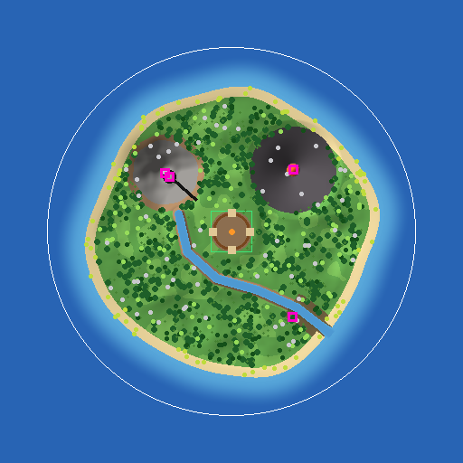

# Guía del mapa: cómo conectar tu isla con el código

El mapa vive en el place **Isla** de Roblox Studio. El código encuentra las piezas importantes por su **nombre** o por un **atributo**. Esta guía explica cómo **generar la isla provisional** y qué tiene que tener el mapa para que todo funcione.

> 💡 Mientras el mapa no tenga estas piezas, el juego crea versiones **de prueba** automáticamente (una zona verde en el centro y árboles, rocas y arbustos alrededor), y lo avisa en la Salida.

---

## Generar la isla provisional (MapBuilder)

El generador `MapBuilder` construye en un minuto la isla completa del GDD en versión *greybox*, lista para jugar y para retocar a mano.



*Vista previa aproximada, vista desde arriba con el norte (Z negativa) arriba. En Roblox el relieve fino cambia un poco, pero la distribución es la misma.*

| En la imagen | Qué es |
|---|---|
| Círculo marrón en el centro | **Basecamp** (170 studs de diámetro): meseta plana con empalizada de estacas con punta, 4 portones con dintel y antorchas, hoguera con bancos y 4 puntos de aparición. El cuadrado verde es la `BasecampZone`. |
| Verde con sombras | **Selva** con colinas (hasta unos 35 studs) y manchas de hierba animada y hojarasca. Se aplana cerca de la playa, el río, el Basecamp y la entrada de la cueva. |
| Puntos verde oscuro | **Árboles de selva** (~265, se talan y dan 🌲 madera) y **helechos** (~265, dan 🌿 fibra), agrupados en bosques con claros entre medias. Hay cinco variedades de árbol: **frondoso**, **ceiba** gigante con raíces en aleta y lianas, **mango** con frutos, **yarumo** de hojas plateadas y matas de **guadua**. |
| (no sale en la imagen) | **Cultivos de banano y plátano** (~14): grupos de 3 a 6 matas en hileras por la selva. Se cosechan con el aviso: el racimo desaparece y vuelve a salir pasado un rato. |
| Gris, noroeste | **Montañas.** La línea negra es la **cueva**: entrada en la falda que mira al Basecamp, túnel y sala al fondo. |
| Oscuro, noreste | **Volcán activo:** lago de lava brillante, llamas, luz naranja, humo y chispas. |
| Azul | **Río:** nace al pie de las montañas, rodea el Basecamp por el sur y desemboca al sureste. |
| Marrón junto a la desembocadura | **Manglar** (barro, a ambos lados del tramo final del río) con ~60 **mangles**: árboles de raíces zanco que solo crecen ahí y se talan como los demás. |
| Anillo claro con puntos amarillos | **Playas con palmeras** (~50). Más allá, el mar y un **muro invisible** (círculo blanco) para que nadie salga. |
| Puntos claros y blancos | **Recolectables:** árboles, arbustos y rocas irregulares (cantos rodados, lajas y peñascos; ~220), fuera del Basecamp, la playa y el río. |
| Cuadrados rosas | **Guaridas de los 4 jefes** (marcadores invisibles para la Fase 5). |

### Cómo ejecutarlo

1. **Abre la Isla correcta.** Es el paso más importante:
   - En la pantalla de inicio de Studio, entra en **Primal Banana Islands**. Se abre el Lobby, que es el lugar de inicio.
   - En el **Gestor de recursos → Lugares en la experiencia**, haz **doble clic en "Isla"**.
   - Comprueba **dos cosas** antes de seguir: en el Gestor de recursos el proyecto se llama **Primal Banana Islands** y tiene **2 lugares**, y la Isla tiene el ID **84163809226177**.
   - ⚠️ Si el proyecto se llama de otra forma (por ejemplo "Isla" con un solo lugar), estás en **otra experiencia**. Lo que publiques ahí no aparecerá en el juego.
2. Lanza `rojo serve island.project.json` y conecta Rojo (puerto **34873**). Comprueba que en **ServerStorage** aparece la carpeta `Tools` con `MapBuilder`.
3. Sin pulsar Play, haz clic en la **barra de comandos**: la barra larga de la parte de abajo de Studio que dice *"Ejecutar un comando con Ctrl↵…"*. Si no la ves, ábrela desde el menú **Ventana**. Pega esto y pulsa **Ctrl+Enter** (o el botón **▷ Ejecutar**):
   ```lua
   require(game.ServerStorage.Tools.MapBuilder).build()
   ```
   Si el place abierto no es la Isla del juego, el generador **no hace nada** y lo avisa en la Salida.
4. Espera unos segundos. La **Salida** termina con *"¡Isla lista!"*.
5. Pulsa **Play** para probarla. Si te gusta, **Archivo → Publicar en Roblox**. No uses "Publicar en Roblox como…": con esa opción es fácil crear una experiencia nueva sin querer.
6. Para verla en el juego publicado, entra a un **servidor nuevo**. Los servidores que ya estaban abiertos siguen con la versión anterior.

**Opciones:**
- `build({ seed = 7 })`: otro reparto aleatorio de colinas, costa y recursos.
- `build({ islandRadius = 950 })`: una isla más grande. Por defecto el radio es 650 studs, unos 40 segundos a pie del centro a la playa; con 950 son unos 60 segundos.
  - La vegetación y los recursos **escalan con el tamaño**, así que la densidad de la selva es la misma. Con 950 salen unos 570 árboles, 570 helechos, 70 palmeras, 30 cultivos y 470 recolectables, unas 34.000 piezas en total (unas 15.000 con el radio de 650). Si en móvil va justo, activa el *streaming* (docs/RENDIMIENTO.md) o baja `JUNGLE_TREE_COUNT` en `MapBuilder`.
  - La cueva se alarga para que la sala siga bajo la montaña.
- Se pueden combinar: `build({ islandRadius = 950, seed = 7 })`.

> ⚠️ **El generador borra y rehace todo:** el terreno, la carpeta `Workspace.Mapa`, la Baseplate y los SpawnLocation sueltos. Úsalo para la versión inicial. Si después retocas el terreno a mano (**Editor de terreno**) o colocas modelos dentro de `Mapa`, **no lo vuelvas a ejecutar** o perderás esos cambios. Pon tus modelos propios **fuera** de la carpeta `Mapa`, por ejemplo en `Workspace/Decoracion`.

---

## Lobby: el naufragio del carguero «Esperanza»

El Lobby es el banco de arena donde encalló el barco de los náufragos, con la isla de la partida y su volcán en el horizonte (lore: GDD §13). Lo genera `LobbyBuilder`:

- **Sin hacer nada**, el servidor del Lobby lo construye al arrancar si el place no lo tiene o tiene una versión anterior (`LobbyWorldService`). Así funciona aunque no lo hayas guardado.
- **Para dejarlo fijo en el place** (verlo sin pulsar Play y retocarlo a mano):
  1. Abre el place **Lobby** y conecta `rojo serve lobby.project.json` (puerto **34872**).
  2. Sin pulsar Play, en la **barra de comandos**:
     ```lua
     require(game.ServerScriptService.Server.World.LobbyBuilder).build()
     ```
  3. La Salida termina con *"¡Naufragio listo!"*. Publica con **Archivo → Publicar en Roblox**.

| Qué | Dónde |
|---|---|
| **Plaza**: círculo de arena libre (centro en (10, −3), radio de unos 40 studs) donde se juntan los jugadores, con la hoguera y sus bancos, la llegada y el **nido de huevos** | Centro del banco de arena |
| **Muñecos de práctica** (3, los del Basecamp; `LobbyDummyService`) para probar las armas y habilidades del rol | Borde oeste de la plaza |
| Carteles en el borde de la plaza, mirando a su centro: **Bitácora del capitán** (el lore), **Elige tu rol**, **Ranking** y **🎖️ Isla de dunas ☠️** (ranking de la arena) | De arriba a la derecha, en ese orden |
| Carguero «Esperanza» encallado: casco de acero con boquete y bodega, castillo blanco con puente de mando, chimenea, radar y luces de navegación, contenedores en cubierta (uno a punto de caer) y grúa | Arriba a la izquierda, fuera de la plaza, con la proa al noreste |
| Pasarela metálica a la cubierta y escalera exterior al castillo | Costado del barco que da a la plaza |
| Ancla con cadena hasta la proa | Detrás de la bitácora |
| Campamento: tienda de lona azul, contenedores varados (uno abierto con cajas del **Proyecto PRIMAL**), cajas y bidones | Abajo a la izquierda, fuera de la plaza |
| **Lancha de rescate** con el aviso **"Zarpar a la Isla de monos"** (`ZarparPrompt`, igual que el botón 🍌 Ir a la Isla de monos 🐒) y su cartelito **🚤 ISLA DE MONOS →**. En el barco queda su pescante vacío | Orilla norte, entre la bitácora y el cartel de roles |
| **Embarcadero** con el velero y el aviso **"Zarpar a la Isla de dunas"** (`ZarparDunasPrompt`) y su cartelito **🎖️ ISLA DE DUNAS →**, como los carteles grandes en pequeño | Orilla sureste, al pie del cartel de la arena |
| Isla con el volcán humeante y ríos de lava | Horizonte, al noreste |
| Luz de atardecer (hora 17:36, atmósfera cálida, brillo y rayos de sol) | `Lighting` |

> ⚠️ Volver a ejecutar `build()` (o que se reconstruya solo al cambiar de versión) **borra y rehace** la carpeta `Workspace.Naufragio`, la Baseplate, los SpawnLocation sueltos y **todo el terreno** del Lobby. Pon tus modelos propios fuera de `Naufragio`.

---

## Cómo añadir un atributo en Studio

1. Selecciona el objeto (Part o Model) en el **Explorador**.
2. En **Propiedades**, baja hasta **Atributos** y pulsa **+** (*Agregar atributo*).
3. Escribe el **nombre**, elige el **tipo** (*string* = texto) y pulsa **Guardar**.
4. Escribe el **valor** en la casilla que aparece.

---

## Basecamp: zona segura (entrega 1.1)

| Qué | Cómo |
|---|---|
| Pieza de la zona | Una **Part** llamada exactamente `BasecampZone` que cubra todo el Basecamp, incluida la altura donde caminan los jugadores. |
| Propiedades recomendadas | `Anchored` ✅, `CanCollide` ❌, `CanTouch` ❌, `CanQuery` ❌, `Transparency` = 1 (invisible). |
| Dónde | Puede estar dentro de carpetas (por ejemplo `Workspace/Mapa/BasecampZone`). |
| Aparición | Pon el **SpawnLocation** dentro de la zona: los jugadores aparecen en el Basecamp. |

Puedes rotarla y darle el tamaño que quieras. El código respeta su forma de caja.

---

## Puntos de recolección (entrega 1.2)

Cualquier **Model** o **Part** con este atributo se convierte en un punto de recolección:

| Atributo | Tipo | Valor | Da |
|---|---|---|---|
| `ResourceNode` | string | `Tree` | 🌲 Madera |
| `ResourceNode` | string | `Rock` | ⛰️ Piedra |
| `ResourceNode` | string | `Bush` | 🌿 Fibra |
| `ResourceNode` | string | `Fern` | 🌿 Fibra (menos que un arbusto) |
| `ResourceNode` | string | `Palm` | 🌲 Madera y 🥥 cocos |
| `ResourceNode` | string | `BananaPlant` | 🍌 Bananos (y a veces fibra) |
| `ResourceNode` | string | `PlantainPlant` | 🥒 Plátanos (y a veces fibra); se asan en la hoguera |

- **Árboles y rocas** se trabajan golpeándolos con el **hacha** o el **pico** equipados. Los **arbustos, helechos y matas** se recogen con el aviso (E o tocar).
- Si el modelo tiene una carpeta llamada `Cosecha`, al agotarse solo desaparece lo que hay dentro (por ejemplo, el racimo) y el resto se queda en su sitio.
- En un **Model**, el aviso y la barra de progreso aparecen sobre su `PrimaryPart` (o sobre su primera pieza si no tiene). El alcance del hacha y el pico se mide desde esa pieza: en un árbol grande, usa como `PrimaryPart` el tronco o una pieza invisible en su base.
- Pon los puntos **fuera** del Basecamp: dentro no debe haber recursos (GDD §10).
- Los tiempos, cantidades y usos se ajustan en `src/shared/Data/ResourceNodes.luau`.
- Si el valor está mal escrito (por ejemplo `tree` en minúsculas), la Salida avisa: *"ResourceNode = … no es un tipo válido"*.

**Consejo:** busca árboles y rocas low-poly en la **Caja de herramientas** (Creator Store), ponles el atributo y duplícalos (`Ctrl+D`). El atributo se copia con ellos.

---

## Mesa de trabajo (entrega 1.6)

No hace falta hacer nada: si el mapa no tiene ninguna mesa, el juego crea una en el Basecamp, al oeste de la hoguera.

Si quieres usar tu propia mesa (por ejemplo, un modelo de la Caja de herramientas), ponle este atributo:

| Atributo | Tipo | Valor |
|---|---|---|
| `CraftingStation` | string | `Workbench` (mesa de trabajo) |
| `CraftingStation` | string | `Campfire` (hoguera para cocinar, entrega 2.1) |

La hoguera del Basecamp que crea `MapBuilder` ya sirve para cocinar: no hace falta regenerar la isla.

- En un **Model**, el aviso "Usar" aparece sobre su `PrimaryPart` (o sobre su primera pieza si no tiene).
- Las recetas se ajustan en `src/shared/Data/Recipes.luau`, y la posición de la mesa automática en `Config.Crafting`.
