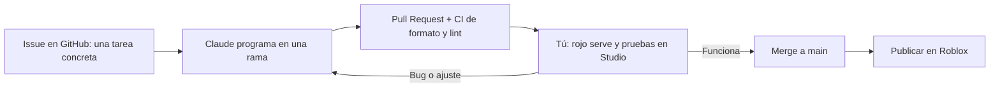
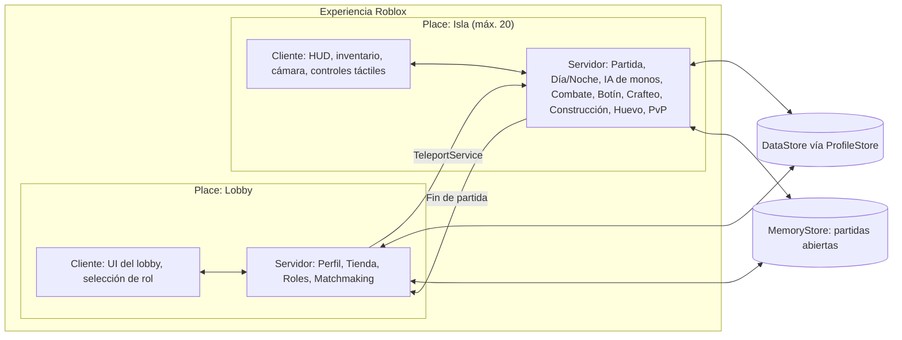
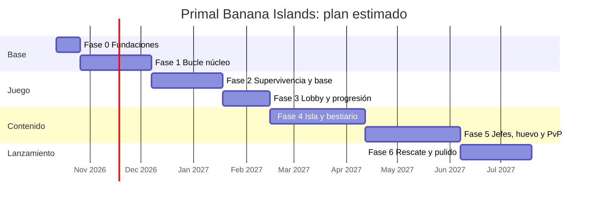

# Primal Banana Islands: plan de trabajo por fases

> Basado en el [GDD v0.2](GDD.md).
> **Contexto:** una sola persona con experiencia básica en Studio y **5–15 h/semana**. Claude escribe el código en el repo.
> **Principio:** cada fase termina con **algo jugable** y se prueba con gente real antes de pasar a la siguiente.

---

## 1. Cómo trabajamos



### Reparto de responsabilidades

| Claude (en el repo) | Tú (en Roblox Studio y la web de Roblox) |
|---|---|
| Todo el código Luau (servidor, cliente, UI) | Instalar herramientas y conectar Rojo |
| Datos de balance (especies, botín, recetas) | Esculpir el terreno y montar el mapa |
| Configuración de herramientas y CI | Colocar modelos del Creator Store |
| Documentación y guías paso a paso | Subir animaciones, sonidos e imágenes a tu cuenta |
| Revisar bugs a partir de tus reportes | **Probar** y decidir qué es divertido |
| | Publicar, y crear gamepasses y productos |

> **Código en Git, mapa en Roblox.** Los scripts viven en el repo y se sincronizan con Rojo. El terreno y el mapa viven en el archivo del *place* (con historial de versiones de Roblox). Los modelos clave se exportan de vez en cuando a `assets/` como `.rbxm`.

---

## 2. Stack técnico

| Herramienta | Para qué |
|---|---|
| **Roblox Studio** | Editor del juego, mapa y pruebas |
| **VS Code + Luau LSP** | Editar código con autocompletado |
| **Rojo** | Sincroniza el código del repo con Studio |
| **Rokit** | Instala versiones fijas de las herramientas (`rokit.toml`) |
| **Wally** | Gestor de paquetes de Roblox (se añade en la Fase 2, con ProfileStore) |
| **StyLua / Selene** | Formato automático y detección de errores (en CI) |
| **ProfileStore** | Guardado seguro de datos del jugador (moneda, XP, mascotas) |
| **GitHub Actions** | Comprueba formato y lint en cada Pull Request |

**Decisiones de arquitectura:**

- **Una experiencia con 2 places:** `Lobby` (inicio) e `Isla` (partida, máximo 20).
- **Servidor autoritativo:** el cliente solo pide ("quiero atacar"); el servidor valida y aplica.
- **Sin frameworks pesados.** Usamos un patrón simple de *Services* (servidor) y *Controllers* (cliente) con `Init` y `Start`.
- **Basado en datos:** especies, recetas, botín y tiempos están en módulos de `Config`. Para balancear basta con cambiar números.
- **Red centralizada:** un único módulo `Remotes` define todos los eventos cliente-servidor.

### Arquitectura



### Estructura del repositorio

```
monkey_island_2026/
├─ docs/                      # GDD, plan y guía de instalación (SETUP.md)
├─ src/
│  ├─ shared/                 # → ReplicatedStorage.Shared (cliente y servidor)
│  │  ├─ Config.luau          #   Configuración central y balance
│  │  ├─ Remotes.luau         #   Todos los eventos de red
│  │  ├─ Loader.luau          #   Carga Services/Controllers (Init → Start)
│  │  └─ UI/                  #   Piezas de interfaz (botones, mensajes)
│  ├─ serverShared/           # → ServerScriptService.ServerShared (solo servidor, ambos places)
│  ├─ combat/                 # → ServerScriptService.Combat: armas, habilidades, combos y estados,
│  │                          #   compartidos por la Isla y la arena; CombatRules = reglas de cada place
│  ├─ combatClient/           # → ReplicatedStorage.CombatClient: controles y efectos del combate
│  │                          #   (armas, habilidades, esquiva, números, cómic), en la Isla y la arena
│  ├─ lobby/
│  │  ├─ server/Services/     # Lógica del servidor del Lobby
│  │  └─ client/Controllers/  # Interfaz y controles del Lobby
│  ├─ island/
│  │  ├─ server/Services/     # Lógica del servidor de la Isla
│  │  ├─ client/Controllers/  # HUD y controles de la Isla
│  │  └─ tools/               # → ServerStorage.Tools: MapBuilder (generador de la isla), Equilibrio
│  └─ dunas/
│     ├─ server/Services/     # Partida de la arena: equipos, banderas, reaparición, Ámbar
│     ├─ server/World/        # ArenaBuilder (mapa de la arena) y FlagModel
│     └─ client/Controllers/  # HUD, ventana previa y resultados de la arena
├─ lobby.project.json         # Proyecto Rojo del Lobby (puerto 34872)
├─ island.project.json        # Proyecto Rojo de la Isla (puerto 34873)
├─ dunas.project.json         # Proyecto Rojo de la Isla de Dunas (puerto 34874)
├─ sourcemap.project.json     # Solo para el autocompletado de VS Code
├─ rokit.toml                 # Versiones de herramientas
├─ selene.toml / stylua.toml  # Lint y formato
├─ .vscode/                   # Extensiones y ajustes recomendados
└─ .github/                   # CI: formato, lint y build en cada push
```

Más adelante se añadirán `wally.toml` (paquetes, Fase 2) y `assets/` (modelos exportados de referencia).

---

## 3. Fases

### Fase 0: Fundaciones (1–2 semanas)

**Objetivo:** que puedas cambiar código en el repo y verlo en Studio, y viajar del Lobby a la Isla.

**Tú** (sigue la guía [SETUP.md](SETUP.md)):
- [x] Instalar Roblox Studio, VS Code, GitHub Desktop y Rokit, y clonar el repo
- [x] Instalar las herramientas (`rokit install`) y el plugin de Rojo
- [x] Crear la experiencia en Roblox con 2 places: **Lobby** (inicio) e **Isla**
- [x] Copiar los IDs de los places a `Config.luau` y poner la Isla en 20 jugadores *(20-10-2026: el juego pasa a ser para grupos de amigos; hay que bajarla a **5**, ver [SETUP.md](SETUP.md) paso 7)*
- [x] Sincronizar con Rojo y publicar ambos places
- [x] Probar el viaje Lobby ↔ Isla en el juego publicado *(hizo falta poner la experiencia en Público y publicar la Isla)*

✅ **Fase 0 completada.**

**Claude:**
- [x] Estructura del repo: 2 proyectos Rojo + código compartido
- [x] `rokit.toml` (Rojo 7.7.1, StyLua 2.3.1, Selene 0.30.0)
- [x] CI en GitHub Actions: formato, lint y build en cada push
- [x] Módulo `Config` central (duración del día, jefes, baliza, viajes…)
- [x] Patrón *Services*/*Controllers* (`Loader`) y módulo `Remotes`
- [x] Botones de prueba "Ir a la Isla" y "Volver al Lobby" (TeleportService con reintentos y límite de peticiones)
- [x] Guía paso a paso en `docs/SETUP.md`, pensada para nivel básico

**Criterio de salida:** editas un número en `Config`, se ve en Studio y el botón del Lobby te lleva a la Isla publicada.

---

### Fase 1: Prototipo del bucle núcleo, "Sobrevivir el día 1" (4–6 semanas)

**Objetivo:** responder a la pregunta más importante: **¿es divertido salir, recolectar, pelear y volver?** Se hace con arte provisional (*greybox*).

Se entrega en partes pequeñas, cada una probable en Studio:

| Entrega | Contenido | Estado |
|---|---|---|
| **1.1** | Ciclo día/noche + Basecamp como zona segura | ✅ Probada en Studio |
| **1.2** | Recolección (árboles, rocas, arbustos) + HUD de inventario | ✅ Probada |
| **1.3** | Barra rápida + combate: machete, honda (gasta piedras) y esquiva, muñecos de práctica | ✅ Probada |
| **1.4** | IA de monos v1: mono ardilla y aullador rojo (aullido y refuerzos), botín, reaparición al amanecer | ✅ Probada |
| **1.5** | Caído → reanimación → Espíritu (mochila, marcas) → reaparición al amanecer | ✅ Probada |
| **1.6** | Mesa de trabajo con 7 recetas: antorcha, venda, hacha y pico de piedra, lanza, garrote y chaleco | ✅ Probada |

- [x] Generador de la isla provisional `MapBuilder`: terreno con colinas en todos los biomas, selva densa, palmeras, volcán activo, Basecamp de 170 studs con empalizada de estacas, portones y antorchas, recursos, guaridas y límites *(Claude)*
- [ ] Generar la isla en Studio, probarla y retocarla *(tú; ver [MAPA.md](MAPA.md))*
- [x] Ciclo día/noche configurable (10+7) con avisos de amanecer, atardecer y "anochece en 60 s" *(1.1)*
- [x] Basecamp como zona segura: pieza `BasecampZone` + indicador en el HUD *(1.1)*
- [x] Recolección: árboles, rocas y arbustos → madera, piedra, fibra (con regeneración) *(1.2)*
- [x] Inventario básico: materiales en el HUD *(1.2)*
- [x] Barra rápida para herramientas y armas: la mochila nativa de Roblox (teclas 1–9, táctil y mando) *(1.3)*
- [x] Combate en 3ª persona: machete (cuerpo a cuerpo), honda (distancia, gasta piedras, ayuda de puntería en móvil) y esquiva (Q / B / botón táctil), validados en el servidor *(1.3)*
- [x] IA de monos v1 (máquina de estados) con **2 especies**: mono ardilla (grupo rápido) y aullador rojo (grito que llama refuerzos) *(1.4)*
- [x] Tablas de botín basadas en datos (`Shared/Data/Monkeys.luau`) *(1.4)*
- [x] Caído → reanimación → Espíritu → reaparición al amanecer *(1.5)*
- [x] Mesa de trabajo con 5–8 recetas *(1.6: 7 recetas en `Shared/Data/Recipes.luau`)*

**Criterio de salida:** 4–6 amigos juegan 30 min seguidos. Se anota qué fue divertido y qué no, y se ajusta antes de seguir.

**Ajustes tras la primera prueba (2 jugadores):**

- [x] Cada jugador empieza con **hacha y pico de madera**. Árboles y rocas se trabajan **golpeándolos con la herramienta equipada** (la tecla E ya no tala ni pica). En la mesa de trabajo se **mejoran** a hacha y pico de piedra.
- [x] Más monos (18 grupos de mono ardilla y 14 de aulladores) y **repoblación continua**: un grupo con bajas recupera un mono cada 45 s si no hay jugadores cerca.
- [x] El Espíritu ya no espera al amanecer: reaparece a los **45 s**, +30 s por cada caída del mismo día (máximo 3 min).
- [x] Talar a golpes se siente bien. Cada árbol se tala de una vez (8 de potencia: 8 golpes con el hacha de madera, 4 con la de piedra), da 6 de madera (+2 con la de piedra) y **cae** antes de desaparecer.
- [x] El Espíritu solo marca enemigos (antes también árboles y rocas).
- [ ] Probar los ajustes *(tú)*

---

### Fase 2: Supervivencia y Basecamp (4–6 semanas)

Igual que la Fase 1, se entrega en partes pequeñas, cada una probable en Studio:

| Entrega | Contenido | Estado |
|---|---|---|
| **2.1** | Hambre, sed y estamina; correr; comer; cocinar en la hoguera; beber en el río | ✅ Código listo, falta tu prueba |
| **2.2** | Construcción por cuadrícula con martillo: núcleo compartido + 20 parcelas; muros, antorcha de pie y cama | ✅ Código listo, falta tu prueba |
| **2.3** | Estaciones construibles: taller del curandero (ungüento, vendas, antídoto) y forja de piedra (machete afilado, lanza, garrote, armadura de hueso) | ✅ Código listo, falta tu prueba |
| **2.4** | Capuchino ladrón (roba y huye; se recupera al derrotarlo) y miedo al fuego (antorchas) | ✅ Código listo, falta tu prueba |
| **2.5** | Asedio nocturno v1: 3 oleadas por noche por los portones, rompen piezas, estacas como trampa, zona de perímetro | ✅ Código listo, falta tu prueba |
| **2.6** | Fiebre del mono v1: mordiscos y carne cruda la suben, vista nublada, daño a 100, antídoto | ✅ Código listo, falta tu prueba |
| **2.7** | Dificultad por día (vida y daño de los monos), derrota (todos caídos de noche), resultados y Ámbar | ✅ Código listo, falta tu prueba |
| **2.8** | Guardado de datos con bloqueo de sesión (módulo propio, como ProfileStore): Ámbar, récord, partidas, XP por rol | ✅ Código listo, falta tu prueba |

- [x] Hambre, sed y estamina; cocinar en la hoguera; agua del río *(2.1)*
- [x] Construcción por cuadrícula (táctil y PC) con **núcleo compartido + parcelas personales** y permisos *(2.2)*
- [x] Estaciones: hoguera, taller del curandero, forja de piedra *(2.1 y 2.3)*
- [x] Monos ladrones (capuchinos) y miedo al fuego *(2.4)*
- [x] Asedio nocturno v1: oleadas hacia el Basecamp, muros, trampas y antorchas *(2.5)*
- [x] Fiebre del mono v1 (mordiscos → fiebre; antídoto básico) *(2.6)*
- [x] Escalado de dificultad por día *(2.7)*
- [x] Derrota del servidor → pantalla de resultados *(2.7)*
- [x] **Guardado de datos** (módulo propio con bloqueo de sesión, como ProfileStore): moneda, récord de días y XP de rol *(2.8)*

**Criterio de salida:** una partida dura 3 o más días con tensión creciente y el progreso se guarda entre sesiones.

---

### Fase 3: Lobby, roles y progresión (3–4 semanas)

| Entrega | Contenido | Estado |
|---|---|---|
| **3.1** | Lobby: cabecera con Ámbar y récord; pestañas Rol, Talentos, Tienda y Grupo | ✅ Código listo, falta tu prueba |
| **3.2** | Roles en la Isla: guerrero, cazador, mago y médico; pasiva, armas propias y 4 habilidades (Z, X, C, V / R1 + A, B, X, Y / botones) | ✅ Código listo, falta tu prueba |
| **3.3** | Talentos (4 por rol, uno por habilidad) y tienda de mejoras con Ámbar | ✅ Código listo, falta tu prueba |
| **3.4** | Grupos de amigos que viajan juntos; partidas en curso; recompensas y tutorial | ✅ Código listo, falta tu prueba |

- [x] Lobby: selector de rol y tienda de mejoras (Ámbar) *(la zona social 3D y la vitrina de mascotas llegan con las mascotas, Fase 5)*
- [x] Roles v1: pasiva + habilidad activa de médico, cazador y recolector
- [x] Árbol de talentos v1 (3 talentos por rol)
- [x] **Roles v2:** nuevo **Guerrero**; el Recolector pasa a **Mago** (su XP se conserva); 3 habilidades activas + 1 definitiva por rol, armas iniciales por rol (garrote de piedra, arco con flechas, bastón mágico) y 4 talentos por rol; las ventajas de recolección pasan a la tienda
- [x] Matchmaking: grupos con amigos al mismo servidor; Roblox mete a los jugadores sueltos en partidas en curso con hueco (y quien entra en una partida terminada vuelve al Lobby)
- [x] Recompensas al terminar la partida: Ámbar y XP del rol (2.7 y 2.8)
- [x] **Tutorial de los primeros minutos** (5 pasos, se puede saltar, solo la primera vez)

**Criterio de salida:** ciclo completo Lobby → Isla → resultados → Lobby, con progreso guardado.

> 💡 **Opción de alfa pública:** al terminar esta fase se puede publicar una alfa abierta para empezar a recoger datos reales de retención mientras se produce el contenido.

---

### Fase 4: La isla completa y el bestiario (6–8 semanas)

- [ ] Mapa completo: playas (límite), selva, ríos y manglar, montañas, cuevas y volcán *(tú, con kits low-poly del Creator Store; la isla generada por `MapBuilder` ya tiene todos los biomas)*
- [x] Todas las especies de categoría 1–3 con su mecánica propia, horario día/noche y respawn diario *(12 especies en `Shared/Data/Monkeys.luau`, cada una en su zona)*
- [x] Tropas con alfa, huida y comportamiento ladrón *(alfa con corona; si muere, la tropa huye)*
- [x] **Bestiario/diario de campo** (UI) que se completa cazando *(J en la Isla y pestaña "Diario" en el Lobby)*
- [x] Armas, armaduras y recetas por nivel; rarezas de botín *(nivel 3 en la forja; 5 rarezas con color)*
- [x] **Optimización (código):** límite de monos activos, "sueño" de la IA y registro de rendimiento
- [ ] **Optimización (tú):** activar StreamingEnabled y probar en móvil de gama baja *(ver [RENDIMIENTO.md](RENDIMIENTO.md))*

**Criterio de salida:** un servidor lleno (5 jugadores desde el 20-10-2026; antes 20) estable en móvil, y cada bioma tiene una razón para visitarlo.

---

### Fase 5: Jefes, huevo, mascotas y PvP (6–8 semanas)

| Entrega | Contenido | Estado |
|---|---|---|
| **5.1** | 4 jefes en sus guaridas, 3 fases, ataques especiales, pieza de baliza y botín legendario | ✅ Código listo, falta tu prueba |
| **5.2** | Huevo misterioso: aviso, portador lento y con PvP, nido, incubación defendida y eclosión | ✅ Código listo, falta tu prueba |
| **5.3** | Mascotas: 13, cinco rarezas, seis tipos de ayuda, 1 activa desde el Lobby | ✅ Código listo, falta tu prueba |
| **5.4** | PvP opt-in con tótem, indicador, recompensa por cabeza y cajas de suministro en las playas | ✅ Código listo, falta tu prueba |
| **5.5** | Clima (lluvia, tormenta con rayos) y erupción del volcán | ✅ Código listo, falta tu prueba |

- [x] 4 jefes de bioma con fases, patrones y botín especial (pieza de baliza garantizada)
- [x] Rotación de jefes: uno cada 2 días (días 2, 4, 6, 8…), y cada uno se queda hasta que lo derrotan o aparece el siguiente
- [x] Evento del huevo: aparición, aviso global, transporte, nido, incubación y eclosión
- [x] Mascotas persistentes: colección, rarezas, 1 activa, tipos de ayuda
- [x] PvP opt-in: tótem, indicador, espera para desactivar, cajas de suministro y recompensa por cabeza
- [x] Clima y eventos: lluvia, tormenta y erupción del volcán

**Criterio de salida:** las partidas generan **momentos memorables** (jefe, huevo, robo) que la gente quiere contar o grabar.

---

### Fase 6: Rescate, pulido y lanzamiento (4–6 semanas)

| Entrega | Contenido | Estado |
|---|---|---|
| **6.1** | Baliza de rescate (4 piezas, desde el día 8) → La Gran Tropa → victoria | ✅ Código listo, falta tu prueba |
| **6.2** | Clasificaciones globales (días y rescates) y pestaña "Ranking" | ✅ Código listo, falta tu prueba |
| **6.3** | Analítica: embudo del tutorial, economía del Ámbar, victorias y derrotas | ✅ Código listo |
| **6.4** | Tienda cosmética con Game Passes (pestaña "Estilo") y servidores privados | ✅ Código listo; faltan los pases *(tú)* |
| **6.5** | Música configurable por situación y sonido de avisos | ✅ Código listo; faltan las pistas *(tú)* |
| **6.6** | Guía de lanzamiento: [LANZAMIENTO.md](LANZAMIENTO.md) | ✅ |

- [x] Baliza de rescate (se puede encender desde el día 8) + noche final "La Gran Tropa" → victoria
- [x] Clasificaciones (días sobrevividos, rescates)
- [x] Sonido y música *(código; los IDs de audio los eliges tú)*; pulido de UI para móvil *(revisar en la beta)*
- [x] Analítica (embudo del tutorial, retención, economía)
- [x] Tienda cosmética (Robux), servidores privados *(código; los pases los creas tú)*
- [ ] Nombre final, icono, miniaturas *(tú; el cuestionario de madurez ya está hecho)*
- [ ] Beta cerrada → **lanzamiento** *(tú; ver [LANZAMIENTO.md](LANZAMIENTO.md))*

---

### Fase 6b: Bucle de retención (octubre de 2026)

Basado en [Bucle central de retencion.txt](Bucle%20central%20de%20retencion.txt) y en la entrevista del 19-oct-2026 (detalles en el GDD §4 "Bucle de retención" y §11). Probado en Studio por partes ([VERIFICACION.md](VERIFICACION.md) §5.2 y §7).

| Entrega | Contenido | Estado |
|---|---|---|
| **R1** | Huevos guardados: perfil v3, rareza al aparecer, mochila de 3 + pendientes | ✅ Probado en Studio |
| **R2** | Nido del Lobby: tu huevo con su temporizador, panel en Mascotas, ceremonia al abrirlo | ✅ Probado en Studio |
| **R3** | Acelerar jugando: −1 h por noche, ruleta del rescate, tope del 50 %, aviso de huevo listo | ✅ Probado en Studio |
| **R4** | Provisiones de partida (se guardan y llegan a la mochila al empezar) | ✅ Probado en Studio |
| **R5** | Calendario de 7 días (ventana al entrar, pestaña Misiones; faltar no reinicia) | ✅ Probado en Studio |
| **R6** | Título "Superviviente de la Isla" gratis, solo al ganar una partida | ✅ Probado en Studio; falta una victoria real |
| **R7** | Misiones diarias (2 generales + 1 del rol), rastreador en la Isla (PC) | ✅ Probado en Studio |

- [ ] Probar con 2 jugadores: los dos se llevan su huevo al defender uno juntos
- [ ] Medir en el juego publicado la retención D1/D7 y cuántos vuelven a abrir su huevo (Analítica: `LoginCalendarDay`, economía `EggDiscard`, `LoginCalendar`, `DailyMission`)

---

### Fase 7: Después del lanzamiento (continuo)

Temporadas con lore, nuevos jefes y eventos, mutadores de partida ("Luna roja", "Temporada de lluvias") y balance basado en datos.

---

### Menú del Lobby por estaciones (20-10-2026)

El menú de 11 pestañas pasa a estaciones en la plaza (roles, nido, Isla de dunas y ranking, cada una con su ventana) y una barra de iconos con el resto. Plan: `C:\Users\jose\.claude\plans\atomic-tumbling-duckling.md`. Comprobación: [VERIFICACION.md](VERIFICACION.md) §9.

| Paso | Qué | Commit | Estado |
|---|---|---|---|
| M0 | Arena del Lobby con la ventaja de cada clase, como en Dunas (`Shared/UI/ArenaRoleCards`) | `ba3db55` | ✅ Probado |
| M1 | Ventanas por estación y barra de iconos con avisos; pastilla del Ámbar; ventanas sin desplazarse y móvil a pantalla completa; aura en el atajo a talentos | `70685d0`, `30f6f66`, `6d1f80c` | ✅ Probado (PC y teléfono del emulador) |
| M2 | Lobby v12: cartel de mascotas con el nido delante, ranking ancho con la arena, cartel y aviso de la Isla de dunas | `c0a7043` | ✅ Probado; **falta guardar el place** |
| M3 | Carteles por jugador (mascotas e Isla de dunas) y recuento de la cola | `a6d3912` | ✅ Probado (la cola real, publicado) |
| M4 | Iconos de las estaciones, contorno al acercarse y guía de la primera vez | `12aa8f8` | ✅ Probado |
| M5 | Documentación | — | ✅ |

### Fase 8: Isla de Dunas, arena PvP (octubre de 2026)

Tercer place: captura la bandera por equipos, de 1v1 a 5v5, con equipamiento propio comprado con Ámbar (diseño en el GDD §12.2, entrevista del 20-10-2026). Probado en Studio con un jugador ([VERIFICACION.md](VERIFICACION.md) §8); falta probarlo con varios jugadores y publicado.

| Entrega | Contenido | Commit | Estado |
|---|---|---|---|
| **D1** | Combate compartido entre places: `src/combat` y `src/combatClient`, con reglas por place en `CombatRules`. La Isla juega igual | `804a2f8` | ✅ Probado en Studio |
| **D2** | Place de Dunas (Rojo 34874), equipos, rol por jugador, partida con espera, cuenta atrás, batalla, muerte súbita y resultados, reaparición, HUD, perfil v4 | `bb38ab1` | ✅ Probado en Studio |
| **D3** | Banderas (robar, capturar, soltar y devolver), portador más lento, Ámbar con tope diario, estadísticas, ranking y revancha | `556e2a9` | ✅ Probado en Studio (un jugador) |
| **D4** | Números de la arena (duelos de 8–10 s), veneno, lento, marcas y combos contra rivales, 24 variantes de equipamiento y su tienda | `3fd7559` | ✅ Probado en Studio (un jugador) |
| **D5** | Lobby: embarcadero con velero, pestaña Arena, cola entre servidores con MemoryStore, cartel de ranking de la arena | `eb18f6c` | ✅ Probado hasta `ReserveServer` (en Studio no se viaja) |
| **D6** | Mapa final de ruinas mayas e iluminación; esquiva y Embestida sin salir volando, efectos de cómic en la arena, cámara al aparecer | `dce4bd9` | ✅ Probado en Studio |
| **D7** | Documentación: GDD §12.2, esta fase y VERIFICACION §8 | — | ✅ |

- [ ] Probar con 2–4 jugadores (*Test → Local Server*): daño entre rivales, curación solo a aliados, devolver la bandera, no puntuar con la propia robada, victoria por abandono
- [ ] Probar publicado: cola y viaje Lobby → Dunas (1v1 con 2 cuentas, grupo de 2 en 2v2), "Volver al Lobby", cobro de Ámbar con tope y ranking
- [ ] Revisar con más jugadores (datos de partidas reales): el duelo de médicos dura 30 s (objetivo 8–10 s); por ahora se deja así (decidido el 20-10-2026)
- [x] Ventana de equipamiento en el teléfono: las tres ranuras en columnas con sus nueve opciones, y la ventana en dos columnas para verlo todo sin desplazarse
- [ ] Antes de publicar: guardar los places del Lobby y de Dunas y **publicar los tres a la vez** (perfil v4: un place con el código viejo borraría el campo `arena`)

---

### Fase 9: Pase de temporada, misiones v2, mitad de partida y cosméticos (octubre de 2026)

Basado en [Sistema de recompensas y retencion.txt](Sistema%20de%20recompensas%20y%20retencion.txt), [battle_pass_30_days.pdf](battle_pass_30_days.pdf), la guía de Roblox para pases de temporada y la entrevista del 20-10-2026. Plan: `C:\Users\jose\.claude\plans\serialized-soaring-biscuit.md`. Cada grupo es un commit y una sesión propia; la economía se mide con la skill `economia-retencion` (calculadora `src/island/tools/Economia.luau`).

Reglas de la entrevista: la premium del pase es **solo cosmética** (Developer Product de 399 R$ por temporada; pack +10 niveles 799; nivel 79); el Ámbar, el tiempo de huevo, las provisiones y los huevos solo salen de la pista gratis y del nivel **ganado jugando**; temporada de 30 días y 30 niveles que se completa con ~20–24 días activos, ×2 de XP la última semana y 7 días de descanso; el calendario de 7 días se queda; "Superviviente de la Isla" sigue siendo solo para quien gana. Temporada 1: "El Despertar del Volcán".

| Grupo | Contenido | Commit | Estado |
|---|---|---|---|
| **G1** | Skill `economia-retencion` y calculadora de la economía (línea base: misiones al 100 % en la primera hora, el habitual gasta el 15 % de su Ámbar, equipo de nivel 3 el día 1) | `857ef5e` | ✅ |
| **G2** | Fundaciones: perfil v5 (`season`, `weekly`, `purchases`, `ownedCosmetics`), compras con recibo (`ServerShared/Purchases`, `ProcessReceipt` en los 3 places), cosméticos con `source`, rareza y huecos por tipo/rol/mascota/rueda de emotes (`Shared/CosmeticSlots`), `Config.Season` y `Config.Shop` | `ca70019` | ✅ |
| **G3** | Pase de temporada: `Data/Seasons` (T1 con premios provisionales: 3 cosméticos gratis y 3 premium), `Shared/SeasonPass` y `ServerShared/SeasonPass` (XP de la Isla, Dunas y misiones con tope de partidas, +10 % con amigos y ×2 la última semana; reclamar; cierre de temporada que entrega lo no reclamado), compras (premium, pack +10, nivel), cartel volcánico del pase en la plaza (Lobby v14) con su "!", ventana sin desplazamiento (`UI/SeasonPassPanel`) y botón 🌋 en la barra, línea de XP en los resultados, sección "Pase" de la calculadora (sin semanales el habitual llega al nivel 24: se cierra con las semanales de G4) | `b0883b0`…`3ccf9f3` | ✅ |
| **G4** | Misiones v2: cada día una fácil, una media (la del rol) y una difícil (avanzar en la partida); 5 semanales de 13 (como mucho una de Dunas) con un extra por las 5; un cambio gratis al día y otro a la semana (`Remotes.RerollMission`); eventos nuevos (llegar a un día, jefe, alfa, especies distintas, rescate, ganar y capturar en Dunas, que empieza a contar); ventana Misiones con pestañas Hoy/Semana y rastreador de la Isla también en el teléfono (fichas en la franja de la barra de Roblox). Calculadora: semanales simuladas por perfil; XP de la Isla 60/día y 150/jefe y diaria fácil 200 para que el casual llegue al nivel 12 y las misiones sean el 65 % de la XP del habitual (termina el día 24); el rastreador de la Isla enseña también las semanales y se pliega | `1b9c370`…`f343d1d` | ✅ |
| **G5** | Equipo ligado a los jefes: cada jefe da 2 de su tesoro a cada participante (no se pierden); el nivel 3 de las armas de rol y la armadura de plata pide la Corona del caudillo (día 4); Forja volcánica con obsidiana (15 vetas en el volcán y la cueva) y nivel 4 (Mazo volcánico, Arco de brasa, Bastón de lava, Cerbatana de azufre, ~+30 % de DPS; Armadura volcánica −65 %) con el Cristal de cueva (día 6); modelos de nivel 4 con hombreras de obsidiana en lava y humo. Gorila de Ceniza 7.000 de vida (sigue en ~3 min). Calculadora: nivel 3 el día 4 y nivel 4 el día 6 (antes, todo el día 1) | `6782ec7` | ✅ |
| **G6** | Contratos de expedición por partida, compartidos por el grupo: 3 contratos (Campamento del náufrago, Diario del naturalista, Ruta del volcán) de 5 pasos que se abren los días 1, 3, 5, 7 y 8 y se pierden al abrir el siguiente; objetivos que crecen con el grupo; cada paso da Ámbar, XP del pase (de partida) y objetos a todos los de la partida; tarjeta bajo el rastreador de misiones (ficha "📜" en el teléfono) y línea en los resultados. Calculadora: el habitual termina el pase el día 23 (antes 24) y el casual llega al nivel 13 | `0adca52` | ✅ |
| **S** | Sobrevuelo de la Isla (S1 y S2): escenas `Flyover` y `Flyover_Comic` (42 s, coordenadas del mundo, hora 17,5; solo para grabar con las órdenes «🎬 Sobrevuelo» y «🎬 Sobrevuelo cómic»): ocho planos panorámicos con corte seco, planeo del avatar en el Quetzalcóatl (`Cinematics/MountedRider`) en siete planos, tres manadas con su alfa (evento `monkey` con `alpha`), cartel del reto y logo de la portada (evento `logo`); la versión cómic lleva viñetas y onomatopeyas en 11 de 25 planos (`FLYOVER_COMIC_PANELS`); campo `streamFollowsCamera` en `CinematicService`; `HudHider` oculta también los rótulos del mundo | 030ca26 | ✅ Probada en Play en el Studio de la Isla y grabada en vídeo (normal y cómic), aprobada por el usuario. Lo que falta, en VERIFICACION §169 (2 jugadores, juego publicado, las onomatopeyas movidas, rótulos del mundo). Frase nueva del cartel: CSV generado, pendiente de subir a Creator Hub |
| **G7** | Eventos de mitad de partida (`MidEventService`, `Data/MidEvents`), cada uno en un día al azar de los suyos, con aviso la víspera al anochecer y línea de estado en el HUD: lluvia tóxica (día 3 o 4: el agua del río y los mordiscos dan fiebre, agua hervida en la hoguera, antídotos y Ungüento del médico), macacos saboteadores (noche 5: van a por trampas, muros y estaciones) y erupción preliminar (día 7: piroclastos en las zonas altas y 2 cajas militares con obsidiana, esquirla de jefe y provisiones que activan el PvP; el paso "Asegurar" del contrato pide abrir una) | `4d97a0d` | ✅ |
| **G8** | Preparar la Gran Tropa: en la noche final la mitad de los mandriles, orangutanes y gorilas de cada oleada va a por la baliza (16.000 de vida; solo la rompen ellos, los demás monos la rodean); si la derriban se corta la señal, no hay rescate esa noche y al amanecer se repara y se puede volver a encender. Tótem guardián (uno por campamento, pide una Perla del río): a 25 studs, −35 % de daño a las piezas y reparación nocturna, −10 % de daño a los jugadores. Las antorchas de pie espantan a los aulladores del asedio y se gastan. Medido en Studio: sin defenderla, la baliza cae al poco de llegar la 5.ª oleada | `908ef85` | ✅ |
| **G9a** | Rareza **Mítico** (por encima de Legendario, solo cosméticos) y regla "cuanto más raro, más detalle"; trajes por rol (`ArmorModels`, ahora en Shared, con `dress` y los atributos `Outfit`/`WeaponSkin` que publica `CosmeticsServer`) y aspectos de arma por rol (`WeaponTools`, en la misma Tool con el nivel 1–4 del arma); los míticos ganan piezas con el nivel de la armadura y del arma en la Isla y se ven enteros en el Lobby y en Dunas; ventana **Armario** (sustituye a Estilo, `UI/WardrobePanel`: avatar 3D que gira, pestañas, rol y tarjetas con borde de rareza); primer par mítico de los dioses de la selva: traje **Rey Gorila Titán** (se gana venciendo de guerrero con la Maza y la Armadura volcánicas, 69→238 piezas, con un motivo propio en la espalda en cada grado: sol, calavera de gorila dorada, ídolo e ídolo con aro solar) y **Maza del Rey Gorila** (Robux, 449 R$; 22→89 piezas) | `62028e6`…`b3f26e0` | ✅ |
| **G9b** | Los otros tres pares míticos, traje (se gana venciendo con el equipo de nivel 4 del rol) y arma (Robux, 449 R$), cada uno con su brillo y su motivo en la espalda en cada grado: **Jaguar Espectral** del cazador (pelaje de jaguar, luz blanca azulada; el espíritu del jaguar sale de la capucha y asoma por el hombro, luna creciente; arco con garras de oro), **Serpiente Emplumada** del mago (escamas turquesa y plumas de quetzal sobre añil, azul de runa; la serpiente enroscada que se alza de perfil, penacho de plumas; báculo con la serpiente que sujeta el cristal) y **Ceiba de la Vida** del médico (corteza con espinas, flores y algodón, verde de curación; el tronco con raíces de contrafuerte que se abre en ramas y copa con colibríes; cerbatana-rama con ramitas) | `f927e2e`, `53f8f4b`, `82b4ed6` | ✅ |
| **G9c** | Skins de mascota (`PetModels` SKINS: paleta que lee `tone`, materiales y piezas propias; las mascotas que comparten modelo llevan **skins de familia**, felinos y perros), con la **Tortuga de Lava** de ejemplo (basalto, placas de lava, volcancito con humo); **marcos** (`UI/PlayerFrames`: bronce y Obsidiana fundida) en el ranking, la ventana Grupo y los resultados de la Isla (fila nueva con el grupo) y de Dunas; **rueda de emotes** (`UI/EmoteWheel`, tecla "." o 😀, junto al ⚙️ en la Isla y en la barra del Lobby; se para al moverte y no deja en combate), con 5 emotes de serie gratis (animaciones de Roblox); el Armario gana las pestañas Mascotas, Marcos y Emotes, y su vista previa junta lo elegido en cada hueco (traje, arma y efectos a la vez) | `5b01fda`, `6ad89ca` | ✅ |
| **G9d** | Tipos baratos para llenar la premium, uno de cada: **estilo de los números** (`UI/NumberStyles`: letra, tres franjas de color y borde en el daño que haces, que también ven los aliados; ejemplo Números de Magma), **estilo de los estallidos** (`ComicBurst` STYLES: colores y palabras de tu golpe, crítico y K.O.; el "OUCH!" sigue rojo; ejemplo Erupción, estrella de basalto con lava dentro) y **decoración del nido** (`Shared/NestDecor`, solo la ve quien la lleva, apoyada en el suelo; ejemplo Nido volcánico); **grados I, II, III** (cosméticos con la misma `line`: se ve el más alto que tienes y el Armario enseña una tarjeta por línea; ejemplo Llama primal, con anillo de llamas desde los pies en el II y brasas, humo y luz en el III); imágenes en `RewardModels.cosmetic` (también las skins de mascota) y pestaña 🎨 Estilos del Armario con números y estallidos en vivo; en el pase provisional, N5, N8, N12, N15 y N30 | `c7d4853`, `7defe2a` | ✅ |
| **G10a** | Tiendas de cosméticos: pestaña **🎨 Cosméticos** en la Tienda del Lobby (`UI/CosmeticShopPanel`), con 4 en Ámbar que rotan cada día y 3 sueltos de Robux que rotan cada lunes (un Developer Product cada uno) y los Game Passes siempre a la venta; rotación común con semilla del día o la semana (`Shared/CosmeticShop`) de la que cada jugador ve lo que aún no tiene, fijada en su perfil (versión 6, `cosmeticShop`) por `CosmeticShopService`; nunca entran premios de la temporada en curso; el Armario dice si algo está hoy en la tienda; la calculadora mide el sumidero, el catálogo y los precios; 5 cosméticos de prueba en Ámbar y los Números Escarcha en Robux | `eec74f8` | ✅ |
| **G10b** | Catálogo de las tiendas, tema "selva y mar" (distinto del volcán de la temporada): 22 cosméticos en Ámbar (19.000 en total; el habitual gasta el 97 % y tiene la tienda entera el día 30) con títulos, estelas por franjas, auras con forma propia (arena, tormenta), marcos, números, estallidos, el nido **Playa de coral** y la skin de familia **Perro pirata** para los tres perros; 6 sueltos de Robux nuevos (99–249 R$, con el nido **Templo dorado**), 11 en la rotación semanal; la tarjeta de un marco enseña tu nombre con él | `81128c4` | ✅ |
| **G11** | Contenido de la Temporada 1: **un premio premium en cada uno de los 30 niveles** (~8 grandes en los niveles clave, el aura que evoluciona en N1/N15/N30 y ~20 pequeños de los tipos baratos) y ~8 cosméticos gratis (G11a trajes y armas ✅, G11b mascotas, marcos y efectos ✅, G11c emotes ✅, G11d los pequeños ✅) | G11a: `1305ccb`, `8c7883b`; G11b: `8f0e0a9`; G11c: `1c1337c`; G11d: `02a7b62` | ✅ |
| **G12** | Calibración final y documentación: la calculadora con todo encendido no da alertas (el habitual termina el pase el día 23 y gasta el 97 % de su Ámbar; el casual llega al nivel 13) y su sección "Reglas de pago" revisa ahora también lo que aún no tiene id (18 productos, todos cosméticos o el pase); prueba de robustez con ritmos más lentos y sesiones más cortas, con sus hallazgos en la skill; nueva línea base; GDD v0.3 (§4 misiones v2 y semanales, §5.4 contratos, eventos y Gran Tropa, §11, §14 con el pase, las tiendas, los cosméticos y las correcciones a la investigación), VERIFICACION §10 paso a paso, LANZAMIENTO (Developer Products a crear con sus precios, fecha de la T1, publicar los tres places a la vez) y hoja "Correcciones" en el Excel del pase | `d9c0a93` | ✅ |

- [x] Crear en el Creator Hub los Developer Products (pase, pack, nivel, cosméticos sueltos) y poner sus ids (G2/G3/G10; los 14, el 22-10-2026)
- [ ] Antes de publicar: **publicar los tres places a la vez** (perfil v5)
- [ ] Poner la fecha de verdad de la Temporada 1 en `Data/Seasons` (hoy, provisional: 19-10-2026) (G3/G12)
- [ ] Guardar y publicar el Lobby con la plaza v14 (cartel volcánico del pase) (G3)
- Decisión del 21-10-2026 (G11a): los trajes y las armas de la Temporada 1 son de **fuego azul y azufre** sobre piedra pómez (la armadura del nivel 4 ya es obsidiana negra con lava naranja) y **ganan piezas con el grado** de la armadura, como los míticos pero en cinco escalones; el machete de obsidiana gratis pasa a ser un aspecto del machete con su propio hueco (`WeaponSkin.Machete`); un par por aprobación. **G11a terminado y aprobado**: par del guerrero (Guardián del Fuego Azul en N5, Maza de Azufre en N3) y hombreras volcánicas de losa con llama en píxeles, `1305ccb`; cazador (Acechador del Fuego Azul en N10, Arco de Azufre en N7), mago (Invocador del Fuego Azul en N20, Bastón de Azufre en N13), médico (Sanador del Fuego Azul en N25, Cerbatana de Azufre en N18) y el Machete de Azufre gratis en N8, `8c7883b`. Sigue el G11b.
- Decisión del 21-10-2026 (G11b): el Jaguar de Magma es de **magma naranja** (basalto, obsidiana y lava, como la Tortuga de Lava), no de fuego azul. **G11b terminado y aprobado** (`8f0e0a9`): premium Estela de fuego azul en N16, Marco de fuego azul en N21, Jaguar de Magma (skin de los tres felinos) en N23 y Marco de Obsidiana fundida en N27; gratis, junto al premio de siempre, Marco de bronce en N4, Tortuga de Lava en N12 y Marco de plata en N22; la Pisada de magma (N11) deja huellas de lava. Quedan 10 niveles premium vacíos (2, 4, 9, 14, 17, 19, 22, 24, 26 y 28) para el G11c (emotes) y el G11d (premios pequeños).
- Decisión del 21-10-2026 (G11c): tres emotes premium con efectos pequeños y uno gratis sin efectos. **G11c terminado y aprobado** (`1c1337c`): premium Grito de gorila en N2 (polvo del pecho, onda de polvo y piedrecitas al rugir), Danza del fuego en N9 (en bucle, llamas azules de bloques en las manos y chispas de azufre al pisar) y Erupción en N17 (grietas de lava y chorro de ceniza y brasas); gratis, junto a las provisiones, Saludo simio en N6. Las animaciones están publicadas (ids en `Data/Cosmetics`) y su fuente es `Data/EmoteAnimations`. La rueda de emotes solo está abierta mientras se mantiene ".". Quedan 7 niveles premium vacíos (4, 14, 19, 22, 24, 26 y 28) para el G11d.
- Decisión del 21-10-2026 (G11d): los siete niveles premium que quedaban, cuatro títulos y tres estilos de fuego azul y azufre. **G11d terminado y aprobado** (`02a7b62`): títulos Hijo del Volcán (N4), Caminante de Ceniza (N19), Domador del Magma (N24) y Guardián de la Llama Azul (N26); Números de fuego azul (N14), Estallido de fuego azul (N22) y el nido Cráter de azufre (N28). Ya hay un premio premium en cada uno de los 30 niveles: **G11 terminado**. Sigue el G12.
- **Fase 9 terminada** (22-10-2026): G1–G12 aprobados y subidos. Queda fuera de Studio lo de las casillas de arriba (Developer Products, fecha de la T1, publicar los tres places a la vez) y medir D1/D7 y la conversión del pase con datos de verdad.
- Decisión del 22-10-2026 (G12): la fecha de la Temporada 1 se queda provisional hasta que se sepa el día de publicar (paso de `docs/LANZAMIENTO.md` §3); las correcciones del Excel van en una hoja nueva "Correcciones" (el PDF es una exportación y no se toca). Los números no cambian: con los ritmos supuestos todo está en sus límites, y lo que salta con ritmos un 30 % más lentos queda apuntado para cuando haya telemetría.
- Decisión del 21-10-2026 (G10): el G10 se reparte en G10a (las tiendas, la rotación y la calculadora) y G10b (el catálogo); en la tienda de Robux van los sueltos que rotan cada semana y, debajo, los Game Passes fijos.
- Decisión del 21-10-2026 (G9): rareza **Mítico** por encima de Legendario, con un traje y un aspecto de arma míticos por rol (tema "dioses de la selva"); el traje se gana (vencer con el equipo de nivel 4 del rol) y el arma se vende suelta en Robux; los míticos crecen con el nivel de la armadura y del arma. El G9 se reparte en 4 sesiones (G9a–G9d).
- Decisión del 21-10-2026: la pista premium lleva **un premio en cada nivel** (solo 3 de 30 se veía vacía y no animaba a comprar). Sin moneda cosmética por ahora ("Brasas" queda para otra temporada, cuando haya tienda y datos de compra).

---

### Fase 10: Combate v2 (octubre de 2026)

Revisión y mejora del combate buscando la **equidad**. Se basa en [Sistema de combate y combos.txt](Sistema%20de%20combate%20y%20combos.txt), el mapa [Sistemas de combate en roblox.png](Sistemas%20de%20combate%20en%20roblox.png), la investigación de referentes (The Strongest Battlegrounds, Deepwoken, juegos de lucha, accesibilidad en móvil, detección en Roblox) y la entrevista del 22-10-2026. Diseño en el GDD §6.5. Plan con los handoffs: `C:\Users\jose\.claude\plans\fizzy-snacking-quiche.md`. Cada grupo es un commit y una sesión. El combate se mide con la skill `combate-roblox` (antes `habilidades-roblox`), con la calculadora `src/island/tools/Equilibrio.luau` (secciones 7 a 10, nuevas). Al cerrar la fase, la comparativa contra la foto inicial (`docs/combate-v2/linea-base.md`) va en `docs/combate-v2/comparativa.md`.

Decisiones de la entrevista:
- Isla y Dunas con el mismo combate.
- Bloqueo + parry + barra de guardia (los imbloqueables la rompen).
- Cadena de 4 golpes en cuerpo a cuerpo y proyectiles reales.
- Evasivo + escalado en PvP + control decreciente sobre los enemigos.
- Una sola ventana de parry para todos, con compensación de ping a favor del defensor.
- Amagos en el golpe y en las habilidades.
- Rebote contra muros, zonas de peligro, coberturas que se rompen y altar en Dunas.
- Aturdido separado de inmovilizado.
- Guardia en F / L2 / botón; Evasivo = esquivar estando aturdido.
- Shift lock de Roblox en Ctrl.
- Sin lock-on; los estilos se documentan y se miden.

| Grupo | Contenido | Commit | Estado |
|---|---|---|---|
| **C1** | Skill `combate-roblox` (renombrada y ampliada: mecánicas, detección, estilos y combos, equidad), números propuestos en `Config` y secciones 7 a 10 de la calculadora con sus límites, foto inicial y GDD §6.5 | `05d7697` | ✅ |
| **C2** | Fundaciones: máquina de estados, aturdido e inmovilizado, estamina del servidor, `Latency`, `Knockback` (la Embestida empuja también a jugadores) y shift lock en Ctrl | `fe480f8` | ✅ |
| **C3** | Detección de impactos unificada (`Combat/Hitbox`: rayos, esferas, cajas, áreas con línea de visión, posiciones rebobinadas). Ningún golpe atraviesa paredes. | `803d208` | ✅ |
| **C4** | Cadena de 4 golpes cuerpo a cuerpo con remate (`Shared/MeleeChain`, tajos `Slash1`–`Slash4`) | `c7cbfa5` | ✅ |
| **C5** | Guardia: bloqueo, parry y rotura; HUD y botón (`Combat/Guard`, `GuardController`, `CombatClient/GuardBar`) | `c4a5552` | ✅ |
| **C6** | Monos y jefes con preparación, control decreciente y muñecos que atacan para practicar (`Combat/EnemyAttack`, `EnemyWindupController`, `Config.ControlDR` en `Status.stun`, muñeco de sparring) | `fa01ab2` | ✅ |
| **C7** | Evasivo, escalado del combo en PvP y telemetría nueva (`Combat/Evasive`, `CombatClient/EvasiveIcon`, `Combat/ComboScaling`, controles PvP con `Config.ControlDR`, `telemetry.mechanic` en la Isla y en Dunas) | `b66465d` | ✅ |
| **C8** | Habilidades con preparación y amagos (`castSeconds` y estado `Casting`, `Combat/Feint` y `CombatClient/Feint`, guardia una vez por uso, sección 10 de `Equilibrio`) | `159671d` | ✅ |
| **C9** | Proyectiles reales (`Combat/Projectiles`, ayuda de puntería `CombatService.aimShot` en studs que adelanta contra monos, tasa de acierto en `Equilibrio` y daños compensados, telemetría `ShotsHit`/`ShotsMissed`) | `9c6b98c` | ✅ |
| **C9b** | Disparo de remate de las armas a distancia (`Shared/RangedChain`, `Config.RangedChain`: cada 4.º disparo seguido, mismo DPS contra uno; el arco atraviesa al primero y da al siguiente, el bastón estalla, la cerbatana cura el doble a un aliado y la honda tambalea a monos pequeños; telemetría `ShotFinishers`) | `1beeb86` | ✅ |
| **C10** | Rebote contra muros (`Combat/Knockback`, `Config.WallBang`: Embestida, Rompehuesos, que ahora aparta, y remate de la cadena; 5 de daño, aturdido 0,5 s, 1,5 s de inmunidad; telemetría `WallBangs`) y zonas de peligro (`Combat/Zones`, `Config.Zones`: hielo de la Nova que ralentiza y hace resbalar, nube del Polvo que se queda, fuego del Meteoro rematado; `ZoneController`) | `2e408bb` | ✅ |
| **C11** | Dunas: coberturas que se rompen (`Combat/Destructibles`, `CoverService`, `Config.Arena.Covers`: estelas y columnas de pie, 100 de piedra, habilidad 25, definitiva 100, remates 20, vuelven a los 45 s; grietas, trozos y polvo en `CoverController`) y altar de la pirámide (`AltarService`, `Config.Arena.Altar`: 6 s para tomarlo, 30 s de definitiva ×2, vuelve a los 75 s; HUD, cartel y resultados). `ArenaBuilder` v5 con barreras en los templos (se salía del mapa) | `ddcae1d` | ✅ |
| **C12** | Claridad, interfaz y aprendizaje: temblor de cámara común con su ajuste (`CombatClient/CameraShake`, `cameraShake`), estallidos ¡PARRY!, ¡GUARDIA ROTA! y ¡CONTRA!, rombos de la cadena a los pies (`ChainPipsController`), sonidos del Creator Store, cadena, guardia y "Controles del combate" en Ajustes, y paso de la guardia en la guía del Lobby (`combatGuideDone`) | `2976926` | ✅ |
| **C13** | Calibración final, documentación y comparativa antes → después: arena sin talentos en la calculadora, Grito de guerra −15 % contra jugadores (`PvPWarCryMultiplier`), daño enlazado del guerrero +15 %, `docs/combate-v2/comparativa.md`, GDD v0.4 y VERIFICACION §11 | `ba5961e` | ✅ |


### Fase 11: Monturas (octubre de 2026)

Una clase nueva de mascota que se monta. La primera es la **Llama Andina** (rara): modelo voxel en `Shared/MountModels` y sus animaciones en `MonkeyAnimationSpecs/Monturas` (galope, rumiar, escupir y saltar). Plan: `C:\Users\jose\.claude\plans\squishy-exploring-toucan.md`.

Decisiones del 23-10-2026:
- Se monta en el Lobby y en la Isla; en Dunas no.
- Se consiguen jugando (huevos), nunca con Robux.
- Viaje rápido: más rápida que correr a pie y sin gastar estamina. Montado no se ataca: atacar, recibir daño, cargar el huevo o caer te desmonta.
- Escupir es un gesto, sin daño.
- La montura es un modelo que cada cliente pega bajo el personaje (como las mascotas que siguen al jugador): el combate sigue apuntando al personaje.

| Grupo | Contenido | Commit | Estado |
|---|---|---|---|
| **M1** | Montar y desmontar en el Lobby y la Isla: perfil (`mounts`, `activeMount`), `ServerShared/MountServer` y remoto `ToggleMount`, `Shared/UI/MountRiders` (montura pegada al jinete con sus animaciones), velocidad de montado, pose `Ride` del jinete, botón Montar (N / R3) y elegir la montura en el Lobby | `125119e` | ✅ |
| **M2** | Conseguirlas jugando: tirada de montura al abrir un huevo de su rareza, ceremonia y lista del nido, GDD y calculadora `Economia` (EggChance 0,5). Con él, el panel de administradores para dar todo a un jugador | `586edf8` | ✅ |
| **M3** | Gesto de escupir montado (remoto `MountSpit`, Y o el botón Escupir, cada 3 s; partículas en el marcador "Escupir") | `6cbf97f` | ✅ |

### Pedidos del 26-10-2026 (tandas)

Diecinueve pedidos agrupados en tandas; cada una es una sesión. Plan con el detalle: `C:\Users\jose\.claude\plans\fluffy-stirring-octopus.md`.

Decisiones: tras ganar, "Seguir sobreviviendo" en la Isla; la montura de los 7 días es una tirada con pesos que se repite en cada ciclo, y una repetida da Ámbar; el Quetzalcóatl planea, no vuela; solo se regalan cosméticos de Robux; el estilo nuevo de V es opcional, no sustituye al actual.

| Tanda | Contenido (puntos del pedido) | Commit | Estado |
|---|---|---|---|
| **T1** | Español latino en todos los textos (15), "pieza" → "estructura" (17), monos alfa: semanal 6 → 20 y diaria 2 → 8, con el ritmo de la calculadora corregido a 0,2/min (18) | `0c92957` | ✅ |
| **T2** | Trajes míticos (Rey Gorila, Jaguar Espectral, Serpiente Emplumada, Ceiba) por grado, hasta 543 piezas | 0b5c42f | ✅ Probado en Studio (sin probar: VERIFICACION §73) |
| **T2** | Menú del martillo compacto y confirmación al volver al Lobby (1), emotes de Dunas unificados (2), Armario en 3 columnas (3) | `e514e82` | ✅ (falta ver la ficha del martillo en el emulador de teléfono) |
| **T3** | No volver a comprar lo que ya tienes (5), mascotas únicas y Ámbar por repetida (12), regalar cosméticos (6) | `861d1d1` | ✅ (falta probar el regalo con 2 jugadores; perfil v9: publicar los 3 places a la vez) |
| **T4** | Panel de administración v2: eventos en vivo, anuncio global, dar a todos y más (4). En 5 sub-tandas: T4a base, T4b eventos, T4c moderación, T4d perfil y servidor, T4e admin jefe gigante | T4a `7070501` · T4b `064edae` · T4c `579f0a0` · T4d `32e0be8` · T4e `fb69ba0` | ✅ (falta probar "todos los servidores", un baneo real y el mantenimiento en el juego publicado, la franja de eventos en el teléfono y el gigante con 2 jugadores) |
| **T5** | Montura Jaguar Albino legendaria y patas del perro pirata (7, 11); montura Quetzalcóatl mítica (8). En 2 sub-tandas: T5a jaguar y perro, T5b Quetzalcóatl | T5a `d3cf7ac` · T5b `8053bb3` | ✅ (falta en el teléfono, con 2 jugadores, en el Lobby y publicado: VERIFICACION §14 y §15; remoto nuevo: publicar los 3 places a la vez) |
| **T6** | Bienvenida de pioneros con el calendario y la montura del ciclo de 7 días (9) | `dffa6f5` | ✅ (falta en el teléfono, sin ser pionero, una montura nueva y publicado: VERIFICACION §16; perfil v10: publicar los 3 places a la vez) |
| **T7** | Estilo nuevo para la V de cada rol, que el jugador elige (19) | `d02020f` | ✅ (faltan los efectos en pantalla, 2 jugadores, el teléfono y publicado: VERIFICACION §17; perfil v11: publicar los 3 places a la vez) |
| **T8** | Fase 12: seguir sobreviviendo y parcela permanente en el Basecamp (10); grupos P1–P6 (ver "Fase 12") | P1 `09bc809`, P2 `0757588`, P3 `509281c`, P4 `a648329`, P5 `d5ca5b9`, P6 `8f39c29` | ✅ (falta publicar los 3 places a la vez, perfil v12, y las pruebas de VERIFICACION §18) |
| **T9** | Diseño (solo documentos): Laboratorio en ruinas (13), isla de aventuras (14), juego en inglés (16). Ver "Diseños de T9" | `dcf513c` | ✅ (se construyen en las Fases 13 y 14 y la tanda I1) |

### Fase 12: Victoria y parcela permanente (octubre de 2026)

Tras ganar, la partida puede seguir, y el que gana por primera vez desbloquea una parcela permanente en el Basecamp que viaja con él a cualquier partida. Plan: `C:\Users\jose\.claude\plans\tender-beaming-planet.md`.

Decisiones del 27-10-2026:
- **Seguir sobreviviendo:** al amanecer del rescate se paga todo y se guarda. Cada jugador elige seguir o volver al Lobby (si no elige en 30 s, vuelve). El final de verdad solo paga los días, las bajas y los jefes extra, sin un segundo rescate. El récord de días cuenta el total. La dificultad sigue subiendo y los 4 jefes vuelven cada 2 días sin piezas de baliza. En cada vuelta salen más fuertes los que ya se derrotaron (con victoria o sin ella); uno que aún no se ha derrotado vuelve igual. Nadie nuevo entra en una partida ya ganada.
- **Parcela:** se desbloquea al ganar por primera vez (también para quien ya había ganado antes). Hay 5 huecos de unas 24×24 dentro de la empalizada, en lugar de los 20 pequeños. Al entrar, cada jugador ocupa uno y su parcela se reconstruye. Todos la ven, y solo el dueño la usa. Quien nunca ha ganado recibe un hueco vacío para su cama.
- **Estructuras:** forja, taller del curandero, huerto, cama, cofre, incubadora y nido, con 3 niveles (I/II/III) que se pagan con Ámbar y materiales del cofre. Dan ventajas pequeñas en la partida. El asedio las daña (dejan de funcionar hasta repararlas o hasta el amanecer), pero el nivel guardado nunca baja.
- **Cofre:** guarda materiales y consumibles, nunca equipo ni piezas de baliza. Se deposita en cualquier momento. La parte compartida la puede vaciar cualquiera de la partida, y lo que se coge va al inventario de la partida de quien lo coge. Retirar de la parte compartida guarda primero el perfil del dueño, para que no se pueda duplicar nada.
- Perfil v12 (`plot`): se introduce en P2, y los 3 places se publican a la vez.

| Grupo | Contenido | Commit | Estado |
|---|---|---|---|
| **P1** | "Seguir sobreviviendo": cobro al ganar sin cobrar dos veces, botón y remoto `ChooseContinue`, jefes que vuelven y récord de días total | `09bc809` | ✅ (falta una victoria de verdad, 2 jugadores y publicado: VERIFICACION §18) |
| **P2** | Parcela: perfil v12 con migración, 5 huecos, desbloqueo al ganar con aviso y reconstrucción al entrar | `0757588` | ✅ (falta el asedio contra la parcela y 2 jugadores: VERIFICACION §18) |
| **P3** | Estructuras con 3 niveles (forja, taller, huerto, cama), sus efectos y la ventana "Parcela" | `509281c` | ✅ (precios de prueba, los fija P6; falta el asedio real, la cama al caer, 2 jugadores y el teléfono: VERIFICACION §18) |
| **P4** | Cofre privado y compartido, sin duplicar objetos | `a648329` | ✅ (falta coger de lo compartido con 2 jugadores, el juego publicado y el teléfono: VERIFICACION §18) |
| **P5** | Incubadora (acelera el nido del Lobby y en el nivel III da un segundo hueco) y nido de la parcela (vida y probabilidad de subir la rareza); los 4 fallos de los nidos y soltar el huevo | `d5ca5b9` | ✅ (falta que se vaya el dueño con 2 jugadores, la subida de rareza, el teléfono y el juego publicado: VERIFICACION §18) |
| **P6** | Costes y ritmo en `Economia` y el GDD | `8f39c29` | ✅ (precios 600 / 2.400 / 6.000: las 7 al III el día 46 el intenso y el 105 el grupo de amigos) |

### Diseños de T9 (27-10-2026): fases futuras

T9 dejó escritos tres diseños que se construirán más adelante, cada uno en su fase. Los grupos son tentativos: al empezar cada fase se hace una sesión de plan propia (`EnterPlanMode`) que los fija.

**Fase 13: Laboratorio en ruinas** (cuarto place, shooter por equipos sin roles). Diseño: [LABORATORIO.md](LABORATORIO.md), resumen en el GDD §12.3.

| Grupo | Contenido | Commit | Estado |
|---|---|---|---|
| **L1** | Place nuevo (`laboratorio.project.json`, `Config.PlaceIds.Laboratorio`), `LabCombatRules`, las 4 armas (`Data/LabWeapons`) y la sección del Laboratorio en `Equilibrio`; primera persona (cámara fija, mira y arma en la cámara) | `93c848f` | ✅ (faltan el zoom con el clic derecho, 2 jugadores, el teléfono y publicar el place: VERIFICACION §24) |
| **L2** | Mapa Laboratorio central (`World/LabBuilder`) y el modo de duelo por equipos (con el selector de arma, que suelta el ratón de la primera persona) | `4da1592` | ✅ (faltan el ratón real, 2 jugadores, el teléfono, los resultados de Dunas y publicar el place: VERIFICACION §25) |
| **L3** | Cola con modo y formato (sobre `ArenaQueueService`), embarcadero y cartel del Lobby | `fdc3f7a` | ✅ (faltan 2 jugadores, el juego publicado y el teléfono real: VERIFICACION §26) |
| **L4a** | Todos contra todos y Rondas (cola del Lobby y Laboratorio central) | `bc72a45` | ✅ (faltan 2 jugadores, el cartel y el teléfono reales y el juego publicado: VERIFICACION §27) |
| **L4b** | Mapas Azotea de la torre y Alcantarillas; votación de mapa | `894f1c2` | ✅ (faltan 2 jugadores, el teléfono real, el juego publicado y las observaciones de diseño: VERIFICACION §28) |
| **L5a** | Recompensas: Ámbar con tope de 300, XP del pase, ranking, misión semanal y títulos; `Economia` y el GDD. Empieza a contar las bajas por arma | `3364413` | ✅ (faltan 2 jugadores, el perfil real y el teléfono: VERIFICACION §29) |
| **L5b** | Skins del Laboratorio por bajas: 12 modelos (4 armas × I/II/III), su dibujo combinado con el bando y la entrega de los grados ganados | `855a57e` | ✅ (faltan 2 jugadores, la vista, la calculadora y el juego publicado: VERIFICACION §30) |

**Handoff siguiente (28-10-2026)**

- **Estado:** la L5b está aprobada y hecha (`855a57e`, umbrales 50/250/1.000). La tabla de la Fase 13 no tiene L6: la L5b es el último grupo.
- **Sin probar:** VERIFICACION §30 (2 jugadores, la vista en el Studio y en el teléfono, la calculadora `Economia` y el juego publicado). Al publicar, los cuatro places a la vez, aunque el perfil siga en la versión 13.
- **Balance:** los umbrales de las skins por bajas bajaron el 28-10-2026 de 100/500/2.000 a 50/250/1.000 (decisión del usuario). Con una sola arma, el grado III tarda unos 42 días de calendario en el perfil intenso y unos 175 en el habitual (línea «Skins del Laboratorio» de `Economia`); repartidas entre las cuatro armas, cuatro veces más.
- **Qué sigue:** por decidir con el usuario. Candidatas del plan: la Fase 14 (Isla Calavera, grupo D1 con el place nuevo); la tanda I1 (inglés), con las pruebas pendientes de VERIFICACION §19 a §23; y las pruebas de la Fase 13 (VERIFICACION §24 a §30) con la publicación de los cuatro places.

**Fase 15: Movimiento y disparo** (plan aprobado el 28-10-2026, se hace antes de la Fase 14). Un solo sistema de movimiento para los cuatro places (andar 18, correr 26, deslizamiento, esquiva con efecto, animaciones propias), el shooter del Laboratorio completo (cargador, recarga, automático, dispersión, mira configurable, cabeza ×1,5), detección PvP con rebobinado, pantalla roja y espectador con killcam en Dunas y el Laboratorio. Cada grupo es una pestaña. Decisiones, arquitectura, orden y handoffs: `C:\Users\jose\.claude\plans\composed-tinkering-karp.md`.

| Grupo | Contenido | Commit | Estado |
|---|---|---|---|
| **V1** | Movimiento unificado: `Movement` + `LocomotionController`, 18/26, modificadores, se borran las copias de Isla, Dunas y Laboratorio; Lobby sin gasto de stamina | 442e7a4 | ✅ Probado en los 4 places; pendiente VERIFICACION §31 |
| **V2** | Deslizamiento (C en el Laboratorio, Alt izquierdo en el resto, botón móvil) | 8873c3d | ✅ |
| **V3** | Esquiva con efecto: más recorrido, impulso, estela, FOV y primera persona | 87ea52f | ✅ |
| **V4** | Animaciones propias de andar, correr y deslizar | b5d9669 | ✅ |
| **V5** | Pantalla roja por crítico o golpe fuerte, pulso con salud baja y dirección del atacante | 317029a | ✅ Probado en la Isla; pendiente VERIFICACION §34 |
| **V6** | Ajustes en el Laboratorio y Dunas, y mira configurable | 2952f5c | ✅ (pendiente VERIFICACION §37) |
| **V7** | Detección PvP con rebobinado y críticos a la cabeza | f1bf8f7 | ✅ (pendiente VERIFICACION §36) |
| **V8** | Cargador, recarga, disparo automático y mira dinámica (Laboratorio) | 5dc4e36 | ✅ |
| **V9** | Animaciones, fogonazos y sonidos de disparo del Laboratorio | a3e5995 | ✅ |
| **V10** | Espectador y killcam en Dunas y el Laboratorio | e3903fa | ✅ |

**Fase 14: Isla Calavera** (quinto place, mazmorra PvE de 1 a 5). Diseño: [AVENTURAS.md](AVENTURAS.md), resumen en el GDD §7.2.

| Grupo | Contenido | Commit | Estado |
|---|---|---|---|
| **D1** | Place nuevo (`calavera.project.json`, `Config.PlaceIds.Calavera`), `DungeonCombatRules`, entrada con grupo y cola, dificultades, caído y puntos de control | — | ⏳ |
| **D2** | Piso 1 entero: salas, variantes, trampas, acertijos, sala secreta y el Narigudo Carcelero | — | ⏳ |
| **D3** | Piso 2 y el Dril del Suero | — | ⏳ |
| **D4** | Piso 3 y el Gelada Rey Calavera | — | ⏳ |
| **D5** | Botín: huevo mítico (con el Quetzal y el Ajolote de la Fase 18, que llevan `origin = "HuevoMitico"` y no salen de huevos normales), set y armas de la Calavera como planos, cofre de llaves y tope semanal, en `Economia` | — | ⏳ |
| **D6** | Ranking de tiempo y la sección de la mazmorra en `Economia` y el GDD | — | ⏳ |

**Tanda "Idioma inglés"** (GDD §18, plan aprobado el 27-10-2026): `Shared/Strings` con el español como clave, el inglés revisado a mano en `Data/Strings/*` y todos los textos del código pasados a `T()` (también los que llevan números dentro). Al terminar la I1e, el usuario cambia el idioma de origen a inglés en Creator Hub, sube `build/localization_*.csv` uno a uno (90 filas cada uno: Creator Hub se corta hacia las 100) y activa la traducción automática. Cada parte cierra con una página de revisión es | en.

| Tanda | Contenido | Commit | Estado |
|---|---|---|---|
| **I1a** | Base: `Shared/Strings`, `UI/Localizer` (carteles, `ProximityPrompt`, herramientas), ajuste de idioma, `Notify` con argumentos, `tools/strings.py` en el CI; la UI de `src/shared` y `CombatClient` | cc56baa | ✅ |
| **I1b** | La Isla: `src/island/**` (HUD, Basecamp, crafteo, misiones, faro, sus `Notify`) | a8d38c8 | ✅ |
| **I1c** | El Lobby y `serverShared`: `src/lobby/**`, carteles de `LobbyBuilder`, pase, compras, retención, moderación | cec2cfd | ✅ |
| **I1d** | Dunas y el combate: `src/dunas/**`, `src/combat/**` (`ArenaBuilder` no tiene carteles con texto) | 63186da | ✅ (sin probar en Studio: `VERIFICACION.md` §22) |
| **I1e** | El contenido de `Data/*` (nombres y descripciones) y el CSV para Creator Hub | e849fd8 | ✅ (sin probar en la Isla, el teléfono ni publicado: `VERIFICACION.md` §23) |

### Fase 16: Presupuesto de piezas y rendimiento (28-10-2026)

Para que el pase y los cosméticos valgan la pena hay que subir la calidad de los modelos, y antes hay que saber hasta dónde. Hoy el presupuesto de piezas solo está escrito en la skill `modelos-3d-roblox` (§6) y ningún código lo cuenta. Plan: `C:\Users\jose\.claude\plans\polymorphic-sleeping-sifakis.md`.

Decisiones del 28-10-2026:
- Presupuestos en `Config.Budgets`, calculadora `Rendimiento` y medición en vivo en el panel de administración.
- Fusión greedy de bloques vecinos del mismo color (`Shared/VoxelMerge`), más topes ×1,5 para los cosméticos. Los monos y jefes siguen con su UnionAsync.
- Dispositivo de referencia: móvil de gama baja (3–4 GB) a 30 FPS estables en la peor escena.
- LOD de detalle para los cosméticos de los demás jugadores, y efectos de jefe escalados por calidad.
- Línea base (R1): la fusión ahorra poco en armas y armaduras (0–10 piezas, ≈5 %) y 8 piezas en Mono X-7. La calidad extra llegará con los topes ×1,5, y la fusión de R3 se conecta igualmente. R4 pasa a opcional: solo se hace si la calculadora ahorra más de ~10 %.

| Grupo | Contenido | Commit | Estado |
|---|---|---|---|
| **R1** | `Config.Budgets` con sus excepciones por id (Mono X-7, Nido, Tótem de guerra, Orangután del Manglar; Laboratorio con skin hasta 200), `Shared/VoxelMerge` (aún sin conectar), calculadora `Rendimiento` con la línea base, §6 de la skill, `CLAUDE.md` y `docs/llm-local` | 175d1dd | ✅ Probado en Studio |
| **R2** | Medición en vivo: `Performance` y la pestaña "Rendimiento" del panel de administración, en los 4 places | 5feb41d | ✅ Probado en Studio (sin probar: VERIFICACION §41) |
| **R3** | Fusión de lo estático: armas de la forja y del Laboratorio, armaduras, `RewardModels`, construibles y parcela | 8cd2ae9 | ✅ Probado en Studio (sin probar: VERIFICACION §42) |
| **R4** (opcional) | Fusión de lo animado: mascotas por firma de articulación y monturas por hueso. Solo si la calculadora ahorra más de ~10 %; las tiras de poses se comparan con la skill `animaciones-roblox` | — | ✅ Medido el 28-10-2026, no compensa y no se conecta: mascotas 2.036→2.022 (0,7 %), monturas 830→829, y las piezas que se mueven por fotograma no bajan en ninguna. Riesgo alto para la animación (`PetModels.animate`, `rig.joints`, `bend`) |
| **R5** | LOD de detalle (`DetailLodController`) y su sección en la calculadora (Lobby con 20 jugadores) | fac26ff | ✅ Probado en Studio con la calculadora (sin probar: VERIFICACION §43) |
| **R6** | Efectos de los jefes: `combatClient/BossFx` con un pool en lugar de `Debris`, una firma visual para cada uno de los 4 jefes (mini-entrevista antes) y la lluvia de rocas y la bomba de lava dibujadas en el cliente | a7a5a3d | ✅ Probado en Studio (sin probar: VERIFICACION §44) |
| **R7** | Prueba en un teléfono con los places publicados (asedio, Dunas 5v5, Lobby con 20); después se ajustan los topes de `Config.Budgets` y `docs/RENDIMIENTO.md` | — | ⏳ |

**Handoff de R6 (28-10-2026)**

- **Estado:** R1, R2, R3 y R5 commiteadas y subidas (R5 `fac26ff`). R4 medido y descartado (no se conecta). Sin probar de R5: VERIFICACION §43 (2 jugadores, teléfono).
- **Antes de escribir código: mini-entrevista al usuario** sobre el estilo visual de cada uno de los 4 jefes (firma propia de cada uno). Con `AskUserQuestion`, y después se decide.
- **Objetivo:**
  - `combatClient/BossFx.luau` con funciones puras `(parent, quality, …)` para que la calculadora cuente el pico, y un pool de piezas en lugar de `Debris`.
  - Una firma visual propia para cada jefe, con mejor aspecto, escalada por calidad (Bajo 40, Medio 90, Alto 160 piezas de pico por cliente: `Config.Budgets.Vfx`).
  - La lluvia de rocas y la bomba de lava pasan a dibujarse en el cliente; el servidor se queda con el daño y los avisos.
  - `FxQuality`: lee `UserGameSettings.SavedQualityLevel` (1–3 Bajo, 4–7 Medio, 8–10 Alto); en Automático, Medio en PC y Bajo en táctil sin teclado. Opción nueva «Efectos» (Auto/Bajo/Medio/Alto) en `Settings`, que manda sobre la detección. Textos por `Strings.t` con su inglés.
  - Calculadora `Rendimiento`, sección 9: contar el pico de cada jefe en las tres calidades y alertar si pasa de `Config.Budgets.Vfx`.
- **Punto de partida:** hoy el pisotón de un jefe crea 190–250 piezas temporales por cliente, sin pool ni escala por calidad. Localiza con `search` dónde se crean (Isla: `AbilityFxController`, los módulos de jefes de `island/server/Monkeys`, `Debris`).
- **Riesgos:**
  - Los telegraphs y avisos de daño no pueden depender de la calidad: la calidad Baja tiene que seguir mostrando el área de peligro (regla de legibilidad del combate; skill `combate-roblox`).
  - Colores con significado: rojo daño recibido, verde solo curación, morado veneno.
  - Al pasar la lluvia de rocas y la bomba de lava al cliente, el servidor debe seguir mandando la posición y la hora para que todos vean lo mismo y el daño coincida con el dibujo.
  - Modelos y efectos voxel (bloques con pocos tonos planos); las 4 firmas tienen que distinguirse entre sí a primera vista.
- **Verificación:** `Rendimiento` (pico por jefe y calidad dentro de `Budgets.Vfx`, 0 alertas); Play con copia previa de `PlayerData_v1`: las 4 peleas de jefe en las 3 calidades, cambiar la opción «Efectos»; capturas pocas y pequeñas. Lo que no se pueda probar (teléfono, 2 jugadores), a `VERIFICACION.md` como sección nueva (siguiente: §44).
- **Flujo:** `search` localiza, `programador` escribe `BossFx` ya especificado, `probador-studio` mide y prueba, `documentador` hace el papeleo; capturas y juicio visual en la sesión principal. Commit solo con «aprobado».
- **Prompt para la pestaña nueva:** «Continúa la Fase 16 de Monkey_Island_2026 con el grupo R6 (efectos de los jefes). Lee CLAUDE.md, la sección "Fase 16" de docs/PLAN.md (su Handoff de R6) y C:\Users\jose\.claude\plans\polymorphic-sleeping-sifakis.md. Empieza con la mini-entrevista sobre el estilo de cada jefe y sigue el flujo del Handoff.»
- **Nota de cierre (28-10-2026, sin commit):** hecho `BossFx` con pool, `FxQuality` y la opción «Efectos de los jefes» en Ajustes, el remoto `BossFx`, y `Hazards` sin piezas de servidor (rocas, lava y onda se dibujan en el cliente). Picos medidos con `Rendimiento` (piezas por cliente en Bajo/Medio/Alto): Chimpancé 40/90/160, Ceniza 35/84/154, Albino y Orangután 16/50/100, 0 alertas. Prueba en Play: llegan el pisotón del Orangután real y 3 bombas de LavaBomb, con pico 36 en Medio, sin errores en la consola. El aspecto de las firmas solo se vio en el pisotón del Albino (las capturas caen en la fase de aviso y el jugador tapa el efecto); el resto, en VERIFICACION §44. R6 no está cerrada del todo: falta el «aprobado» y §44. R7 sigue pendiente.

**Pendiente para fases futuras:** subir la calidad de los cosméticos del pase (trajes, skins de arma y de mascota) y de las armas del Laboratorio con el nuevo presupuesto. Se planeará cuando la Fase 16 haya fijado los topes.

### Fase 17: Armas del Laboratorio y sus skins, con más calidad (28-10-2026)

Las armas del Laboratorio parecían de juguete, no se distinguían entre sí y las skins no impresionaban. Se rehace **un arma por grupo**: la base de los dos bandos y sus 3 skins juntas, porque las skins se apoyan en la geometría de la base. Plan completo en `C:\Users\jose\.claude\plans\federated-meandering-key.md`.

Reglas: voxel con pocos tonos planos; silueta propia de cada arma; base de hasta 45 piezas tras fusionar y skins de hasta 200 (`Config.Budgets.Models`); cada grado se distingue a primera vista; los rasgos del grado III tienen que verse también en primera persona, porque lo de la espalda (`LabBack`) se esconde ahí. Sin superficies en el mismo plano (parpadean al mover la cámara). Antes de pedir el «aprobado», la vista previa queda montada en el Studio del Laboratorio.

| Grupo | Arma y skins | Commit | Estado |
|---|---|---|---|
| **W1** | Lanzadardos tranquilizante (subfusil compacto) y Avispa I/II/III | 13decf9 | ✅ Probado en Studio (sin probar: VERIFICACION §45) |
| **W2** | Rifle de bananas primales (francotirador) y Escorpión I/II/III | dc0d298 | ✅ Probado en Studio (sin probar: VERIFICACION §46) |
| **W3** | Lanzarredes de arpón (escopeta corta) y Kraken I/II/III | 9e28871 | ✅ Probado en Studio (sin probar: VERIFICACION §47) |
| **W4** | Cañón de suero ácido (lanzagranadas) y Dragón I/II/III, y las 4 armas juntas | 184027a | ✅ Probado en Studio (sin probar: VERIFICACION §48) |

**Fase 17 cerrada (28-10-2026).** Las 4 armas del Laboratorio y sus 12 skins están rehechas. Lo que queda sin probar está en VERIFICACION §45–48.

- **Trampa de W4:** al clonar `Shared` para la vista previa, `LabWeaponModels` sigue cargando `LabWeaponSkins` por la ruta original y enseña skins viejas. Se evita renombrando `Shared` a `SharedOrig` y el clon a `Shared` mientras se construye, y devolviendo el nombre después.
- **Cañón de suero:** 35 (Guardianes) y 40 (Piratas) piezas; Dragón III 132 y 136. Las skins I y II quedaron algo por debajo de la escalera (+29 y +47), con margen hasta 200 si se quiere más detalle.
- **Pendiente:** `Rendimiento` sección 6 (Studio de la Isla) y las pruebas en Play de VERIFICACION §45–48.

### Fase 18: Pedidos del 28-10 (arreglos, admin, eventos globales, Laboratorio, ambiente, mascotas, armaduras) (29-10-2026)

Doce pedidos del usuario más el sentir del Laboratorio (dinamismo, puntería, deslizar y esquivar), agrupados en 16 tandas que se trabajan en pestañas distintas, cada una con su handoff. Plan completo en `C:\Users\jose\.claude\plans\majestic-chasing-clarke.md`.

Decisiones del 28-10-2026:
- **Gigante:** el que falla es el gigante al golpear cuerpo a cuerpo (su caja de golpe no crece con su tamaño).
- **Globales:** el gigante y el jefe se invocan en los 4 places. Fuera de la Isla el jefe da Ámbar y XP del pase a quienes le hagan daño (cantidades medidas con `Economia`). Clima, fiesta y lluvia de huevos siguen como están.
- **Menús en combate:** se ocultan 4 s tras hacer o recibir daño. Reanimar sigue disponible.
- **Luna:** 4 fases, una cada 2 días de partida, efectos suaves (10–15 %). La luna roja es un evento en vivo global con horda y premio.
- **Mascotas:** capibara (Poco común), quetzal y ajolote (Míticos). Los míticos no salen de huevos normales: se dan desde el panel de admin y entran al sorteo con el huevo mítico de la Fase 14 (D5).
- **Armaduras:** una tanda por rango, con los 4 roles.
- **Laboratorio:** la estela del esquive solo la ve el rival (uno ve líneas blancas de movimiento en primera persona); deslizar con C sin tener que correr, con aviso de la tecla y animación visible para los demás; mira precisa y balas más visibles.

| Grupo | Contenido | Commit | Estado |
|---|---|---|---|
| **A1** | Textos en latino de los contratos, menús bloqueados 4 s en combate, caja de golpe del gigante | 1887267 | ✅ Probado en Studio (sin probar: VERIFICACION §49) |
| **A2** | Panel de admin: premium en el perfil, jefe junto al admin con aviso global, tablero con activar/desactivar, mantenimiento único y cancelable | 72203eb | ✅ Probado en Studio (sin probar: VERIFICACION §50) |
| **A3** | Gigante en los 4 places, con vida según jugadores activos | 457e24a | ✅ Probado en Studio con 1 jugador (sin probar: VERIFICACION §51) |
| **A4** | Jefe en los 4 places, con premio fuera de la Isla (permitir elegir que jefe invocar)| 344963e | ✅ Probado en Studio (sin probar: VERIFICACION §52) |
| **L1** | Laboratorio: mira precisa, balas visibles, poses al apuntar y disparar | 3509ba1, fafd564 | ✅ Probado en Studio (sin probar: VERIFICACION §53) |
| **L2** | Laboratorio: deslizar con C, estela solo para el rival y líneas blancas de movimiento | 7fe633a | ✅ Probado en Studio (sin probar: VERIFICACION §54) |
| **B1** | Iluminación del amanecer y el atardecer, curva del día y la noche | 9a40a19 | ✅ Probado en Studio (sin probar: VERIFICACION §55) |
| **B2** | Ciclo lunar: fases, efectos y su icono | de653ef | ✅ Probado en Studio (sin probar: VERIFICACION §56) |
| **B3** | Evento de luna roja | a65adfe | ✅ Probado en Studio (sin probar: VERIFICACION §57) |
| **M1** | Capibara (Poco común) | 8e91b46 | ✅ Probado en Studio (sin probar: VERIFICACION §58) |
| **M2** | Quetzal (Mítico) | 8f7c4f0 | ✅ Probado en Studio (sin probar: VERIFICACION §59) |
| **M3** | Ajolote (Mítico), con clips de la capibara, el ajolote y el quetzal | 88779ff | ✅ Probado en Studio (sin probar: VERIFICACION §60) |
| **M4** | Clips propios para las mascotas antiguas (reposo, correr, andar) | 19ce22d | ✅ Probado en Studio y en Play por el usuario (VERIFICACION §61) |
| **R1** | Armaduras de Pelaje (rango I), 4 roles | 9eaed8a | ✅ Probado en Studio (sin probar: VERIFICACION §62) |
| **R2** | Armaduras de Hueso (rango II), 4 roles | f32b4db | ✅ Probado en Studio (sin probar: VERIFICACION §63) |
| **R3** | Armaduras de Plata (rango III), 4 roles | fb1ffa1 | ✅ Probado en Studio (sin probar: VERIFICACION §64) |
| **R4** | Armaduras Volcánicas (rango IV), 4 roles | 6c4425b | ✅ Probado en Studio (sin probar: VERIFICACION §65) |
| **S1** | Armas de la forja de rango I (Machete, Honda, Garrote, Arco, Cerbatana, Bastón), con tope `ForgeWeaponRank` | 343054f | ✅ Probado en Studio (sin probar: VERIFICACION §66) |
| **S2** | Armas de la forja de rango II (Machete afilado, Honda de liana, Maza de hueso, Arco reforzado, Cerbatana de hueso, Bastón dorado) | e8217ed | ✅ Probado en Studio (sin probar: VERIFICACION §67) |
| **S3** | Armas de la forja de rango III (Maza gruesa, Arco de liana, Cerbatana de chamán, Bastón de plata) | ec6435a | ✅ Probado en Studio (sin probar: VERIFICACION §68) |
| **S4** | Armas de la forja de rango IV (Maza volcánica, Arco de ascuas, Cerbatana de azufre, Bastón de lava) | 9f3a7c5 | ✅ Probado en Studio (sin probar: VERIFICACION §69) |
| **K1** | Skins de temporada Sulfur (Maza, Arco, Bastón, Cerbatana, Machete) por nivel, con topes `WeaponSkinEpic` 125 y `WeaponSkinRare` 70 | e93482a | ✅ Probado en Studio (sin probar: VERIFICACION §70) |
| **K2** | Skins míticas de arma (Rey Gorila, Jaguar Espectral, Serpiente Emplumada, Ceiba) por nivel, hasta 160 piezas | 41207ad | ✅ Probado en Studio (sin probar: VERIFICACION §71) |
| **T1** | Trajes legendarios del pase (Fuego Azul, 4 roles) por grado, hasta 345 piezas, con tope `OutfitLegendaryGrade4` 350 | f7be041 | ✅ Probado en Studio (sin probar: VERIFICACION §72) |

**Handoff de A1 (29-10-2026)**
- **Estado:** plan aprobado, nada escrito todavía. Las pruebas de la fase empiezan en VERIFICACION §49.
- **Objetivo:** (1) `Levantad`/`Recolectad` pasan a `Levanten`/`Recolecten` en `Data/Contracts.luau` (líneas 71, 97, 126) y en las claves de `Data/Strings/Content.luau` (148, 154, 159); luego `python tools/strings.py --csv-nuevas` y `--marcar-subidas`. (2) Atributo de jugador `CombatUntil` = ahora + `Config.Combat.InteractLockSeconds` (4), puesto al recibir daño (`SurvivalService`, junto a `lastDamagedAt`) y al hacerlo (`CombatService.damage` / `damagePvP`); un helper en `Shared` que lo lee y que usan los `ProximityPrompt` de estaciones (`CraftingController`, 303–332), cofres, parcela y beber; reanimar no se bloquea. (3) La caja de `CombatService.meleeAttack` (`MELEE_HITBOX`, líneas 70 y 588–604) y su copia en `combatClient/Controllers/WeaponController.luau` (62, 262–263) se escalan con el tamaño del personaje y el alcance empieza en el borde del cuerpo.
- **Riesgo:** a escala 1 nada debe cambiar; se comprueba con `Equilibrio`. El helper del cliente y el servidor tienen que usar el mismo reloj (`workspace:GetServerTimeNow()`).
- **Verificación:** pelear junto a la hoguera no abre el menú y 4 s después sí; el gigante acierta a un muñeco con la espada; stylua, selene, `strings.py` y `rojo build`. Lo que necesite 2 jugadores va a VERIFICACION §49.
- **Flujo:** probar en Studio, commit tras «aprobado», push y fila de `PLAN.md` en un commit aparte.
- **Prompt para la pestaña nueva:** «Lee `docs/PLAN.md` Fase 18 y el Handoff de A1, y el plan en `C:\Users\jose\.claude\plans\majestic-chasing-clarke.md`. Haz el grupo A1.»

**Handoff de A2 (29-10-2026)**
- **Estado:** A1 cerrada y subida (1887267). A2 sin empezar. Siguiente número libre de VERIFICACION: §50.
- **Antes de escribir código:** pide al agente `search` el mapa de `serverShared/Admin.luau`, `AdminEventsService`, `LiveEventsServer`, `ServerOps`, `AdminProfile`, `Data/IslandActions` y `UI/AdminPanel` (1077–1315). Este handoff se escribió con un mapa de otra sesión: comprueba las líneas.
- **Objetivo:**
  1. **Premium en el perfil:** `serverShared/AdminProfile.luau` (68–98 y 153–175) añade «Pase premium: sí/no» con `SeasonPass.normalize(data.season, temporada actual)`, no leyendo `season.premium` a pelo, para que no cuente el de una temporada vieja.
  2. **Jefe junto al admin:** `AdminEventsService` (77–81) pasa la posición del admin a `BossService` (318–320), que hoy lo saca en su guarida y borra el jefe que hubiera. El aviso llega a todos los servidores por `AdminNet` («Announce» con jefe, place y servidor).
  3. **Tablero «Ahora en la Isla» → «Ahora en el juego»** (`UI/AdminPanel.luau` 1284–1305, `Data/IslandActions`): cada acción activa/desactiva y se pinta resaltada si está en marcha (jefe vivo, clima, erupción, gigante). El servidor publica el estado en un atributo.
  4. **Mantenimiento** (`ServerOps.maintenance`, 84–103): rechaza uno nuevo si ya hay uno programado o en marcha; la pestaña Servidor enseña el programado (hora y mensaje) con un botón de cancelar que llama a `LiveEventsServer.stop` y manda un aviso global «Mantenimiento cancelado». `LiveEventsServer.start` (116–142) deduplica por id los eventos que no deben apilarse.
- **Riesgos:** el panel se queda en español, pero los avisos que ven los jugadores (jefe, mantenimiento) pasan por `Strings`. El mantenimiento echa a los jugadores: probar solo cancelándolo a tiempo y con los admins exentos. Nada de esto toca el combate.
- **Verificación:** en Play, un segundo mantenimiento se rechaza y el programado se cancela; el jefe aparece junto al admin; el perfil dice si hay premium. Lo que necesite 2 servidores o 2 jugadores (avisos entre servidores) va a VERIFICACION §50.
- **Flujo:** probar en Studio con `probador-studio` (copia de perfil antes), commit tras «aprobado», push y fila de `PLAN.md` en un commit aparte.
- **Prompt para la pestaña nueva:** «Lee `docs/PLAN.md` Fase 18 y el Handoff de A2, y el plan en `C:\Users\jose\.claude\plans\majestic-chasing-clarke.md`. Haz el grupo A2.»

**Handoff de A3 (29-10-2026)**
- **Estado:** A2 cerrada y subida (72203eb). A3 sin empezar. Siguiente número libre de VERIFICACION: §51. El tablero ya publica `Config.AdminTools.IslandStateAttribute` (JSON con `Giant`) y `Ser gigante` es un interruptor.
- **Antes de escribir código:** pide al agente `search` el mapa de `GiantAdminService` (y su controlador de cliente), `Admin.luau` (`onIslandAction`), `BossService` (vida según jugadores) y las reglas de zona segura de cada place (`CombatRules`: Lobby, Dunas, Laboratorio).
- **Objetivo:** ver la tanda A3 del plan (`GiantAdminService` a `src/combat/Services`, vida según jugadores activos, zona segura del Lobby suspendida, neutral en Dunas y Laboratorio, `Admin.luau` sin restringir a la Isla).
- **Riesgo:** `AdminEventsService` (solo Isla) llama a `GiantAdminService.toggle`; al moverlo, la acción «Giant» debe llegar en los 4 places. El atributo de jugador `AdminBoss` lo lee `publishState`.
- **Prompt para la pestaña nueva:** «Lee `docs/PLAN.md` Fase 18 y el Handoff de A3, y el plan en `C:\Users\jose\.claude\plans\majestic-chasing-clarke.md`. Haz el grupo A3.»

**Handoff de A4 (29-10-2026)**
- **Estado:** A3 cerrada y subida (457e24a). A4 sin empezar. Siguiente número libre de VERIFICACION: §52. `GiantAdminService` (ahora en `src/combat/Services`) es el patrón: reglas del place envueltas en `Start`, `setHooks` para lo que solo existe en la Isla, vida por jugadores activos (`countFighters`/`rescaleHealth`), `Hazards` ya en `src/combat`, `BossHUDController` ya en `combatClient`, y `AdminNet.on` admite varios manejadores.
- **Antes de escribir código:** pide al agente `search` el mapa de las dependencias de `BossService` con servicios de la Isla (biomas, guaridas, `BasecampService`, `MonkeyAnimator`, `Beacon`, telemetría, `MatchStats`, botín) y de `ACTIONS.Boss` en `AdminEventsService`.
- **Objetivo:** ver la tanda A4 del plan, más lo que anotó el usuario: poder elegir qué jefe invocar. Premio fuera de la Isla (Ámbar y XP del pase) medido con `Economia` y guardado en `Config`; zona segura del Lobby suspendida durante el combate.
- **Prompt para la pestaña nueva:** «Lee `docs/PLAN.md` Fase 18 y el Handoff de A4, y el plan en `C:\Users\jose\.claude\plans\majestic-chasing-clarke.md`. Haz el grupo A4.»

**Handoff de L1 (29-10-2026)**
- **Estado:** A4 cerrada en Studio, con el commit y la subida pendientes de «aprobado». Siguiente número libre de VERIFICACION: §53.
- **Antes de escribir código:** pide al agente `search` el mapa de `FirstPersonController` (406–481), la dispersión y el bloom, la ayuda de puntería, las trazadoras y las poses del Laboratorio. Comprueba las líneas: este handoff se escribe sin haber leído el código.
- **Objetivo:** ver la tanda L1 del plan (`C:\Users\jose\.claude\plans\majestic-chasing-clarke.md`, sección L1):
  1. **Mira precisa:** revisar la dispersión y su crecimiento al disparar seguido (bloom), la ayuda de puntería (estrecha, como pide la memoria) y el retroceso. El primer tiro va exacto al centro, y la dispersión solo aparece con ráfagas o al moverse. Se mide con `Equilibrio`. Mira dinámica que se abre y se cierra, y marca de impacto.
  2. **Balas visibles:** trazadoras más gruesas y brillantes, fogonazo en la boca del arma e impacto en la superficie, para el que dispara y para el rival.
  3. **Poses al apuntar y disparar:** `AnimationTrack` nuevas (skill `animaciones-roblox`). Las publica el usuario.
- **Verificación:** `stylua --check src`, `selene src`, `python tools/strings.py` y `rojo build` de los 4 places. En Play con `probador-studio`: el primer tiro sale al centro, las trazadoras y el fogonazo se ven. Lo que necesite 2 jugadores o el juego publicado va a VERIFICACION §53.
- **Flujo:** probar en Studio, commit tras «aprobado», push y fila de `PLAN.md` en un commit aparte.
- **Prompt para la pestaña nueva:** «Lee `docs/PLAN.md` Fase 18 y el Handoff de L1, y el plan en `C:\Users\jose\.claude\plans\majestic-chasing-clarke.md`. Haz el grupo L1.»

**Handoff de L2 (29-10-2026)**
- **Estado:** L1 cerrada y subida (3509ba1). L2 sin empezar. Siguiente número libre de VERIFICACION: §54. Las poses de L1 (rifle, arpón y cañón) ya están publicadas y enlazadas (fafd564); además se añadió la pista `HeadSteady` que deja la cabeza quieta al andar (967593d).
- **Antes de escribir código:** pide al agente `search` el mapa de `Slide` (`Slide.tryStart`, `Config.Movement.Slide`), `CombatService.onSlide` y el atributo `SlidingUntil`, `BodyAnimations` (la animación «Slide» en clientes remotos), `AbilityFxController` «DodgeFx» y el Laboratorio (`FirstPersonController`, `LabCombatRules`). Comprueba las líneas: este handoff se escribe sin haber leído el código.
- **Objetivo:** ver la tanda L2 del plan (`C:\Users\jose\.claude\plans\majestic-chasing-clarke.md`, sección L2):
  1. **Deslizarse con C sin correr:** `Slide.tryStart` funciona sin correr, con una versión más corta (`Config.Movement.Slide` o una regla del Laboratorio en `CombatRules`). Aviso de la tecla «C» en el HUD (texto por `T()`).
  2. **Que los demás vean la animación «Slide»:** averiguar por qué no la ven (`BodyAnimations` en el cliente o el atributo `SlidingUntil` que publica `CombatService.onSlide`). Si hace falta, reproducirla en los clientes remotos al leer el atributo.
  3. **Esquive:** la estela («DodgeFx») no se dibuja para uno mismo en primera persona; los rivales sí la ven.
  4. **Líneas blancas de movimiento** en pantalla (primera persona) al esquivar, al deslizarse y al correr rápido: un `ScreenGui` en el cliente, con la paleta de `interfaz-roblox`.
- **Riesgos:** el deslizamiento es combate compartido: lo nuevo solo para el Laboratorio, sin cambiar la Isla ni Dunas (comprobar con `Equilibrio` y a escala normal). En el Laboratorio el viewmodel no usa `AnimationTrack` (ver L1), así que la animación remota es la del personaje. Las líneas blancas no usan verde ni morado.
- **Verificación:** `stylua --check src`, `selene src`, `python tools/strings.py` y `rojo build` de los 4 places. En Play con `probador-studio` en el Laboratorio: deslizar con C sin correr, estela invisible en primera persona, líneas blancas. Que el rival vea el deslizamiento y la estela necesita 2 jugadores: va a VERIFICACION §54.
- **Flujo:** probar en Studio, commit tras «aprobado», push y fila de `PLAN.md` en un commit aparte.
- **Prompt para la pestaña nueva:** «Lee `docs/PLAN.md` Fase 18 y el Handoff de L2, y el plan en `C:\Users\jose\.claude\plans\majestic-chasing-clarke.md`. Haz el grupo L2.»

**Handoff de B1 (29-10-2026)**
- **Estado:** L2 cerrada y subida (7fe633a, PLAN 4f334a8). B1 sin empezar. Siguiente número libre de VERIFICACION: §55.
- **Antes de escribir código:** pide al agente `search` el mapa de `island/client/Controllers/LightingController`, `island/server/Services/DayNightService` (fases, `ClockTime`, salto de velocidad al cambiar de fase), `WeatherService` (lo que toca de la luz) y lo que haya de iluminación en `Config`. Comprueba las líneas: este handoff se escribe sin haber leído ese código.
- **Objetivo:** ver la tanda B1 del plan (`C:\Users\jose\.claude\plans\majestic-chasing-clarke.md`, sección B1):
  1. **`Config.Lighting`:** una curva en función de `ClockTime` de `Ambient`, `OutdoorAmbient`, `Brightness`, `ColorShift`, `Atmosphere` y un `ColorCorrection` base. La noche queda legible y en el amanecer y el atardecer no hay un apagón.
  2. **`LightingController`:** interpola la curva en cada fotograma y quita el salto de velocidad al cambiar de fase.
  3. Los pesos de la luna (B2) se enganchan después a esta curva: deja un sitio claro para ellos.
- **Riesgos:** el clima, la erupción y la luna roja (B3) también tocan la luz: la curva es la base y ellos se suman encima, sin pelearse. Los carteles y la linterna no pueden depender de la fase. Lo generado en el place (Lighting, Atmosphere) se guarda en el place, no en el repo.
- **Verificación:** `stylua --check src`, `selene src`, `python tools/strings.py` y `rojo build` de los 4 places. En el Studio de la Isla, con `SkipPhase` o fijando `ClockTime`, capturas a las 5:30, 6, 6:30, 17:30, 18, 18:30 y 0 (pocas y pequeñas; cámara de edición en `Fixed` al final). Lo que necesite el juego publicado o dos jugadores va a VERIFICACION §55.
- **Flujo:** probar en Studio, commit tras «aprobado», push y fila de `PLAN.md` en un commit aparte.
- **Prompt para la pestaña nueva:** «Lee `docs/PLAN.md` Fase 18 y el Handoff de B1, y el plan en `C:\Users\jose\.claude\plans\majestic-chasing-clarke.md`. Haz el grupo B1.»

**Handoff de B2 (29-10-2026)**
- **Estado:** B1 cerrada y subida (9a40a19, PLAN 75ab7ed). B2 sin empezar. Siguiente número libre de VERIFICACION: §56.
- **Antes de escribir código:** pide al agente `search` el mapa de `island/server/Services/DayNightService` (donde se escribe `MatchDay`), de dónde salen la detección de los monos, el daño y el botín de los monos, el crecimiento de las plantas y la bajada de hambre y sed, y cómo dibuja el cielo la luna (el `Sky` del place y `MoonAngularSize`). Comprueba las líneas: este handoff se escribe sin haber leído ese código.
- **Objetivo:** ver la tanda B2 del plan (`C:\Users\jose\.claude\plans\majestic-chasing-clarke.md`, sección B2):
  1. **Fase de la luna:** `fase = floor((MatchDay-1)/2) % 4` (Nueva, Creciente, Llena, Menguante), en el atributo `MoonPhase` de `ReplicatedStorage`, escrito por `DayNightService`.
  2. **Efectos** en `Config.Moon` (del 10 al 15 %), medidos con `Equilibrio` y `Economia`: Nueva = noche más oscura y monos que detectan desde menos distancia; Creciente = plantas un 15 % más rápidas; Llena = monos con +10 % de daño y un 15 % más de botín; Menguante = hambre y sed un 10 % más lentas.
  3. **Visual:** tamaño y textura de la luna según la fase, y su peso en la curva de luz: se engancha en `adjust` de `LightingController` (B1 dejó ahí el sitio).
  4. **Interfaz:** icono de la fase junto al reloj, con su descripción (skill `interfaz-roblox`). Un icono, una sola cosa: no repetir el emoji de otro objeto.
- **Riesgos:** la luna roja (B3) se sumará encima de la fase: deja un sitio claro. El botín extra de la fase Llena no puede dar Ámbar (regla de pago de `Economia`). Los textos nuevos pasan por `T()` y llevan su inglés; al cerrar, `strings.py --csv-nuevas` y `--marcar-subidas`.
- **Verificación:** `stylua --check src`, `selene src`, `python tools/strings.py` y `rojo build` de los 4 places. `Equilibrio` y `Economia` en el Studio de la Isla (modo edición, con `Clone`). En Play con `probador-studio`: fase de la luna con `SkipPhase` y capturas de la luz y del icono. Lo que necesite el juego publicado o dos jugadores va a VERIFICACION §56.
- **Flujo:** probar en Studio, commit tras «aprobado», push y fila de `PLAN.md` en un commit aparte.
- **Prompt para la pestaña nueva:** «Lee `docs/PLAN.md` Fase 18 y el Handoff de B2, y el plan en `C:\Users\jose\.claude\plans\majestic-chasing-clarke.md`. Haz el grupo B2.»

**Handoff de B3 (29-10-2026)**
- **Estado:** B2 cerrada y subida (de653ef). B3 sin empezar. Siguiente número libre de VERIFICACION: §57.
- **Antes de escribir código:** pide al agente `search` el mapa de `Data/LiveEvents` y `LiveEventsServer` (cómo se define y se activa un evento global), el tablero «Ahora en el juego» de A2 (`AdminPanel`, `IslandActions`, `AdminEventsService`), el asedio nocturno de `SiegeService` (hordas, vida y daño) y el reparto de Ámbar y botín de la partida. Comprueba las líneas: este handoff se escribe sin haber leído ese código.
- **Objetivo:** ver la tanda B3 del plan (`C:\Users\jose\.claude\plans\majestic-chasing-clarke.md`, sección B3): evento en vivo `RedMoon`, global, con botón de activar y desactivar en el tablero de A2. En la Isla: cielo rojo, horda nocturna (más monos, +X % de vida y daño) y doble botín y Ámbar de partida. En el Lobby, Dunas y el Laboratorio: solo cielo rojo y aviso. Los números se miden con `Equilibrio` y `Economia`.
- **Ya hecho en B2:** `Config.Moon.RedMoonTexture` tiene la imagen de la luna roja; `LightingController.adjust` es el sitio donde sumar el cielo rojo después de la fase; la fase de la luna sigue activa debajo de la roja.
- **Riesgos:** el Ámbar doble es una recompensa, no un producto: la regla de pago de `Economia` tiene que seguir en verde. El cielo rojo debe verse también en los places sin ciclo de día (no tienen el `LightingController` de la Isla).
- **Prompt para la pestaña nueva:** «Lee `docs/PLAN.md` Fase 18 y el Handoff de B3, y el plan en `C:\Users\jose\.claude\plans\majestic-chasing-clarke.md`. Haz el grupo B3.»

**Handoff de M1 (29-10-2026)**
- **Estado:** B3 cerrada y subida (a65adfe). M1 sin empezar. Siguiente número libre de VERIFICACION: §58. B3 arregló los ids de la luna (eran de Decal, no de imagen): para cualquier imagen en un `Sky` o un `ImageLabel`, comprueba que el id es de imagen.
- **Antes de escribir código:** pide al agente `search` el mapa de `Data/Pets.luau` (campos de una mascota, emojis ya usados), `PetModels.voxelBuilders` y `CLIPS`, `PetRoll.petsOfRarity` y los topes `PetTotal`/`PetAnimated` de `Config.Budgets`. Comprueba las líneas.
- **Objetivo:** ver la tanda M1 del plan (`C:\Users\jose\.claude\plans\majestic-chasing-clarke.md`, sección M1): Capibara, mascota Poco común, con la skill `modelos-3d-roblox` y la referencia voxel «Capibara Voxel.jfif» de `docs/img`. Base: un cuadrúpedo nuevo. Entra solo al sorteo Uncommon.
- **Riesgos:** un icono, una sola cosa. Medir con `Rendimiento` (topes 240 y 110). Dejar el modelo de vista previa y la cámara en Studio antes de pedir el «aprobado».
- **Prompt para la pestaña nueva:** «Lee `docs/PLAN.md` Fase 18 y el Handoff de M1, y el plan en `C:\Users\jose\.claude\plans\majestic-chasing-clarke.md`. Haz el grupo M1.»

**Handoff de M3 (29-10-2026)**
- **Estado:** M1 (8e91b46) y M2 (8f7c4f0) cerradas y subidas. M3 sin empezar. Siguiente número libre de VERIFICACION: §60. El CSV de textos nuevo está en `build/localization_nuevas.csv` (4 filas de M1 y M2): el usuario lo sube y después `strings.py --marcar-subidas`.
- **Antes de escribir código:** no hace falta mapa nuevo. Patrón: `Data/Pets.luau` (el Quetzal, con `origin = "HuevoMitico"`, y la Capibara), un constructor en `PetModels.voxelBuilders` (`voxelKit`; plantilla de cuadrúpedo: Capibara; de anfibio: Rana), `Data/Strings/Content.luau` (nombre y descripción con su inglés) y `PetRoll` (ya excluye lo que tiene `origin`).
- **Objetivo:** ver la tanda M3 del plan (`C:\Users\jose\.claude\plans\majestic-chasing-clarke.md`): Ajolote, mascota Mítica, referencia «Axololt voxel.jfif» y las fotos de `docs/img` (ajolote). Base: la Rana. Con `origin = "HuevoMitico"`, solo desde el panel de admin.
- **Riesgos:** un icono, una sola cosa (el 🐸 es de la Rana; comprueba en `src` el que elijas y que sea anterior a 2020). Medir con `Rendimiento` (topes 240 y 110; el Quetzal usó 97 piezas con el permiso del usuario hasta 120). Dejar el modelo de vista previa y la cámara en `Fixed` antes de pedir el «aprobado». Pendiente de decidir: `AVENTURAS.md` y `GDD.md` dicen «una mascota mítica nueva»; el plan dice dos.
- **Prompt para la pestaña nueva:** «Lee `docs/PLAN.md` Fase 18 y el Handoff de M3, y el plan en `C:\Users\jose\.claude\plans\majestic-chasing-clarke.md`. Haz el grupo M3.»

**Handoff de M4 (29-10-2026)**
- **Estado:** M3 cerrada y subida (88779ff). M4 sin empezar, añadida a petición del usuario: las mascotas antiguas no tienen clips propios. Siguiente número libre de VERIFICACION: §61. El CSV de textos (`build/localization_nuevas.csv`, 6 filas de M1–M3) lo sube el usuario y después `strings.py --marcar-subidas`.
- **Antes de escribir código:** pide al agente `search` el mapa de `PetModels` (`CLIPS`, los huesos `bone` de cada constructor y qué mascotas ya tienen clips: Gato/Felino `Cat`, `Dog`, `Beagle`, `Labrador`, `Pointer`, `Jaguarundi`, `Ocelote`, `X7`, `Bird`, y las nuevas Capibara, Ajolote y Quetzal). Faltan por revisar: Tucán, Tortuga, Rana dardo, Guacamaya, Perezoso, Colibrí, Jaguar de cristal y lo que el mapa diga que no tiene `Idle*`, `Run` o `Walk`.
- **Objetivo:** que cada mascota tenga rutinas de reposo `Idle*` (varias), `Run` si es de suelo, `Attack` si ataca, y `Glide` o `Hover` con detalle si es un ave. Los clips usan los huesos que ya publican sus constructores (`bone`); si falta un hueso (patas, cola, orejas), se añade en el `v.swing` del constructor. Patrón: `CLIPS.Capibara`, `CLIPS.Ajolote` y `CLIPS.Quetzal`.
- **Riesgos:** cada mascota es una sesión corta; se puede dividir en M4a (aves), M4b (cuadrúpedos) y M4c (anfibios y reptiles). Los clips no cambian piezas, pero hay que medir con `Rendimiento` si se añade algún hueso. Las rutinas se ven en Play (`PetFollowers`), no en edición; en edición se prueban con `PetModels.animate(modelo, reloj, 0, { { clip = "...", time = t, weight = 1 } }, 0, 0)`.
- **Prompt para la pestaña nueva:** «Lee `docs/PLAN.md` Fase 18 y el Handoff de M4, y el plan en `C:\Users\jose\.claude\plans\majestic-chasing-clarke.md`. Haz el grupo M4.»

**Handoff de R1 (29-10-2026)**
- **Estado:** M1–M4 cerradas y subidas (último 19ce22d, PLAN ee490fb). R1 sin empezar. Siguiente número libre de VERIFICACION: §62. El Studio de la Isla tiene el Workspace limpio (sin modelos de vista previa) y la cámara en `Fixed`.
- **Antes de escribir código:** pide al agente `search` el mapa de `src/shared/ArmorModels.luau` (los 4 constructores de rango I y sus helpers: `Body`, `OUTFITS` en 2957, `BUILDERS` en 5808, `BY_GRADE` en 5816 y cómo se pone un traje mítico encima), `Data/Armor.luau` (`FurVest`, 17) y `Rendimiento.luau` (317: cómo mide cada rango, `fusionSoldada`) y cómo se ve la armadura en el cliente (`RewardModels`, `Armario`). Lee las memorias `armor-tier-congruence`, `back-view-matters`, `hombreras-formas`, `top-tier-gear-detail` y `vista-previa-antes-de-aprobar`. Comprueba las líneas: este handoff las toma de una búsqueda rápida.
- **Objetivo:** ver la tanda R1 del plan (`C:\Users\jose\.claude\plans\majestic-chasing-clarke.md`, sección R1–R4): rehacer los 4 builders del **rango I (`FurVest`)**, uno por rol, en `ArmorModels.BUILDERS` (línea 5809):
  - Guerrero: `furVest` (321).
  - Cazador: `trackerCape` (945).
  - Mago: `amuletMantle` (1359).
  - Médico: `healerBandolier` (1733).
- **Reglas:** congruencia de grados (los grados de un set comparten materiales, paleta y motivos), la espalda vistosa (se ve casi siempre desde atrás), formas de hombrera (losas cuadradas, estrella, círculo, óvalos planos; nunca almohadas) y voxel con pocos tonos planos, con las referencias de `docs/img`. Los trajes míticos (`OUTFITS`) se ponen encima de cada grado: comprobar que siguen encajando.
- **Topes:** `Config.Budgets.Models.ArmorRank` = { 80, 115, 150, 210 } (línea 2184 de `Config.luau`; el rango I tiene 80 piezas por armadura). Mide con `Rendimiento` antes del commit; si hace falta subir un tope se cambia allí (y se avisa al usuario, como con el Quetzal y el Ajolote).
- **Verificación:** `stylua --check src`, `selene src`, `python tools/strings.py` (si hay textos) y `rojo build` de los 4 places. En Studio de la Isla (modo edición): construir cada armadura sobre un maniquí con `ArmorModels`, capturas de frente, de lado y de espaldas. **Antes de pedir el «aprobado», deja los 4 modelos de vista previa en el Workspace y la cámara en `Fixed`.** Lo que necesite Play o varios jugadores va a VERIFICACION §62.
- **Flujo:** commit solo tras «aprobado», push y fila de `PLAN.md` en un commit aparte; después, escribe el Handoff de R2 (Hueso) con su prompt.
- **Prompt para la pestaña nueva:** «Lee `docs/PLAN.md` Fase 18 y el Handoff de R1, y el plan en `C:\Users\jose\.claude\plans\majestic-chasing-clarke.md`. Haz el grupo R1.»


**Handoff de R2 (29-10-2026)**
- **Estado:** R1 cerrada y subida (9eaed8a). R2 en curso en la misma pestaña. Siguiente número libre de VERIFICACION: §63.
- **Objetivo:** rehacer los 4 builders del rango II (`BoneArmor`): `boneArmor`, `hunterLeather`, `runeTunic`, `healerPlastron`; tope `ArmorRank[2]` = 115. Mismo método que R1: `programador` escribe; la sesión principal mide con `Rendimiento` y captura sobre maniquíes (`HumanoidDescription` con color de piel y `ArmorModels.wear`); espalda vistosa, congruencia con el rango I y trajes míticos sin errores.
- **Prompt para la pestaña nueva:** «Lee `docs/PLAN.md` Fase 18 y el Handoff de R2, y el plan en `C:\Users\jose\.claude\plans\majestic-chasing-clarke.md`. Haz el grupo R2.»

**Handoff de R3 (29-10-2026)**
- **Estado:** R1 (9eaed8a) y R2 (f32b4db) cerradas y subidas. R3 en curso en la misma pestaña. Siguiente número libre de VERIFICACION: §64.
- **Objetivo:** rehacer los 4 builders del rango III (`SilverArmor`): `silverArmor`, `silverHunter`, `crystalMantle`, `silverHealer`; tope `ArmorRank[3]` = 150. Mismo método que R1 y R2: `programador` escribe; la sesión principal mide con `Rendimiento` y captura sobre maniquíes (`HumanoidDescription` con color de piel y `ArmorModels.wear`); espalda vistosa y distinta de la del rango II, congruencia con I y II, y trajes míticos sin errores. Reutiliza `slabPauldron`, `discPauldron`, `leafStar`, `blockLeafFan`, `blockHood` y `monkeySkull`.
- **Prompt para la pestaña nueva:** «Lee `docs/PLAN.md` Fase 18 y el Handoff de R3, y el plan en `C:\Users\jose\.claude\plans\majestic-chasing-clarke.md`. Haz el grupo R3.»

**Handoff de R4 (29-10-2026)**
- **Estado:** R1 (9eaed8a), R2 (f32b4db) y R3 (fb1ffa1) cerradas y subidas. R4 en curso en la misma pestaña. Siguiente número libre de VERIFICACION: §65.
- **Objetivo:** rehacer los 4 builders del rango IV (`VolcanicArmor`): `volcanicArmor`, `emberCloak`, `lavaRobe`, `sulfurMantle`; tope `ArmorRank[4]` = 210. Mismo método que R1–R3. Es el rango más rico (memoria `top-tier-gear-detail`): hombreras de losa con cristales de obsidiana en lava, gotas de lava, llama de píxeles y humo, y una espalda de exhibición por rol. Reutiliza los helpers de R1–R3 y revisa que ninguna punta atraviese otras piezas.
- **Prompt para la pestaña nueva:** «Lee `docs/PLAN.md` Fase 18 y el Handoff de R4, y el plan en `C:\Users\jose\.claude\plans\majestic-chasing-clarke.md`. Haz el grupo R4.»

**Handoff de S2 (29-10-2026)**
- **Estado:** S1 cerrada y subida (343054f). Siguiente número libre de VERIFICACION: §67. `Config.Budgets.Models.ForgeWeaponRank = { 40, 55, 70, 90 }` ya existe (los de II y III son provisionales: ajústalos al medir).
- **Objetivo:** rehacer las armas de rango II (Hueso): SharpMachete, LianaSling, BoneMace, ReinforcedBow, BoneBlowgun, GoldenStaff. Mismo método que S1: `programador` escribe con opciones nuevas por defecto neutras; la sesión principal mide con `Rendimiento`, captura de frente, lado y espalda y deja la vista previa en `workspace` con la cámara en `Fixed`. Congruencia con el rango I (mismos motivos, más hueso y riqueza) y claramente más simple que el III.
- **Prompt para la pestaña nueva:** «Lee `docs/PLAN.md` Fase 18 y el Handoff de S2. Haz el grupo S2.»

**Handoff de S3 (29-10-2026)**
- **Estado:** S1 (343054f) y S2 (e8217ed) cerradas y subidas. Siguiente número libre de VERIFICACION: §68. `ForgeWeaponRank = { 40, 55, 70, 90 }`.
- **Objetivo:** rehacer las armas de rango III (Plata/Liana): Club/BigFangClub no (son otra rama; solo las de rol): ThickBoneMaul, LianaBow, ShamanBlowgun, SilverStaff. Tope 70. Mismo método que S1/S2 (programador con opciones opcionales; la sesión principal mide, captura de frente, lado y espalda; vista previa en `workspace` y cámara `Fixed`). Congruencia con I y II, y claramente más simple que el IV. Ojo: el Machete no tiene rango III (el Guerrero sube por Maza).
- **Prompt para la pestaña nueva:** «Lee `docs/PLAN.md` Fase 18 y el Handoff de S3. Haz el grupo S3.»

**Handoff de K1 (29-10-2026)**
- **Estado:** S1–S4 cerradas y subidas (S4 9f3a7c5). Siguiente número libre de VERIFICACION: §70. Rango IV al tope: Maza 87, Arco 82, Cerbatana 80, Bastón de lava 89 de 90 (ForgeWeaponRank[4]). Las skins (Sulfur* y míticas) usan builders propios y no cambiaron.
- **Objetivo:** `K1` skins de temporada (SulfurMace, SulfurBow, SulfurStaff, SulfurBlowgun, SulfurMachete) y después `K2` skins míticas (≤165 piezas), cada una distinta de su arma base rehecha a primera vista y desde atrás, con el nivel del arma como grado. Ahora las armas base de rango IV son más ricas: comprueba que las skins épicas siguen destacando (Sulfur* miden 63–74) y, si no, súbelas con el mismo método. Pregunta antes al usuario si prefiere subir el tope del rango IV.
- **Prompt para la pestaña nueva:** «Lee `docs/PLAN.md` Fase 18 y el Handoff de K1. Haz el grupo K1.»

**Handoff de armas y skins (29-10-2026)**
- **Estado:** la serie de armaduras R1–R4 está cerrada y subida (R4 6c4425b, PLAN 0a59e5a). Siguiente número libre de VERIFICACION: §66. Las armas no tienen tandas en la Fase 18: este handoff propone crearlas (nombres `S1`–`S4` y `K1`–`K2`, o los que decida el usuario) y añadirlas a la tabla de la Fase 18 o a una fase nueva. Pregunta al usuario qué quiere rehacer primero antes de escribir código.
- **Antes de escribir código:** pide al agente `search` que compruebe las líneas de este mapa (se tomó de una búsqueda rápida) y mide la línea base con `Rendimiento` (`informe()` en el Studio de la Isla). Lee las memorias `mythic-tier`, `visual-variants-clearly-distinct`, `top-tier-gear-detail`, `armor-tier-congruence`, `back-view-matters`, `voxel-style-pilot`, `models-default-voxel` y `vista-previa-antes-de-aprobar`, y la skill `modelos-3d-roblox`.
- **Mapa del código:**
  - Armas de la Isla: `src/shared/WeaponTools.luau`, `BUILDERS` (2750). Familias: Machete y SharpMachete; Honda y LianaSling; Spear, Sickle y las herramientas (hachas y picos); Club, BigFangClub, StoneClub, BoneMace, ThickBoneMaul y VolcanicMaul; Bow, ReinforcedBow, LianaBow y EmberBow; Blowgun, BoneBlowgun, ShamanBlowgun y SulfurBlowgun; MagicStaff, GoldenStaff, SilverStaff y LavaStaff. Roles en `Data/Roles.luau` (`weapons`); estadísticas en `Data/Weapons.luau`; cadenas de mejora en `Data/Recipes.luau`.
  - Skins de arma (aspectos, `(tool, level)`): `WeaponTools.luau` 3138–3148. De temporada: SulfurMace, SulfurBow, SulfurStaff, SulfurBlowgun y SulfurMachete (gratis). Míticas, una por rol y con el nivel del arma: TitanKingMace, SpectralJaguarBow, FeatheredSerpentStaff y CeibaBlowgun. Helpers: `FAMILY_LEVELS` 3154, `roleLevel` 3179, `skinOf` 3228, `build` 3283, `reskin` 3301, `preview` 3354. Datos en `Data/Cosmetics.luau` (kind `WeaponSkin`).
  - Laboratorio: `src/shared/LabWeaponModels.luau` (armas base LabDartGun, LabBananaRifle, LabNetHarpoon y LabAcidCannon, por bando Pirates o Guardians; `BUILDERS` 419) y `LabWeaponSkins.luau` (LabWasp, LabScorpion, LabKraken y LabDragon, con grados I, II y III por bajas 50/250/1.000; `BUILDERS` 677). Datos en `Data/LabWeapons`.
  - Topes (`Config.Budgets.Models`, `Config.luau` 2181): `ForgeWeaponLevel4` 90, `WeaponSkinMythic` 165, `LabWeaponBase` 45, `LabWeaponSkin3` 200. No hay tope por arma de rango I–III de la forja: decide cuáles poner (por ejemplo como `ArmorRank`) y escríbelos en `Config.Budgets`. El PLAN (594) deja pendiente subir la calidad de las skins de arma y de las armas del Laboratorio con el nuevo presupuesto.
- **Tandas propuestas** (una por sesión, el mismo método que las armaduras: `programador` escribe, la sesión principal mide, captura y juzga):
  - `S1`–`S4`: armas de la forja por rango (I: Machete, Honda, Bow, MagicStaff, Blowgun…; II; III; IV), cuatro roles en cada una, con la silueta propia por rol y la congruencia entre rangos.
  - `K1` skins de temporada (las cuatro Sulfur más el machete) y `K2` skins míticas (cuatro, 165 piezas como máximo), cada una distinta de la normal a primera vista y también desde atrás o en la mano, con el nivel del arma como grado.
- **Reglas:** voxel con pocos tonos planos y referencias de `docs/img`; las variantes (rarezas, estilos, grados) se distinguen de la normal con colores y rasgos nuevos, no con tintes; las poses de las armas son `AnimationTrack`, nunca articulaciones giradas; ningún icono repetido (si cambia algún emoji); cuida que ninguna punta atraviese otra pieza (error ya visto en R2).
- **Sin probar y relacionado:** VERIFICACION §42 (fusión de armas), §45–48 (armas y skins del Laboratorio, Fase 17) y §30 (skins por bajas del Laboratorio, 2 jugadores). Mide con `Rendimiento` antes del commit; si un tope sube, se cambia en `Config.Budgets` y se avisa.
- **Verificación:** `stylua --check src`, `selene src`, `python tools/strings.py` (si hay textos) y `rojo build` de los 4 places. Modelos montados sobre un maniquí o una mano en el Studio de la Isla, con capturas de frente, de lado y de espaldas; deja la vista previa y la cámara en `Fixed` antes de pedir el «aprobado».
- **Flujo:** commit solo tras «aprobado», push y fila de `PLAN.md` en un commit aparte; después, el Handoff de la tanda siguiente.
- **Prompt para la pestaña nueva:** «Lee `docs/PLAN.md` Fase 18 y el Handoff de armas y skins. Pregúntame con cuál de las tandas S1–S4 o K1–K2 empezamos y haz ese grupo.»

### Fase 19: Experiencia de combate a distancia (29-10-2026)

En el Laboratorio publicado solo se ve el deslizamiento. No se ven la pose de apuntar, los disparos, las líneas blancas, las balas ni dónde pegan. Plan completo (decisiones de la entrevista, archivos, números y riesgos) en `C:\Users\jose\.claude\plans\magical-stirring-puddle.md`; se basa en `docs/Combate a distancia.txt`. Siguiente número libre de VERIFICACION: §81. En los handoffs, escribir «Fase 19 W1…» (los nombres W1–W4 también existen en la Fase 17).

Decisiones del 29-10-2026:
- **Alcance:** Laboratorio, Dunas e Isla; las líneas blancas también en el Lobby.
- **Pose:** arma al frente siempre con un arma a distancia, salvo al correr; la ven todos (respaldo replicado como el del deslizamiento).
- **Puntería:** todas las armas se apuntan, cada una con su mira (rifle hueca, dardos y honda punto rojo, arpón/arco/cerbatana de hierro, cañón y bastón arco de caída). Sin ayuda de puntería en el Lab; en Isla y Dunas, hacia la zona más cercana. En tercera persona, cámara al hombro.
- **Zonas por piezas** en los 3 places y contra monos y jefes: cabeza ×1,5 (rifle ×2), torso ×1, extremidades ×0,8, puntos débiles en jefes; rebobinado de la pose.
- **Impactos:** bala inmediata en el cliente, marcas en paredes, pulpa de plátano, hitmarker inmediato (cabeza en amarillo-naranja; el punto rojo de la mira es excepción aceptada a la regla del rojo), «tac» y «dink», killfeed.
- **Primera persona del Lab:** rig de brazos voxel con `AnimationController`; el usuario publica las animaciones.
- **Líneas blancas, FOV y sacudida:** más fuertes, con su propio ajuste, en todos los places.

| Grupo | Contenido | Commit | Estado |
|---|---|---|---|
| **W1** | Líneas blancas, FOV y sacudida en los 4 places | f6b7fa1 | ✅ Probado en Studio, Laboratorio (sin probar: VERIFICACION §74) |
| **W2** | Pose de apuntar visible para todos (3P) | 015e9d3 | ✅ Probado en Studio (sin probar: VERIFICACION §75) |
| **W3** | Confirmación de impacto: `HitFeedback`, hitmarker y sonidos | f71ba2e | ✅ Probado en Studio y en el juego publicado con 2 jugadores (sin probar: VERIFICACION §76) |
| **W4** | Bala inmediata del tirador y dispersión sincronizada | da12de9 | ✅ Probado en Studio (sin probar: VERIFICACION §78) |
| **W5** | Marcas de impacto, chispas, polvo y pulpa | 8c075e6 | ✅ Probado en Studio (sin probar: VERIFICACION §79) |
| **W6** | Zonas por piezas, rebobinado de pose y ayuda de puntería | c7e07fd | ✅ Probado en Studio (sin probar: VERIFICACION §80) |
| **W7** | Apuntar de verdad (ADS) y cámara al hombro | 864414a | ✅ Probado en Studio (solo carga y Equilibrio) (sin probar: VERIFICACION §81) |
| **W8** | Miras por tipo de arma | 576ed76 | ✅ Probado en Studio solo la honda (sin probar: VERIFICACION §82) |
| **W9** | Killfeed | 4206652 | ✅ Probado en Studio en la Isla con FakeKill (sin probar: VERIFICACION §83) |
| **W10** | Rig de brazos en primera persona del Lab | 2306989 | ✅ Probado en Studio (rig, builder, Rendimiento; faltan publicar las 20 animaciones, VERIFICACION §84) |
| **W11** | Prueba publicada con 2 a 10 jugadores y ajuste | — | ⏳ |

**Handoff de la Fase 19 W11 (29-10-2026)**
- **Estado:** W1–W10 hechas, commiteadas y subidas (W10 2306989). Queda W11 (prueba publicada) y el ajuste de combate del Laboratorio (más abajo). Siguiente número libre de VERIFICACION: §88 (la §86 es la ruta de la prueba publicada W11 y la §87, los modelos de apuntado). Plan completo en `C:\Users\jose\.claude\plans\magical-stirring-puddle.md` (sección W11).
- **Lo que hay que hacer en W11 (lo hace el usuario con el juego publicado, de 2 a 10 jugadores y un teléfono; el resto de la sesión ajusta):**
  - Publicar los 4 places con Rojo sincronizado y guardados (los 20 ids del rig de brazos ya están en `Data/ViewModelAnimations`).
  - Recorrer las secciones de VERIFICACION desde la §74 hasta la §85: pose replicada, rebobinado con ping real, pico de marcas, killfeed, miras y líneas en el teléfono, FPS, rig de brazos con las 5 pistas de las 4 armas y la vida 144 del Lab.
  - Con lo que salga, ajustar `Config` y `Budgets` y cerrar esas secciones.
- **Ajuste del Laboratorio (29-10-2026):** el combate dura ×1,5. Medido con `Equilibrio` (sección 12): tiempo medio de una pelea 1 contra 1 de 2,285 s a 3,381 s. Vida 100 → 144, regeneración 20 → 29 por segundo (de 0 a llena en 5 s), rifle 45 → 48 de daño (sigue en 3 disparos al torso) y arpón 35 → 36 (4 disparos). Límite de la calculadora `laboratorioTTK` 1,5–2,5 → 2,25–4,5 s y `zonaSaltoSegundos` 1 → 1,5. Sin alertas del Laboratorio. VERIFICACION §85.
- **Trampas conocidas:** caché de `require` (clona el módulo), Play escribe el perfil real, la cámara de edición se deja en `Fixed` al final, la captura de Studio no dibuja los `BillboardGui`.
- **Flujo:** commit solo tras el «aprobado»; push y fila de `PLAN.md` en un commit aparte.
- **Prompt para la pestaña nueva:** «Lee `docs/PLAN.md` Fase 19 y el Handoff de la Fase 19 W11. Prepara la prueba publicada W11 con la lista de VERIFICACION §74–§85 y ajusta con lo que salga.»

### Lanzamiento y promoción: vídeos (30-10-2026)

Vídeos para YouTube, Shorts y TikTok. Guion, guía de grabación y música en `docs/videos/` (README y `trailer.md`, en español e inglés). Herramientas en el Studio de la Isla: el botón 🎬 Modo grabación del panel 🛠️ Pruebas, `Trailer` (escenas `roles`, `jefes`, `huevo`, `mascotas`, `monturas` e `isla`) y `TrailerCamara` (caminos y órbitas, sin dependencias del juego). Siguiente número libre de VERIFICACION: §96 (la Fase 20 usa la §94 y la §95). Se llaman TR1 y TR2 para no confundirlas con V1 y V2 de la Fase 15 (movimiento).

| Grupo | Contenido | Commit | Estado |
|---|---|---|---|
| **TR1** | Tráiler de YouTube (16:9, unos 75 s, guion ES/EN en `docs/videos/`) y su herramienta: modo grabación en el panel 🛠️ Pruebas, `Trailer` y `TrailerCamara` | be6babc, 24d0ddf | ✅ Tomas grabadas el 30-10-2026 (falta el montaje); pendiente VERIFICACION §91 |
| **TR2** | Shorts de YouTube y TikTok (9:16, 15–30 s) con las tomas del tráiler | 8469f50 | ✅ Hecho en la [Fase 22](#fase-22-edición-agéntica-de-vídeo-con-capcut-03-11-2026) (V0–V4) |

### Fase 20: Modelos voxel con más calidad sin perder rendimiento (02-11-2026, replanteada el 03-11-2026)

Parte de `docs/Rendimiento y Presupuesto de Modelos Voxel 3D.txt`, que propone subir los presupuestos de piezas (+20 % a +250 %). Sus cifras de partida no son las del juego (los monos y jefes se unen con `UnionAsync` y quedan en ~10 y ~30 piezas; mascotas y monturas ya tienen cientos), así que los % del documento son objetivos sobre `Config.Budgets`. Plan completo en `C:\Users\jose\.claude\plans\lively-stirring-treasure.md`. Los grupos se llaman Q1–Q8 para no confundirlos con V1 y V2 de la Fase 15.

Decisiones del 02-11-2026:
- **Dos niveles de tope:** bloques de diseño (antes de la unión o la fusión) y piezas en juego, más los **triángulos** de la escena (650.000, la cifra de Roblox).
- **Técnicas del estilo voxel:** sombreado pintado, rejilla más fina en cara y manos, biseles con cuñas y acentos de material o brillo (sin texturas ni transparencia parcial).
- **Escena de la Isla de la calculadora:** 5 jugadores con el equipo **medio**, no el peor, para no dejar margen sin usar; una fila informativa con el peor equipo.
- **Móvil:** sin prueba en teléfono por ahora (R7 sigue pendiente).

Replanteo del 03-11-2026:
- **Prioridad:** jefes, monturas, mascotas, armaduras y armas, en ese orden. Los monos, la parcela y los construibles usan el margen que sobre.
- **Monos congelados** en sus triángulos de hoy (solo reciben técnicas que no cuestan triángulos). El equipo de 5 jugadores ya ocupa ~235.000 de los 650.000.
- **Jefes sin precalentar:** se construyen una vez por servidor y, si tardan ~2 s, pasa cuando los jugadores están en el Basecamp. Tope de 2.000 bloques de diseño y 15.000 triángulos.
- **Mapa y efectos:** se miden primero (`Rendimiento` cuenta el mapa a 350 studs del Basecamp); el margen del equipo sale de esa medida.
- **Lobby y Dunas:** solo medir, con alerta; se decide cuando salten.

Decisión del 03-11-2026, después de la Fase 21: **en adelante los modelos de esta fase se hacen con malla con textura**, no solo en bloques unidos. El spec voxel sigue siendo la fuente (se modela y se aprueba en bloques, con la vista previa de siempre) y `tools/mallas.py` lo convierte en una `MeshPart` por parte (silueta con los bloques gruesos, mechones y manchas finos pintados en la textura de 0,05 studs por texel). Medido en los dos gorilas: de ~10.000 a ~4.000–5.900 triángulos visibles por fase y la unión de ~500 a ~330–360 ms. Consecuencias:
- **Topes de los jefes:** pasan a ser de **triángulos visibles** (15.000 por jefe, y se espera quedarse muy por debajo). Los bloques de diseño y las piezas siguen contando para lo que queda como unión (lo de otro material o que cambia por fase: Neon, Glass, caras y ojos por fase, venas), no para el cuerpo.
- **Se puede subir el detalle** del cuerpo (más mechones, cicatrices, matas, pelaje, remates) porque lo fino va a la textura y cuesta casi nada; la silueta (bloques gruesos) es lo que cuesta triángulos.
- **Q4–Q7 (monturas, mascotas, armaduras, armas):** se hacen con malla cuando el flujo las cubra. Hoy `tools/mallas.py` + `Mallas.volcar` + `BossMeshes` solo cubren **partes del cuerpo de los jefes** (`Torso`, `Head`, `Right/Left Arm`, `Right/Left Leg`). Antes de cada familia hay que ampliar el volcado y el montaje a sus constructores (`MountModels`, `PetModels`, armaduras y armas, que no usan `VoxelSpecs`); es el primer paso de Q4, Q5, Q6 y Q7.

| Grupo | Contenido | Commit | Estado |
|---|---|---|---|
| **Q1** | Normas y calculadora, sin tocar modelos: GDD §19, topes en `Config.Budgets`, `Rendimiento` (bloques, triángulos en todas las secciones, unión, escena de la Isla con mapa y efectos, reparto del margen, Lobby y Dunas, foto antes y después), `MonkeyModels` (atributos y precalentado de monos), skill y `docs/llm-local`. Línea base del 03-11-2026 en `RendimientoBase`: 110 monos 147.567 triángulos, 5 jugadores con equipo medio 243.746 (con las skins de arma), escena de la Isla 425.623 de 650.000 con mapa y efectos | 683dbdc | ✅ Probado en Studio con la calculadora, 0 alertas (sin probar: VERIFICACION §94) |
| **Q2** | Jefes, piloto: el Gorila de Ceniza con las 4 técnicas (hasta 2.000 bloques, 15.000 triángulos, 40 piezas, acentos de fase fuera de la unión); fija la receta. Resultado: 744 bloques (antes 318), 30 piezas, 10.218 / 10.338 / 11.128 triángulos por fase (antes 4.202), 0,49 s de unión; volcán en el lomo, cuernos, hombreras, garras, ojos con expresión por fase, color de naranja a rojo por fase (`phaseColors`) | 85719c2 | ✅ Probado en Studio con vista previa aprobada (sin probar: VERIFICACION §95) |
| **Q3** | Los otros 3 jefes (Gorila Albino, Chimpancé Caudillo, Orangután del Manglar), uno por sesión (Q3a, Q3b, Q3c) con la receta de Q2 y, desde Q3b, **con malla** (Fase 21) | Q3a `969052a`; mallas `c620ed1`, `1cc6790` | ✅ Q3a (Gorila Albino) en bloques: 868 bloques (antes 147), ~13.200 triángulos con las 3 fases (antes 1.664) (sin probar: VERIFICACION §96); pasado a malla en la Fase 21 M1/M2: ~3.800 / 4.900 / 5.900 triángulos visibles por fase (sin probar: §97). ✅ Q3b Chimpancé Caudillo con malla, rehecho como jefe tribal (manto de leopardo, hombreras y brazaletes de hueso, cinturón con trofeos, melena canosa, abanico en la espalda): 6 mallas con 2.478 triángulos, ~6.200 / 6.400 / 6.500 visibles por fase, 8–14 uniones, ~0,7 s de construcción (`5de585f`; sin probar: VERIFICACION §98). ✅ Q3c Orangután del Manglar con malla, rehecho como señor del pantano (cortina de pelo, musgo y lianas, conchas y cangrejos, raíces y flores por fase): 6 mallas con 2.256 triángulos, ~3.200 / 4.200 / 5.800 visibles por fase, 9 / 14 / 20 uniones, ~0,65 s de construcción (`7147a80`; sin probar: VERIFICACION §99). **Q3 cerrado** |
| **Q4** | Monturas (+100 %); con malla, ampliando antes el volcado a `MountModels` | Q4a Llama `b1bb84e`; Q4b Jaguar `a656d01`; Q4c Quetzalcóatl `cd20227` | ✅ Las tres monturas con malla. Quetzalcóatl a máximo detalle (11 mallas, 3.842 triángulos + 468 piezas; topes de la Mítica 560 piezas y 17.200 triángulos). Corregido el desfase de las mallas por cajas con nombre de hueso (Quetzalcóatl y Jaguar). Carga de monturas más rápida y con indicador (sin probar: VERIFICACION §101 y §113). **Q4 cerrado** |
| **Q5** | Mascotas: estándar (+50 %) y especiales o míticas (+100 %); con malla, ampliando antes el volcado a `PetModels` | Q5a Capibara y Q5b Tucán `1f74fbc`, `cf21182`; tanda A `4955511`; tanda B `487eee9`; tanda C `bcbe04f`; tanda D `d46c86d`; Ajolote `c0f43ec`; Mono X-7 `cc63f6e`; Jaguar de cristal `8977504` | ✅ **15 de 15 con malla**: Capibara, Tucán, Colibrí, Guacamaya, Quetzal, Rana, Tortuga, Perezoso, Beagle, Labrador, Pointer, **Jaguarundí y Ocelote** (836 triángulos cada uno, 12 mallas, orejas y cola sueltas), **Ajolote** (9 mallas, 4.732 triángulos, 0 piezas sueltas: branquias, cola y patas en escalones) y **Mono X-7** (7 mallas, 2.884 triángulos, 40 piezas sueltas de neón, vial y visor). El **Jaguar de cristal se queda en bloques** (vidrio y neón) pero se rehízo (núcleo de neón, gema, cabeza facetada, 22 cristales, brillo a la mitad: 219 piezas, 2.828 triángulos). Sin probar en Play: VERIFICACION §114–§118 y §121–§124 (hay dos §121: la de los felinos es la de Q5f) |
| **Q6** | Armaduras y trajes (+60 %: son el 84 % del equipo y el margen no da para más); con malla si el flujo las cubre | Q6a `325b929`; Q6b `fd6a1c8`; Q6c `8e7e37b`; Q6d `a8a0a40`; Q6e `6aeb184`; Q6f `215cbb3`, `3c38880`, `1d6b973`; Q6g `ec554d5` | ✅ **Las 16 armaduras de rol con malla** (Guerrero, Cazador, Mago y Médico × 4 rangos: 8–16 mallas cada una, 17 a 183 piezas en juego en lugar de 140 a 540; topes `ArmorTriangles` crecientes, el IV a 21.000). **Los 4 trajes de Fuego azul con malla en el grado 4** (6, 8, 7 y 8 mallas; hombreras y cuerpos rediseñados; excepción de 370 piezas para tres). **Los 4 trajes Míticos con malla en el grado 4** (Rey Gorila 12, Jaguar espectral 15, Serpiente emplumada 12 y Ceiba 16 mallas; hombreras y cuerpos rediseñados; puntos de luz de color de rol en la volcánica y dorados en los Míticos; excepción de 590 piezas para la Serpiente). **Q6 está hecho**; siguiente: Q7 (armas) y M4. Probado por el usuario en Play (05-11-2026) el paso 10 de §134 (ojos del Gorila, ojos y garra del Cazador, abanico de la Serpiente y puntos de luz). Sin probar en Play: VERIFICACION §126, §129–§133 y el resto de §134 (Jaguar de noche, Ceiba, grados 0 a 3, móvil) |
| **Q7** | Armas: forja, skins y Laboratorio (+100 %); con malla si el flujo las cubre | Q7a piloto `ea0010b`; Q7a `4fc8381`; Q7b-1 a Q7b-3 `92a4f86` | 🔶 **Q7b-1 a Q7b-3 hechos (05-11-2026): armas de rangos I a III del Guerrero, el Cazador y el Mago con malla; faltan el Médico, la honda, el machete, los aspectos de pago y el Laboratorio.** **Q7a hecho: las 4 armas de forja de rango IV con malla** (Bastón de lava, Maza volcánica, Arco de brasas y Cerbatana de azufre: 2 mallas cada una, 1.260 a 1.596 triángulos, rediseñadas con escalones y con más detalle pintado; piezas en juego 149→34, 158→46, 127→60 y 141→37). Flujo nuevo: `Mallas.volcarArma`, `tools/arma.py`, `Data/WeaponMeshes` y `Meshing` en `WeaponTools`. Sin probar en Play: VERIFICACION §135. **Falta de Q7:** armas de rangos I a III, los 9 aspectos de pago y el Laboratorio |
| **Q8** | Sobrante: monos, parcela (+25 %) y construibles (+20 %), solo si la tabla de reparto deja margen | — | ⏳ Pendiente |

Q4–Q8 aplican la receta que fije Q2 (y la malla de la Fase 21) y miden con `Rendimiento` contra la foto de Q1; su tope de triángulos es el objetivo o lo que dé la tabla de reparto de la §8b. Mientras `Rendimiento` no cuente las mallas (Fase 21 M4), los triángulos de una `MeshPart` salen del `manifiesto.json` de `tools/mallas.py`.

**Handoff de Q3b (03-11-2026)** — siguiente: el Chimpancé Caudillo, con malla. Q3c (Orangután del Manglar) es igual.
- **Estado (03-11-2026, tras Q3b):** Q1 (`683dbdc`), Q2, Q3a, Q3b (`5de585f`) y la Fase 21 M1/M2 hechos y commiteados. El Albino, el Ceniza y el Caudillo ya son malla. El Orangután del Manglar (Q3c, `7147a80`) también: **Q3 cerrado, los 4 jefes con malla**. Siguiente número libre de VERIFICACION: §100. Siguiente de la Fase 20: Q4 (monturas, ampliando antes el volcado a `MountModels`).
- **Lo aprendido en Q3b (volcado y pruebas):** (1) la Salida del MCP se trunca por el principio y `get_console_output` devuelve todo el log (caro): `execute_luau` puede `return` un texto, y para volcados largos se lee el log del Studio (`%LOCALAPPDATA%\Roblox\logs\*Studio*_last.log`) con un script de Python, **pero cada mensaje del log se corta a ~1000 caracteres: imprime el volcado en trozos de 18 líneas** (`@@Unn`) y júntalos; así no se copia a mano. Las partes pequeñas caben en un trozo. (2) En Edit la caché de `require` impide ver las mallas: la prueba real es Play (`MonkeyShowcase` del panel de pruebas pone las 3 fases de cada jefe; las capturas ignoran la cámara que se les pasa en Play: ponla desde un `execute_luau` del Client dentro de `task.delay`). (3) `TriangleCount` no existe en `MeshPart`: los triángulos son los del `manifiesto.json` más los `TriangleCount` de las uniones visibles. (4) Rosetas, manto y trofeos con relieve de 0,3 o menos van a la textura sin coste.
- **Antes de escribir código:** mini-entrevista de estilo del jefe con `AskUserQuestion` (colores, qué tiene que verse por detrás, qué cambia en cada fase; mira `Data/Bosses` y `docs/img`). Lee la skill `modelos-3d-roblox` y su `references/estilo-del-proyecto.md` §6 (receta de jefe y mallas con textura), GDD §19 y la sección «Fase 21» de este plan (su Handoff).
- **Flujo (el usuario solo interviene en el «aprobado» del diseño y en la importación):**
  1. **Diseñar en bloques** en su propio spec (`VoxelSpecs/Chimpance.luau` o `Orangutan.luau`; copia los ayudantes de `Gorila.luau` que necesites: `tower`, `vein`, `frame`, `mottle`, `phaseFaces`, o muévelos a un módulo común). Con malla, lo **fino va a la textura** (mechones, manchas, cicatrices, venas sobre el pelo: bloques de menos de 0,4 celdas de grosor) y casi no cuesta; lo que cuesta es la silueta (bloques gruesos). Lo de otro material (Neon, Glass, Slate) o que cambia por fase (cara, ojos, venas con `phaseColors`) sigue en `groups`, como unión: máximo 40 piezas (Orangután del Manglar 47).
  2. **Vista previa en Studio** (clon de `Combat.Monkeys`, `build` y `showPhase` con las 3 fases junto al maniquí, como en Q2 y Q3a) y correcciones hasta el **«aprobado» del diseño**. El jefe aún se construye con bloques en esa vista; no hay ids.
  3. **Volcar y exportar:** `local m = game.ServerStorage.Tools.Mallas:Clone(); require(m).volcar("<Jefe>", <clon de Combat.Monkeys>, { "Torso" })` (y las otras partes: `Head`, `Right Arm`, `Right Leg`; una llamada por parte si la Salida se trunca), copiar a `tools/mallas/<Jefe>.txt` (la suma de control avisa de un número mal copiado), y `python tools/mallas.py tools/mallas/<Jefe>.txt --jefe <Jefe> --escala <scale> --fino <0,4·unit·scale> --espejo Left_Arm=Right_Arm --espejo Left_Leg=Right_Leg`. Chimpancé Caudillo: `unit` 0,1, `scale` 2,8 → `--escala 2.8 --fino 0.11`; Orangután del Manglar: `unit` 0,1, `scale` 3 → `--escala 3 --fino 0.12`. Si una parte pasa de 1024 de alto la herramienta sube sola el texel.
  4. **Importar:** pide al usuario que importe los 6 `.obj` de `build/mallas/<Jefe>` con Import 3D (escala por defecto); lee los ids de `workspace` por MCP (`MeshPart` `default`: `MeshId` y `TextureID`) y ponlos en `Data/BossMeshes` con los `offset` del `manifiesto.json`.
  5. **Probar en Play** (copia del perfil antes y restaura después; el botón «Jefe» del panel de pruebas rota Orangután, Chimpancé, Albino, Ceniza): mallas y fases, animación sin piezas sueltas, zonas de daño y punto débil, capturas de frente y de espaldas. Mide triángulos visibles por fase como en M2 y `UnionMs`.
  6. **Cerrar:** VERIFICACION §98 (sección nueva), fila de Q3b en `PLAN.md` en un commit aparte, y commit solo con el «aprobado»; el push, con el «aprobado».
- **Receta (lo aprendido en Q2 y Q3a):**
  - Contraste: lo que sea oscuro sobre piel o pelo claro, en casi negro o en el tono del pelo, nunca en un tono derivado de la piel. La fase 3 debe distinguirse de la 1 a primera vista, también por detrás; cejas, ojos y colmillos escalan con la fase.
  - Color por fase sin piezas extra: `phaseColors` en un grupo (`MonkeyModels.showPhase` lo cambia con `BossPhase`). Las ascuas, el humo y la luz de `BOSS_EXTRAS` no cambian de color.
  - No renombres las piezas que usan las animaciones y las zonas de daño: `Torso`, `Head`, `Arm`, `Leg`, y los puntos débiles de `Data/Bosses` (`LavaCore`, `CrystalCore`, `Medallion`…). Lo que cuelga de la cabeza cuenta como cabeza.
  - Una malla sustituye a la unión de la parte; sus cristales, venas y cara siguen siendo uniones soldadas al cuerpo.
- **Trampas de las pruebas:** la caché de `require` de Studio (clona `Combat.Monkeys` **y** `Shared`); el escudo `ForceField` tiñe de rosa y azul lo que se ve a través; la cámara del juego mira siempre a -Z (para ver a un jefe de espaldas, gíralo a él); `execute_luau` no puede dejar la cámara en `Fixed` (usa `task.delay` y espera) y hay que dejarla así al acabar; la Salida del MCP se trunca por el principio.
- **Reparto:** `search` localiza, la sesión principal escribe el spec y las capturas, `probador-studio` solo para pruebas largas, `documentador` para el papeleo. Commit solo con el «aprobado»; push y fila de `PLAN.md` en commits aparte.
- **Prompt para la pestaña nueva:** «Continúa la Fase 20 de Monkey_Island_2026 con el grupo Q3b: el Chimpancé Caudillo, hecho con malla (Fase 21). Lee CLAUDE.md, la sección "Fase 20" de docs/PLAN.md (su Handoff de Q3b) y la "Fase 21" (su Handoff), GDD §19 y la skill modelos-3d-roblox (references/estilo-del-proyecto.md §6). Haz la mini-entrevista de estilo del jefe, modélalo en bloques con vista previa y, cuando yo apruebe el diseño, exporta con tools/mallas.py, pídeme que importe los .obj y sigue el flujo del Handoff.»

**Handoff de Q4 (03-11-2026)** — siguiente: las monturas con malla. Antes de modelar hay que ampliar el flujo (volcado + `tools/mallas.py` + montaje), que hoy solo cubre las partes del cuerpo de los jefes.
- **Estado:** Q1, Q2 y Q3 (los cuatro jefes con malla: `683dbdc`, `85719c2`, `969052a`, `5de585f`, `7147a80`) y la Fase 21 M1/M2 hechos, commiteados y subidos. Siguiente número libre de VERIFICACION: §100. Pendiente de la Fase 21: M4 (`Rendimiento` cuenta las mallas) y M5 (monturas, mascotas y armaduras si compensa).
- **Qué hay que ampliar (primer paso de Q4):**
  - `Shared/MountModels.luau` (1.861 líneas) construye cada montura con un `builder(kit)` que llama a `kit.box(bone, name, center, size, color, rotation)`: cada caja es una `Part` con el atributo `Bone` y `build` crea después un hueso (pieza invisible + `Motor6D`) por articulación (`built.joints`). Los bloques de un mismo hueso son los que se fusionarían en una `MeshPart`: ahí no hay `VoxelSpecs` ni uniones, a diferencia de los jefes. El volcado tiene que recorrer las cajas por `Bone` (tras `build`, o con un `setBoxSink` como el de `MonkeyModels`) y escribir una parte por hueso con el formato de `Mallas.volcar` (`PART <hueso> <n> <suma>` y una línea por bloque: posición respecto al centro del primero, tamaño y color).
  - Las rotaciones (`rotation`) y las cuñas no son bloques alineados: decide con el usuario si se quedan como piezas sueltas o si `tools/mallas.py` admite cajas giradas. Lo de otro material (Neon del aura, el brillo de la Mítica) sigue como pieza suelta, como en los jefes.
  - `tools/mallas.py` ya admite `--escala`, `--fino` y `--espejo Izquierda=Derecha` (los huesos pares de las monturas pueden ser espejo). Las monturas animan por hueso (`MountModels.animate`: galope, planeo, gestos `spit`, `roar`, `hiss`): la malla de cada hueso tiene que colgar de su `Motor6D` igual que una `MeshPart` de jefe.
  - Dónde van los ids: lo natural es una tabla nueva `Data/MountMeshes` (o ampliar `BossMeshes`) con `mesh`, `texture` y `offset` por montura y hueso; `MountModels.build` usa la malla de un hueso si tiene id y las cajas si no, como `MonkeyModels.meshedPart`.
  - Las monturas se ven en el Lobby (nido, vitrinas), en el panel de `RewardModels` (`ViewportFrame`, tope 300 piezas) y montadas por jugadores (`UI/MountRiders`): comprueba los tres, y que un `ViewportFrame` carga la `MeshPart` con su textura.
- **Montura de partida:** solo hay tres monturas (`Data/Mounts`): Llama Andina (Rara), una Legendaria y una Mítica. Topes actuales: piezas 260 / 375 / 410 (`Budgets.Models.MountRare/Legendary/Mythic`) y triángulos 4.100 / 5.900 / 8.600 (`Budgets.Models.MountTriangles`, el máximo medido × 2: se concedió +100 %). Empieza por la Llama Andina; mide con `Rendimiento` (columna «Δ tris» frente a `RendimientoBase`).
- **Lo aprendido en los jefes (vale aquí):**
  - Lo fino (bloques de menos de ~0,4 celdas de grosor: mechones, manchas, costuras, cuentas) va a la textura y casi no cuesta; la silueta (bloques gruesos) es lo que cuesta triángulos.
  - Mini-entrevista de estilo antes de modelar (`AskUserQuestion`: identidad, colores, qué se ve por detrás y qué cambia por rareza), diseño en bloques con vista previa (`MountModels.build` en un clon de `Shared`; la caché de `require` de Studio engaña) y «aprobado» del diseño antes de exportar. Las variantes por rareza tienen que distinguirse a primera vista, también por detrás.
  - Volcado largo: la Salida del MCP se trunca y `get_console_output` devuelve todo el log (caro). Clona `ServerStorage.Tools.Mallas`, cambia `print(` por una función que guarde el texto, y vuelca en **trozos de 18 líneas** (`@@V <parte> <nn>`): el log del Studio (`%LOCALAPPDATA%\Roblox\logs\*Studio*_last.log`, el que contiene la etiqueta, no el más reciente) corta cada mensaje a ~1.000 caracteres. Un script de Python junta los trozos y `tools/mallas.py` comprueba la suma de control.
  - `execute_luau` puede devolver un texto con `return`; las capturas en Play ignoran los argumentos de cámara (ponla desde un `execute_luau` del Client dentro de `task.delay`, y para seguir a un modelo que se mueve, con `RenderStepped`). `start_stop_play` pide `is_start`; todas las herramientas piden `datamodel_type` (`Edit`, `Server` o `Client`).
  - En Edit la caché de `require` impide ver las mallas: la prueba es Play, con copia del perfil antes (`PlayerData_v1_backups`, clave `_antesQ4`) y restaurada después. `MeshPart` no tiene `TriangleCount`: son los del `manifiesto.json` más los de las uniones visibles.
- **Reparto:** `search` localiza, la sesión principal escribe el spec y las capturas, `programador` para ampliar el volcado y `tools/mallas.py` si pasa de unas 50 líneas, `probador-studio` solo para pruebas largas, `documentador` para el papeleo. Commit solo con el «aprobado»; push y fila de `PLAN.md` en commits aparte.
- **Prompt para la pestaña nueva:** «Continúa la Fase 20 de Monkey_Island_2026 con el grupo Q4: las monturas con malla (Fase 21). Lee CLAUDE.md, la sección "Fase 20" de docs/PLAN.md (su Handoff de Q4) y la "Fase 21" (su Handoff), GDD §19 y la skill modelos-3d-roblox (references/estilo-del-proyecto.md §6). Empieza ampliando el volcado y tools/mallas.py a MountModels, hazlo primero con la Llama Andina, haz la mini-entrevista de estilo, modélala en bloques con vista previa y, cuando yo apruebe el diseño, exporta, pídeme que importe los .obj y sigue el flujo del Handoff.»

**Handoff de Q4b (03-11-2026, hecho: `a656d01`)** — la montura Legendaria (`Data/Mounts`) con malla; Q4c es la Mítica, con su propio Handoff más abajo.
- **Estado:** Q4a (Llama Andina, `b1bb84e`) hecho, probado en Play (una sola llama, patas en su sitio) y subido. Siguiente número libre de VERIFICACION: §101. Pendiente de la Fase 21: M4 (`Rendimiento` cuenta las mallas; su fila de montura enseña solo los huesos invisibles) y las Q5–Q7.
- **Herramientas ya hechas (no repetir):** `ServerStorage.Tools.Mallas.volcarMontura(id, <clon de ReplicatedStorage.Shared>)` imprime una parte por hueso en trozos `@@V`; `python tools/mallas.py tools/mallas/<Montura>.txt --del-log` los junta (usa solo el último volcado del log, el que empieza con «Volcado de X empieza»); después `python tools/mallas.py tools/mallas/<Montura>.txt --jefe <Id> --escala <size de Data/Mounts> --fino 0.07 --texel 0.01 --espejo LegFL=LegFR …` (los pares L/R son espejo; comprueba que de verdad lo son en esa montura). `Data/MountMeshes` y `MountModels.build` (`meshedBone`, `meshableBox`) ya leen los ids; las cajas giradas, con otro material, transparentes o brillantes (aura, neón, cristales) se quedan sueltas.
- **Lo aprendido en la Llama:**
  1. `fino` se mide en studs (0,4 celdas × `CELL` 0,2 = 0,08; se usó 0,07). Un bloque fino solo se pinta sobre la cara de uno grueso **de su misma parte**: `mallas.py` pinta las capas apiladas de dentro afuera y convierte en geometría los finos sin apoyo (labios, líneas flotantes), pero eso sube triángulos: diseña lo fino pegado a un bloque grueso de su hueso.
  2. Roblox reutiliza el id si la geometría o la textura son idénticas (las patas izquierda y derecha comparten malla). Cada cambio de diseño obliga a reimportar solo los `.obj` que cambian: compara los archivos de `build/mallas/<Montura>` antes y después (`cmp`) y pide solo esos.
  3. `MountModels.build` ahora espera a cargar las mallas: quien lo llame no puede reentrar (MountRiders lo serializa con `building[player]`). Las mallas van soldadas con `Weld` de desfase explícito (un `WeldConstraint` las dejaba a ~22 studs al soldar la montura al jinete).
  4. En Edit las capturas con cámara dejan la cámara en `Scriptable`: ponla en `Fixed` al acabar (con `task.delay`). Una captura por llamada si dan timeout. El Play del MCP monta con `Remotes.ToggleMount:FireServer(true)` desde el Client si el perfil ya tiene `ActiveMount`.
- **Antes de modelar:** mini-entrevista de estilo (identidad, colores, qué se ve por detrás, qué cambia frente a la Rara) con `AskUserQuestion`; diseño en bloques con vista previa; «aprobado» del diseño; después exportar, pedir la importación de los `.obj`, ids en `MountMeshes`, prueba en Play y VERIFICACION §101. Topes: Legendaria 375 piezas y 5.900 triángulos; Mítica 410 y 8.600 (`Config.Budgets`).
- **Reparto y flujo:** como en Q4a (commit y push solo con el «aprobado», fila de `PLAN.md` en un commit aparte).
- **Prompt para la pestaña nueva:** «Continúa la Fase 20 de Monkey_Island_2026 con el grupo Q4b: la montura Legendaria con malla (Fase 21). Lee CLAUDE.md, la sección "Fase 20" de docs/PLAN.md (su Handoff de Q4b) y la "Fase 21", GDD §19 y la skill modelos-3d-roblox (references/estilo-del-proyecto.md §6). Haz la mini-entrevista de estilo, modélala en bloques con vista previa y, cuando yo apruebe el diseño, exporta con tools/mallas.py, pídeme que importe los .obj y sigue el flujo del Handoff.»

**Handoff de Q4c (03-11-2026)** — siguiente: la montura Mítica, el Quetzalcóatl (`Data/Mounts.Quetzalcoatl`, builder en `MountModels.luau`), con malla.
- **Estado:** Q4a (Llama, `b1bb84e`) y Q4b (Jaguar, `a656d01`) hechos, probados en Play y commiteados. Siguiente número libre de VERIFICACION: §102. Pendiente de la Fase 21: M4 (`Rendimiento` cuenta las mallas) y las Q5–Q7.
- **Antes de modelar, comprueba lo que arregló Q4b:** `MountModels.build` suelda ahora las piezas sueltas con `Weld` de desfase explícito (antes `WeldConstraint`: se quedaban en el origen al mover la montura con las mallas cargadas). Abre el Quetzalcóatl en el Lobby (nido y montado) y mira que el aura, las grecas, el plumero y las plumas sigan en su sitio (VERIFICACION §101.1 paso 6).
- **Lo que cambia respecto a la Llama y el Jaguar (léelo antes del diseño):**
  1. **Las grecas se animan:** `MountModels.animate` busca las piezas llamadas `Greca` y les cambia el color en un pulso que recorre la serpiente (`grecas`, `GRECA_BRIGHT`). Una pieza que va a la malla queda pintada en la textura y no pulsa: las grecas tienen que quedarse **sueltas** (por ejemplo con `Reflectance = 0.01` o `Material = Metal`, como el oro del Jaguar; `meshableBox` ya deja suelto lo que no es `SmoothPlastic` opaco y sin reflejo). Lo mismo para las plumas que se sueltan (`feathers`, `shed`) y los remolinos de viento (`swirls`, huesos `Wind1…`).
  2. **El cuerpo es una cadena de seis huesos** (`Body`, `Seg1`–`Seg5`) que ondula de lado a lado: deja **solape** entre tramos pasada cada articulación (en el Jaguar la cola se abría 0,2 studs al animarse; midió con `gap(a, b)` de cajas sobre la marcha en Play). El penacho de fuego y las plumas de los abanicos tienen cajas giradas (`tilted`): no son cajas alineadas, así que `meshableBox` las deja sueltas; cuenta esas piezas contra el tope de 410.
  3. **Planea** (`glide`): los abanicos se abren en la animación `Glide`; revisa que sus huesos sigan a la malla y que `updateShadow` siga leyendo la altura del cuerpo.
- **Lo aprendido en Q4b (vale aquí):**
  - Una lámina fina (`plate`) **sin una caja gruesa de su mismo hueso debajo** se convierte en geometría, y delante de un ojo suelto (neón) parecía una mancha oscura. Pupilas, reflejos y todo lo que va sobre una pieza suelta, también suelto (`Reflectance = 0.01`).
  - Un bloque fino cuenta como textura si su grosor es menor que `--fino` (0,08 studs = 0,4 celdas × 0,2 × `size`, aquí `size` 0,9: usa ~0,07). Lo que quieras en relieve (garras, bigotes, escalones de la cara), de 0,4 celdas o más.
  - **Los bigotes y bordes finos que sobresalen más allá del bloque grueso se recortan** al pintarlos: dales 0,4 de grosor para que sean geometría.
  - El `rosette` y los `plate("y"…)` tienen desfases heredados: en una cara de arriba el centro baja 1,8; no te fíes de ellos sin mirarlos en la vista previa.
  - Cuando solo cambian unos huesos, compara `build/mallas/<Montura>` antes y después con `cmp` y pide solo esos `.obj`. Importados duplicados en `workspace` tienen los mismos ids: no pasa nada.
  - Para probar en Play: `Remotes.ToggleMount:FireServer(true)` desde el Client (el perfil ya tiene `ActiveMount`); la cámara se fuerza con `RunService:BindToRenderStep("PreviewCam", Enum.RenderPriority.Camera.Value + 1, …)` (la de `CameraType` suelta la pisa el juego). Mide los huecos de la cadena de huesos con una función que calcule la distancia entre las cajas de dos mallas mientras camina (`Humanoid:Move`). Con la luz de Play el pelaje claro sale sobreexpuesto: no juzgues el color ahí.
  - Una montura con piezas sueltas con `Material ~= SmoothPlastic` o `Reflectance > 0` o `Transparency > 0` no entra en la malla: cuéntalas como piezas (tope 410) y revisa que `Rendimiento` no alerte.
- **Antes de modelar:** mini-entrevista de estilo (qué mantener y qué subir de detalle frente a la versión en bloques; qué se ve por detrás y qué cambia por rareza) con `AskUserQuestion`; el diseño en bloques con vista previa (`MountModels.build("Quetzalcoatl", true)` en un clon de `Shared`; Rojo sincroniza y la caché de `require` engaña) y el «aprobado» del diseño antes de exportar. Topes de la Mítica: 410 piezas y 8.600 triángulos (`Config.Budgets`).
- **Flujo:** volcado con `ServerStorage.Tools.Mallas.volcarMontura("Quetzalcoatl", <clon de Shared>)` (con Studio en Edit), `python tools/mallas.py tools/mallas/Quetzalcoatl.txt --del-log`, después `python tools/mallas.py tools/mallas/Quetzalcoatl.txt --jefe Quetzalcoatl --escala 0.9 --fino 0.07 --texel 0.01` (sin `--espejo` si los lados no son idénticos), pedir al usuario que importe los `.obj`, leer los ids de `workspace` por MCP (`MeshPart` `default`: `MeshId` y `TextureID`) y ponerlos en `Data/MountMeshes` con los `offset` del `manifiesto.json` y `scale = 0.9`; prueba en Play; VERIFICACION §102; commit y push solo con el «aprobado»; fila de `PLAN.md` en un commit aparte.
- **Reparto:** como en Q4a y Q4b: la sesión principal escribe el diseño y juzga las capturas; `search` localiza; `probador-studio` solo para pruebas largas; `documentador` para el papeleo.
- **Prompt para la pestaña nueva:** «Continúa la Fase 20 de Monkey_Island_2026 con el grupo Q4c: la montura Mítica (el Quetzalcóatl) con malla (Fase 21). Lee CLAUDE.md, la sección "Fase 20" de docs/PLAN.md (su Handoff de Q4c) y la "Fase 21", GDD §19 y la skill modelos-3d-roblox (references/estilo-del-proyecto.md §6). Primero comprueba en el Lobby que el Quetzalcóatl se ve bien tras el arreglo de las soldaduras de Q4b, haz la mini-entrevista de estilo, modélalo en bloques con vista previa y, cuando yo apruebe el diseño, exporta con tools/mallas.py, pídeme que importe los .obj y sigue el flujo del Handoff.»

**Handoff de Q5 (04-11-2026, cerrado)** — las mascotas con malla (`PetModels`), estándar +50 % y especiales o míticas +100 %. **Q5 está hecho: 15 de 15** (ver la fila). Siguiente grupo de la Fase 20: Q6 (armaduras) o M4 (ver «Siguiente»).
- **Estado (04-11-2026, tras cerrar Q5):** Q1–Q5 hechos y commiteados; Q5 acabó con la tanda D (`d46c86d`), el Ajolote (`c0f43ec`), el Mono X-7 (`cc63f6e`) y el rediseño del Jaguar de cristal (`8977504`). Siguiente número libre de VERIFICACION: §125 (las de Q5 son §114 Capibara, §115 Tucán, §116 tanda A, §117 tanda B, §118 tanda C, §121 tanda D, §122 Ajolote, §123 Mono X-7 y §124 Jaguar de cristal). Pendiente de la Fase 21: M4 (`Rendimiento` cuenta las mallas) y Q6–Q8.
- **Trampas que costaron vueltas en Q4c (léelas antes de volcar):**
  1. **Ninguna caja puede llamarse como un hueso** (`Jaw`, `Tail`, `Neck`, `Tongue`…): `modelo:FindFirstChild(hueso)` devolvía la caja y la malla salía desplazada hasta ~0,6 studs. Comprueba los choques de nombres antes de volcar (Llama, Jaguar y Quetzalcóatl ya están limpios); `Mallas.volcarMontura` mide ahora contra el marco de los Motor6D.
  2. **Mide siempre malla contra cajas** (extensión y centro de cada hueso en el espacio de la montura) antes de enseñar nada; en el Quetzalcóatl la mandíbula parecía mal diseñada y era un desfase.
  3. **Revisión antes de presentar:** captura de cerca de lo tocado, vista del jugador (detrás y arriba), Play con jinete y boca/estado de reposo; decir qué se miró y qué no.
  4. Las plumas o láminas que se solapan, en capas distintas (grosor y profundidad) o parpadean (z-fighting); un hueso con giro de reposo (la mandíbula) se acomoda a 14°→7° y las animaciones publicadas parten de ese reposo.
  5. En Studio, si el usuario tiene Play abierto no se puede usar Edit: pídeselo o páralo. El perfil: copia `_antesQ4cN` en `PlayerData_v1_backups` y restaura (el `SetAsync` justo tras parar Play puede fallar: espera unos segundos).
- **Carga de monturas:** `MountModels.build` pide todas las mallas a la vez y las guarda por sesión; `MountRiders` muestra un anillo dorado «Preparando montura…» si tarda más de 0,15 s. La frase está en `Data/Strings/Ui`; falta subirla a Creator Hub (`python tools/strings.py --csv-nuevas build/localization_nuevas.csv`, subirlo y `--marcar-subidas`).
- **Antes de modelar:** mini-entrevista de estilo; ampliar volcado y montaje a `PetModels` (las mascotas no usan `VoxelSpecs`); topes en `Config.Budgets` (`PetTriangles` 2.800 estándar; las especiales por id en `Exceptions`).
- **Pendiente para otra tanda (anotado el 04-11-2026): animación por oreja de los perros.** Hoy `EarL` y `EarR` ya son huesos propios y los clips de `PetModels` (`CLIPS.Dog`, sentarse, tumbarse…) los mueven con poses distintas por lado, pero no existe un gesto que mueva solo una oreja (por ejemplo, una que se levanta al detectar un mono o al oír algo) ni que reaccione a un objetivo. Con la malla las orejas siguen sueltas (sin id en `PetMeshes`), así que no cambia nada. Se hace con la skill `animaciones-roblox` y un clip nuevo (`EarL`/`EarR` con tiempos distintos) en `CLIPS.Dog`.
- **Flujo de las mascotas (Q5), por tandas de tres con un solo «aprobado» de diseño:** (1) diseño en bloques en `PetModels` y vista previa en `Workspace.PreviewMascota` (clon de `ReplicatedStorage.Shared`, `PM.build(id, nil, true)`); (2) «aprobado»; (3) en el Studio de la Isla, en Edit: `local m = game.ServerStorage.Tools.Mallas:Clone(); for _, id in {…} do require(m).volcarMascota(id, game.ReplicatedStorage.Shared:Clone()); task.wait(0.5) end`; (4) `python tools/mascota.py exportar <Mascota>… [--sin Ear* Tail*]` (junta los volcados del log, detecta los pares espejo `XL/XR` y `XL2/XR2`, convierte y lista los `.obj`); (5) el usuario los importa con Import 3D; (6) se lee en Edit `workspace` (cada `<Mascota>_<Grupo>` con su `MeshPart` `default`: `MeshId` y `TextureID`) y se guardan en un txt de líneas `Mascota_Grupo | malla | textura`; (7) `python tools/mascota.py ids <Mascota>… --texto ids.txt` escribe `Data/PetMeshes`; (8) comprobar en Edit que la malla y los bloques miden lo mismo, y en Play con copia del perfil (`_antesQ5x` en `PlayerData_v1_backups`, restaurada después); (9) sección nueva en VERIFICACION y commit solo con el «aprobado»; fila de `PLAN.md` en commit aparte.
- **Lo aprendido en Q5 (léelo antes de seguir):**
  1. Las mallas son **por grupo de articulación** (`PetModels.meshGroups`: piezas con la misma bisagra, eje, seno, hueso, retraso y giro) más `Static` (lo fijo) y `Hip` (la cadera que se dobla, `rig.bend`). Un grupo **sin entrada en `Data/PetMeshes` se queda en bloques**: así se dejan sueltas las orejas y los tramos pequeños de cola. Con skin, o si las mallas no han cargado, la mascota se construye con bloques; `PetFollowers` la reconstruye al cargar (`PetModels.onMeshesReady`, atributo `Meshed`).
  2. **Fino y grueso:** `tools/mallas.py` (`--fino 0.035`) pinta en la textura los bloques con una dimensión menor de ~0,32 celdas y deja como geometría el resto. Con un factor de anchura (`slim` en el Colibrí y el Quetzal) los bloques de 0,4 bajan a 0,34 y se pintan sobre la pieza equivocada (los dedos del Quetzal desaparecieron): dales ≥ 0,5 antes de escalar. Un fino sin un grueso de su misma malla debajo pasa a geometría.
  3. **Nada inclinado:** una pieza girada (cola en viga, brazo, dedo, pluma) no entra en la malla. Ayudantes en `PetModels`: `voxelStairs` (cintas: colas, plumas), `voxelLimb` (brazos y patas gruesos en diagonal), `voxelFlat` (dedos planos), `voxelScales` y `voxelTopScales` (plumas, escamas y mechones pintados). Las piezas de material no liso, con brillo o transparentes (cristal, neón) tampoco entran.
  4. **`voxelDog`:** los extras de pelo, cara, uñas y cráneo solo salen si `rig.palette == nil` (sin skin). Opciones nuevas de `DogOptions`: `accent`, `iris` (contraste de una cabeza oscura), `faceEdge` y `skullChamfer` (un cráneo grande, el del Labrador, necesita la cara más ancha para que quepan los ojos). `tones` aclara los tonos casi negros hacia un gris cálido.
  5. **Presupuestos:** `Rendimiento` mide la versión de bloques (la de respaldo y la de las skins), no la de malla; por eso hay excepciones en `Config.Budgets.Exceptions` para el Quetzal, el Perezoso, el Beagle, el Labrador y el Pointer. Cuando M4 cuente las mallas habrá que revisarlas a la baja.
  6. **Las capturas** de Studio dan timeout a menudo (repite una a una); las de Play salen al anochecer y no sirven para el color (compara en Edit con luz). La cámara de edición se deja en `Fixed` al acabar.
  7. **Árbol compartido:** otra sesión trabaja a la vez en el combate (archivos de `src/combat`, `src/combatClient`, `src/laboratorio`…). Haz `git add` solo de lo tuyo y mira `git status` antes del commit: un renombrado ya añadido al índice por la otra sesión (`LabAmmoHUDController`) se coló una vez en un commit y hubo que deshacerlo. `stylua src` reformatea también sus archivos: usa `stylua src/shared` mientras sigan.
  8. **Lo aprendido en las tandas D y E (felinos, Ajolote y X-7):**
     - **Un fino tiene que tocar el grueso** (tolerancia `E` = 0,001 studs en `tools/mallas.py`): si las placas se separan de la cara, la primera capa no se pinta y desaparece (los ojos del Jaguarundí). Por eso las placas llevan `lift` 0,05 (centro dentro de la cara) y el pelo pintado va más fino (`depth` 0,06 a 0,03 de la cara) para quedar por debajo. Las caras de un cráneo en escalones tienen que llegar al mismo ancho (`outer`) que las placas que se apoyan en ellas (mejillas, pliegue, pecas).
     - **`voxelSteps`** (nuevo, junto a `voxelStairs`): escalones alineados en cualquier dirección (por el eje más largo). Pasó a malla las branquias, la cola y las patas del Ajolote y las mangueras del X-7. Los felinos dejan sueltas orejas y cola, como se pidió; las orejas son grupos propios (`EarL`, `EarR`).
     - **Emisores y luces colgados de bloques mallados se destruyen con ellos** (el aura del X-7 colgaba de `Body` y `Pack`): cuélgalos de una pieza invisible aparte (`AuraBody`, `AuraPack`), que se queda suelta.
     - **`PetModels.build(id, nil, true)` es `boxesOnly`:** para ver la malla en Edit, `PetModels.preload(id)`, esperar ~10 s y `PetModels.build(id)`; `Meshed` en `true` confirma que se usó.
     - **Importación:** Roblox tarda uno o dos minutos en generar el asset («Asset content representation is being generated»): espera ~45 s antes de probar. Reimporta solo los archivos que cambian (guarda `build/mallas/<Mascota>` en `build/prev` y compara con `cmp`). Al leer los ids de `workspace` hay duplicados con el mismo nombre: el nuevo es el que no está en el txt anterior.
     - **Neón y vidrio no entran en la malla**; lo pequeño que brilla (venas, luces, niveles) se puede pintar con un cian vivo y lo que ilumina de verdad se queda suelto. Para bajar el brillo del neón, oscurece el color (la transparencia lo deja gris y pierde el cian).
     - **Árbol compartido:** la otra sesión hizo un commit mientras mi índice tenía preparados cambios en `Config.luau` y `VERIFICACION.md`, y se los llevó. Prepara el índice justo antes del commit y, para archivos con cambios ajenos, sube solo tu trozo con `git hash-object -w` y `git update-index --cacheinfo` (a partir de `HEAD`).
- **Siguiente (en este orden):**
  1. **Q7b-4** (armas del Médico de rangos I a III, después honda, machete, aspectos de pago y Laboratorio): ver el Handoff de Q7; Guerrero, Cazador y Mago ya hechos (`92a4f86`). **M4 está hecho** (`9cc9b0a`, VERIFICACION §136): `Rendimiento` cuenta las mallas.
  2. **Probar en Play** §126, §129–§134 y §135 (y §136.2), cuando el usuario pueda.
  3. **Probar en Play** §114–§118 y §121–§124 de VERIFICACION cuando el usuario pueda (buena luz, skins, nido y vitrinas del Lobby, Armario y `RewardModels`). El Ajolote es la mascota más cara con malla (4.732 triángulos; si pesa, recorta los filamentos de las branquias, 1.506 cada una) y la textura de `Static` del X-7 es de 1024×1024.
  4. **Pendiente anotado: animación por oreja de los perros** (arriba) y que los felinos muevan una oreja suelta.
  5. **Creator Hub:** si hay frases nuevas, `python tools/strings.py --csv-nuevas build/localization_nuevas.csv`, el usuario sube el CSV y después `--marcar-subidas` (pendiente la de «Preparando montura…» de Q4).
- **Prompt para la pestaña nueva:** «Continúa la Fase 20 de Monkey_Island_2026 con el grupo Q6: las armaduras y trajes con malla. Lee CLAUDE.md, la sección "Fase 20" de docs/PLAN.md (su Handoff de Q5, sobre todo el punto 8, y la fila de Q6) y la "Fase 21", GDD §19 y la skill modelos-3d-roblox (references/estilo-del-proyecto.md §6). Primero mira cómo se construyen las armaduras (no usan VoxelSpecs) y propón cómo ampliar el volcado de tools/mallas.py a ellas, con una mini-entrevista de estilo; modela en bloques con vista previa y, cuando yo apruebe el diseño, exporta, pídeme que importe los .obj y revisa antes de presentar. Haz git add solo de tus archivos: hay otra sesión trabajando en el combate.»

**Handoff de Q6 (05-11-2026)** — armaduras y trajes con malla. **Q6 está hecho y subido (`ec554d5`):** las 16 armaduras de rol (Q6a–Q6e), los 4 trajes de Fuego azul (Q6f) y los 4 Míticos (Q6g), estos dos últimos solo en el grado 4; falta Q7 (armas).
- **Flujo que funciona (por tanda de un rol o de los 4 rangos de un tipo):** (1) rediseño en bloques en `ArmorModels` y vista previa en `Workspace.PreviewArmadura` (rigs R15 sin `BodyColors`, `ArmorModels.wear(rig, id, rol, outfitId?, grado?, true)`; fila de espaldas en `z = 0` y de frente en `z = -30`, 10 studs entre avatares) con capturas cercanas; (2) «aprobado» del diseño; (3) `Mallas.volcarArmadura(armorId, rol, <clon de Shared>, outfitId?, grado?)` en el Studio de la Isla (Edit; para un traje, `armorId = nil`, p. ej. `volcarArmadura(nil, "Cazador", shared, "BlueFireStalkerOutfit", 4)`); (4) `python tools/armadura.py exportar <clave>` (`Armor_<id>_<rol>` u `Outfit_<id>_<grado>`); (5) el usuario importa los `.obj` con Import 3D; (6) se leen los ids de `workspace` (cada modelo `<clave>_<Anclaje>_<Soft|Hard>`, sin duplicados) a un txt de líneas `clave_grupo | malla | textura` y `python tools/armadura.py ids <claves…> --texto ids.txt` escribe `Data/ArmorMeshes`; (7) comparar en Edit malla y bloques con un avatar de otra proporción (`HumanoidDescription` con `WidthScale` 0,8, `HeightScale` 1,1 y `DepthScale` 1,3) tras `ArmorModels.preload(...)` y unos 35 s de espera; (8) `Rendimiento`: excepciones de piezas en `Config.Budgets.Exceptions` (la versión de bloques, que es la de respaldo, mide más que el tope del rango); (9) sección de VERIFICACION y commit solo con el «aprobado», subiendo de `Config.luau` y `VERIFICACION.md` solo los trozos propios (`git hash-object -w` más `git update-index --cacheinfo`) porque la otra sesión toca esos archivos. Al acabar, borrar de `workspace` los modelos importados y `PreviewArmadura`.
- **Cómo está montado:** `Data/ArmorMeshes`: `Armor[armorId][rol]` y `Outfit[outfitId][grado]` (grado 0 a 4); una malla por parte del cuerpo y clase de material (`<Anclaje>_<Soft|Hard>`; Soft = Fabric y Leather, Hard = el resto liso; sin espejos). `ArmorModels.wear` sustituye por ellas los bloques meshables de cada grupo, escala por `ancla.Size / ref` y, si aún no han cargado, viste con bloques y reconstruye al llegar (`Meshing`). **`STEPS.on`** (solo si lo que se viste tiene entrada en `ArmorMeshes`, o con `boxesOnly`): los ayudantes compartidos (`leaf`, `quiver`, `strap`, `blockLeafFan`, `leafStar`, `blockHood`, `silverCape`, `hoop`, `band`, `backTotem`…) usan escalones sin giro, y el constructor convierte bola, cilindro, óvalo y colmillo alineados en bloques; sin malla conservan su versión de pocas piezas. `mageDetail` pone detalle pintado genérico (costuras, bandas, flecos, hombreras con rayas y remaches, anillos, faldones) con la paleta de cada rango.
- **Lo que no entra en malla:** neón, cristal, piezas con `Reflectance`, bolas, cilindros y cuñas no alineados, y todo lo que lleva hijos (luces, partículas). Se queda suelto: en los rangos IV y en los trajes de fuego será mucho.
- **Q6f, los 4 trajes de Fuego azul (siguiente):** `BlueFireGuardianOutfit` (Guerrero), `BlueFireStalkerOutfit` (Cazador), `BlueFireInvokerOutfit` (Mago) y `BlueFireHealerOutfit` (Médico), Legendarios del pase de la T1. Están en `ArmorModels` dentro de un bloque `do … end` (hacia las líneas 8417–9677: ayudantes `blueFire`, `blueFirePauldron`, `motes`, `drips`, `backFrame`, `seasonBelt` y `seasonLimbs`, y los constructores `blueFireGuardian`, `blueFireStalker`, `blueFireInvoker` y `blueFireHealer`, que escriben en `OUTFITS`). Ganan piezas con el **grado** de la armadura de debajo (0 a 4; el 4 entero en el Lobby y en Dunas; en la Isla crecen con la armadura). Su paleta es pómez, carbón, azufre y fuego azul, y cada grado tiene que cambiar algo visible también desde detrás. Presupuestos: `OutfitLegendaryGrade4` = 350 piezas y `OutfitTriangles.Legendary` = 39.400; hoy miden 340–381 piezas y 13.000–24.600 triángulos al grado 4.
- **Decisiones con el usuario antes de modelar (mini-entrevista):** (a) **qué grados llevan malla**: 4 trajes × 5 grados son 20 volcados y unos 300 `.obj`; propuesta: empezar solo por el **grado 4** (el que ven el Lobby, Dunas, el pase y las tiendas) y dejar los grados 0 a 3 en bloques, o hacer 1, 3 y 4; la clave `Outfit[id][grado]` admite tener solo algunos (si falta el grado, `Meshing.find` devuelve nil y viste con bloques); (b) cuánto sube cada traje de detalle (el fuego azul es casi todo neón y llamas: la malla solo cubre pómez, carbón y tela, y lo que arde sigue suelto); (c) si se usan las hombreras ricas de la volcánica (`lavaPauldron` con `rich`) o se mantiene la forma de losa, piedra y llama azul de la temporada (`blueFirePauldron`).
- **Trampas conocidas:** un traje no pasa por `BUILDERS` sino por `OUTFITS[outfitId]`, y `Meshing.find` ya lo contempla (`outfitId` y `grade`); cada traje va en su bloque `do … end` por el límite de 200 locales del nivel superior de `ArmorModels` (hoy 173 líneas `^local`; no añadas locales sueltos, usa tablas); `STEPS.on` se pone en `wear` antes de construir y se apaga después, así que un constructor de traje que llame a un ayudante ya lo respeta; para la vista previa, `ArmorModels.wear(character, nil, rol, outfitId, grado, true)`. Las capturas de Studio dan timeout a menudo (repite una a una) y, tras tocar `Config.luau`, el Studio queda un rato inalcanzable (reintenta; si no vuelve, pide al usuario que lo reconecte). Deja la cámara de edición en `Fixed`.
- **Q6f hecho (05-11-2026):** diseño en bloques con tres agentes `programador` en paralelo (cada uno escribe su constructor en un archivo del scratchpad y la sesión principal lo integra: así no se pisan en `ArmorModels.luau`), vista previa, malla solo en el grado 4. Trampas nuevas: (1) con un avatar ancho y hondo (`DepthScale` 1,3) la malla escala el grosor de lo que lleva dentro, y las piezas sueltas de delante (llama del pecho, cruz de neón, medallón) quedan enterradas; se resolvió adelantándolas 0,08–0,1 studs, y hay que repetirlo para cada traje o armadura con piezas sueltas pegadas al pecho; (2) `Rendimiento` no consultaba `Budgets.Exceptions` para los trajes (ahora usa `topeOpc(id, "ArmorPieces", …)`); (3) con `STEPS.on` la versión de bloques mide más que sin él (367 frente a 339), así que mide el traje ya con malla; (4) un script de Python para integrar constructores: ojo con los finales de línea CRLF de la copia de trabajo (`replace("
", "
")` antes de partir por líneas) y escribe el script con la herramienta Write, no con un heredoc con escapes; (5) las capturas de Studio dan timeout si se lanzan en paralelo o justo tras reconstruir la vista previa: una cada vez; (6) la escena del Studio de la Isla tiene ~38.000 piezas y la consola guarda volcados enormes, lo que también las ralentiza.
- **Q6g hecho (05-11-2026, `ec554d5`):** los 4 Míticos con malla en el grado 4 (12, 15, 12 y 16 mallas; 6.802, 4.976, 4.718 y 5.238 triángulos). Mini-entrevista: solo grado 4, rediseño rico dentro del tope y una hombrera propia por traje (aprobadas primero, luego los cuerpos). Cuatro agentes `programador` en paralelo, uno por traje, con la sesión principal integrando; después retoques sobre lo que se veía mal de espaldas (espíritu y luna del Jaguar, serpiente y abanico de la Serpiente, legibilidad de la Ceiba). Piezas en bloques al grado 4: 558, 555, 578 y 557 (tope 570; excepción `FeatheredSerpentOutfit` = 590). El `ceibaOfLife` midió 538 antes de rediseñarlo, no 993. **Puntos de luz** (11 piezas de neón de 0,08 a 0,11 studs, sin halo) en la armadura volcánica de rango IV de cada rol (naranja, turquesa, violeta y verde del Médico) y dorados en los Míticos de grado 4; los topes `VolcanicArmor_<rol>` subieron 10 piezas.
- **Trampas nuevas de Q6g:** (1) **bloques finos:** el conversor pinta en la textura los bloques con alguna dimensión <0,2 studs sobre uno grueso, y lo que sobresale de él se pierde sin avisar (las plumas de 0,05 de fondo desaparecían de la malla): hazlos ≥0,2 o déjalos sueltos y girados fuera de ejes (ni 0° ni 90°, que son alineados y entrarían en la malla); (2) **piezas sueltas y avatares de otras proporciones:** el avatar real de Play tiene brazos de 0,57 × 1,09 × 0,78 frente a 1,0 × 1,24 × 1,0 de la referencia; la malla se escalaba eje a eje y el neón y lo girado no, así que se separaban. Ahora `ArmorModels.wear` diseña contra `entry.ref` y escala cada pieza por eje (`builder(..., scale)`); (3) **cómo probarlo:** en Edit, reproducir las medidas de las partes R15 (`Size` de cada una) y comparar el vestido con malla y con `boxesOnly`; las del avatar real se leen con `execute_luau` en el Studio de Play (Client, solo lectura); (4) Roblox reutiliza el id de una malla idéntica: al reimportar solo hay que subir el `.obj` que cambió (`armadura.py ids` pide las 12 líneas); (5) comparar malla y bloques con un avatar fino y otro ancho antes de presentar encontró fallos que el normal no enseñaba; (6) el Médico es `"Medico"` (sin tilde) en `wear` y en el volcado; (7) las plumas giradas y el neón quedan sueltos: la Serpiente pasó de 34 a 135 piezas sueltas, que es el coste real en el Lobby (medir con la sección 8c de `Rendimiento`); (8) el verde brillante choca con la regla del verde solo para curación: el jade brillante de la Serpiente es turquesa (90, 235, 190).
- **Después de Q6:** M4 (que `Rendimiento` cuente las mallas y se revisen a la baja las excepciones de piezas de mascotas, armaduras y trajes: hoy miden la versión de bloques, la de respaldo), Q7 (armas) y probar en Play §126 y §129–§134.
- **Prompt para la pestaña nueva:** «Continúa la Fase 20 de Monkey_Island_2026 con el grupo Q7: las armas con malla (forja, skins y Laboratorio). Lee CLAUDE.md, la sección "Fase 20" de docs/PLAN.md (su Handoff de Q6, con las trampas de Q6g, y la fila de Q7) y la "Fase 21", GDD §19 y la skill modelos-3d-roblox (references/estilo-del-proyecto.md §6). Primero mira cómo se construyen las armas (`WeaponTools`, `LabWeaponModels`, sus skins; no usan VoxelSpecs) y propón cómo ampliar `tools/mallas.py` y `tools/armadura.py` a ellas, con una mini-entrevista de estilo (qué armas y skins llevan malla, cuánto detalle sube cada una); modela en bloques con vista previa en una fila y, cuando yo apruebe el diseño, exporta, pídeme que importe los .obj y revisa con un avatar de brazos finos (UpperArm 0,57 × 1,09 × 0,78) y otro ancho y hondo antes de presentar. Si prefieres empezar por M4 (que `Rendimiento` cuente las mallas), dímelo. Haz las capturas de una en una y git add solo de tus archivos: hay otra sesión trabajando en el combate.»

**Handoff de Q7 (05-11-2026)** — armas con malla. **Q7a está hecho y subido (`4fc8381`):** las 4 armas de forja de rango IV. **M4 está hecho (`9cc9b0a`, VERIFICACION §136).** **Siguiente grupo: Q7b** (armas de rangos I a III, aspectos de pago y Laboratorio). Siguiente número libre de VERIFICACION: §137.
- **Cómo está montado:** `Mallas.volcarArma(weaponId, shared, skinId?, nivel?)` vuelca las piezas del arma en el espacio del `Handle`, en dos grupos `Handle_Soft` (Fabric y Leather) y `Handle_Hard`; `python tools/arma.py exportar Weapon_<id>` y `python tools/arma.py ids Weapon_<id>… --texto ids.txt` (misma mecánica que `armadura.py`, sin `ref`: el arma no se escala por avatar) escriben `Data/WeaponMeshes` (`Weapon[weaponId] = { groups }`). `WeaponTools.fill` pide las mallas con `Meshing.load` y las aplica con `Meshing.apply` **antes** de `VoxelMerge.mergeWelded`; si aún no han cargado, la herramienta sale en bloques y `Meshing.rebuild` la reconstruye al llegar (suelta y vuelve a coger si va en la mano). `WeaponTools.useMeshes = false` (lo pone el volcado) vuelve a los bloques. `WeaponTools.preload(weaponId)` las pide por adelantado. Hoy `Meshing.find` solo mira el arma sin aspecto: **para los aspectos hay que añadir `Skin[skinId][nivel]` a `WeaponMeshes`** y pasar `skinId` y el nivel en `find`.
- **Flujo por arma:** (1) rediseño con escalones en bloques (`stepKit(handle)` da `put(nombre, tamaño, color, material, x, y, z)` y `out(nombre, dirección 1–4, radio, y, largo, alto, ancho, color, material)`) y vista previa en `Workspace.PreviewArmas` (las armas se ponen con `WeaponTools.previewWeapon(id)`; el arco gira 90° para verlo de perfil); (2) «aprobado»; (3) volcado, `arma.py exportar`, el usuario importa los `.obj`; (4) leer los ids de `workspace` (`Weapon_<id>_Handle_<Soft|Hard>`) y `arma.py ids`; (5) comparar malla y bloques y probar con dos avatares con el arma en la mano (fino 0,8 × 1,1 × 1,0 y ancho 1,3 × 1,0 × 1,3), construyendo la herramienta **antes** de que carguen las mallas para ver la reconstrucción; (6) VERIFICACION y commit solo con el «aprobado».
- **Reglas del diseño de un arma con malla:** solo entran los bloques alineados con los ejes, sin neón ni cristal, sin `Transparency`, sin `Reflectance` (quítalo, o la pieza se queda suelta), sin hijos y que no se llamen `Handle`, `Crystal`, `Muzzle`, `Eye`, `Greca`, `Feather`, `Border`, `Bounds` (nombres que `VoxelMerge` no funde). Las cuñas, los cilindros y las bolas no entran: se rehacen con bloques en escalones. Con `--fino 0.07` los bloques con alguna dimensión menor se pintan en la textura sobre uno grueso de su misma clase (Hard sobre Hard, Soft sobre Soft) y casi no cuestan triángulos: así se añade detalle (marcos, tachones, costuras, grabados); lo que sobresale del bloque grueso se pierde. Los cristales translúcidos pasan a escalones opacos con la punta de neón. El neón, las bolas y los efectos (luz, brasas, humo) siguen sueltos.
- **Trampas conocidas:** (1) **caché de `require` en Studio:** `WeaponTools` pide `ReplicatedStorage.Shared.Data.WeaponMeshes` por ruta absoluta, así que un clon de `Shared` usa la copia vieja de ese módulo; para probar tras añadir una entrada hay que copiarla en la tabla viva (`require(game.ReplicatedStorage.Shared.Data.WeaponMeshes).Weapon.X = require(clon.Data.WeaponMeshes).Weapon.X`); (2) **recién importadas**, las texturas tardan en generarse («Asset content representation is being generated» en el log): se reintenta con un clon nuevo y la carga de la malla suele valer ya, pero en un clon con la carga fallida `Meshing.failed` no reintenta; (3) los scripts de Python escritos en un heredoc de Bash pierden las barras invertidas (`\n` se convierte en un salto de línea real): escríbelos con la herramienta Write o usa `chr(92)`; (4) `stylua src` formatea todo `src` (hoy no tocó archivos ajenos, pero compruébalo con `git status`); (5) las ramas `lava` y `volcanic` de `buildBow` y `buildBlowgun` ya no las usa ninguna arma (código muerto, limpieza pendiente); (6) en Edit las armas en la mano salen sin la pose de combate: la prueba real es en Play (§135).
- **Q7b y siguientes (sin hacer):** armas de rangos I a III de los cuatro roles (`StoneClub`/`BoneMace`/`ThickBoneMaul`, `Bow`/`ReinforcedBow`/`LianaBow`, `MagicStaff`/`GoldenStaff`/`SilverStaff`, `Blowgun`/`BoneBlowgun`/`ShamanBlowgun`, más la honda y el machete y su mejora); los 9 aspectos de pago (`TitanKingMace`, `SpectralJaguarBow`, `FeatheredSerpentStaff`, `CeibaBlowgun` y los 5 `Sulfur*`, cada uno en 4 niveles); y el Laboratorio (`LabWeaponModels`, 4 armas por bando y 12 skins de bajas, más `LabAimModels` en primera persona). Antes de cada tanda, la mini-entrevista de alcance: cada variante son 2 `.obj` que importa el usuario a mano.
- **M4 (hecho, `9cc9b0a`):** `Rendimiento` cuenta las mallas. La sección 0 «Mallas con textura» pide todas las de `Data/*Meshes` (armas, armaduras, trajes, mascotas y monturas), espera hasta 90 s y alerta «Malla sin cargar» de las que no cargan. Los triángulos de una `MeshPart` salen del campo `triangles` de su entrada (`MeshPart` no tiene `TriangleCount`; antes contaba 12 por pieza). `informe({ mallas = false })` mide los bloques de respaldo, y ahí salen alertas por diseño. Topes de `Config.Budgets` bajados a lo medido: `ForgeWeaponRank[4]` y `ForgeWeaponLevel4` 70, `ArmorTriangles` {5.500, 6.000, 11.000, 13.000}, `OutfitTriangles` {Legendario 12.000, Mítico 16.000}, `WeaponTriangles` {3.500, 5.000, 7.000, 5.000}, `MonkeyTriangles.Boss` 9.000, `OutfitMythicGrade4` 200, `OutfitLegendaryGrade4` 280, `MountRare` 60 y `MountLegendary` 120. Excepciones de `ArmorPieces` al máximo medido +30 % (rango IV 220, Fuego azul 280, Serpiente 200); las mascotas no tienen excepciones de `PetTotal` ni `PetAnimated`, salvo `JaguarCristal` (`PetAnimated` 140); `PetTriangles` sin cambios. `RendimientoBase` no se regenera (es la línea base de antes de la Fase 20). Pendiente: la prueba en Play (VERIFICACION §136.2). GDD §19.5, skill `modelos-3d-roblox` §6 y `docs/llm-local/modelos.md` ya están al día.
- **Q7b (en curso, 05-11-2026):** hechas **Q7b-1 (Guerrero), Q7b-2 (Cazador) y Q7b-3 (Mago)**, armas de rangos I a III con malla (`StoneClub`, `BoneMace`, `ThickBoneMaul`, `Bow`, `ReinforcedBow`, `LianaBow`, `MagicStaff`, `GoldenStaff`, `SilverStaff`; 522, 1.384, 1.398, 916, 1.114, 1.352, 768, 1.002 y 1.480 triángulos), probadas en Edit (VERIFICACION §138, sin probar en Play). **Subidas en `92a4f86`** (con la §138 de VERIFICACION; la otra sesión toca los mismos archivos de docs: sube solo tu trozo con `git hash-object -w` y `git update-index --cacheinfo`). **Siguiente: Q7b-4, el Médico** (`Blowgun`/`BoneBlowgun`/`ShamanBlowgun`; reescribir `buildBlowgun` con escalones como se hizo con `buildBow` y `buildStaff`: una función con campos de estilo en lugar de adornos propios, quitando las ramas `sulfur` y `volcanic` si ya no las usa nada), y después la honda y el machete con su mejora, los 9 aspectos de pago (`Skin[skinId][nivel]` en `WeaponMeshes`) y el Laboratorio. Decisiones de la mini-entrevista: las 12 armas de rol más honda y machete, por tandas de un rol, con la vista previa en una fila (`Workspace.PreviewArmas`) y la escalera de detalle I limpio, II con hueso, placas o púas y grabados, III con plata, liana y gemas.
- **Trampas nuevas de Q7b:** (1) **piezas finas:** un bloque con alguna dimensión < 0,07 que sobresale de uno grueso se **pierde** en la malla sin avisar (desaparecieron la cuerda de los arcos, las hojas, las plumas y los cordones); lo que tiene que verse mide ≥ 0,08, y solo van finos los grabados, costuras y grietas que se pintan; compara siempre pares bloques/malla de cerca antes de presentar (`WT.useMeshes = false/true` y `previewWeapon`); (2) los metales (oro, plata) se ven algo más claros en la malla (plástico liso); (3) `Mallas.volcarArma` no avisa de las piezas que se pierden: reexportar tras cualquier cambio de grosor, y al reimportar solo hay que subir los `.obj` que cambian (`cmp` contra `build/prev_q7b`); (4) si el Studio de la Isla se queda en Play (otra sesión), pregunta antes de pararlo; (5) `blob` (capas apiladas) es el tercer valor de `stepKit` para bolas y óvalos; (6) las armas con cristal, gema de cristal o neón dejan esas piezas sueltas (4 a 8 piezas por arma).
- **Prompt para la pestaña nueva:** «Continúa la Fase 20 de Monkey_Island_2026 con el grupo Q7b-4: las armas del Médico de rangos I a III con malla (`Blowgun`, `BoneBlowgun`, `ShamanBlowgun`), y después la honda y el machete. Lee CLAUDE.md, la sección "Fase 20" de docs/PLAN.md (su Handoff de Q7, con las trampas de Q7b: piezas finas, metales y el flujo por tanda) y la "Fase 21", GDD §19 y la skill modelos-3d-roblox (references/estilo-del-proyecto.md §6). Mira cómo están hechos `buildBow` y `buildStaff` (ya con escalones) y haz lo mismo con `buildBlowgun`: propón el diseño en bloques con vista previa en una fila; cuando yo apruebe, exporta con tools/arma.py, pídeme que importe los .obj y revisa con un avatar de brazos finos y otro ancho antes de presentar. Las mallas nuevas deben llevar `triangles`. Haz las capturas de una en una y git add solo de tus archivos: hay otra sesión trabajando en el combate. Commit solo con mi «aprobado».»

### Fase 21: Mallas con textura para los jefes (03-11-2026)

Sale de comparar *Hatch a Mount* y *Survive the Swarm* (03-11-2026): sus modelos tienen más detalle con presupuestos parecidos. La medida en nuestros jefes (Ceniza y Albino) mostró que fusionar los bloques en una malla no ahorra triángulos (la superficie visible ya es casi todo), pero que **entre el 50 y el 70 % de los triángulos son bloques finos** (mechones de pelo, venas, capas de piel) que son sombreado y color. Pintarlos en una textura y dejar solo la silueta en geometría los reduce a la mitad o menos.

Lo comprobado el 03-11-2026 (Studio de la Isla, en edición y en Play, con copia del perfil):
- **`EditableMesh` no sirve en el servidor:** en Play exige activar la opción de la experiencia, y lo que crea el servidor llega al cliente con la forma pero con un patrón de cuadros (sin colores ni textura). Creado en el propio cliente sí se ve bien.
- **Malla subida con Import 3D:** funciona. Se crea con `AssetService:CreateMeshPartAsync(Content.fromUri(id))`, se anima con las mismas `Motor6D`, el cliente la ve con su textura y no deja piezas sueltas.
- **Resultado en el Gorila Albino (6 partes del cuerpo):** de unos 8.900 / 10.000 / 11.100 triángulos visibles por fase a 3.800 / 4.900 / 5.900; 351 bloques de diseño en las uniones que quedan (adornos de otro material) y `UnionMs` 360 frente a 520. El cristal, las venas y la cara siguen siendo uniones (otro material y color por fase).

| Grupo | Contenido | Commit | Estado |
|---|---|---|---|
| **M1** | Herramienta y piloto: `tools/mallas.py` (volcado de bloques → `.obj` + `.mtl` + `.png` por parte, espejo de los lados izquierdos, suma de control), `ServerStorage.Tools.Mallas.volcar`, `Data/BossMeshes.luau` y `MonkeyModels` (usa la malla de una parte si hay id, o los bloques si no). Piloto: el Gorila Albino entero | c620ed1 | ✅ Probado en Play con vista previa aprobada (sin probar: VERIFICACION §97) |
| **M2** | Gorila de Ceniza con malla y textura de 0,05 studs por texel (también el Albino, que se reimportó con la resolución nueva). El color por fase no era un problema: `phaseColors` está en los grupos de lava y piel de la cara, que siguen siendo uniones; el cuerpo es estático. Resultado: 1.932 triángulos en las 6 mallas y ~3.900 / 4.000 / 4.800 visibles por fase (antes ~10.100 / 10.200 / 11.000), 269 bloques de diseño en las uniones, `UnionMs` 328 (antes ~490) | 1cc6790 | ✅ Probado en Play con el «aprobado» (sin probar: VERIFICACION §97.3) |
| **M3** | Chimpancé Caudillo y Orangután del Manglar: **son Q3b y Q3c de la Fase 20**, que se hacen ya con malla (diseño en bloques, vista previa, exportación e importación). Su Handoff está en la Fase 20 | Q3b `5de585f`, Q3c `7147a80` | ✅ |
| **M4** | `Rendimiento` cuenta los triángulos de las mallas (`MeshPart` no da `TriangleCount`: se leen del campo `triangles` de cada entrada de `Data/*Meshes`) y `Config.Budgets` pasa los topes a lo medido | 9cc9b0a | ✅ Probado en el Studio de la Isla, sin alertas con las mallas cargadas (sin probar en Play: VERIFICACION §136) |
| **M5** | Montura, mascotas y armaduras (Q4–Q7), si el coste de importar cada modelo a mano compensa | — | ⏳ Pendiente de decidir |

Pendiente y riesgos: la opción de la experiencia de las APIs de malla (¿hace falta con `CreateMeshPartAsync` y un id? la prueba tuvo la opción activada); el filtrado bilineal difumina los mechones de cerca (en M2 se subió a 0,05 studs por texel y el torso a 1024×1024, ~4 MB sin comprimir por textura); no se ha medido la memoria de texturas ni probado en teléfono; el importador gira la malla 180° sobre Y (compensado en `MonkeyModels`; sin confirmar si es giro o espejo con una pieza asimétrica).

**Handoff de la Fase 21 (03-11-2026)**
- **Estado:** M1 (`c620ed1`) y M2 (`1cc6790`) hechos, probados en Play y commiteados. M3 son Q3b y Q3c de la Fase 20. Archivos: `tools/mallas.py`, `tools/mallas/GorilaAlbino.txt`, `src/island/tools/Mallas.luau`, `src/shared/Data/BossMeshes.luau`, `src/combat/Monkeys/MonkeyModels.luau` (`meshedPart`, `setBoxSink`), GDD §19.2, CLAUDE.md y VERIFICACION §97. Siguiente número libre de VERIFICACION: §98.
- **Para otro jefe:** `local m = game.ServerStorage.Tools.Mallas:Clone(); require(m).volcar("<Jefe>", <copia de Combat.Monkeys>)`, copiar lo impreso a `tools/mallas/<Jefe>.txt` (la suma de control avisa de un número mal copiado), `python tools/mallas.py … --espejo Left_Arm=Right_Arm --espejo Left_Leg=Right_Leg`, pedir al usuario que importe los `.obj` de `build/mallas/<Jefe>` (Import 3D, escala por defecto), leer los ids de `workspace` por MCP (`MeshPart` `default`: `MeshId` y `TextureID`) y ponerlos en `BossMeshes` con los `offset` de `manifiesto.json`. La Salida truncada por el límite del MCP no impide copiar: las partes salen una a una.
- **Trampas:** `require` de Studio cachea `Shared` (en edición `BossMeshes` salía con los ids vacíos: clónala también); Play escribe el perfil real (copia antes, restaura después; la sesión usó claves `_antes…` en `PlayerData_v1_backups`); el arnés revierte un cambio de `CurrentCamera.CameraType` hecho dentro de un comando (usa `task.delay` y espera a que acabe); una `MeshPart` nueva hay que reparentar sus `Motor6D` antes de destruir la vieja (cuelgan del torso).
- **Resolución (M2):** `tools/mallas.py` usa 0,05 studs por texel y atlas de 1024 de ancho; el torso de los dos gorilas llena 1024×1024. Cada textura pesa hasta ~4 MB sin comprimir (12 texturas ≈ 25 MB en dos jefes): sin medir en teléfono. Para un jefe de otra escala, `--escala` y `--fino` (Ceniza: `--fino 0.25 --escala 3.625`).
- **Trampa de las pruebas:** el escudo (`ForceField`) del jugador tiñe de rosa y azul lo que se ve a través de él; para capturas, ni lo pongas o míralo desde fuera. La cámara del juego mira siempre hacia -Z: para ver a un jefe de espaldas, gíralo, no al jugador. `Boss` del panel de pruebas rota Orangután, Chimpancé, Albino, Ceniza.
- **Decidido el 03-11-2026:** de ahora en adelante los modelos de la Fase 20 se hacen con malla (ver su «Decisión del 03-11-2026»). Pendiente: M4 (`Rendimiento` cuenta las mallas) y M5/Q4–Q7 (ampliar el volcado a montura, mascota, armadura y arma).

### Fase 22: Edición agéntica de vídeo con CapCut (03-11-2026)

Sale de querer que el agente edite los vídeos de promoción y el usuario supervise, con el plan gratis de CapCut. Investigación con fuentes y fechas en [docs/videos/CAPCUT-INVESTIGACION.md](videos/CAPCUT-INVESTIGACION.md). Cierra la tanda **TR2** (Shorts y TikTok).

**Decidido el 03-11-2026 (entrevista):** el usuario graba con OBS y el agente edita; el MVP son 3-5 Shorts 9:16 de 15-30 s sacados de las tomas del tráiler, en ES y EN, sin voz (solo subtítulos grandes y música); ritmo rápido, gancho en el primer segundo, cierre con la portada; el agente prepara el borrador y el usuario lo abre, lo revisa y exporta; publicar queda fuera; todo gratis y local; el PC queda libre. Éxito: 10 minutos del usuario por Short y 7 de cada 10 sin retoques de fondo.

**Lo verificado:** CapCut 9.7.0.4153 instalado; los borradores `trailer esp` y `trailer en` (hechos con 9.5) están en JSON de texto plano, con 39 clips de `O:/` y la portada; `ffmpeg`, `faster-whisper` y `auto-editor` no están instalados. **Lo supuesto y por probar en V0:** que 9.7 guarde sin cifrar, que `pyCapCut` encaje con 9.7 (sus autores lo marcan en 8.2.0 y 9.5.0.4050), qué recursos de CapCut salen marcados Pro y los términos de uso de CapCut (solo se conocen por resúmenes de terceros).

**Arquitectura:** scripts de Python que escriben borradores con `pyCapCut` (fijado en `pycapcut==0.0.4`) y `ffmpeg` para fotogramas y vistas previas; CapCut solo para el acabado y la exportación, a mano. El borrador del tráiler es la lista de cortes. **Descartado:** computer use como método principal (lento, ocupa el PC, sin datos de fiabilidad en una línea de tiempo), API o MCP oficial (no existe), CapCut Web o móvil (suben los vídeos a la nube), Remotion/HyperFrames (pesado para el MVP), Whisper (sin voz no hay nada que transcribir; queda para después) y las funciones IA gratis de CapCut (límites contradictorios entre fuentes).

**Seguridad:** las tomas de `O:/` solo se leen; antes de leer un borrador se copia a `build/videos/copias/<fecha>-<nombre>/` (`/build/` ya está en `.gitignore`); nunca se escribe en un borrador existente (cada ejecución crea `v1`, `v2`…); CapCut cerrado mientras se escribe (el script lo comprueba); nada se borra, exporta ni publica sin confirmación.

**Archivos:** `tools/video/borrador.py` (lee un borrador y saca la lista de cortes), `tools/video/short.py` (crea el borrador 1080×1920 de un Short en un idioma), `tools/video/fotogramas.py` (fotogramas con la guía 9:16 y vista previa en `build/videos/`), `docs/videos/shorts.md` y `docs/videos/shorts/*.json` (guion de cada Short), skill `.claude/skills/video-capcut/` con su resumen en `docs/llm-local`. Los textos salen de `docs/videos/trailer.md` y, si son frases del juego, de `Data/Strings/*` (GDD §18). Música: solo las bibliotecas de YouTube y TikTok.

| Grupo | Contenido | Terminado cuando | Commit | Estado |
|---|---|---|---|---|
| **V0** | Spike de 1 día: instalar ffmpeg y pyCapCut; (1) CapCut 9.7 guarda en texto plano y no cifra un borrador escrito por el script; (2) borrador 9:16 con 3 trozos de `O:/2026-10-30 10-42-16.mkv`, un texto y un MP3; (3) qué sale marcado Pro | El usuario abre el borrador en 9.7, se ve bien y exporta a 1080×1920 sin marca de agua. Si falla: se apunta qué y se replantea antes de V1 (alternativas: `capcut-cli` o un render solo con ffmpeg) | `ed253a0` | ✅ 03-11-2026 |
| **V1** | `borrador.py`, la lista de cortes del tráiler (sobre copia) y `fotogramas.py` | Los 39 clips de `trailer esp` con su toma y sus tiempos, comprobados contra 5 clips vistos en CapCut; un fotograma por clip con la guía 9:16 | `09f9b3e` | ✅ 03-11-2026; falta comprobar 5 cortes en CapCut (VERIFICACION §104) |
| **V2** | `short.py`, `shorts.md` y el primer Short (gancho del capuchino ladrón y los jefes), ES y EN | Los dos borradores abren sin errores; tiempos y textos coinciden con el guion; el texto cae en el tercio central; el usuario exporta y apunta sus minutos de retoque | — | 🟡 03-11-2026: `short.py`, `shorts.md` y los dos borradores hechos; falta abrirlos, exportar y apuntar el retoque (VERIFICACION §105) |
| **V3** | Los otros 2-4 Shorts (mascotas y monturas, roles, Dunas y Laboratorio) y los ajustes que pida V2 | Cada Short pide 10 minutos o menos de retoque, en al menos 3 de 4 | — 🟡 03-11-2026: `mascotas`, `roles` y `pvp` hechos en ES y EN; `pvp-en` retocado en 15 min 29 s `mascotas-es` en 9 min 30 s y `roles-es` en 3 min 40 s (objetivo 10); faltan `jefes` y los demás (VERIFICACION §106) |
| **V4** | Skill `video-capcut`, su resumen en `llm-local`, título, descripción y etiquetas de cada Short en `shorts.md` (los sube el usuario), fila TR2 cerrada | Una pestaña nueva, con solo la skill, reproduce «haz el Short de jefes en inglés» | 0c156a7 | ✅ 03-11-2026: skill, resumen y textos hechos (más carpeta de música `docs/videos/musica`, 6957b66); prueba en pestaña nueva hecha (VERIFICACION §107). Retoque medido: 3 de 4 Shorts en 10 min o menos |

**Después (fuera del MVP):** Whisper para vídeos con voz, terminar el tráiler desde su borrador, Shorts de tomas nuevas (novedades por fase) y exportar con computer use.

**Riesgos y cómo se detectan:** cifrado o formato nuevo de 9.7 (V0, paso 1); `pyCapCut` y 9.7 (V0, paso 2); recurso Pro que mete marca de agua (V0, paso 3; después, solo fuentes y animaciones básicas); una actualización de CapCut (`short.py` lee `ProductInfo.xml` y avisa si no es la versión probada); recorte 9:16 que corta la acción (fotogramas de V1); términos de uso (todo es local; leer los oficiales es tarea del usuario).

**Handoff de la Fase 22 (03-11-2026)**
- **Estado:** V0 cerrado (`ed253a0`). CapCut 9.7.0.4153 abre un borrador escrito por `pycapcut==0.0.4` (aunque escribe `new_version` 140.0.0), lo reescribe en texto plano (191.0.0) y exporta 1080×1920 a 30 fps sin marca de agua; el borrador de prueba solo usaba la fuente Alegreya. Siguiente número libre de VERIFICACION: §104.
- **Instalado:** ffmpeg 9.0.2 (`winget`; reabrir la terminal para el PATH) y `build/videos/.venv` con `pycapcut==0.0.4`. Se ejecuta con `build/videos/.venv/Scripts/python -I tools/video/<script>.py`. `tools/video/spike_v0.py` es el modelo: comprueba que `CapCut.exe` esté cerrado y escribe en `build/videos/borradores/<nombre>/` (carpeta nueva).
- **Aprendido en V0:** para que CapCut vea un borrador basta copiar su carpeta a `%LOCALAPPDATA%/CapCut/User Data/Projects/com.lveditor.draft/` con CapCut cerrado: lo añade solo a `root_meta_info.json`. Las tomas de `O:/` son la ventana entera de Studio (barra de herramientas arriba y franja abajo): `short.py` tiene que recortarlas o escalarlas, y `fotogramas.py` tiene que enseñar la guía 9:16 para elegir el recuadro. La marca Pro de `pycapcut` (`is_vip`) sale de su copia de metadatos, no de CapCut 9.7: probar cada fuente, transición o animación nueva antes de usarla. Falta música real (solo las bibliotecas de YouTube y TikTok).
- **V1 cerrado (`09f9b3e`):** `borrador.py` y `fotogramas.py` (con `--hoja`, necesita Pillow). Listas en `build/videos/cortes/trailer-{esp,en}.{json,md}` y fotogramas en `build/videos/fotogramas/trailer-esp/`. Las 39 tomas existen y ningún corte se sale de su toma. El recuadro 9:16 corta la acción en varios cortes (1, 7, 23, 26-28): V2 elige recuadro a mano. En la ejecución, ffmpeg está en `%LOCALAPPDATA%\Microsoft\WinGet\Packages\Gyan.FFmpeg*` (los scripts lo buscan solos). Siguiente número libre de VERIFICACION: §105.
- **V2 hecho (sin commit hasta «aprobado»):** `tools/video/short.py` lee `docs/videos/shorts/<id>.json` (ver `docs/videos/shorts.md`) y crea `<id>-<idioma>-vN` en `build/videos/borradores/`; `--solo-vista` saca `build/videos/shorts/<id>/hoja.jpg` con el recuadro de cada corte. El primer Short es `jefes.json` (15,99 s, ES y EN). Las tomas de `O:/` llevan la barra de Studio arriba y una franja abajo: el script solo usa del 14,5 % al 92,5 % de la altura (zoom mínimo 1,28). El texto chico del cierre va en una segunda pista de texto (`pie`): dos textos a la vez no caben en una. Fuente Anton (no Pro en los metadatos de `pycapcut`; falta confirmarlo en CapCut). Sin música en el borrador. Siguiente número libre de VERIFICACION: §106.
- **Pendiente del usuario:** abrir `jefes-es-v1` y `jefes-en-v1` en CapCut, exportar y apuntar los minutos de retoque (§105); y los 5 cortes de §104.1. Los ajustes que pida (recuadros, tiempos, textos) van en V3.
- **V3 hecho (sin commit hasta «aprobado»):** guiones `mascotas.json`, `roles.json` y `pvp.json` en `docs/videos/shorts/` con sus tablas en `shorts.md`; los 6 borradores `<id>-<es|en>-v1` están copiados a CapCut. Sin ajustes de V2 todavía: el usuario no ha apuntado nada (§105). `roles` dura 14,1 s. Siguiente número libre de VERIFICACION: §107.
- **V4 hecho (0c156a7, pusheado):** skill `.claude/skills/video-capcut/`, `docs/llm-local/video.md` (preset «Monos – Vídeo», ya generado), fila en CLAUDE.md y títulos/descripciones/etiquetas al final de `shorts.md`. Siguiente número libre de VERIFICACION: §108. Pendiente: §107 (probar la skill en pestaña nueva) y medir el retoque que falta (§105, §106). La Fase 22 queda cerrada cuando §107.3 se cumpla.
- **Antes de V4:** V4 (skill `video-capcut`, resumen en `llm-local`, título/descripción/etiquetas por Short, fila TR2) con los ajustes que salgan de §105 y §106. (Antes: V3, otros 2-4 Shorts: mascotas y monturas, roles, Dunas y Laboratorio; clips 26-28, 7-10 y 29-34 del tráiler) con los ajustes de V2.
- **Prompt para la pestaña nueva:** «Lee `docs/PLAN.md` Fase 22 y su Handoff. Haz el grupo V4.»

### Fase 23: Campo de tiro del Lobby (03-11-2026)

Zona aparte en el Lobby, lejos del resto, para probar tiro, puntería, hitbox, efectos y pelotas que rebotan sin salir del juego.
Plan en `C:\Users\jose\.claude\plans\lucky-scribbling-stardust.md`.
Maqueta 3D en el navegador (aprobada): `tools/maquetas/campo-de-tiro.html`.

| Grupo | Contenido | Commit | Estado |
|---|---|---|---|
| **23a** | Maqueta 3D web del campo (`tools/maquetas/campo-de-tiro.html`), antes de construirlo en Studio | — | ✅ Aprobada por el usuario; entra en el commit de 23b (ccf6747) |
| **23b** | Construcción del recinto y acceso: `World/RangeBuilder` en `Workspace.CampoDeTiro`, estación `Campo` (🔭, `CampoPrompt` y `CampoSalidaPrompt`) con `Services/RangeService`, `LobbyBuilder` VERSION 18 y `Config.Budgets.Matches.RangeParts = 6000` | ccf6747 | ✅ Aprobada (VERIFICACION §108 sin probar) |
| **23c** | Dianas, pantallas y ronda de tiro: `RangeTargets` como combatientes con zonas; movimiento de móviles, emergentes y giratoria en el servidor; `CombatService.onEnemyDamaged` pasa `hitPos` y la zona; remoto nuevo para las marcas de las pantallas (los frames `Marks` y `Readout` ya existen); ronda de 60 s sin Ámbar | e3a9763 | ✅ Aprobada (VERIFICACION §109 sin probar) |
| **23d** | Física de rebotes: `RangeBalls` con `CustomPhysicalProperties`, `Config.Range`, cañón de pelotas y `bounces` en `Projectiles`, con panel de elasticidad, gravedad, tamaño y velocidad | d804f25 | ✅ Aprobada (VERIFICACION §110 sin probar) |
| **23e** | Modo de depuración (hitbox visibles, trazas) con `DebugCommands` y estación de efectos | a13f6ba | ✅ Aprobada (VERIFICACION §111 sin probar del todo) |
| **23f** | Documentación: sección «Campo de tiro» del GDD, párrafo Mundo de CLAUDE.md, resumen de `docs/llm-local/base.md` y cierre de la fase | — | ✅ |

**Fase 23 cerrada (04-11-2026).** Lo que queda sin probar está en VERIFICACION §108 a §112.

**Handoff de cierre de la Fase 23 (04-11-2026)**
- **Estado:** 23a a 23e hechas y aprobadas; 23f (esta documentación) hecha, sin commit hasta el «aprobado». Lo que queda sin probar de la fase está en VERIFICACION §108 a §112. Siguiente número libre de VERIFICACION: §113.
- **Limitaciones conocidas:** la posición rebobinada de la víctima no se dibuja en las trazas (solo los segundos); las hitbox solo salen a menos de 160 studs. (Lo de «8 de 12 Enemy» era que las dianas emergentes perdían la etiqueta al hundirse; arreglado en aed9f28.)
- **Siguiente fase pendiente:** la Fase 20, grupo Q4c (la montura Mítica, el Quetzalcóatl, con malla; su Handoff está en la Fase 20). La Fase 14 (Isla Calavera, grupo D1) tampoco ha empezado y es la otra opción; la decide el usuario.
- **Prompt para la pestaña nueva:** «Lee `docs/PLAN.md` Fase 20 y el Handoff de Q4c. Haz el grupo Q4c.»

**Handoff de 23e (cerrado)**
- **23d hecha (d804f25):** `RangeBallService` + `RangeBallController` (remoto `RangeBalls`, `Config.Range.Balls`, aviso `PelotasPrompt` en `Canon/Base`, pieza `Boca`), `bounces`/`bounciness` en `Projectiles.fire` (cada rebote es un tramo nuevo para el cliente) y `RangeBuilder` VERSION 6: sin faroles de la línea, dianas 2, 3, 4 y 10 colgadas del muro izquierdo (alturas 8, 16, 28, 36; `wallFrame`), giratoria movida a (−38, 4). Probado en Studio por el MCP; falta el dibujo de los rebotes en el cliente y 2 jugadores (§110). Hay que guardar el place del Lobby (recinto v6).
- **Pendiente anotado:** las pelotas empujan a los jugadores (sin grupo de colisión); `bounces` no lo usa ningún arma ni se ha medido con `Equilibrio`.

**Handoff de 23d (cerrado)** — fue: física de rebotes (cañón de pelotas).
- **Estado:** 23a y 23b hechas y aprobadas (ccf6747). 23c hecha y aprobada (e3a9763): dianas como combatientes (`RangeTargetService`: Humanoid de `Config.Range.TargetHealth`, tag Enemy, `Bullseye` con `Zone = "Head"`, movimiento de raíl, giratoria y emergentes en servidor), marcas en las pantallas (`RangeScreenService` + remoto `RangeShot` solo al tirador, `RangeScreenController`), Ronda de tiro de 60 s (`RangeRoundService`, `RangeRoundController`, remoto `RangeRound`), consolas en el recinto (`RangeBuilder` VERSION 5) y cambios aditivos en el combate compartido (`Projectiles.onImpact` y `onShot`, `HitOptions.position`, `onEnemyDamaged(model, attacker, amount, position, zone)`, `aimShot` ignora `RangeTarget`). Lo que falta probar de 23b y 23c está en VERIFICACION §108 y §109. Siguiente número libre: §110.
- **Para 23d:** el cañón de la plataforma (`CampoDeTiro/Canon`, en (34, 8.5, 56) locales) es decorativo; el foso con paredes en ángulo está en `Obstaculos`. `Config.Range` ya existe (añade ahí elasticidad, gravedad, tamaño, velocidad y el tope de pelotas vivas). Idea: `RangeBalls` con pelotas sin anclar y `CustomPhysicalProperties`, un panel de estación para ajustarlas y una opción `bounces` en `Projectiles.fire` (reflejo con la normal del rayo) medida con `Equilibrio` aunque ningún arma la use todavía.
- **Cambios de mapa pedidos por el usuario (03-11-2026, tras probar 23c en Play), a hacer en `RangeBuilder` antes o junto con 23d (sube su `VERSION` a 6):**
  1. **Quitar los 4 faroles de la línea de tiro:** el primer bucle de `Luces` (postes `PosteLuz` y `Farol` en z = FIRE_Z + 2, x = −40, −14, 14, 40). Se quedan los 10 focos altos de los muros laterales.
  2. **Dianas de distancia pegadas a la pared izquierda, sin soportes en el suelo y a alturas que suben con la distancia:** `Diana2` (hoy 8 studs de altura, z = 16), `Diana3` (16 studs, z = −4), `Diana4` (28 studs, z = −20) y `Diana10` (la de 120 studs, z = −54). Cada una va colgada de la cara interior del muro izquierdo (x ≈ −44,5), sin `Poste` ni torre, con la altura creciente con la distancia: 8, 16, 28 y la lejana a unos 36 (la pantalla larga llega a y = 40; el usuario no fijó el número, déjalo a 36 y dilo). Gíralas hacia el centro de la línea de tiro (guiñada hacia (0, FIRE_Z)) para que se vean de frente desde el tirador; actualiza `CenterHeight` y mueve los carteles de altura con ellas. La pantalla corta ocupa la misma pared en z = 50…82 y y = 4…22, así que no chocan (las dianas empiezan en z ≤ 16). La ronda puntúa con los ejes locales del `Bullseye`, no hay que tocar `RangeRoundService`; sí hay que repetir la prueba de que `RangeTargetService` las sigue tratando como `fixed` (no se mueven). `Diana1` (a ras de suelo, 15 studs), el raíl, la giratoria y las emergentes se quedan como están.
- **Trampas aprendidas en 23c:** `Workspace:GetServerTimeNow()` vale ~1,8e9; multiplicado por una velocidad y pasado a `CFrame.Angles` pierde precisión de float32 y el ángulo se queda quieto: reduce siempre el ángulo módulo 2π. En el Studio de edición, `Config` queda en la caché de `require` y un módulo clonado falla con `Config.Range` nil: para reconstruir el recinto, clona la carpeta `ReplicatedStorage.Shared`, haz el `require` y restáurala. Desde el MCP no se puede activar un `ProximityPrompt`: la ronda y el borrado de marcas solo se prueban a mano.
- **Prompt para la pestaña nueva:** «Lee `docs/PLAN.md` Fase 23 y el Handoff de 23d. Haz el grupo 23d.»

### Fase 24: Combate unificado (vistas, autoaim táctil, balística y calibración) (04-11-2026)

Unificar el combate de los cuatro places: tercera persona libre en Lobby, Isla y Dunas; primera persona solo en el Laboratorio y en el modo shooter del campo de tiro (pared de armas); autoaim solo para el control táctil; proyectiles con velocidad, masa y daño propios (también los hechizos y habilidades del Mago, el Cazador y el Médico); y un modo de calibración en el campo de tiro para medir todo antes de tocarlo.
Plan en `C:\Users\jose\.claude\plans\jazzy-sauteeing-hearth.md` (el orden de 24d–24f cambió: la calibración va antes de la balística).

| Grupo | Contenido | Commit | Estado |
|---|---|---|---|
| **24a** | Vistas unificadas: `CombatClient/ViewMode` («Third» / «First»), `Config.View`, zoom mínimo 2,5 en Lobby, Isla y Dunas, `FirstPersonController` compartido (inerte salvo en «First») | 982acad | ✅ Aprobada (VERIFICACION §118 sin probar en Dunas y Laboratorio) |
| **24b** | Armero y modo shooter del campo (v8): 4 armas del Laboratorio colgadas, `Combat/LabMagazine` compartido, `abilities` y `guard` por jugador, `RangeShooterService`, `ShooterViewController`; retoque del Armero (v9: armas en horizontal, nombre bajo cada una) | 436744f, 548c61b | ✅ Aprobada (§119) |
| **24c** | Autoaim solo táctil: `AimInputService` + `InputReporter` (`Remotes.ReportInput`), `Config.AimAssist` (perfiles Touch y Lab), `CombatRules.aimAssistProfile`; el Dardo curativo sigue enganchando aliados con cualquier control; Rayo en cadena y Rayo de lava no cambian | 80e05de | ✅ Aprobada (§120) |
| **24d** | Calibración del tiro en el campo (v13): `Projectiles.Shot.source`, pantallas coloreadas por arma/habilidad, consola «Calibración» con panel (500 px, a la derecha; distancia del muñeco, movimiento y «Borrar datos» dentro), muñeco de calibración en el carril x = -32, exportación a `ServerStorage.CalibracionExportada` (solo Studio); armas del rol, habilidades proyectil y armas del Laboratorio | 785b684, 70a4698 | ✅ Aprobada (§121; el panel en teléfono sin medir) |
| **24e** | Balística y habilidades: `Data/Ballistics` (velocidad, gravedad, frenado, masa, daño según distancia), caída suave (≤ 3 studs al alcance máximo), empuje solo contra monos, habilidades proyectil con el mismo lag y zonas que las armas, arreglo del origen al disparar en el aire, lanzadardos | e62353d | ✅ Aprobada (VERIFICACION §125); pendiente: origen y número del cliente y zonas en las habilidades, `PushScale` por afinar |
| **24f** | Sección «Distancia» en `Equilibrio` (con `CalibracionExportada`), alertas y cierre de los números de `Data/Ballistics` y `Config.AimAssist` | cd78440 | ✅ Hecha (§127; `PushScale` 25) |
| **24g** | Documentación: GDD (cámara por place, autoaim táctil, balística, calibración), CLAUDE.md («Reglas por place»: `ViewMode`, `aimAssistFor`, `aimAssistProfile`), `docs/llm-local`, VERIFICACION, frases nuevas a Creator Hub | (este commit) | ✅ Hecha (frases subidas a Creator Hub) |
| **24h** | Revisión de la puntería con la cámara bloqueada (05-11-2026): bloqueo de cámara propio en Ctrl (`CombatClient/CameraLock`; `EnableMouseLockOption` en false en los cuatro places), mira del bastón nueva (punto donde cae el tiro con `Aim.landing` y anillo fino del remate), corregido el desfase de 58 px del punto de `Sights` (`AbsolutePosition` bajo la barra de Roblox), el hechizo sale de la punta del bastón, puntería desde el centro de la pantalla (`Aim.centered`) y calibración por vista (`Data/AimViews`, `ReportAimView`, `AimViewReporter`) | 6cb4dc4 | ✅ Hecha (probada en Play; VERIFICACION §128 sin probar en publicado, 2 jugadores, teléfono, mando y Laboratorio) |

**Decisiones del usuario (04-11-2026)**
- Tercera persona: zoom libre (2,5 a 128 studs), sin primera persona. Primera persona: Laboratorio y modo shooter del campo (4 armas del Laboratorio con sus reglas; sin habilidades ni guardia).
- Autoaim: solo con el último control usado = táctil (el servidor guarda el tipo; pasar a táctil tarda 0,5 s en contar). También en el Laboratorio, más estrecho (jugadores 1,5 studs / 1°). Táctil: monos 3,5 studs / 3°, jugadores 2 / 1,5°. PC y mando: sin ayuda. Rayo en cadena, Rayo de lava y el enganche del Dardo curativo a aliados: iguales para todos.
- Balística: las cuatro (caída por gravedad, empuje al impactar, frenado en el aire, daño según distancia). Caída suave (≤ 3 studs al alcance máximo). Empuje solo contra monos (nunca en PvP; los jefes casi no se mueven). Las habilidades proyectil pasan al pipeline de las armas con lag y zonas (baja su daño base con `Equilibrio`).
- Calibración en el campo para jugadores y exportación a `Equilibrio` (solo Studio). Incluye las armas del Laboratorio.

**Handoff de la Fase 24 (04-11-2026) — fase cerrada**
- **Estado:** 24a a 24h hechas (24h: revisión posterior de la puntería con la cámara bloqueada). Pendiente de tu parte: pruebas de `docs/VERIFICACION.md` §118–121 y §125–127 (panel de calibración en el emulador de teléfono, clic derecho real, disparar saltando con latencia, Armero, Dunas y Laboratorio con la vista unificada, exportar la calibración y pasarla por `Equilibrio`), guardar el place del Lobby con el campo v13 y publicar los places.
- **Quedó fuera de 24e (candidato a un grupo propio):** las habilidades proyectil usan el ping del servidor (`rewind`/`lead`) pero no el origen, el instante ni el número de disparo del cliente (como `UseWeapon`), ni zonas de daño; y el adelanto del táctil contra un mono con velocidad real no se pudo medir (el muñeco de calibración está anclado): repetir en la Isla. `Config.Ballistics.PushScale` (25) es un número de sensación sin probar en juego.
- **Hallazgos sin resolver:** un tiro del bastón cayó una vez a dy -7,2 en la pantalla corta (no se reprodujo); el aviso del Armero dejó de salir tras el primer uso en una batería (¿montaje del probador o fallo real? `RangeShooterService.equipWeapon`); el tiro de remate del arco no se midió por separado.
- **Revisión 24h (05-11-2026):** pendiente de tu parte, VERIFICACION §128 (juego publicado, 2 jugadores, teléfono y mando, Laboratorio y modo shooter). Antes de publicar: reconectar Rojo (`EnableMouseLockOption` pasó a false en lobby, island y dunas; en los Studios abiertos de Lobby e Isla ya se puso a mano, falta Dunas) y guardar los places. El panel de calibración ahora tiene una fila por arma y vista: caben menos armas (3 filas en teléfono, 6 en PC); mídelo en el teléfono. `Equilibrio` solo ve las filas por vista con una exportación nueva.
- **Trampas de la revisión 24h:** (1) `GuiObject.AbsolutePosition` va en coordenadas de debajo de la barra de Roblox: en una pantalla con `IgnoreGuiInset` da (0, -58); para colocar algo en coordenadas de pantalla (`WorldToViewportPoint`) hay que sumar `GuiService:GetGuiInset()`. (2) `require(PlayerModule)` ya no trae `GetCameras` y en Studio el shift lock de Roblox viene apagado (`ControlMode` Classic, no se puede cambiar por código): el bloqueo de cámara es propio. (3) En Play, el MCP usa otra copia de los módulos (`Aim.cameraLocked` da false ahí) y `moveTo` con el ratón bloqueado no gira la cámara: para orientarla, `BindToRenderStep` a `Camera + 2` con `CFrame.lookAt`. (4) Rojo tarda en sincronizar: tras editar, comprueba el `Source` en modo edición antes de arrancar Play. (5) Los nombres con «ñ» y tildes en el código del MCP van con escapes `\u{F1}`. (6) Play abre el calendario diario cada vez: ciérralo con su X, nunca con «Cobrar».
- **Trampas aprendidas:** `AssemblyLinearVelocity` del personaje de un cliente llega ~0,2 s tarde al servidor (por eso el margen fijo del origen en el aire); en el campo, el único carril libre es x = -32; `stylua --check` falla en `PetModels.luau` (trabajo de mascotas ajeno); al commitear usa rutas explícitas (los archivos de mascotas, mallas y armaduras son de otra línea).

### Fase 25: Cinemáticas (05-11-2026)

Escenas animadas para promocionar el juego (YouTube y Shorts) y cinemáticas en tiempo real que vea el jugador dentro del juego. Hoy solo existen las tomas del tráiler (`Trailer.luau` y `TrailerCamara.luau`): dioramas quietos con poses `Portada` giradas por código, algo que el proyecto prohíbe. Plan en `C:\Users\jose\.claude\plans\serene-humming-nova.md`.

**Decisiones del usuario (05-11-2026)**
- Solo cinemáticas en tiempo real dentro del juego. No se suben vídeos para `VideoFrame` (cuestan unos 2.000 Robux y hay un límite de subidas).
- Secuenciador propio en Luau. Las escenas son datos versionados en git, y el mismo motor sirve para el juego y para grabar.
- Actores: maniquíes R15 con el equipo y los cosméticos del juego, y el avatar del usuario en Play.
- Escenas del juego: llegada a la isla (completa la primera vez; después, una versión corta de unos 3 s que se puede saltar); aparición de cada uno de los 4 jefes (cada jugador ve o salta su cámara, y el jefe queda congelado e invulnerable unos 5 s); eclosión del huevo en el nido del Lobby; rescate con un helicóptero voxel nuevo con hélice (la llegada empieza en la playa, no hay barco).
- Regla común: la primera vez se ve entera y después se puede saltar. Ajuste «Cinemáticas» para desactivarlas.
- Estilo: franjas negras, HUD oculto y cartel grande con el nombre y un subtítulo, todo con `T()`.
- Animaciones: se reusan las que hay. Las imprescindibles (rugido o intro de jefe, gestos de la historia) se hacen con la skill `animaciones-roblox` y las publica el usuario.
- Batallas montadas con las habilidades y los efectos reales del combate.
- Grabación: OBS a 1080p60 en 16:9, con la zona 9:16 segura (`guia`). Las escenas animadas se graban en Play solo en Studio.
- Orden: motor → jefes → huevo y rescate → llegada e historia → batallas.

| Grupo | Contenido | Commit | Estado |
|---|---|---|---|
| **G1** | Motor: `Shared/Cinematics/*` (`CameraPath`, `Sequencer`, `Presentation`, `Actors`, `CinematicClient`), `UI/HudHider`, remotos `Cinematic` y `CinematicDone`, `CinematicLock` (congela el combate), `CinematicService` de la Isla, `CinematicController` del Lobby y de la Isla, ajuste `cinematics`, campo `cinematicsSeen` del perfil (sin subir la versión), órdenes «🎬 Cinemática de prueba» y «🎬 Plató» (este solo avisa; el decorado va en G2), escena «Prueba» (un maniquí y el avatar) | f78c656, 9602332 | ✅ Probada en el Studio de la Isla (G1a en f78c656, G1b en 9602332). Lo que falta, en VERIFICACION §137 |
| **G2** | Jefes: 4 escenas `Boss_<id>` en `Data/Cinematics` (`bossScene`: 6 s, freeze, anchor el jefe, cartel con nombre y subtítulo y fundido; evento de servidor `bossRoar` a 1,0 s), enganche en `IslandBossHooks.spawnBoss` (reloj de partida y «👑 Siguiente jefe»), `BossService.roar()` y el decorado del «🎬 Plató» (`Trailer.decorar`, jefe estático) | d000355 | ✅ Probada en el Studio de la Isla (4 jefes con «Siguiente jefe», Saltar, ajuste «Cinemáticas», Plató con 3 jefes). Lo que falta, en VERIFICACION §139. Quedan fuera la variante trailer y la acción `Intro` del plan original (se usa `Roar`) |
| **G2b** | Estilo cómic de las cinemáticas: `Shared/Cinematics/Comic` (viñetas `panel` con presets y fondos `flat`, `halftone` y `speed`; bocadillos `bubble` y onomatopeyas `sfx`), `Data/Cinematics.bossComicScene` con `Boss_OrangutanDelManglar_Comic` y «🎬 Plató cómic» (para grabar, no sale en el juego) | e838a6a | ✅ Probada en el Studio de la Isla (versión del Orangután, en Play con capturas). Lo que falta, en VERIFICACION §140. Las otras 3 versiones cómic (Caudillo, Albino y Ceniza) se hicieron en G2c |
| **G2c** | Jefes en su sitio y habilidades en la toma: `Data/BossStages` (cima, sala de la cueva, borde del cráter, orilla del manglar, con su orientación; `BossService.spawn(…, facing)`), «🎬 Plató» y «🎬 Plató cómic» en el sitio real del mapa, evento `bossSkill` (`BossService.demo`: pisotón, lluvia de rocas, rugido que apaga antorchas, erupción y bombas de lava; solo visual), escenas de 7,5 s con la cámara de frente a los 2,0 s, versiones cómic de Caudillo, Albino y Ceniza, `CinematicService` renueva el streaming cada segundo, `Cinematics/SceneLight` (luz que sigue a la cámara y empujón de imagen) y la sala de la cueva más grande (`MapBuilder.carveCave` y el terreno del place) | bd12316 | ✅ Probada en el Studio de la Isla (Play, capturas y vídeo con hoja de contacto). Lo que falta, en VERIFICACION §141: guardar y publicar el place, regrabar la luz, la Isla de verdad y casos límite |
| **G3** | Huevo y rescate: `NestController.playCeremony` pasa a la escena local «EggHatch» (`CinematicClient.playLocal`, 7 s, Saltar siempre); helicóptero voxel nuevo (`Shared/HelicopterModel.luau`: cabina hueca, 60 piezas, tope `Config.Budgets.Models.Helicopter` = 65 medido con `Rendimiento`); escena `Rescue` de 19 s antes de la Victoria (`BeaconService.startRescue`, reintento de 0,5 s hasta 15 s, `rescuing`): llegada, cartel, corte a negro y segunda parte con la tripulación (`RescueCrew`: piloto R15 y copias de los jugadores, con los personajes reales ocultos en cada cliente y las `AnimationConstraint` pasadas a `Motor6D`); orden «🚁 Rescate» (`CineRescue`) | 19afa19 (G3a), 1da1813 (G3b) | ✅ Probada en Studio (G3a en Play del Lobby y encuadres en edición; G3b en el Studio de la Isla con «🚁 Rescate» sin baliza, capturas de la cabina). Lo que falta, en VERIFICACION §142 (huevos publicados, saltar, móvil) y §143 (rescate con baliza real, 2 o más jugadores, avatares R6, móvil, publicar y tabla de Creator Hub) |
| **G4** | Llegada e historia: escenas `Arrival` (13 s, la primera vez no se salta) y `ArrivalShort` (3 s) en la playa con 4 maniquíes (Guerrero, Cazador, Mago y Médico con su mejor equipo) que salen del mar, miran, señalan y celebran; `ArrivalService` las lanza al entrar cada jugador (serial, con reintento) con el personaje real oculto en la playa y vuelta al Basecamp con espera de suelo (`ArrivalGround`); tarjeta de espera con el logo de la portada (`Data/Branding`, atributo `ArrivalHold`); gestos `Point`, `LookAround` y `Cheer` y pose de arma `WeaponCarry` (ids publicados); `Actors.alignWeapon`; mascotas ocultas en todas las cinemáticas (`PetFollowers.setHidden`); orden «🏝️ Llegada» | bf37a0b | ✅ Probada en Play en el Studio de la Isla (capturas y 6 grabaciones del usuario). Lo que falta, en VERIFICACION §144 (juego publicado, 2 a 5 amigos, móvil, ajuste apagado, R6) |
| **G4b** | Travesía en lancha antes de la llegada: escena `Voyage` (12 s, sin Saltar la primera vez) con la tripulación sentada en la lancha voxel nueva (`Shared/LifeboatModel`, 20 piezas, tope `Config.Budgets.Models.Lifeboat` = 25, con espuma en la proa y `SEATS`), cartel «Rumbo a la Isla de monos» y dos subtítulos; luz por tramos (`bloom`, `brightness` y `tint` en `SceneLight`); `ArrivalService` encadena `Voyage`, la tarjeta «Preparando la isla…» y `Arrival` la primera vez, y `ArrivalShort` después; sin candado `busy` (cada jugador su ejecución y su hueco de espera, `waitSlot`); orden «🚤 Travesía» | 1c59a79 | ✅ Probada en Play en el Studio de la Isla con un jugador (capturas y orden «🚤 Travesía»). Lo que falta, en VERIFICACION §145 |
| **G5a** | Batalla montada de la tripulación contra una manada: evento de servidor `monkey` (`CinematicMonkeyService`, monos sin IA que se borran al acabar), evento de cliente `abilityFx` (`Shared/Cinematics/AbilityShow`, efectos reales con gobernador de picos contra `Config.Budgets.Vfx`), gestos de habilidad en el animador de maniquíes, escenas `Battle_Pack` (14 s) y `Battle_Pack_Comic`, órdenes «🥊 Batalla» y «🥊 Batalla cómic»; versión reel (`Battle_Pack_Reel`, modo reel de `Comic`, orden «🥊 Batalla reel») (reel: 9bffacd) | cba1c07 | ✅ Probada en Play en el Studio de la Isla con un jugador (capturas de ambas versiones, sin errores de Luau). Reel: probado en Play con un jugador (capturas de varios cortes, 14,8 s medidos) y aprobado por el usuario. Lo que falta, en VERIFICACION §147 y §149 |
| **G5b** | Batallas montadas contra el Orangután y el Caudillo (normal, cómic y reel) con el motor de G5a: `bossBattleScene` en `Data/Cinematics`, habilidades reales del jefe (`bossSkill`, `bossRoar`, `bossAct`), `StageBoss` (jefe de plató compartido con el Plató), `ArrivalService.play` con `stage` (aparta al personaje real, lo protege y esconde los monos reales de la zona), campo `snap` de `Actors`, órdenes «🥊 Batalla jefe», «… cómic» y «… reel» | 9d072c4 | ✅ Probada en Play en el Studio de la Isla y grabada en vídeo (normal, cómic y reel de los dos jefes), aprobada por el usuario. Lo que falta, en VERIFICACION §166. Ceniza y el Albino quedan para después |
| **G6** | Cinemática de bienvenida «Naufragio» en el Lobby: solo la primera vez que alguien entra al juego (y una vez más si entró y no la vio): el barco del Lobby viaja por el mar con aves, la cámara baja desde un plano abierto con giro hasta el maniquí del jugador en la cabina de mando (el puente, con el casco cerrado), se oscurece, rayo y tormenta con olas grandes y poca visibilidad, y poco a poco se aclara y revela el barco encallado en el Lobby. Toda la escena es de noche con luna roja llena en el horizonte, menos la última toma, justo antes de amanecer | — | 🔶 G6a `1e812f2`, G6b `8d8bc84` y G6c `41532a0` subidas a la rama (40 s: viaje, puente, tormenta y amanecer). Falta probarla en Play y en vídeo (VERIFICACION §167 y §168) y el primer ingreso real con el perfil limpio. «Handoff de G6» más abajo |
| **G7a** | Clips de mascota en `PetModels` (`Jump` en gatos, perros, Capibara, Ajolote y Quetzal; `GivePaw`, `LieDown` y `Bite` en perros; `Attack` del Jaguar de Cristal, que ahora también lo usa en la partida) y piezas del motor: `Cinematics/PetActor` (mascota como actor `prop`, evento `petClip`), `Cinematics/CameraShake` (evento `shake`) y ayudas de `CameraPath` (`pushShot`, `zenith`, `behind`, `montage`) | `7ec8652` | ✅ Poses revisadas en Studio; el movimiento real y las mezclas, pendientes (VERIFICACION §170) |
| **G7b** | Cinemática «Mascotas» de la Isla para grabar: `Pets` (40 s) y `Pets_Reel` (15 s) con siete mascotas (Jaguar de Cristal, Ocelote, Labrador, Beagle, Capibara, Ajolote y Quetzal) y el avatar en la jungla, el manglar (manada de monos) y la falda de la montaña; órdenes «🐾 Mascotas» y «🐾 Mascotas reel». Incluye `hideEnemies` (esconde a los monos reales cerca de los tres sitios; la escena lleva `freeze`), sin rayos ni truenos para quien ve una cinemática y la espera única con reintentos de las mallas (`PetActor.preloadAll`) | `cfde80f` | ✅ Subida; el usuario la grabó y funciona. Quedan pasos de Play (VERIFICACION §171) y subir 5 frases a Creator Hub |
| **G7c** | Cómic de «página con viñetas» (`Comic.luau`, eventos `page`, `cell` y `pageEnd`; plantillas en `Data/ComicPages`; viñetas anteriores congeladas en `ViewportFrame`, tope `Config.Budgets.Comic.FrozenParts` = 1.500) y escena `Pets_Comic` (15 s, orden «🐾 Mascotas cómic»); lo reutilizan G8 y G9 | `1800e49` | ✅ Subida; el usuario la grabó y la aprobó. Quedan pasos de Play y la fila de `Rendimiento` en VERIFICACION §172 |
| **G8a** | Cinemática de las monturas `Mounts` (20 s, solo para grabar; orden «🐎 Monturas»): montaje de seis cortes, la Llama por la playa, el Jaguar por la selva con cámara fija final de frente y el Quetzalcóatl bajando la ladera de la montaña, saltando y quedando flotando de tres cuartos. `MountedRider` con poses Run, Idle, Jump y Glide, `setPose`, `gesture`, eventos `mountPose`/`mountGesture` y `preloadAll` (el `prepare` de la escena) | `14c4e4b` | ✅ Hecha; el usuario vio dos vídeos y pidió los cambios del Jaguar, la montaña y el final. Quedan pasos de Play y `Rendimiento` en VERIFICACION §173 |
| **G8b** | `Mounts_Reel` (15 s, ventana alta 9:16) y `Mounts_Comic` (15 s, cinco páginas con viñetas), derivadas de `Mounts` con los eventos escalados ×0,75; órdenes «🐎 Monturas reel» y «🐎 Monturas cómic»; onomatopeyas ¡PTUI!, ¡GRRR!, ¡FIUU!, ¡FSSS! | `159b859` | ✅ Escrita y comprobada solo en estructura (sin vídeo): falta grabarla y medir las viñetas congeladas con `Rendimiento` (VERIFICACION §174) |
| **G9a** | Cinemática `Ballgame` (20 s, solo para grabar; orden «🎬 Juego de pelota (cinemática)» del panel de Dunas): montaje de cinco cortes, saque, cuatro pases (cadera, codo, rodilla, cadera) y tiro del avatar en cámara lenta que da en el borde del aro y sale; cartel «Juego de pelota». Dunas carga el motor (`CinematicController`, `BallgameCineController`), `Cinematics/BallActor` (`ballPath`, `animSpeed`), `Actors` con `weapon = false`, `ballGear` y `localPlayer` con `copy = true` (copia del avatar sin su equipo; el real escondido) | `9272617` | ✅ Subida; probada en Play con un jugador y dos vídeos del usuario. Lo que falta, en VERIFICACION §175 |
| **G9b** | `Ballgame_Reel` (15 s, 9:16) y `Ballgame_Comic` (15 s, página con viñetas) derivadas de `Ballgame` con los eventos escalados ×0,75; órdenes «… reel» y «… cómic» | — | ⬜ Pendiente |

**Handoff de G9a (07-11-2026)** — siguiente: G9b (`Ballgame_Reel` y `Ballgame_Comic`), en su propia sesión y en modo plan. G9a `9272617` está subida.
- **Estado:** `Ballgame` normal hecha y probada en Play (copia del avatar sin equipo, hora 17,5 y restauración al acabar y al saltar). El usuario grabó dos vídeos y se corrigieron el avatar, los planos y el cartel; falta una tercera grabación para afinar `BALLGAME_HIT_LEAD` (0,15 s) y las animaciones `BallHip`/`BallKnee`/`BallElbow` con el avatar real. Pendiente del usuario: grabar «🎬 Juego de pelota» (lanzar la orden dos veces y grabar la segunda), «Monturas reel» y «Monturas cómic», y subir a Creator Hub las frases de G7c, G8 y G9a (`python tools/strings.py --csv-nuevas build/localization_nuevas.csv`, luego `--marcar-subidas`). VERIFICACION §173, §174 y §175.
- **Lo que hay para G9b:** `ballgameScene(variant)` en `Data/Cinematics.luau` solo admite `"full"` (`assert`); hay que seguir el patrón de `mountsScene(variant)` (K = 15/20; cada variante pone sus cortes y sus textos: `ballgameCamera` es la cámara de la normal; para reel mira `mountsReelCuts`, `addMountsReelText` y `addBattleFade`; para cómic, `mountsComicCuts`, `addComicPages` y `pageKey`). Las trayectorias salen de `ballgamePlan()` (`BALLGAME_LEGS`: pases, tiro con bisección, tiro a ~11,4 s y `rimAt` a ~13,5 s). El avatar es `kind = "localPlayer", copy = true`. Páginas de cómic previstas: `grid6` (montaje) → `four_*` (pases) → `single` (tiro), con ¡PAM! en los golpes y ¡TOC! en el aro; mide las viñetas congeladas con `Rendimiento` (tope `Config.Budgets.Comic.FrozenParts` = 1.500; seis maniquíes con equipo pesan mucho).
- **Trampas de G9a:**
  1. **El servidor de Dunas devuelve al personaje real a la sala de espera (0, 34, -71) a los ~0,5 s** (sobre todo en la primera ejecución tras abrir Play). Por eso el avatar es una copia (`copy = true`) y el real se esconde con `LocalTransparencyModifier`. Si en algún plano se asoma el real, hay que esconderlo en cada fotograma.
  2. **La física del juego no coincide con una simulación aparte:** el primer plan salía a 14,9 s porque un pase de rodilla no sube a la altura del codo con Weak ni Good. Los pases se eligieron con una búsqueda en Studio contra `BallSim` (cancha de formato 3). Si cambias `BALLGAME_LEGS`, comprueba que la escena se registra (si no, sale un `warn` «no se pudo construir la escena Ballgame») y que el tiro da `ringRim` sin `ringPass`.
  3. **Para encuadrar en edición:** `CourtBuilder.layout(3)` reconstruye la cancha del formato 3 (déjala en `layout(1)` al acabar); instala `Presentation`, `Actors`, `BallActor`, `CameraShake` y `SceneLight` en el `Sequencer` de un clon de `Shared` y reproduce con `Sequencer.play`; `seek` hacia atrás no rebobina a los actores (para cada instante, para y vuelve a reproducir) y un `Heartbeat` que repite `seek(t)` congela el fotograma. Sustituye el `localPlayer` por un `dummy` para verlo en edición. `screen_capture` con `camera_position` no sirve mientras el `Sequencer` lleva la cámara. Espera ~3 s a Rojo tras cada edición antes de clonar `Shared`.
  4. **Planos:** cámaras a menos de ~6 studs solo enseñan manchas rojas; las laterales de los pases quedan bien por encima del banco (y = 11, z = ±20); el cartel «Juego de pelota» sale en el centro, así que el avatar del plano final va al tercio derecho (`side * 4`).
  5. **Studio vuelve a Play tras grabar el usuario:** para el Play antes de usar `execute_luau` en Edit. Los clics sobre «Saltar» solo funcionan con un clic real (`instance_path` `LocalPlayer.PlayerGui.Cinematic.Skip`), no con `Activate()` ni `firesignal`.

**Handoff de G8 (07-11-2026)** — siguiente: G9 (pelota 3v3 en Dunas), que va en su propia sesión y empieza en modo plan. G8a `14c4e4b` y G8b `159b859` están commiteadas; **sin push** (el commit de PLAN `1a6370a` tampoco está subido).
- **Estado:** `Mounts` se grabó dos veces y se ajustó con el vídeo (selva con cámara fija de frente, montaña nueva, final de tres cuartos); `Mounts_Reel` y `Mounts_Comic` están escritas pero sin grabar. Pendiente del usuario: grabar «🐎 Monturas reel» y «🐎 Monturas cómic»; subir a Creator Hub las frases nuevas («Elige tu montura», «¡PTUI!», «¡GRRR!», «¡FSSS!») con `python tools/strings.py --csv-nuevas build/localization_nuevas.csv` y después `--marcar-subidas` (siguen también las 8 frases del cómic de G7c); y medir con `Rendimiento` las viñetas congeladas de `Mounts_Comic` (tope `Config.Budgets.Comic.FrozenParts` = 1.500; tres monturas con jinete pesan mucho). VERIFICACION §173 y §174.
- **Lo que hay de G8 para reutilizar:** `MountedRider.setPose/gesture/install/preloadAll` y los eventos `mountPose`/`mountGesture`; el patrón de `mountsScene(variant)` en `Data/Cinematics.luau` (la escena larga define los eventos y reel y cómic los reutilizan con `t` y `seconds` escalados por K = 15/20; cada variante pone sus textos y su cámara: `mountsReelCuts`, `mountsComicCuts`, `addMountsReelText`, `addMountsComicText`); cámara que sigue a un actor muestreando su posición cada 0,3 s (`follow` en `mountsCamera`); `runMounts` en `DebugService`.
- **Trampas de G8:**
  1. **Una `AnimationTrack` cargada con el modelo aún sin colgar del mundo y reproducida después de colgarlo se queda con peso 0 y sin avanzar** (solo suena si se reproduce antes de colgar). `MountedRider` ya carga las pistas cuando el modelo entra en el mundo (`fillTracks`). Cualquier actor nuevo con `AnimationTrack` debe hacer lo mismo. Se comprobó leyendo `Transform` de las articulaciones y `WeightCurrent`/`TimePosition` de `Animator:GetPlayingAnimationTracks()` en Play del cliente.
  2. **La hierba (Terrain Decoration, ~3 studs) solo se dibuja cerca de la cámara y sobre césped, y `screen_capture` con `camera_position` NO la dibuja:** una cámara que en la captura se veía limpia salía tapada en el juego. Para encuadrar, pon `workspace.CurrentCamera` en `Scriptable` y captura sin argumentos. Cámaras a menos de ~8 studs del suelo sobre césped quedan tapadas; sobre roca desnuda no hay hierba.
  3. **Rojo tarda ~2 s en sincronizar:** espera antes de clonar `ReplicatedStorage.Shared` (`SharedTmp`) para encuadrar, o verás datos viejos. Borra `SharedTmp` y `PruebaMonturas` y deja la cámara en `Fixed` al acabar.
  4. **Studio vuelve a Play tras grabar el usuario:** `start_stop_play(is_start = false)` antes de cualquier `execute_luau` en Edit. `get_console_output` devuelve miles de líneas (mallas «being generated»): evítalo; un `warn` con prefijo y un `return` bastan.
  5. **Sol a las 17,5 h:** dirección (-0,91, 0,12, -0,40), al oeste y a ~7° de elevación; la roca de la ladera de la montaña salió oscura y morada en el vídeo (valorar otro fondo si molesta).
  6. **Los props no tienen `snap` al suelo:** se guarda `CinematicLift` (raíz a la pieza más baja, medida en reposo) y el `move` lo suma a la Y del suelo dada; en carrera las patas pueden bajar o subir algo.
  7. **Un plano de tres cuartos de una serpiente larga** (Quetzalcóatl, 16 studs) pide la cámara a ~24 studs y unos 31° de su morro; más cerca no cabe y más lejos sale pequeño.
- **G9 (pelota), ya decidido en la entrevista de G7–G9 (ver el handoff de G7):** solo para grabar; tres versiones (normal ~20 s con bandas, reel 15 s 9:16 y cómic de página); hora 17,5; abre con montaje de 3 a 5 s; cancha en `CourtGeometry.CENTER` = (0, 0, 1400), aros en x = 0, y = 22, z = ±43,4 (radio interior 3,2); `BallSim` calcula la trayectoria; animaciones `BallHip`, `BallKnee`, `BallElbow` de `Data/PlayerAnimations`; seis maniquíes con el equipo de cada bando (Jaguar y Quetzal; el avatar del jugador tira y falla); 4 o 5 pases y un tiro final a cámara lenta que da en el borde del aro y sale. **Dunas no tiene motor de cinemáticas cargado:** hace falta un controlador de cliente que llame a `CinematicClient.playLocal` desde una orden de depuración (como `ShipwreckController` en el Lobby; mira `BallReplayController` para la cámara lenta y el confeti) y comprobar que `Loader` del cliente de Dunas carga `Shared/Cinematics`. Place de Dunas: `dunas.project.json` (puerto 34874, Studio «🎖️Isla de dunas☠️(PvP)»); el Studio que hay abierto hoy es el de la Isla, hay que abrir el de Dunas.

**Handoff de G7 (07-11-2026)** — siguiente: G8 (monturas), luego G9. G7c ya hecha (`1800e49`); trampas de G7c: (a) el `ScreenGui` de las cinemáticas es `ZIndexBehavior.Global`: toda la capa de página va a `ZIndex` 1 y manda el orden de creación; (b) para el cómic de página se encuadra con `pageKey` (el sujeto en el centro de la viñeta) y `ComicPages.cellPoint` coloca las onomatopeyas; las páginas de cuatro viñetas abren por la grande (`BIG_FIRST`); (c) al recortar el vídeo para revisarlo, usa `crop=1920:850:0:150` (con 1590 se pierde el lado derecho) y recuerda que el botón «Skip» tapa la esquina inferior derecha; (d) Studio queda en Play tras grabar el usuario: hay que pararlo para usar `execute_luau` en Edit. Plan original de G7–G9 más abajo.
- **Estado:** G7a `7ec8652` y G7b `cfde80f` subidas a la rama. Plan completo de G7–G9 en `C:\Users\jose\.claude\plans\optimized-questing-ladybug.md` (fuera del repo: lo esencial está aquí). Pendiente sin tocar: marcar con `--marcar-subidas` las 5 frases de `build/localization_nuevas.csv` (4 de G7b y la del Sobrevuelo) cuando el usuario las suba a Creator Hub; probar lo de VERIFICACION §170 y §171; la copia de perfil `u_8620190944_antesG7b` de `PlayerData_v1_backups` se borra si no hace falta.
- **Decisiones del usuario (entrevista):** solo para grabar (órdenes del panel de pruebas, los jugadores no las ven); cada una en tres versiones (normal 16:9 con bandas, reel 9:16 y cómic); hora 17,5 (atardecer dorado); abren con un montaje rápido de 3 a 5 s (cortes, acercamientos, primeros planos, cenitales, plano desde atrás como lo ve el jugador); subtítulos narrativos y cartel final en normal y reel; las duraciones: mascotas ~40 s, monturas y pelota ~20 s, reels ~15 s. **Cómic nuevo = «página con viñetas»** (distinto del de ahora, que es una sola ventana inclinada con halftone o líneas de velocidad): varias viñetas en pantalla con borde negro grueso y medianil blanco; solo la viñeta activa enseña la escena en vivo, recortada a su rectángulo; al pasar a la siguiente, la anterior queda **congelada**: copia de los personajes en su pose en un `ViewportFrame` sobre fondo plano o de puntos, sin paisaje; bocadillos, onomatopeyas y cambio de página con barrido; abre con viñetas pequeñas que se llenan muy deprisa (montaje inicial). Tope de piezas clonadas en las viñetas congeladas, medido con `Rendimiento`.
- **G7c (siguiente):** `Cinematics/Comic.luau` ya tiene `PRESETS` (`full`, `wide`, `diagLeft`, `diagRight`, `tallSlant`, `tri`, y los `reel*`), fondos `flat`/`halftone`/`speed`, `bubble`, `sfx` y `reel`; solo existe UNA ventana a la vez. Hay que añadir el modo `page` (plantillas de 2 a 4 viñetas) y la escena `Pets_Comic` (reutiliza los eventos y la cámara de `petsScene`). Mira antes `bossComicScene`, `battleScene("comic")` y `FLYOVER_COMIC_PANELS` en `Data/Cinematics.luau` para no repetir su estilo.
- **G8 (monturas):** las tres (Llama por la playa, Jaguar albino por la selva, Quetzalcóatl despegando de la montaña), con jinete: `Cinematics/MountedRider.build(mountId, character?, { pose })` hoy tiene las poses `Glide` e `Idle`; añadir `Run` y `Jump` (pistas de `Data/Mounts.animations`; el jinete usa `Ride`). Primeros planos de detalles (cara, plumas, aura, silla), gestos con `MountModels.gesture` (Spit, Roar, Hiss). Patrón de `flyoverScene` (`Data/Cinematics.luau`).
- **G9 (pelota):** place Dunas (cancha en `CourtGeometry.CENTER` = (0, 0, 1400); aros en x = 0, y = 22, z = ±43,4, radio interior 3,2; `BallSim` calcula la trayectoria; animaciones `BallHip`, `BallKnee`, `BallElbow` de `Data/PlayerAnimations`); seis maniquíes con el equipo de cada bando (Jaguar y Quetzal; el avatar del jugador tira y falla); 4 o 5 pases y un tiro final a cámara lenta que da en el borde del aro y sale. **Dunas no tiene motor de cinemáticas cargado:** hace falta un controlador de cliente que llame a `CinematicClient.playLocal` desde una orden de depuración (como `ShipwreckController` en el Lobby; mira `BallReplayController` para la cámara lenta y el confeti) y comprobar que `Loader` del cliente de Dunas carga `Shared/Cinematics`.
- **Lo que hay en G7a y G7b (para reutilizar):** `PetActor.build/preload/preloadAll/propBuilder/play/setMoving/stop` y evento `petClip { actor, clip?, loop?, moving? }`; `CameraShake` (`shake { amp, seconds, hz? }`); `CameraPath.zenith/behind/montage/pushShot`; evento de servidor `hideEnemies { centers, radius? }` (en `CinematicMonkeyService`; esconde a los monos reales y los repasa cada 0,5 s porque `MonkeyService` genera más al llegar el avatar) y `CinematicService.isPlayingFor(player)`; `Actors.localPlayer` ahora apunta su sitio original y admite `snap`. Las coordenadas de los tres sitios de `Pets` (jungla (-25, 12,5, 272), manglar (386, 13, 540), falda de la montaña (-410, 21, -100)) y las cámaras, medidas en Studio, están en `Data/Cinematics.luau` (`PET_JUNGLE`, `PET_LINE`, `PET_CLIMB_START`, `petsCamera`).
- **Trampas:**
  1. **Una línea que empieza por `(` se pega a la anterior** como llamada (`table.insert(...)(x)[k] = v` daba «attempt to call a nil value» y stylua lo dejó a la vista): usa una variable local (`local target: any = instance`).
  2. **La primera cinemática tras abrir Play se quedó en negro ~40 s en la máquina del usuario:** las esperas a las mallas se sumaban (6 s por mascota, sin interfaz) y `PetModels.preload` no reintenta una malla que falló («Asset content representation is being generated»). `PetActor.preloadAll` espera 6 s en total con reintentos, baja las texturas con `PreloadAsync` (2,5 s) y `build` ya no espera. Nunca se reprodujo en Studio (caché caliente): probar con el usuario justo tras abrir Play. Un fundido de entrada en `t = 0` y `t = 0,2` se quitó por si era la causa.
  3. **Capturas en Play:** salen cada ~8 s, no sirven para encuadrar planos concretos. Se encuadra en modo edición: monta las mascotas con `PetModels.build` + `PetModels.animate(model, 0, 0, {{clip, time, weight}}, 0, 0)`, pon `workspace.CurrentCamera` en `Scriptable` con el `pos`, `look` y `fov` de `CameraPath.sampleTimed(Cinematics.X.camera, t)` y haz `screen_capture` sin argumentos; al acabar, cámara en `Fixed` y borra las carpetas de prueba. Los tres primeros planos del montaje de `Pets` estaban a 2,5 studs de las mascotas (solo se veía un hombro): usa ~4,5 studs y fov 38-50.
  4. **Hierba de la montaña:** mide ~3 studs; las cámaras a 2,4 studs sobre el suelo no ven a las mascotas. Quedaron a 5-11,5 studs y mirando hacia abajo. Alternativa si aún tapa: `Terrain.Decoration`.
  5. **Monos reales y tormenta:** `WeatherService` echaba rayos con trueno y daño al avatar de una escena (fuera del Basecamp) y los monos de la isla se veían en el claro. Ya resuelto con `hideEnemies`, `freeze` en la escena y `isPlayingFor`; toda escena nueva de la Isla con el avatar fuera del Basecamp debería llevar `hideEnemies` y `freeze`.
  6. **Perfil real:** en modo edición el MCP no tiene acceso a DataStore; la copia de `PlayerData_v1` se hizo desde `execute_luau` con `datamodel_type = "Server"` durante Play.
  7. **Avatar:** no hay animación de «mano tendida»; en `Pets` usa `Place` (agacharse a dejar algo). Si en un plano de cerca no encaja, hace falta crear una `AnimationTrack` nueva que publica el usuario.
  8. **Jaguar de Cristal sin malla a propósito** (bloques de cristal translúcido, no está en `Data/PetMeshes`): siempre se ve a bloques.

**Handoff de G6 «Naufragio» (07-11-2026)**
- **Estado (07-11-2026):** G6 entera escrita, revisada en maqueta y con el vídeo del usuario en el Studio del Lobby, y commiteada: G6a `1e812f2` (viaje nocturno, aves, puente, luna roja), G6b `8d8bc84` (tormenta de 19 a 31 s: cinco planos estáticos con cortes secos, niebla, lluvia, viento, rayos, 7 textos del «diario de a bordo») y G6c `41532a0` (de 31 a 40 s: evento `dawn`, el Lobby real a ~5,3 h, popa del carguero «ESPERANZA PANAMÁ» desde el mar, plano bajo de la superestructura, «Al amanecer solo quedaba la arena.», título «Primal Banana Islands / Monkey Survival» y fundido). La escena dura 40 s (`SHIPWRECK_SECONDS`). Frases nuevas subidas a Creator Hub y marcadas. **Queda sin ver en vídeo:** el plano A del amanecer ya retocado (cámara a (-100, 13, 2); antes un basalto del arrecife lo llenaba de negro), el último plano del puente abierto a fov 78 (antes la mochila del avatar llenaba el cuadro), los rayos más gruesos, la lluvia (apenas se aprecia), el trueno (`Sfx.playLocal`), `Workspace.GlobalWind` escrito desde el cliente y el signo de `Squash`; y la primera entrada real con el perfil limpio. **Pendientes de decisión del usuario:** la silueta lejana de las Dunas en los primeros 8 s (se bajó la mirada y se subió la niebla en vez de girar, porque queda en la dirección del barco); mostrar el logo en vez de texto en el título (haría falta un evento que cree una `ImageLabel` con `Branding.Logo` y `Branding.LogoAspect`, como la tarjeta de espera de `CinematicClient`).
- **Decisiones del usuario:** el actor es el avatar real del jugador (clon de su personaje); no se puede saltar (campo `noSkip`); **toda la escena es de noche, con luna roja llena en el horizonte, menos la última toma (G6c), que es justo antes de amanecer**; el personaje va **en la cabina de mando (puente) de arriba, mirando al frente** (se descartó el camarote en el casco: «el hueco es demasiado»); el casco queda cerrado; la luz de la escena **empieza con más luz y va bajando**; la escena termina con el logo del juego y suelta al jugador en el Lobby; una luna permanente en el Lobby queda para otra tanda; después de G6 sigue la batalla contra Ceniza y el Albino.
- **Flujo (hecho):** `src/lobby/client/Controllers/ShipwreckController.luau` decide (cuando el atributo `Progress` existe, `cinematicsSeen.Shipwreck` no está y el ajuste `cinematics` está activo): tarjeta del logo, espera a `Naufragio.Esperanza`, aplica la noche y llama a `CinematicClient.playLocal("Shipwreck", { anchor, onFinished })`. Al acabar entera, `Remotes.CinematicDone("Shipwreck", true)`; `src/lobby/server/Services/ShipwreckService.luau` marca `cinematicsSeen.Shipwreck` con `PlayerData.update`. La orden «🚢 Naufragio» (`CineShipwreck`) la repite sin marcar (atributo `ShipwreckReplay` del Player). Hoy la escena dura 21 s y acaba en negro (placeholder hasta G6b).
- **Dónde está cada cosa:**
  - `src/shared/Cinematics/ShipwreckSet.luau`: `ROUTE` (centro del recorrido (430, 0, 40), `centerSeconds` 7, `bowOffsetDeg` 8, `zone` x 280–580 y z -150–150, `bounds` x 270–590 y z -170–170), `buildShip` (clon del carguero «Esperanza», limpio e intacto, casco cerrado con `closeBreach`, ventanas Neon tenues, 8 `PointLight`), el puente, `buildGull`, `buildAvatar`, `positionAt`/`frameAt`/`poseAt`, `setCourse(hour, offsetDeg)` (rumbo hacia la luna), `moonInfo(hour)`, los eventos de cliente `shipSail`, `shipAvatar`, `birds` y `night` (rampa de luz con `midAt = 19` y `deepAt = 21`, que guarda y restaura `Lighting`, `Atmosphere`, `ColorCorrection`, `Bloom` y `Sky` con `MoonTextureId = Config.Moon.RedMoonTexture`, `MoonAngularSize = 22` y `CelestialBodiesShown`), `preview(parent?, { t?, night?, nightT? })` con `clearPreview()`, y los diagnósticos `findCoplanar`, `checkCamera`, `checkLook` y `cameraMoonAngles`.
  - `src/shared/BridgeModel.luau`: interior del puente (53 piezas, tope `Config.Budgets.Models.Bridge` = 59). `src/shared/GullModel.luau`: gaviota (10 piezas, tope `Gull` = 13). Medidos con `Rendimiento` (filas «Gull (naufragio)» y «Bridge (naufragio)»): dentro del límite.
  - `src/shared/Data/Cinematics.luau`: escena `Shipwreck` con `prepare` (`shipwreckCamera`), tabla `SHIPWRECK_CAMERA` (en el marco del barco) y `SHIPWRECK_HOUR` = 18,8. `src/shared/Cinematics/CinematicClient.luau`: `noSkip`, `prepare`, `hasSeen`, `holdScreen` y `releaseHold`. `src/shared/Cinematics/Sequencer.luau`: `ctx.frameHooks`. `src/shared/UI/HudHider.luau`: oculta los carteles del mundo y los avisos de cercanía durante cualquier escena. `RescueCrew`: `toMotors` y `freeze` públicas.
- **Números medidos en el Lobby:** a 18,8 h la luna está a 12° de elevación y azimut 93,6° (+X); el barco va con rumbo a +11,6° (proa 8° pasada la luna). Mar abierto limpio al este (x 280–580, z -150–150): la apertura desde detrás y a babor, mirando adelante, enseña la luna enorme sobre el horizonte. El oeste desde ahí enseña el Lobby (el barco encallado y las palmeras en el horizonte): **prohibido mirar al oeste** (azimut 235–305 con elevación < 25°); el sur (140–220°) tiene tierra a 500+ studs. En (-300, 540) hay una isla grande a ~100 studs al sur: descartado.
- **Trampas de G6:**
  1. **Medir el horizonte antes de fijar una cámara:** barrido de rayos horizontales (36 azimuts, a y = 12 y a y = 45, ignorando muros invisibles y `Transparency ≥ 0,95`) sobre una malla de 50 studs en el mar. El primer barrido contaba el muro invisible como bloqueo y el segundo daba por «lejana» una isla a 100 studs. Además, un rayo a y = 12 pasa por encima de una barra de arena baja.
  2. **Mirar desde estribor hacia el barco enseña el Lobby;** por babor y desde detrás se ve mar y luna. Con la proa a +X, estribor es +Z local y babor -Z.
  3. **El avatar de `preview()` sale negro** (R15 sin descripción): no sirve para juzgar el interior; mira el vídeo con el avatar real.
  4. **La luz de luna pegada a la cámara quema el casco blanco** a menos de 40 studs: no se usa (`exposure` 0,3 y un `PointLight` suave en el palo).
  5. **`GetMoonDirection()` y `ClockTime`:** `moonInfo(hour)` fija el `ClockTime` un instante y lo restaura. El cielo del Lobby se escribe directamente (no hay controlador de ciclo) y se restaura al acabar o saltar.
  6. **z-fighting en la cubierta:** el suelo nuevo del puente estaba a 0,036 del techo del castillo; hay que elevar 0,06 a 0,08 lo que se coloca encima de una cara existente (`BRIDGE_FLOOR_LIFT`) y comprobar con `findCoplanar` (objetivo 0 pares nuevos; quedan 7 de esquinas del mismo color o ocultos).
  7. **Permisos:** el clasificador denegó al `probador-studio` un `execute_luau` que disparaba `Remotes.DebugCommand` («Modify Shared Resources»); no se rodea. La prueba en Play de la escena la hace el usuario con «🚢 Naufragio», o la autoriza.
  8. **Una prueba cortada marcó `Shipwreck` en el perfil real del usuario:** para probar la primera entrada hay que restaurarlo con VERIFICACION §10.0.
  9. **Cómo ver el barco en maqueta:** clona `ReplicatedStorage.Shared` a `ServerStorage` (caché de `require`), `require(...ShipwreckSet).preview(nil, { t = 17, night = true, nightT = 16 })`, calcula la cámara con `ship:GetPivot() * Vector3.new(x, y, z)` (marco del barco: x proa, y arriba, z estribor) y captura con `screen_capture`. Al acabar, `clearPreview()` y destruye el clon (no guardes el place con la noche escrita).
- **Siguiente paso, en este orden:**
  1. El usuario restaura su perfil (VERIFICACION §10.0), graba «🚢 Naufragio» (40 s) y pasa el vídeo. Se revisa con hojas de contacto de `ffmpeg` (`-ss` al segundo que toque, `fps=1,5` o `2`, recortando la ventana del juego: `crop=1590:850:0:150`). Mirar: plano A del amanecer, último plano del puente, lluvia y rayos, y que no queden restos de luz ni de viento al acabar.
  2. Ajustes que salgan del vídeo (las poses están en `SHIPWRECK_CAMERA`, `SHIPWRECK_SHOTS` y `SHIPWRECK_DAWN_SHOTS` de `Data/Cinematics`; la tormenta y el amanecer en las tablas `STORM` y `DAWN` de `ShipwreckSet`). Pedir el «aprobado» antes de cada commit.
  3. Marcar la primera entrada real (§167 pasos 2 a 9 y §168 pasos 1 a 11) y publicar el Lobby.
  4. Después: la luna permanente en el Lobby (otra tanda) y G5c, la batalla contra Ceniza y el Albino con `BOSS_BATTLES`.
- **Trampas de G6b y G6c:** (a) `screen_capture` no respeta el fov de la cámara de la escena: usa siempre `camera_position` y `look_at_position` con los puntos de `prepare()` (la mirada de `prepare()` está a 10 studs de la cámara). (b) En edición no se ven las olas del terreno ni el agua de Play: el fondo oscuro del mar de las capturas no es lo que sale en el juego. (c) Si el Studio está en Play, `execute_luau` en Edit falla: pararlo con `start_stop_play` (`is_start` false). (d) Los carteles de la plaza tapan el barco desde la plaza: el amanecer se rueda desde poniente (mar). (e) A ras del mar, los basaltos del arrecife (y ≈ 6) en x -94 y z -11 tapan la cámara: usar y ≥ 12. (f) El carguero que navega no cabía en la zona de mar con 31 s: la tormenta lo frena casi a cero (`STORM.slow` 0,02). (g) Las cámaras de la tormenta con el barco balanceando atraviesan el casco: los planos pegados (el avatar de perfil y el interior final) llevan `rocked = true` (marco CON balanceo). (h) Las Dunas (820, 0, 470) quedan en la misma dirección que el barco en los primeros 8 s: no se pueden sacar girando. (i) Los avisos de `checkLook` por mirar al oeste o al sur y por cámaras a unos 10 studs fuera de la zona son esperados en los planos de la tormenta.
- **Prompt para la pestaña nueva:** «Lee CLAUDE.md y `docs/PLAN.md` → Fase 25, fila G6 y su «Handoff de G6» (HEAD: el commit de papeleo de G6 en la rama actual). G6a, G6b y G6c están commiteadas y subidas (`1e812f2`, `8d8bc84`, `41532a0`): la escena «🚢 Naufragio» dura 40 s (viaje nocturno, puente, tormenta y amanecer sobre el barco encallado). No toques `.vscode/settings.json` ni `src/shared/Data/ArenaGear.luau` (cambios del usuario). Lo primero: pídeme que restaure mi perfil (VERIFICACION §10.0) y que grabe «🚢 Naufragio»; con el vídeo, saca hojas de contacto con ffmpeg y revisa el plano A del amanecer, el último plano del puente, la lluvia, los rayos y que no queden restos de luz o viento al acabar; ajusta lo que haga falta (poses en `Data/Cinematics`, números en `STORM` y `DAWN` de `ShipwreckSet`). Pregúntame lo pendiente: la silueta de las Dunas en los primeros 8 s y si quiero el logo en vez de texto en el título. Lee antes las trampas de G6b y G6c. Cuando esté aprobado: commit con rutas explícitas, y sigue con la luna permanente del Lobby o G5c según te diga. Flujo del proyecto: especifica al programador, prueba con probador-studio, revisa tú las capturas una a una y pídeme el «aprobado» antes de cada commit; el push solo cuando yo lo diga.»

**Hecho en G5b y dónde** (commit 9d072c4)
- `src/shared/Data/Cinematics.luau`: `bossBattleScene(bossId, variant)` y la tabla `BOSS_BATTLES` (centro de la tripulación `centre`, cámaras `plan`, cortes de reel `reel`, colores y frases de cada jefe), rejillas de terreno medidas con `terrainY` (interpolación bilineal), `BOSS_CREW_OFFSETS`, línea de tiempo `bossBattleAction`, capas `addBossComic` y `addBossReelComic`, `orangutanPlan` y `orangutanReel` (cámaras propias del manglar). Refactor sin cambiar `Battle_Pack*`: `actionWriters`, `comicWriters`, `reelWriters`, `addReelPanels`, `addReelTitle`.
- `src/shared/Cinematics/Actors.luau`: campo `snap` de los dummies (rayo contra Terrain al colocar y en cada `move`).
- `src/combat/Monkeys/StageBoss.luau` (nuevo, fuera de lo que carga el Loader): jefe estático de plató, lo comparten `runStage` y la batalla.
- `src/island/server/Services/ArrivalService.luau`: `play(player, sceneId, beforeId?, stage?)`; con `stage` monta al jefe, espera en `waitOffset`, `InvulnerableUntil` y `clearArea` (esconde y ancla los `Enemy` a menos de 130 studs, barriendo cada 0,4 s).
- `src/island/server/Services/IslandBossHooks.luau`: evento de servidor `bossAct` (`Hurt`, `Roar`, `Stomp`, `Die`).
- `src/island/server/Services/DebugService.luau` y `src/shared/DebugCommands.luau`: `CineBossBattle`, `CineBossBattleComic` y `CineBossBattleReel` (rotan entre los dos jefes).
- **Trampas de G5b:**
  1. **Las cámaras de un jefe se miden en el escenario:** el Caudillo está en una ladera y el Orangután en un manglar. Rejillas de terreno de 6 en 6 studs en el marco del anchor (en `Data/Cinematics`) y rayos contra todo lo que no es Terrain para los árboles (el rayo despejado no basta: un tronco a 8 studs de la cámara aún se ve delante).
  2. **Monos reales de la zona:** aparecen después de colocar al personaje (streaming y reaparición), así que barrer una sola vez no basta; `clearArea` barre mientras dura la escena. Sin protección (`InvulnerableUntil`) mordían al personaje oculto.
  3. **La tripulación tapa al jefe desde detrás o el cazador tapa al guerrero desde el costado:** los planos del jefe se ponen de frente o de lado y por encima de la tripulación; se comprueba en vídeo.
  4. **Un recorte del reel se dimensiona por `width` (studs):** `h` y `fill` solo valen para un personaje; para tripulación y jefe juntos hacen falta 22 a 28 studs. El sujeto es el que queda en el centro.
  5. **El cartel de cierre del reel queda hacia el centro:** `Comic` lo mantiene en la zona segura y no se puede bajar más con `at`. Si estorba, hay que tocar `Cinematics/Comic.luau`.
  6. **Calidad Medium:** el gobernador de `AbilityShow` descarta la Curación en área y el Rompehuesos (92 y 96 piezas). Se graba en High.
  7. **Las capturas de MCP en Play no sirven para ver los planos de una escena** (llegan con retraso y desde otra cámara): lo fiable es el vídeo del usuario con hoja de contacto de ffmpeg (`fps=2`, recortando la ventana del juego; el reel, la banda 9:16 central).
- **Lo que queda de la Fase 25:** G6 (naufragio de bienvenida: escrita y subida, falta probarla en Play y en vídeo), batalla contra Ceniza y el Albino con el mismo motor (`BOSS_BATTLES`, rejilla de terreno y cámaras propias de cada escenario), y la variante trailer de los jefes.

**Handoff de la Fase 25 (05-11-2026)**
- **Estado (05-11-2026, hora fija de las escenas):** G1 a G3 y G4 (bf37a0b) hechos y subidos; G4b (travesía en lancha antes de la llegada) hecho y aprobado. G5a (batalla montada de la tripulación contra una manada, cba1c07) hecho y aprobado, y su versión reel (`Battle_Pack_Reel`, modo reel de `Comic`, orden «🥊 Batalla reel») aprobada por el usuario, con el commit pendiente (marcador «reel: commit —» en la fila de G5a). La hora fija de las escenas está hecha y aprobada, sin commit aún (ver el bloque «Hecho (hora fija)»). Queda G5b (batallas montadas contra jefes). La llegada completa, con la travesía antes, está en el juego y se reproduce al entrar cada jugador a la Isla; sin probar publicada ni con 2 o más jugadores.
- **Pendiente de tu parte:**
  1. VERIFICACION §137 (G1: 2 jugadores en la Isla, juego publicado, una persona en Play con móvil y PC, y los avisos de la Salida), §139 (G2: 2 jugadores, visual en Play, Plató y grabación, casos límite y juego publicado), §140 (G2b: visual en Play, tamaños de pantalla, grabación y casos límite), §141 (G2c: place guardado y publicado, regrabar la luz, la Isla de verdad y casos límite), §142 (G3a: huevos publicados, saltar, móvil) y §143 (G3b: rescate con baliza real, 2 o más jugadores, avatares R6, móvil, publicar y tabla de Creator Hub). §144 (G4: llegada, gestos y arma en la mano, tarjeta de espera, mascotas). §145 (G4b: travesía en lancha, 2 a 5 amigos, teléfono, R6, oleaje en vídeo, ajuste apagado y tabla de Creator Hub). §147 (G5a: batalla montada en Play con las órdenes, Low/Medium/High, vídeo, 2 jugadores y juego publicado). §149 (G5a reel: Play con «🥊 Batalla reel», grabación en OBS y recorte en CapCut, otras ventanas, hora del día, Low/Medium/High, inglés, 2 jugadores y juego publicado). §150 (hora fija de las escenas: horas por escena, barrido sin parpadeo, saltar, clima y luna roja, Voyage más clara, 2 jugadores y juego publicado). Siguiente número libre de VERIFICACION: §151 (§146 es de la Fase 26 26a, §147 de G5a, §148 de la Fase 26 26b, §149 del reel de G5a y §150 de la hora fija; la §138 es de la línea de armas Q7b).
  2. **Restaurar tu perfil** si no lo has hecho: las pruebas dejaron `cinematicsSeen` con `Prueba` y los 4 `Boss_*` (script de restaurar en VERIFICACION §10.0, copia `u_8620190944_antesCine`).
  3. **Tabla de Creator Hub:** al día (06-11-2026): las 20 frases de G2 y G3 y las 7 de G4 están subidas y marcadas en `tools/strings_subidas.txt`. Pendientes de G4b: 3 frases («Rumbo a la Isla de monos», «Al amanecer, con el mar en calma», «Ya se ve la isla a lo lejos…»), sin subir (VERIFICACION §145.7). Pendientes de G5a: 9 frases («Una manada baja de la selva…», «¡Que vengan!», «¡Fuego!», «¡Aguanten!», «¡Lo logramos!», «¡FUM!», «¡WHOOSH!», «¡CRASH!», y «¡BUM!» del reel), sin subir; van en la misma tanda que las de G4b.
  4. Publicar el Isla y el Lobby para probar con el juego publicado.
  5. **Guardar y publicar el place de la Isla**: la sala de la cueva del Albino se agrandó en el terreno (esfera de radio 48, suelo plano a y≈13) y vive en el place, no en el repo. Sin guardar se pierde.
  6. **Regrabar el Orangután, el Caudillo y el Albino** con la luz que sigue a la cámara (hoja de contacto con ffmpeg `fps=1,tile`, sin `drawtext`, que falla): se ve si arrancan a oscuras o se queman. Los números a mover están en `bossLights` de `Data/Cinematics` (`brightness = 2`, `range = 5 × h`) y en `setExposure` de `Cinematics/SceneLight` (brillo `value × 0,18`).
- **Hecho (hora fija) y dónde** (aprobado, sin commit; el commit lleva el código y VERIFICACION §150):
  - `src/shared/Data/Cinematics.luau`: la cabecera tiene la tabla de horas y el campo de escena `hour`. `DUSK_HOUR` = 18,8 (`Arrival`, `ArrivalShort`, batallas `Battle_Pack*`, jefes y sus cómic), `VOYAGE_HOUR` = 5,95 (amanecer, con `Voyage` más oscura de lo deseable: luces bajadas a exposure lejano 0,8, sol 2,0, relleno 0,7, brightness cercano 0,6 y exposure cercano 0,2), `Rescue` = 6,1, `Prueba` = 14 y Gorila de Ceniza y su cómic = 17,5. `EggHatch` no lleva hora: el Lobby no tiene controlador de ciclo y su `LobbyBuilder` fija `ClockTime` 17,6.
  - `src/shared/Cinematics/SceneLight.luau`: evento `clock { hour, seconds? }`. Escribe `Lighting.CinematicClockTime` (hora % 24) y `CinematicClockSeconds` (si viene `seconds`), y los borra al acabar la escena.
  - `src/island/client/Controllers/LightingController.luau`: con `CinematicClockTime` dibuja la hora de la escena con un desfase de reloj de 0,4 s al entrar y 0,8 s al salir. El ciclo real (incluido `DebugClock`) no se toca: solo cambia lo dibujado.
  - `src/island/client/Controllers/WeatherController.luau`: mientras dura una escena con hora propia trata el clima como despejado y sin erupción.
  - Probado en Play en el Studio de la Isla con `Voyage` y `DebugClock` = 12: sale con su hora y al acabar el reloj vuelve a 12. Lo que falta, en VERIFICACION §150.
- **Trampas de la hora fija:**
  1. **`LightingController` reescribe `ClockTime` y `Brightness` en cada cuadro:** todo cambio de luz de una escena pasa por atributos de `Lighting` que él respete (`CinematicClockTime`, `CinematicBrightnessScale`). Si la escena escribe `Lighting` a mano, el siguiente cuadro lo pisa.
  2. **El ciclo real no se toca, solo el desfase dibujado:** al cortar una escena el reloj vuelve solo con el barrido de salida; no hay que restaurar `ClockTime` a mano.
  3. **Toda escena nueva lleva `hour`** (tabla en la cabecera de `Data/Cinematics`). Sin `hour` no hay hora propia y la escena sale con la hora del ciclo real, sea la que sea.
- **Hecho en G4 y dónde:**
  - `src/shared/Data/Cinematics.luau`: `Arrival` y `ArrivalShort` (la tripulación sale de `CREW`: guerrero, cazador, mago y médico con `startZ`, `endZ` y `yaw` propios, en arco y no en fila; `beach(x, z)` y `ground(x, h, z)` dan el suelo de la playa, que baja 0,08 por stud hacia el mar), campo de escena `waitTerrain` (puntos cuyo suelo debe estar cargado antes de empezar) y los textos sin solaparse.
  - `src/island/server/Services/ArrivalService.luau` (nuevo): al entrar cada jugador pone el atributo `ArrivalHold` y, con perfil cargado y 2 s de margen, elige `Arrival` o `ArrivalShort` (`hasSeen`) y llama a `ArrivalService.play(player, sceneId)`: lleva al personaje a la playa (45 studs al costado, anclado, oculto y con título, estelas, auras y luces apagados), espera 2,5 s, lanza la escena y, al acabar, lo devuelve al Basecamp quieto hasta el aviso `ArrivalGround` del cliente (tope de 15 s, mínimo 1,6 s). Una sola llegada a la vez (`busy`), con reintento cada 0,5 s hasta 40 s. La orden «🏝️ Llegada» (`CineArrival`) usa la misma función.
  - `src/shared/Cinematics/CinematicClient.luau`: tarjeta de espera (`startHold`/`releaseHold`, atributo `ArrivalHold` = `"Arrive"` o `"Return"`) con el logo (`Data/Branding`, precargado al arrancar), consulta de suelo bajo el personaje (`watchGround` → `Remotes.ArrivalGround`), `waitTerrain`, pose de arma de los maniquíes (`startWeaponPose`/`pauseWeaponPose`, `GESTURES_WITH_WEAPON_ARM`) y mascotas ocultas mientras dura cualquier cinemática.
  - `src/shared/Cinematics/Actors.luau`: `alignWeapon` y la petición de la pose de arma al animador (`"WeaponPose"`).
  - `src/island/tools/PlayerAnimationBuilder.luau` y `src/shared/Data/PlayerAnimations.luau`: `Point`, `LookAround`, `Cheer` y `WeaponCarry` (ids publicados 127851964641078, 132317126007326, 108143501926462 y 78684880424604; `WeaponCarry` en Action4 y bucle). `BodyAnimations.idOf(key)`.
  - `src/shared/UI/PetFollowers.luau`: `setHidden(bool)` saca la carpeta `Workspace.Mascotas` del mundo. `src/island/server/Services/CinematicService.luau`: `isRunning(id)`.
  - `src/shared/Data/Branding.luau` (nuevo) y `art/portada/titulo-logo.png`: el título de la portada como imagen transparente (901×501, subida como `rbxassetid://108558555483743`). `Remotes.ArrivalGround`.
- **Trampas de G4 (lo aprendido en las cinemáticas):**
  1. **Las armas se montan fuera del mundo:** `WeaponTools.build` une las piezas con `WeldConstraint` y la malla con `Weld`. Si se suelda el mango a la mano antes de meter al maniquí en el `Workspace`, el `Weld` mueve solo el mango al entrar y las llamas, grietas y cuerda quedan desplazadas (el cuerpo de malla sí queda bien). `Actors.alignWeapon` lleva todas las piezas a donde dejará el mango el agarre antes de `rig.Parent = Workspace`.
  2. **Terreno lejano grueso:** a 950 studs del jugador el terreno se dibuja en facetas y más alto que el real (el rayo dice que es fino, porque usa la física) y los maniquíes salen hundidos. No basta esperar al suelo (`waitTerrain`): hay que traer al personaje real cerca (`ArrivalService`) y esperar 2,5 s antes de empezar.
  3. **Volver al Basecamp:** soltar al personaje (desanclar) con el terreno del Basecamp sin cargar lo hace caer por el vacío y recibir daño. `RequestStreamAroundAsync` no garantiza el suelo en el cliente: el cliente comprueba con rayos (4 seguidos) y avisa con `ArrivalGround`.
  4. **Ocultar al jugador no basta con `Transparency`:** el título (`BillboardGui` `CosmeticTitle`), las estelas, las auras y las luces siguen dibujándose; se apagan y se devuelven. Las mascotas son de cliente (carpeta `Mascotas`).
  5. **Prioridades de animación:** en cada articulación manda la pista de más prioridad. La pose de arma en Action4 sostiene el arma durante un gesto de Action3 que usa los dos brazos; los gestos que usan el brazo del arma (`Point`, `LookAround`) la paran mientras duran.
  6. **Las poses del juego no sirven para un maniquí quieto:** `Aim*` pone el arma en la cara, `Hold` la deja vertical a la altura de la cabeza y `toolnone` también. Hizo falta una pose propia (`WeaponCarry`).
  7. **Medir en vivo, no calcular:** la cinemática directa a mano no coincidió con el juego. Se paran las pistas de los maniquíes en Play, se ponen `AnimationConstraint.Transform` a mano y se mide la punta del arma contra la cabeza; los gestos de la escena (Cheer a los 8,4 s) ensucian la medida. Los rigs con `AnimationConstraint` no mueven sus piezas en edición (`Transform` no hace nada sin simulación).
  8. **Una escena larga solo para fotografiarla:** `screen_capture` con `camera_position` no sirve durante la escena (manda su cámara). Para ver de cerca se alarga `duration` y se mueve el último punto de cámara en un archivo temporal, y se restaura desde una copia. Las capturas llegan entre 1,5 y 4 s tarde: se lanza la escena en una llamada y se captura en otra; cada una sola (varias dan timeout).
  9. **Tiempo de un texto:** está en pantalla fundido de entrada (0,5 s) + `seconds` + fundido de salida (0,6 s). Contar solo `seconds` solapaba el subtítulo y el cartel.
  10. **Estados de la interfaz por atributo del `Player`:** el servidor lo pone (`ArrivalHold`) y el cliente reacciona (`GetAttributeChangedSignal`); un remoto se pierde si llega antes de que el cliente se conecte. Desde el MCP se puede forzar un estado poniendo el atributo en el cliente.
  11. **Imágenes de marca:** el título de la portada se saca de `art/portada/gen.py` (`gen.title`) con Edge sin ventana y `--default-background-color=00000000` para el fondo transparente. `upload_image` del MCP sube desde una URL: se sirve el PNG con `python -m http.server` en 127.0.0.1 desde una carpeta aparte y se cierra el servidor después (en Windows, parar el proceso por su línea de comandos).
  12. **El primer Play tras cambiar archivos puede correr código viejo** (otra vez): comprueba con `string.find` sobre `.Source` antes de fiarte.
- **Hecho en G5a y dónde:**
  - `src/island/server/Services/CinematicMonkeyService.luau` (nuevo): evento de servidor `monkey`. Son monos reales sin IA y sin etiqueta Enemy, con los atributos `CinematicActor` y `CinematicOwner` y la etiqueta `Config.Combat.CinematicActorTag`. Acciones de `MonkeyAnimations`, `move` con Tween y `Die` con el «¡puf!». `CinematicService.onEnd` los borra al acabar la escena.
  - `src/shared/Cinematics/AbilityShow.luau` (nuevo): evento de cliente `abilityFx { t, fx, from, to?, args? }` con los efectos reales de `AbilityFxController.play` sobre maniquíes y monos. Gobernador de picos: coste estimado por efecto contra `Config.Budgets.Vfx[FxQuality]`, máximo 2 grandes vivos, al menos 0,4 s entre grandes; `Meteor` y `ArrowRain` con `fallback` en Low.
  - `src/combatClient/Controllers/AbilityFxController.luau`: `groundParams` ignora la etiqueta de cinemática.
  - `src/combat/Monkeys/MonkeyAnimator.luau`: `setSpeed`.
  - `src/shared/Cinematics/Actors.luau` y `CinematicClient.luau`: animador de maniquíes ampliado (gestos de habilidad y claves `Slash*`, `Aim*`, `Arrow` y `Spell` de `WeaponAnimations` con `playIdOn`), `pauseWeaponPose` extendida y evento `dimLights`.
  - `src/shared/Cinematics/RescueCrew.luau`: `dimLights` compartido. `src/shared/Cinematics/Comic.luau`: `findActor` con `ctx.resolveActor` (bocadillos que apuntan a monos).
  - `src/shared/Data/Cinematics.luau`: `battleScene`, `battleShots` (10 planos laterales y contraplanos), escenas `Battle_Pack` (14 s) y `Battle_Pack_Comic` (paneles, narración, 4 bocadillos y 4 onomatopeyas).
  - `src/shared/DebugCommands.luau` y `src/island/server/Services/DebugService.luau`: órdenes «🥊 Batalla» (`CineBattle`) y «🥊 Batalla cómic» (`CineBattleComic`).
  - `src/island/server/Services/CinematicService.luau`: `onEnd` borra los monos de la escena.
  - `src/shared/Config.luau`: `Config.Combat.CinematicActorTag`. `src/shared/Data/Strings/Content.luau`: 8 frases nuevas (sin subir a Creator Hub).
- **Trampas de G5a:**
  1. **El campo del evento `abilityFx` es `fx`, no `kind`:** `kind` es el tipo de evento del Sequencer.
  2. **Los monos de cinemática son instancias de servidor visibles a todos** (marcados con `CinematicActor` y `CinematicOwner`): solo valen para grabar.
  3. **La cámara a menos de 9 studs de un maniquí con armadura gigante o de un WarCry tapa la imagen:** los planos laterales van a ≥12 studs.
  4. **Los efectos de rol no respetan `Budgets.Vfx` por sí solos:** el gobernador de `AbilityShow.launch` reparte el pico.
  5. **Los monos ambientales de la isla se cuelan en la playa de Arrival:** el cuadro debe cerrarse o buscar un sitio sin monos.
  6. **La banda 9:16 se calcula con `Comic.reelBand`** y todo el reel debe pasar por él: no se recorta con medidas fijas, porque el viewport cambia con la ventana y con el móvil. Las capturas de MCP llegan 1,5–5 s tarde: para ver un corte concreto, se lanza la escena y se devuelve el control a los 1,5–1,7 s (probar varias veces).
  7. **Los bocadillos de actor van por defecto sobre la cabeza:** en una ventana alta con borde inclinado se corren sobre la cara. Se usa `side` (`"left"`, `"right"` o `"down"`).
  8. **El ciclo de día afecta a la luz de las escenas:** las de batalla y la travesía están calibradas para noche y atardecer, y de día el sol quema el fondo. Se graba de noche o se fija la hora.
- **Hecho en G4b y dónde:**
  - `src/shared/LifeboatModel.luau` (nuevo): lancha voxel de 20 piezas, con espuma (`spray`) y `SEATS` con las plazas. Tope `Config.Budgets.Models.Lifeboat` = 25, medido con `Rendimiento` (fila «Lifeboat (travesía)»).
  - `src/shared/Data/Cinematics.luau`: escena `Voyage` (12 s, 48 `move` con `pitch`/`roll` para el oleaje, cartel y subtítulos, luz por tramos).
  - `src/shared/Cinematics/SceneLight.luau`: eventos nuevos `bloom`, `brightness` y `tint` en `exposure`. `src/island/client/Controllers/LightingController.luau` lee el atributo `CinematicBrightnessScale`.
  - `src/shared/Cinematics/RescueCrew.luau` (`voyageBoard`: tripulación sentada, escala 0,55, luces apagadas, Neon a SmoothPlastic, partículas al 30 %), `Actors.luau` (`move` con `pitch`/`roll`), `Presentation.luau` (`oneLine`).
  - `src/island/server/Services/ArrivalService.luau` (encadena `Voyage` y `Arrival`; sin `busy`, con `waitSlot`) y `CinematicService.luau` (`running` por `id#UserId` en escenas de un jugador sin freeze; `isRunningFor`).
  - `src/shared/DebugCommands.luau` y `src/island/server/Services/DebugService.luau`: orden «🚤 Travesía» (`CineVoyage`). `src/island/tools/Rendimiento.luau`: fila de la lancha. `src/shared/Data/Strings/Content.luau`: 3 frases nuevas (sin subir a Creator Hub).
- **Trampas de G4b (travesía en lancha):**
  1. Las armaduras de los maniquíes llevan `PointLight` propias y el `Bloom` global quemaban el plano cercano, no la luz de cámara.
  2. Tres tintes naranja apilados (`WeatherTint`, `DayCycleGrade` y `CinematicLift`) amarilleaban la imagen: usar un tinte frío.
  3. `LightingController` reescribe `Lighting.Brightness` en cada cuadro: se baja con el atributo `CinematicBrightnessScale`.
  4. El `running` de `CinematicService` era por id y obligaba a una llegada a la vez: ahora la clave es `id#UserId` en escenas locales de un jugador.
  5. El pivote de la lancha está en la línea de flotación, y la altura del mar es `SEATS`/`SEA_LEVEL` = 2 en el anchor y = 3 → -1.
- **Hecho en G3 y dónde:**
  - `src/shared/Cinematics/CinematicClient.luau`: `playLocal(scene, ctx)`, para escenas que solo ve el propio cliente. Lleva la escena local `EggHatch` (7 s, Saltar siempre).
  - `src/shared/Data/Cinematics.luau`: `EggHatch` y `Rescue` (19 s: llegada, cartel, corte a negro y segunda parte con la tripulación).
  - `src/lobby/client/Controllers/NestController.luau`: `playCeremony` lanza `EggHatch` en local.
  - `src/shared/HelicopterModel.luau` (nuevo): helicóptero voxel con cabina hueca y 60 piezas. Tope `Config.Budgets.Models.Helicopter` = 65, medido con `Rendimiento` (fila «Helicopter (rescate)»).
  - `src/shared/Cinematics/RescueCrew.luau` (nuevo): piloto R15 y copias de los jugadores; los personajes reales se ocultan en cada cliente. `toMotors` pasa las `AnimationConstraint` a `Motor6D`.
  - `src/island/server/Services/BeaconService.luau`: `startRescue` (reintento de 0,5 s hasta 15 s, con el estado `rescuing`) lanza la escena antes de `MatchService.endMatch("Victory")`.
  - `src/island/server/Services/DebugService.luau`: orden «🚁 Rescate» (`CineRescue`), sin baliza.
- **Trampas de G3:**
  1. **En Play, el `require` del MCP crea remotos duplicados:** dispara el `Remotes.<X>` real buscándolo en `ReplicatedStorage.Remotes` (hay dos con el mismo nombre; dispara los dos o el primero) o desde el cliente.
  2. **Los personajes actuales de jugadores usan `AnimationConstraint`, no `Motor6D`:** para una postura estática se cambian por `Motor6D` (`RescueCrew.toMotors`). En R15 la unión de la raíz se llama «Root».
  3. **`screen_capture` con `camera_position` sí funciona en Play** para un objeto que persiste: se monta con `Sequencer.play` en el cliente con duración larga.
  4. **`Rendimiento` entero agota la llamada del MCP:** usa `informe({ filtro = "Helicopter", mallas = false })`.
  5. **Un `return` en `execute_luau` devuelve texto, un `print` no.**
  6. **`sit` de `RescueCrew` devuelve nil con rigs que no mide:** no se debe tratar como fallo.
  7. **Un `move` largo del Actors sigue vivo y pisa un salto instantáneo posterior:** acorta el anterior.
- **Hecho en G2c y dónde:**
  - `src/shared/Data/BossStages.luau` (nuevo): por jefe `position` (X y Z; la Y es una pista) y `facing`. Medido con raycast en el mapa de `islandRadius = 950`: Orangután (404, 533) mirando (-0,6, -0,8); Caudillo, cima (-474, -412) y≈156; Albino, centro de la sala (-393, -349) mirando a la boca del túnel (0,75, 0,66); Ceniza, borde del cráter por el lado del Basecamp (376, -377) y≈161. Si se regenera el mapa hay que volver a medirlos.
  - `src/combat/Services/BossService.luau`: `spawn(bossId, round?, position?, quiet?, facing?)` (con `facing`, el suelo se busca con `groundNear`, solo contra Terrain, y ese punto es también el `lair`), `playSkillAnim(model, animation)` y `demo(skill, model?, audience)`: solo visual, manda `Remotes.BossFx` a la audiencia (`stomp`, `rock`, `roar`, `lavaBomb`) y, en `extinguish`, apaga las antorchas con `hooks.douse`.
  - `src/island/server/Services/IslandBossHooks.luau`: `spawnBoss` usa `BossStages` si no se le pasa posición y registra el evento de servidor `bossSkill`. `src/island/server/Services/CinematicService.luau`: renueva `RequestStreamAroundAsync` cada `STREAM_RENEW_SECONDS` (1 s) mientras dura la escena.
  - `src/island/server/Services/DebugService.luau`: «🎬 Plató» y «🎬 Plató cómic» ponen al jefe en su sitio real (sin `Trailer.decorar`); ya no requieren `ServerStorage.Tools.Trailer`.
  - `src/shared/Data/Cinematics.luau`: `BossShot` gana `skill`, `skillAt`, `lit` y `frontZ` (este último sin uso hoy); la cámara llega de frente a los 2,0 s (Ceniza 2,4 s); `duration = 7,5`; `bossLights` (luz que sigue a la cámara más empuje de imagen) en Orangután, Caudillo y Albino; versiones cómic `Boss_ChimpanceCaudillo_Comic`, `Boss_GorilaAlbino_Comic` y `Boss_GorilaDeCeniza_Comic`.
  - `src/shared/Cinematics/SceneLight.luau` (nuevo; `CinematicClient` lo instala): evento `light { pos, follow?, offset?, color?, brightness?, range?, seconds? }` y evento `exposure { value }` (un `ColorCorrectionEffect` propio, `CinematicLift`, porque `LightingController` reescribe `ExposureCompensation` en cada Heartbeat). Todo se borra al acabar la escena.
  - `src/island/tools/MapBuilder.luau`: `carveCave` talla la sala con una esfera de radio 48 y un suelo plano de roca (radio 44). El mismo cambio se hizo a mano en el terreno del Studio de la Isla (hay que guardar el place).
  - `src/shared/Data/Strings/Content.luau`: citas y narraciones nuevas con su inglés.
- **Trampas de G2c:**
  1. **El primer Play tras cambiar archivos puede correr código viejo** (Rojo tarda): pasó 3 veces. Antes de probar, comprueba las fuentes en Edit (`string.find(script.Source, "texto nuevo")`) y relanza el Play si hace falta.
  2. **Capturar planos concretos:** `screen_capture` con `camera_position` y `look_at_position` en modo edición, con el jefe estático puesto en su sitio (`MonkeyModels.spawnBoss` con `Tools`/clon de `ServerScriptService.Combat`), es lo único fiable. En Play el MCP devuelve la cámara a `Custom` y el tiempo no se controla. Las capturas pueden dar timeout en el terreno: se reintenta.
  3. **Rayos desde dentro del terreno no devuelven nada**: un punto dentro de la roca parece «libre». Para ver si una cámara atraviesa paredes se usa `Terrain:ReadVoxels` sobre un solo voxel (`Region3(p, p+0.1):ExpandToGrid(4)`) más un rayo de la cara del jefe a la cámara.
  4. **El rayo al suelo debe ignorar al propio jefe** (filtro `Include` de `Workspace.Terrain`), o la ancla sale a la altura de su cabeza.
  5. **El código que se manda por MCP no puede llevar tildes ni eñes en los comentarios**: falla el parseo («Failed to parse command code»).
  6. **StreamingEnabled y el jefe lejos del jugador**: una sola petición de `RequestStreamAroundAsync` caduca a los ~5 s y el jefe y el decorado se descargan a media escena.
  7. **La sala de la cueva es redonda** y el suelo, un cuenco que sube hacia la boca: la cámara baja quedaba por debajo de la rampa. Con la sala nueva (suelo plano y≈13, túnel a 12–13 de suelo y 13–14 de altura libre) la toma por defecto cabe sin tocar roca.
  8. **Ceniza queda sin luz añadida** (el volcán ya brilla) y el douse de las antorchas del Albino dura 8 s, más que la escena: se encienden solas después.
- **Hecho en G2b y dónde:**
  - `src/shared/Cinematics/Comic.luau` (nuevo, ~1000 líneas): motor del estilo cómic. Todo son `GuiObject` (sin imágenes), con la fuente `Bangers`. `Comic.install(Sequencer)` lo registra desde `CinematicClient`, y `Presentation.letterbox` no dibuja si hay `ComicLayer`.
  - `src/shared/Data/Cinematics.luau`: `bossCamera` (extraída de `bossScene`; las cuatro escenas normales no cambian), `bossComicScene(bossId, subtitle, quote, narration, colors, shot?)` y `Boss_OrangutanDelManglar_Comic` (panel `diagLeft` con halftone, narración, `sfx` «¡ROAAAR!» a 1,0 s, `diagRight` con líneas de velocidad, `tallSlant` con degradado, título y bocadillo con la cola a la cara, fundido final). Las escenas cómic no incluyen el evento `letterbox`.
  - `src/shared/Data/Strings/Content.luau`: frases nuevas con su inglés.
  - `src/shared/DebugCommands.luau` («🎬 Plató cómic», `CineStageComic`) y `src/island/server/Services/DebugService.luau` (`runStage(player, comic)`, con su propia rotación `nextComicStageBoss`; si el jefe no tiene versión cómic avisa y no monta nada).
- **API de `Comic`:**
  - `panel { shape, border, bg, seconds? }`: `shape` es un id de `Comic.PRESETS` o una lista de 3 a 6 vértices `{x,y}` (coordenadas 0–1, sentido de las agujas del reloj); `border = { color?, width? }` o `false`; `bg = { style = "flat" | "halftone" | "speed", colors = {c1, c2}, focus? }`. Solo hay una ventana viva: cambiar de plano es cambiar su forma, y con `seconds` se interpola.
  - `bubble { balloon = "speech" | "thought" | "narration" | "title", text, args?, actor?, point?, side?, corner?, sub?, subArgs?, seconds? }`: `actor` es `"boss"` o un nombre de `ctx.actors`; `side` es auto, left, right, up o down; `corner` (TL, TR, BL o BR) solo vale en `narration`. `title` es como `narration` con `sub`.
  - `sfx { text, args?, pos = {x,y}, rot?, size? (0..1 del lado corto), color?, seconds? }`.
  - `Comic.PRESETS`: `full`, `wide`, `diagLeft`, `diagRight`, `tallSlant` y `tri` (esquinas TL, TR, BR, BL; el triángulo con el ápice arriba). En los principales cabe el tercio central 9:16.
  - Al saltar en el tiempo (`ctx.seeking`), el panel se aplica al momento y `bubble` y `sfx` no se repiten.
- **Trampas de G2b:**
  1. El MCP devuelve la cámara a `Custom` al terminar cualquier `execute_luau` que la cambie. Entonces los bocadillos leen la cámara del jugador y se colocan lejos del jefe. Es un artefacto del arnés de prueba, no del juego (la cámara real se queda `Scriptable`). Para fotografiar una escena cómic, empieza la escena con `task.delay` después de que acabe la llamada.
  2. En Studio `ComicBubbles.AbsolutePosition` vale (0, -58) y `project()` lo resta del punto de `WorldToViewportPoint`: el objetivo del bocadillo queda ≈58 px más abajo que la cabeza (en el mentón o la gema). En un dispositivo real puede valer (0, 0) y la cola quedaría en la cabeza. Se mide en VERIFICACION §140.2.
  3. `ClipsDescendants` no vale en frames rotados: las líneas de velocidad y las cuñas se salen del marco. El recorte del 3D lo hace la ventana poligonal, no el marco.
  4. Los textos van con `Enum.Font.Bangers` (`FONT` en `Comic.luau`). Cambiar la fuente cambia la medida de carteles y bocadillos y obliga a repetir VERIFICACION §140.4 (inglés).
- **Hecho en G2 y dónde:**
  - `src/shared/Data/Cinematics.luau`: `bossScene` y las cuatro escenas `Boss_OrangutanDelManglar`, `Boss_ChimpanceCaudillo`, `Boss_GorilaAlbino` y `Boss_GorilaDeCeniza` (6 s, audiencia todos, freeze, anchor el jefe, `bossRoar` de servidor a 1,0 s, cartel a `frontT - 0.1` y fundido a negro al final).
  - `src/shared/Data/Strings/Content.luau`: los subtítulos («Señor del manglar», «Amo de las montañas», «Espectro de las cuevas», «Furia del volcán») con su inglés.
  - `src/shared/Cinematics/Presentation.luau` y `Sequencer.luau`: cambios para el cartel (y=0,70) y el subtítulo (y=0,80), dentro de la zona segura 9:16, y para los eventos de servidor.
  - `src/island/server/Services/CinematicService.luau`: `registerServerEvent` (eventos `server = true`) y `PlayOptions` con `bossId`, `noFreeze` y `context`. Pide el streaming del anchor (`RequestStreamAroundAsync`) antes de empezar.
  - `src/combat/Services/BossService.luau`: `spawn(bossId, round, position, quiet)`, `roar(model?)` y `currentModel()`. Con `quiet` no ruge al salir; lo lanza `roar()` desde la escena.
  - `src/island/server/Services/IslandBossHooks.luau`: `spawnBoss` (lo usan el reloj de partida y «👑 Siguiente jefe»). Si la escena no se puede lanzar (otra con bloqueo en marcha), ruge al momento.
  - `src/island/server/Services/DebugService.luau` (orden «🎬 Plató», `CineStage`: monta `Workspace.Plato` con `Trailer.decorar` y lo limpia con `Trailer.devolverLuz`) e `src/island/tools/Trailer.luau` (`decorar` y `devolverLuz` expuestos).
- **Hecho en G1 y dónde:**
  - `src/shared/Cinematics/` (motor, sin requerir `Remotes` ni `Settings`).
  - `src/shared/UI/HudHider.luau`, `src/shared/Data/Cinematics.luau` (escena «Prueba») y `src/shared/Data/Strings/` (su inglés).
  - `src/combat/CinematicLock.luau`, con el congelado en `CombatService.damage` e `isInvulnerable`, `BossService.tick`, `MonkeyService` y `SurvivalService`. La invulnerabilidad de la audiencia es el atributo `InvulnerableUntil` del `Player`.
  - `src/island/server/Services/CinematicService.luau` y `src/{island,lobby}/client/Controllers/CinematicController.luau`.
  - `Shared/Remotes` (`Cinematic`, `CinematicDone`), `Shared/Settings` y `UI/SettingsPanel` (ajuste `cinematics`), `serverShared/PlayerData` (`cinematicsSeen`).
  - `src/shared/DebugCommands.luau` (órdenes `CineTest` y `CineStage`).
- **API:**
  - `Sequencer.play(scene, ctx)` devuelve un manejador con `stop`, `seek(t)` y `skip`. `Sequencer.registerHandler(kind, fn)` registra un tipo de evento y `Sequencer.addHooks(hooks)` engancha los ciclos de la escena.
  - `Actors.spawn(def, anchor, ctx)` crea los actores, `Actors.cleanup(ctx)` los borra, `Actors.setDummyFactory(fn)` y `Actors.setAnimator(fn(actor, action, event))` los conectan con el cliente. `CinematicClient` ya registra las dos.
  - `Presentation.install(sequencer)` registra las franjas, `title`, `caption`, `fade` y `letterbox`.
  - `CinematicService.play(id, opts)` devuelve `boolean`; `CinematicService.hasSeen(player, id)`.
  - De G2: `CinematicService.registerServerEvent(kind, fn(event, run))` registra un evento de servidor de la escena (`server = true`); los `essential` salen también al saltar la escena. `PlayOptions` gana `bossId` (el anchor "boss"), `noFreeze` (el Plató no congela el juego real) y `context` (llega a `run.context`).
  - De G2: `BossService.spawn(bossId, round, position, quiet)` (con `quiet` no ruge), `BossService.roar(model?)` (sonido y animación `Roar` del jefe vivo o del modelo dado) y `BossService.currentModel()`.
- **Trampas aprendidas:**
  1. `RunService:IsEdit()` no es llamable desde scripts normales: usa `IsRunning`.
  2. Las esperas en el cliente rompen el margen del servidor. Una espera de 2 s a `PlayerModule` retrasaba la escena y el `CinematicDone` llegaba tarde: ahora se usa `FindFirstChild` y `END_MARGIN_SECONDS = 4`.
  3. El perfil no sube de versión (sigue en 13) para no romper el juego publicado: `reconcile` rellena `cinematicsSeen`.
  4. El MCP no accede a DataStore. La copia y la restauración del perfil las hace el usuario a mano con los scripts de `VERIFICACION.md` (§10.0, ya corregidos con los paréntesis).
  5. Play escribe `cinematicsSeen` en el perfil real del usuario. Haz copia antes de probar.
  6. Los textos van dentro de la zona segura 9:16 (cartel en y=0,70, subtítulo en y=0,80): los nombres largos se parten en dos líneas. Se comprueba en el móvil emulado (VERIFICACION §139.2).
  7. El servidor manda el anchor del jefe (`bossId`) y pide el streaming (`RequestStreamAroundAsync`) antes de empezar; si no, el cliente no tiene la guarida cargada.
  8. El MCP reinicia la cámara a `Scriptable` tras cada `execute_luau`. Para ver planos fijos de una escena, usa una copia clonada de `Shared.Cinematics` con las escenas ×20 y `handle.seek`. `seek` no repite `title` ni `caption`.
- **Lo que queda fuera de G2:** la variante trailer de la fila original (no está hecha en este grupo; decidir si entra); la acción `Intro` (no existe, se usa `Roar`); la acción «👑 Jefe» del panel de administrador (llama a `spawn` sin escena, con rugido al aparecer); Ceniza sin medir en el Plató; las otras tres escenas solo medidas en el encuadre, no miradas en captura.
- **Archivos de G2 para el commit:** los de la lista de arriba (`Data/Cinematics`, `Data/Strings/Content`, `Cinematics/Presentation`, `Cinematics/Sequencer`, `CinematicService`, `BossService`, `IslandBossHooks`, `DebugService`, `island/tools/Trailer`). En el árbol hay además cambios sin commit de otra línea (`VoxelMerge`, `WeaponTools`, `WeaponMeshes`, `.vscode/settings.json`, VERIFICACION §138 de las armas del Guerrero): no van en este commit; usa rutas explícitas.
- **Nota de commits:** el árbol de trabajo suele tener cambios sin commit de otras líneas (armas Q7, mallas, `VERIFICACION.md` con otras secciones). Se commitea con rutas explícitas, y de `VERIFICACION.md` solo la sección propia: se construye el índice a partir de HEAD insertando la sección antes de «## Cuando termines» (un script corto de Python con `git hash-object -w` y `git update-index --cacheinfo`), sin tocar las demás.
- **Siguiente paso, en este orden:**
  1. **Commit de la hora fija** (tras «aprobado»): código de los archivos del bloque «Hecho (hora fija)» más `docs/VERIFICACION.md` solo con la sección §150; después, la fila de G5a con su hash del reel en un commit aparte de PLAN.
  2. **G5b, batallas montadas contra jefes:** Orangután del Manglar y Caudillo o Ceniza (qué jefes lo decide el usuario en la mini-entrevista) con el motor de G5a: evento de servidor `monkey` (`CinematicMonkeyService`), `abilityFx` con `AbilityShow` (gobernador de picos contra `Config.Budgets.Vfx`), `BossService.demo` con el evento `bossSkill` de G2c (`IslandBossHooks`) y las posiciones de `Data/BossStages`. `Battle_Pack*` es la plantilla, con la versión normal, cómic o reel elegida por `battleScene(variant)` y sus órdenes 🥊. Cada escena nueva lleva `hour` (18,8, o 17,5 con Ceniza). Las viñetas, onomatopeyas y líneas de velocidad de `Comic` van en la variante para vídeo. Mira el tope de efectos en High y el reparto de picos con el jefe en escena. Reutiliza la tripulación (`CREW`), las poses de combate del animador de maniquíes y `Actors.alignWeapon`. Trampas a tener en cuenta: las de G5a (el campo de `abilityFx` es `fx`; los monos de cinemática son visibles a todos; los bocadillos de actor van con `side`; la banda reel con `Comic.reelBand`) y que las capturas de MCP llegan 1,5–5 s tarde.
  3. **Pendientes del usuario** (no bloquean G5b): subir las 12 frases nuevas a Creator Hub (3 de G4b, 9 de G5a) con `python tools/strings.py --csv-nuevas` y después `--marcar-subidas`; VERIFICACION §145, §147, §149 y §150; restaurar el perfil con §10.0; publicar los places.
- **Mini-entrevista de arranque de G5b** (con `AskUserQuestion`, antes de escribir código): 1) qué jefes entran (Orangután del Manglar, Caudillo, Ceniza o los tres); 2) qué versiones (normal, cómic, reel); 3) qué poses hacen los maniquíes ante un jefe grande (avanzan en guardia, se paran a distancia con el arma lista o se apartan para dejar la pantalla al jefe).
- **Prompt para la pestaña nueva:** «Lee CLAUDE.md y `docs/PLAN.md` → Fase 25 y su Handoff (HEAD: el commit de PLAN que sigue a G5a). Estado: G1 a G4b hechos y subidos; G5a y su versión reel aprobados; la hora fija de las escenas aprobada y, si aún no se ha commiteado, primero va su commit (ver «Siguiente paso», punto 1). Antes de escribir código, haz la mini-entrevista de arranque de G5b con AskUserQuestion: qué jefes entran (Orangután del Manglar, Caudillo, Ceniza o los tres), qué versiones (normal, cómic, reel) y qué poses hacen los maniquíes ante un jefe grande (avanzan en guardia, se paran a distancia con el arma lista o se apartan para dejar la pantalla al jefe). Después haz el grupo G5b: batallas montadas contra jefes con el motor de G5a, con las habilidades reales (`BossService.demo`, `bossSkill`, `BossStages`), viñetas, onomatopeyas y líneas de velocidad de `Comic` en la variante para vídeo, el tope de efectos en High y `hour` en cada escena nueva. Sigue el flujo del proyecto: especifica al programador, prueba con probador-studio (la copia y restauración del perfil las hago yo a mano con VERIFICACION §10.0), revisa tú las capturas una a una y pídeme el «aprobado» antes de cada commit; el push solo cuando yo lo diga. Lee antes las trampas de G5a, G4b, G2c, G2 y la hora fija.»

### Fase 26: Juego de pelota (tlachtli) en Dunas (05-11-2026)

Segundo modo de Dunas: una cancha de juego de pelota mesoamericano basada en `docs/juego de pelota.txt`, para 1v1 a 5v5, con la planta en «I», una pelota física golpeada con cadera, rodilla y codo, y aros de victoria inmediata. Captura la bandera sigue siendo el modo de siempre (`CaptureFlag`). Plan en `C:\Users\jose\.claude\plans\misty-soaring-pearl.md`.

**Decisiones del usuario (05-11-2026)**
- Segundo modo y mapa dentro de Dunas, como hace el Laboratorio.
- Golpe con botón con tiempo: en el momento justo la pelota sale más fuerte y hacia donde miras; un roce pasivo da un rebote flojo.
- Habilidades de rol limitadas y sin daño entre jugadores: dos por rol, propias del modo.
- Reglas simplificadas: gana el primero a 8 rayas, el aro da la victoria al momento, hay tiempo límite y muerte súbita.
- La pelota usa una simulación propia: el servidor manda y los clientes predicen.
- Una sola cancha que se acorta según el formato (1v1 a 5v5).
- Aros difíciles pero posibles.
- Todo lo extra se apunta en «Para más adelante».

| Grupo | Contenido | Commit | Estado |
|---|---|---|---|
| **26a** | Modos en Dunas: la bandera sale a `Modes/CaptureFlag` (misma interfaz que el Laboratorio); `Config.Arena.Modes`, `ModeNames`, `ModeFormats` y `StudioMode`; `Shared/ArenaModes`; cola por modo (`ArenaQueue_<modo>_<formato>`, con `mode` y `format` en `TeleportData`); `ArenaWorldService.setMode` como esqueleto para el mapa de cada modo; `Modes/Ballgame` como placeholder | commit pendiente | ✅ Hecha y subida (57cfd67) (probada en Studio con un jugador: la bandera igual que antes). Lo que falta, en VERIFICACION §146 |
| **26b** | La cancha: `World/CourtBuilder` con versión propia y `Workspace.Cancha` (pasillo de 26 studs, largo según el formato, cabeceras 22×80, muros con banqueta, talud, paramento y aro, colores de los cuatro rumbos), `setFormat`, muro invisible de equipo (`TeamBarrier`) y tope `Config.Budgets.Matches.CourtParts` (800; 248 piezas con 5v5) | commit pendiente | ✅ Hecha y subida (44c4c79) (probada en Studio de Dunas por MCP con un jugador: layout 1/3/5, apariciones por equipo, muro de equipo y bandera igual). Lo que falta, en VERIFICACION §148 |
| **26c** | La pelota: `Shared/BallSim` (matemática pura, mismo código en servidor y cliente), `Data/Ballgame` (números de la pelota y de los golpes), `BallService` (simula a 60 Hz y manda el estado a 20 Hz), `BallController` (predicción con suavizado) y remotos `BallState`, `BallEvent` y `BallHit` | commit pendiente | ✅ Hecha y subida (e2ba5e2) (probada en Studio de Dunas con un jugador: 11 pruebas de `BallSim` en edición y, en Play, pelota y sombra en el cliente, desvío y reposo, comandos de depuración y cambio de formato). Lo que falta, en VERIFICACION §151 |
| **26d** | El golpe: botón «Golpear» en el móvil y clic o tecla en el PC, zona por altura (rodilla, cadera, codo), falta por pie, ventana perfecta de 0,15 s y ventana buena, anillo de tiempo, dirección hacia donde miras, validación en el servidor y animaciones de `AnimationTrack` (las publica el usuario) | commit pendiente | ✅ Hecha y subida (403e322) (probada en Studio de Dunas con un jugador: matemática en edición, servidor con nueve entradas inválidas y roce pasivo, y en Play la acción, el anillo y la predicción). Lo que falta, en VERIFICACION §152 |
| **26e** | Reglas y partido: `Modes/Ballgame` (saque por la raya perdida, rayas por bote, fuera, pie y aro fallado, tiro al muro del fondo rival, aro de victoria, 8 rayas o `MatchSeconds`, muerte súbita y pelota parada 3 s); el modo entra en `Config.Arena.Modes` | 0f6695d | ✅ Hecha y subida (0f6695d) (probada en Studio de Dunas con un jugador: 10 pruebas, todas pasan: arranque, tres botes, fuera con y sin último toque, pie, muro del fondo y propio, pelota parada de 3 s, intento fallido de aro y aro, 8 rayas, tiempo con ventaja y con empate, y revancha). Lo que falta, en VERIFICACION §153 |
| **26f** | Habilidades de rol sin daño: Guerrero «Golpe de yugo», Cazador «Salto de jaguar», Mago «Viento» y Médico «Paso ligero», desde `CombatRules`, medidas con `Equilibrio` por recargas | commit pendiente | ✅ Hecha y subida (b6302d7) (probada en Studio de Dunas con un jugador: hueco único, recargas, yugo, curva del viento, salto y paso). Lo que falta, en VERIFICACION §155 |
| **26g** | HUD y textos: marcador de rayas como tallas de Jaguar contra Quetzal, contador de botes, avisos («¡Tres botes!», «¡Fuera!», «¡Falló el aro!»), gran aviso de victoria por aro e indicador de tiempo; todo con `T()` y skill `interfaz-roblox` | commit pendiente | ✅ Hecha y subida (3692a09) (probada en Studio de Dunas con un jugador: palitos de 0 a 8, banderas ocultas, puntos de botes, banners de raya y aro, sin Toast duplicado por raya y vuelta a CaptureFlag). Lo que falta, en VERIFICACION §156 |

**Para más adelante (se apunta, no entra en 26a–26g)**
- Recompensas en Ámbar con tope diario, medidas con `Economia`.
- Templos Norte y Sur en las cabeceras, *tzompantli*, relieves de animales y serpientes, y gradas con público.
- Equipamiento visual durante el partido: yugo, palma, rodilleras y tocado de plumas.
- Repetición a cámara lenta del aro, sonidos de impacto y celebración.

**Handoff de la Fase 26 (05-11-2026)**
- **Estado (06-11-2026):** 26a (57cfd67), 26b (44c4c79), 26c (e2ba5e2), 26d (403e322), 26e (0f6695d) y 26f (b6302d7) hechas y subidas. 26g (3692a09) hecha y subida. La fase 26 está completa salvo los tests pendientes.
- **Pendiente de tu parte:** VERIFICACION §146 (26a con 2 jugadores y el juego publicado), §148 (26b: Rendimiento, la cancha publicada, 2 jugadores, móvil y PC, iluminación) y §151 (26c: latencia con 2 jugadores, profiler, juego publicado, teléfono y roce del aro) y §152 (26d: 2 jugadores y latencia, falta por pie, roce pasivo con la pelota parada, F y golpe forzado en el juego publicado, y las animaciones cuando haya ids), y §153 (26e: partido con 2 jugadores, formatos 2v2 a 5v5, abandono, cola real Lobby → Dunas, perfil de la copia, profiler con el oyente de partido y umbral del roce del aro), y §155 (26f: daño nulo y curva con 2 jugadores, tope de 140 y muros del salto en Play, recargas con `Equilibrio` y el teléfono), y §156 (26g: teléfono, 2 jugadores, inglés, partido completo, altar y vuelta a Captura la bandera).
- **Qué necesita 26c de la cancha:** la fuente única de medidas es `src/shared/CourtGeometry.luau`. `BallSim` usa sus funciones y constantes, no números propios.
  - `CourtGeometry.forFormat(format)` devuelve el `Layout` del formato (`length`, `halfLength`, `halfWidth`, `endX`, `headerHalfWidth`, `profile`, `ring`, `spawns`, `waiting`). `LENGTHS` = 56, 72, 88, 104 y 120 para 1 a 5 jugadores por equipo.
  - `surfaceY(absZ)` da la altura de la superficie a esa distancia lateral del eje (suelo 0, banqueta 2, talud hasta 10) o `nil` si ahí hay un muro vertical. `isOut(layout, x)` es fuera por la línea de fondo. `teamOfSide(x)` da el equipo que defiende ese lado (Jaguar en X negativa, Quetzal en positiva; `nil` en la línea central).
  - Constantes: `ALLEY_HALF_WIDTH` 13 (pasillo de 26), `BENCH_INNER_Z` 13, `BENCH_OUTER_Z` 16, `BENCH_HEIGHT` 2, `TALUD_OUTER_Z` 22,5, `TALUD_TOP_Y` 10, `WALL_TOP_Y` 20, `PLAZA_HALF_Z` 62,5, `HEADER_DEPTH` 22, `HEADER_HALF_WIDTH` 40, `TEAM_WALL_HEIGHT` 24, `BALL_RADIUS` 1, `ring` (aro centrado en z 19,5 y y 15, agujero de radio 1,6, `embed` 0,6), `WAITING` (0, 21, -45) y `SPAWN_OFFSET`, `SPAWN_HALF_Z`, `SPAWN_Y`.
- **Coordenadas:** `CourtGeometry` y el `Layout` van en coordenadas locales de la cancha (centro en x = 0, z = 0). En el mundo, `CourtBuilder.toWorld(p)` = `CENTER + p`, con `CENTER = (0, 0, 1400)`. No es z = 900: el Suelo de la arena llega a z = 900. `BallSim` trabaja en local y el servidor pasa al mundo solo para mandar o dibujar.
- **Piezas de `Workspace.Cancha`:**
  - `Court` con `Floor` (suelo del pasillo), `Bench_L/R`, `Talud_L/R`, `Wall_L/R` (paramento), `EndFloor_<equipo>`, `EndWall_<equipo>`, `HeaderWall_<equipo>_L/R`, `TeamBarrier` (muro invisible de equipo en x = 0, en el grupo `CourtBarrier`), `Spawn_Jaguar` y `Spawn_Quetzal` (volúmenes de aparición, sin colisión).
  - `Court/Decor` (sin colisión): `Ring_L` y `Ring_R` (aros), `Tlecotl`, y las rayas `FloorStripe_<equipo>` (a 0,06 sobre el suelo).
  - `Cancha/EsperaSpawn`: una Part (no un `SpawnLocation`) en la plaza superior, donde esperan los que no tienen equipo.
- **Probar Ballgame:** `ArenaWorldService.setMode("Ballgame")` se llama directamente (el modo sigue fuera de `Config.Arena.Modes` hasta 26e). `setFormat` reconstruye la cancha con `CourtBuilder.layout(format)`; `setGates` no hace nada en este modo; `spawnCFrame` usa `Court/Spawn_<equipo>` o `Cancha/EsperaSpawn`.
- **Generar y publicar:** `Workspace.Cancha` se genera en el place con `require(game.ServerScriptService.Server.World.CourtBuilder).build()` en modo edición (`VERSION` = 4: la 3 rellena el hueco bajo el paramento y la 4 hace macizas la plaza y el desierto, tras ver en Studio los huecos de los laterales). El servidor la reconstruye al arrancar si falta o si `Version` no coincide. Después hay que guardar y publicar el place Dunas.
- **Tope de piezas:** `Rendimiento` solo existe en el Studio de la Isla y no mide `Workspace.Cancha`. El tope es `Config.Budgets.Matches.CourtParts` = 800; medido a mano, 248 piezas con 5v5 sin fusionar.
- **Trampa de la caché de `require`:** para ver un cambio en `CourtGeometry` o en `CourtBuilder`, clona la carpeta `Shared` entera, renómbrala y haz `require` del clon. Un `require` suelto reutiliza la copia vieja. Así se probó 26b.
- **Pendiente de decidir:** la cancha decorativa de `ArenaBuilder.buildCourtWall` (`src/dunas/server/World/ArenaBuilder.luau`, línea ~1407) sigue en el centro del mapa de bandera. 26b no la quita; decidir antes de 26e.
- **Hecho en 26c (commit pendiente):**
  - `Shared/BallSim` es matemática pura, la misma en servidor y cliente. Va en coordenadas locales de la cancha con paso fijo `BallSim.STEP` (1/60 s). Funciones: `new`, `step`, `clone`, `snapshot`, `restore` e `inDomain`. Las medidas vienen de `CourtGeometry`.
  - `BallService` (`src/dunas/server/Services/BallService.luau`) simula a 60 Hz y difunde el estado a 20 Hz por `Remotes.BallState` (no fiable). Cada evento va por `Remotes.BallEvent` (fiable). `BallController` (`src/dunas/client/Controllers/BallController.luau`) dibuja la pelota y su sombra, predice con `BallSim` y suaviza el desvío.
  - Remotos nuevos: solo `BallState` y `BallEvent`. La fila de 26c nombra también `BallHit`, que no existe todavía: lo crea 26d.
  - Escala: 1 stud ≈ 0,28 m. `CourtGeometry.BALL_RADIUS` = 1.
- **API de `BallService` (para 26d y 26e):**
  - `setActive(bool)` y `isActive()`: sin activar no simula ni manda nada. El atributo `BallActive` de `ReplicatedStorage` avisa a los clientes.
  - `place(localPos, localVel?)`: coloca la pelota. `serve(teamId?)`: saque desde el centro del pasillo, con `Data.Serve`.
  - `state()`: devuelve una copia (`BallSim.clone`), nunca el estado vivo.
  - `applyImpulse(velocity)`: suma la velocidad en coordenadas locales, con el tope `Data.MaxSpeed`. Despierta la pelota si estaba parada. No hace nada si está muerta (tras `out`). No comprueba si el servicio está activo.
  - `onEvent(listener)`: se suscribe a los eventos de cada paso de `BallSim.step`, en su orden. Devuelve la función que desconecta.
  - `layout()`: `CourtGeometry.forFormat(Arena.format())`, con caché por formato.
- **Eventos de `BallSim.step`** (cada uno es `{ kind = …, … }`):
  - `bounce`: `surface` (la superficie: `Floor`, `Bench`, `Talud`, `Ring`, `Wall`… las claves de `Data.Restitution`), `side` (equipo que defiende ese lado; `nil` en la línea central), `pos` (local) y `speed` (velocidad normal). Solo sale si la velocidad normal supera `MinBounceSpeed` (3).
  - `endWall`: `sign` (lado X del muro del fondo que golpea).
  - `crossEndLine` y `returnEndLine`: `sign` y `pos`. Cruzar la línea de fondo y volver.
  - `ringPass`: `zSign` (qué aro, -1 o 1) y `dir` (sentido en X con el que atraviesa el agujero).
  - `ringRim`: `zSign`. Roce del borde del aro.
  - `out`: `pos`. La pelota sale de la cancha y queda muerta.
  - `rest`: `pos` y `surface`. Se para, o rueda hasta parar.
- **Constantes (`Data/Ballgame`):**
  - `Gravity` 70, `AirDrag` 0,05 (por segundo), `TangentialKeep` 0,92, `RestSpeed` 2,5, `RollingDecel` 14, `MaxSpeed` 140, `MinBounceSpeed` 3.
  - `Restitution`: Floor, Bench, Riser y Talud 0,72; Wall, EndWall, HeaderWall y AlleyEnd 0,8; Ring 0,85.
  - `Serve`: Height 10, Horizontal 12, Vertical 16, SideSpeed 3.
  - `Net`: StateHz 20, SnapDistance 8, SmoothSeconds 0,15, RestResendSeconds 1, MaxCatchUp 0,3.
  - El umbral de roce del aro (`ringPass`) es ≈0,6 studs (`innerRadius` − radio). Se ajusta en 26d o 26e al jugar: VERIFICACION §151.5.
- **Golpe de 26d:** el servidor valida (zona por altura, ventana, dirección) y solo entonces llama a `BallService.applyImpulse`. El cliente predice con `BallSim` sobre una copia de su estado (`BallSim.clone`), usando el mismo impulso que el servidor. El estado que llega por `BallState` lo corrige. Antes de tocar nada hay que medir el desvío, que en 26c fue de 1,08 studs como máximo.
- **Comandos de depuración** (`ArenaDebugService`, en Dunas): `BallOn`, `BallOff`, `BallServe`, `BallPlace` y `BallRing` (tiro al aro, alterna lado). `DebugCommands` tiene botón para `BallOn`, `BallOff`, `BallServe` y `BallRing`. `BallPlace` no tiene botón.
- **Trampas de 26c:**
  1. `BallService.layout()` usa `Arena.format()`, que lee el atributo `ReplicatedStorage.ArenaFormat` (lo fija `ArenaMatchService`), no el formato de `ArenaWorldService.setFormat`. Para probar a mano hay que poner ese atributo.
  2. El `require` del MCP en el Server, en Play, es otra copia y no comparte estado con el juego. Para tocar la pelota en Play se disparan los remotos de depuración desde el cliente.
  3. `BallState` llega a unos 17–19 paquetes/s en lugar de 20, por la cuantización de Roblox a 60 Hz. No es un fallo, pero hay que tenerlo en cuenta al medir.
- **Hecho en 26d (commit pendiente):**
  - `Shared/BallHit` es matemática pura. `zoneOf(dy)` da la zona por altura relativa de la pelota respecto al `HumanoidRootPart`: Foot por debajo de −2,2, Knee por debajo de −0,6, Hip por debajo de 1,4, Elbow hasta 3,5, y `nil` por encima. `timeToContact` mide el tiempo hasta el contacto. `quality(ttc, slack)` da Perfect (ventana de 0,15 s), Good (0,35 s) o Weak, con el margen de lag sumado a las ventanas. `velocity(zone, quality, lookDir, rivalSign)` da la velocidad final y `rivalSign(team)` el sentido hacia el campo rival.
  - Velocidad fija: el golpe fija la velocidad final de la pelota en vez de sumar un impulso. `BallHitService` llama a `BallService.applyImpulse` con final − actual, así que la salida no depende de cómo venía la pelota. El cliente predice con el mismo cálculo.
  - Zonas por altura relativa, no absoluta, porque el personaje puede saltar o ser más alto. Los umbrales están en `Data.Hit` (`Data/Ballgame`): `Reach` 5,5, `PerfectSeconds`, `GoodSeconds`, `CooldownSeconds` 0,45 por jugador, `BallCooldownSeconds` 0,15 entre golpes, `PassiveContactDist` 2,2, `PassiveSpeed` 12, `FootSpeed` 10, `RingLeadSeconds` 0,5, `Speed` y `Pitch` por zona y calidad, y `WalkSpeed` 16 para ampliar el alcance con el lag.
  - Enfriamiento y alcance: el servidor descuenta el margen de lag del enfriamiento del jugador y amplía `Reach` con `WalkSpeed` por segundo de margen.
  - Roce pasivo en `Heartbeat` (`BallHitService`): a 2,2 studs o menos, la pelota rebota flojo una vez, y el roce se rearma al salir a 1,5 veces esa distancia.
  - `BallHitService.onHit(listener)` avisa con `{ player, team, zone, quality, pos, vel }` (26e cuenta las faltas por pie con esto). `BallHitService.force(player, zone, quality, lookDir)` es para depuración.
  - Remotos: `BallHit` (cliente a servidor). `BallEvent` gana `kind = "hit"` con `{ t, userId, zone, quality, pos, vel }`. `BallController` procesa ese evento y devuelve una tabla con `predictHit`, `predictedState` y `part`.
  - Cliente: `BallHitController` lee el clic izquierdo y F (PC), R2 y X (mando) y el botón táctil «Golpear» (casilla (1,1) de `ActionButtons`), solo mientras `BallActive`. Dibuja el anillo BillboardGui sobre la pelota. En la prueba, la predicción desvió 0,41, 0,57 y 0,44 studs a 0,5 s.
  - Animaciones: `BallHip`, `BallKnee` y `BallElbow` están en `Data/PlayerAnimations` (cuerpo sin arma, `Action3`, id vacío) y sus specs en `island/tools/PlayerAnimationBuilder` (golpe a 0,1 s, revisadas en tira). `BallHitController` las reproduce con `BodyAnimations.play`; las ven los demás por la réplica del Animator. Generadas ya en `ReplicatedStorage.PlayerAnimations` del Studio de la Isla: falta publicarlas (clic derecho > Save to Roblox, mismo dueño) y pegar los ids.
  - Depuración: comando `BallHit` en `ArenaDebugService` (zona y calidad, por ejemplo `Hip Perfect`) y botón «🏀 Pelota: golpe forzado (zona calidad: Hip Perfect)» en `DebugCommands`. «Golpear» pasa por `Data/Strings/Dunas` como `"Hit"`.
- **Trampas de 26d:**
  1. Falta por pie difícil: con el jugador en el suelo y la pelota en el suelo, la zona sale Knee (dy −2,0). Foot solo sale con el jugador más alto o saltando. Si no es jugable, se ajusta `ZoneFoot`.
  2. El Studio de Dunas tiene el id `75d2946a-3a66-4eb7-af38-36a49985c079`.
  3. `ReplicatedStorage.ArenaFormat` ya vale 1 en Play (lo fija `ArenaMatchService`).
  4. La tecla F llega al cliente con `gameProcessed` = true en Studio y no golpea; el clic sí.
  5. Lag: el tramo inicial del golpe propio tiene un desvío de 5,5 a 7,7 studs durante unos 0,25 s (el cliente aplica al pulsar y el servidor unos 80 ms después). El suavizado de 0,15 s lo absorbe. Se mira con ping en VERIFICACION §152.1.
  6. Si 26f reactiva las armas en este modo, el clic izquierdo chocará con el ataque: hay que desactivarlo mientras `BallActive`.
  7. La copia de perfil `u_8620190944_pre26d` está en `PlayerData_v1_backups`: se borra si no hace falta (VERIFICACION §152.4).
- **Hecho en 26e (commit pendiente):**
  - `Modes/Ballgame` (`src/dunas/server/Modes/Ballgame.luau`) tiene cuatro estados: `Idle` (sin partido), `Live` (partida en curso, con la pelota activa), `Pause` (2,5 s tras cada raya y antes del primer saque, con la pelota desactivada) y `Over` (fin). El modo entra en `Config.Arena.Modes` (`CaptureFlag` y `Ballgame`).
  - Reglas en `Config.Arena.Ballgame`: `RaysToWin` 8, `MatchSeconds` 8 min (al acabar el tiempo, con empate, `Arena.phase()` pasa a `SuddenDeath` y la siguiente raya gana), `MaxBounces` 2, `RestSeconds` 3, `PointPauseSeconds` 2,5 y `RingAttemptDistance` 6.
  - Saque: un lob desde el centro del pasillo hacia el campo del equipo que perdió la raya (no desde su cabecera).
  - Oyentes: `BallHitService.onHit` (golpes y faltas por pie) y `BallService.onEvent` (`bounce`, `endWall`, `out`, `ringPass`, `ringRim` y `rest`). El roce pasivo cuenta como toque.
  - Intento al aro: un golpe Perfect abre `ringAttempt`; en cada `Heartbeat` se mide la distancia mínima de la pelota a cada aro, y `ringRim` marca el roce. `resolveAttempt` cierra el intento: raya para el rival si hubo roce o si la distancia mínima es ≤ `RingAttemptDistance`. `ringPass` (aro limpio) da la victoria al último que tocó.
  - Orden en `onBallEvent`: `resolveAttempt()` va antes que `endWall` y `out`, para que el intento se cierre antes de decidir la falta por muro o por fuera.
  - Avisos para el HUD de 26g: atributos `ReplicatedStorage.BallgameCall` (la clave del aviso, no la plantilla), `BallgameCallTeam` (el equipo) y `BallgameCallSeq` (contador, para que el HUD vea también avisos repetidos). Hoy los avisos salen solo por `Notify`.
  - Depuración: `Ballgame.debugPoint(team, call)` y `Ballgame.debugState()`, con los comandos `BallScore` («equipo [aviso]», por ejemplo `Jaguar Out`) y `BallState` (imprime en la Salida). Tienen botón en `DebugCommands`: «🏀 Partido: dar raya…» y «🏀 Partido: estado (se imprime)».
  - Frases: 10 nuevas en `Data/Strings/Dunas` («¡Tres botes!», «¡Fuera!», «¡Falta de pie!», «¡Falló el aro!», «¡Aro!», etc.). Sin subir a Creator Hub todavía: se sube al cerrar el grupo (`python tools/strings.py --csv-nuevas`).
- **Trampas de 26e:**
  1. Con un solo jugador, el saque automático da tres botes y sube el marcador solo: no es un fallo de las reglas, es que nadie golpea la pelota.
  2. `BallPlace` (depuración) activa la pelota incluso en `Results`. Tras usarlo, `BallOff`.
  3. La cancha decorativa de `ArenaBuilder.buildCourtWall` se queda: es decorado del mapa de bandera y vive en otra carpeta que `Cancha` (`Workspace.Cancha`, de `CourtBuilder`). Decidido en 26e, no se quita.
  4. `src/dunas/server/Services/ArenaMatchService.luau`, línea 43, tiene un comentario viejo («Ballgame… aún no está en Config.Arena.Modes»). Ya está: corregirlo cuando se toque ese archivo.
  5. La trampa 6 de 26d sigue viva: si 26f reactiva las armas, el clic izquierdo chocará con el ataque mientras `BallActive`.
- **Hecho en 26f (b6302d7):**
  - Habilidades de rol sin daño en el Juego de pelota, desde `CombatRules`: Guerrero «Golpe de yugo» (×1,4), Cazador «Salto de jaguar» (salto de 14 studs), Mago «Viento» (curva) y Médico «Paso ligero» (×1,35). Recargas base: Yugo 8 s, Salto 6 s, Viento 10 s y Paso 8 s; el `CooldownRate` del equipo de arena las acorta.
  - Hueco único: en el Juego de pelota el botón 1 de habilidades muestra la habilidad del rol y los botones 2 a 5 no aparecen.
  - Sin armas ni guardia en el Juego de pelota. `DunasCombatRules.Start` reparte las armas al cambiar `ArenaMode`.
  - Curva del Viento: `BallSim` lleva `curveLeft` (segundos de curva que quedan) y `Data/Ballgame.Wind.CurveAccel` da la aceleración lateral. `BallState` lleva `curve` para que el cliente prediga igual.
  - Tope de velocidad: `Ballgame.MaxSpeed` = 140 studs/s, también con el Yugo.
  - El Salto de jaguar lo hace el cliente (`RoleController.jaguarLeap`).
- **Trampas de 26f:**
  1. `RoleAbilities.of` sin rol explícito devuelve solo la habilidad de Ballgame. Las ventanas con `roleId` explícito no cambian.
  2. `BallSim` lleva `curveLeft` y `BallState` lleva `curve`: si cambias uno hay que cambiar el otro, o la predicción y el servidor no coinciden.
  3. El Salto de jaguar lo hace el cliente (`RoleController.jaguarLeap`): por remoto no salta.
  4. `DunasCombatRules.Start` reparte las armas al cambiar `ArenaMode`: un cambio de modo a mitad de partida pasa por ahí (§155.2 paso 6).
  5. Studio de Edit no puede copiar el perfil (la API da «Access forbidden»). El Play de 26f escribió el perfil real sin copia.
- **Hecho en 26g (3692a09):**
  - `BallgameHUD` (`src/dunas/client/Controllers/BallgameHUD.luau`, nuevo): marcador de rayas como palitos (tallas de cinco con diagonal), puntos de botes bajo cada casilla y banners de aviso bajo el marcador, con el color del equipo que puntúa (sin equipo, color neutro). El del aro dura más.
  - Atributos nuevos `ReplicatedStorage.BallgameBounces_<equipo>` (botes seguidos en el campo de cada equipo, para los puntos).
  - `Data/Ballgame.Calls` es compartido: las 8 plantillas de los avisos, que leen el servidor y el HUD. Se quitó `CALL_TEMPLATES` de `Modes/Ballgame`.
  - `Ballgame.announce` solo notifica cuando se pide. No notifica ni la raya ni el aro, que los dibuja el banner, para no duplicar avisos.
  - `ArenaHUDController` oculta en Ballgame las banderas, el altar y la fase de Captura la bandera. Las casillas se oscurecen en Ballgame.
  - La clave `BallgameCall` es la clave del aviso (`ThreeBounces`, `Out`…), no la plantilla. La plantilla sale de `Data/Ballgame.Calls[call]`.
  - Trampa: el aviso `Debug` de `BallScore` no dibuja banner, porque `Debug` no tiene plantilla en `Calls`. Para ver el banner hay que dar una raya con un aviso real (por ejemplo `Jaguar Out`).

### Fase 27: Mejoras de la cancha y del Juego de pelota (06-11-2026)

Mejoras sobre lo que dejó la Fase 26. No se reforma la cancha: se mantienen la planta en «I», los formatos 1/3/5 (de 1 a 5), las cabeceras y los aros; cambian las proporciones del perfil lateral. Referencias en `docs/img/Tlachtli/` (`diseño-cancha-con-angulo-45.jpg`, `Coba_Ballcourt-27527.jpg` y los dos esquemas de terminología y secciones). Modelos voxel.

**Decisiones del usuario (06-11-2026, 27a; números finales)**
- Muros ×1,5: el tope del paramento pasa de 20 a **30**. Los aros suben con ellos, de y=15 a **y=22**.
- Pasillo ampliado de 26 a **30** (z=±15). La banqueta mantiene sus 3 de fondo y su altura de 2 (z 15→18); el escalón sigue en 2.
- Talud de (18, 2) a (48, 16): **30 de tramo horizontal** (= el ancho del pasillo; hoy 6,5) y **14 de subida**, unos **25°** (no 45°: el usuario bajó la inclinación para que la cima quede un poco bajo los aros). Paramento vertical de 16 a 30 en z=48; cornisa y plaza de z 48 a 88 (`PLAZA_HALF_Z` 88, calculado).
- Perfil, mitad en z: suelo 0→15; contrahuella (15, 0→2); banqueta (15→18, y=2); talud (18, 2)→(48, 16); paramento (48, 16→30); cornisa (48→88, y=30). Constantes: `WALL_BACK_Z` 54, `TALUD_OUTER_Z` = `BENCH_OUTER_Z` + `TALUD_RUN` (48, calculado), `TEAM_WALL_HEIGHT` 34 y `WAITING` (0, 31, -71).
- Cabeceras ampliadas para conservar la «I»: `HEADER_HALF_WIDTH` 66 (ancho 132; sobresalen 18 de cada muro) y `HEADER_DEPTH` 30 (antes 40 y 22); plaza fija en x ±132 (`PLAZA_HALF_X`). Con 5v5 la cancha mide 120 de largo y el bloque 96 de ancho.
- Aro: centro y=22, `centerZ` = `TALUD_OUTER_Z` − 4,6 = 43,4 (la piedra exterior entra 0,6 en el paramento), hueco de radio interior **3,2** (diámetro 6,4; antes 1,6) y exterior 5,2; el eje sigue a lo largo de X. Motivo: con el aro a ~30 del pasillo y el eje en X, los golpes al azar casi nunca lo emboca. Medido con `tools/luau/BallRingOdds.luau` (12 000 golpes al azar, semilla 27, sin apuntar): el aro original (z 19,5, y 15, radio 1,6) pasó 1 de 12 000 (0,008 %) y tocó el borde un 16,9 %; el final (radio 3,2 a z 43,4) pasó 0 de 12 000 y tocó el borde un 4,08 %. Son cifras de ruido: el criterio «igual que antes» se cumple en orden de magnitud (≈0 con golpes al azar; los tiros apuntados sí pasan, como muestran las pruebas f de `BallSimTests`). Decide si es jugable al probar jugando (VERIFICACION §157). Si no se emboca, ensanchar el hueco o acercar el aro.
- Deslizamiento del talud: `Data/Ballgame.Talud.SlideSpeed` **20 studs/s** a lo largo de la pendiente (≈18,1 horizontales a 25°: andando (18) no se avanza, corriendo (26) sube despacio), `MaxForceFactor` 3000. No se puede quedar quieto ni en el aire sobre el talud. Solo desliza el talud; la banqueta es plana. La pelota se comporta como ahora. (En la primera decisión eran 25 studs/s.)
- Líneas del centro (Tlécotl, banda negra con filete de jade): ahora también cruzan el escalón, la banqueta y el talud hasta el pie del paramento en los dos lados.

| Grupo | Contenido | Commit | Estado |
|---|---|---|---|
| **27a** | Cancha: `CourtGeometry` con el perfil nuevo (pasillo 30, talud de 18 a 48 hasta y=16 a unos 25°, muro a 30, aros a y=22 en z=43,4 con hueco de radio 3,2, `TEAM_WALL_HEIGHT` 34, `WAITING`, plaza y cabeceras acordes); `BallSim` y sus consumidores al día (aros, alcance, apariciones, `TeamBarrier` de 96 × 34); `CourtBuilder` versión 6 (278 piezas con 5v5; `Config.Budgets.Matches.CourtParts` sigue en 800); deslizamiento del talud (`TaludSlideController`, cliente, `LinearVelocity` «TaludSlide» que lee `CourtGeometry`, número en `Data/Ballgame.Talud`); líneas del centro (Tlécotl) hasta el pie del paramento; pruebas de `BallSim` guardadas en el repo (`tools/luau/BallSimTests.luau`, 38 de 38, y `tools/luau/BallRingOdds.luau`); limpieza de `CourtGeometry.isOut`, `ring.embed` y el comentario de la altura del aro | dbec9b1 | ✅ Hecha y subida (dbec9b1) (probada en Studio de Dunas: 38 pruebas de `BallSim` en edición y, en Play con un jugador, deslizamiento, salto e impulso vertical). Lo que falta, en VERIFICACION §157 |
| **27b** | Modo de prueba del juego de pelota en el menú Pruebas (solo Studio): el panel «🛠️ Pruebas» manda argumentos y tiene cabeceras (Partida, Pelota, Marcador, Rivales de prueba, Bandera, Otros; 37 botones en Dunas); `Mode` fuerza Ballgame o CaptureFlag (`ArenaMatchService.debugSetMode`); `SlowServe` deja la pelota quieta tras el saque hasta el primer golpe; `BotRivals` pone muñecos rivales que devuelven la pelota (`BallBotService`); `BallPlace` con atajos (mine, rival, center), `BallServe` por equipo, `BallRing` y `BallScore` con «Out»; `BallHitService` añade `HitInfo.player?` y `botHit` | df8da77 | ✅ Hecha y subida (df8da77) (probada en Studio de Dunas con un jugador: modo, saque lento, botones y bots; capturas). Lo que falta, en VERIFICACION §158 |
| **27c** | Recompensas de Ámbar por partida jugada y ganada del Juego de pelota, con tope diario; el número lo decide `Economia` (sección «Reglas de pago»); reutiliza `PlayerData`, `Retention` y las misiones como ya paga Dunas por la bandera. Solo Ámbar de juego: lo de Robux sigue siendo cosmético | 23b8560 | ✅ |
| **27d** | Decorado voxel: Templos Norte y Sur en las cabeceras, tzompantli, relieves de animales y serpientes y gradas con público simple de pocos tonos, todo fusionado con `Shared/VoxelMerge` y medido con `Rendimiento`; tope de `CourtParts` solo si hace falta | 8705b1b | ✅ Hecha y subida (8705b1b): cancha v7 con 1.257 piezas (tope 1500); templos de 5 terrazas, estandartes en vez de tzompantli, relieves y público. Lo que falta, en VERIFICACION §160 |
| **27e** | Equipamiento visual solo durante el partido: yugo, palma, rodilleras y tocado de plumas, solo cosmético, sin chocar con `CosmeticsServer` ni los trajes, y que se vea por detrás | `348cf64` | ✅ |
| **27f** | Repetición a cámara lenta del aro (con `Shared/Cinematics` si encaja), sonidos de impacto y celebración | `df7b54b` | ✅ |

**Handoff de 27a (para 27b–27f y para quien pruebe)**
- **Lo que cambió en la cancha** (números finales arriba): `CourtBuilder` versión 6; `TeamBarrier` de 96 de ancho y 34 de alto; `WALL_BACK_Z` 54; `PLAZA_HALF_Z` 88 y `PLAZA_HALF_X` 132; cabeceras de 132 × 30. Para 27d: las plazas son mucho más grandes que antes (cada cabecera 132 × 30 y la cornisa de 40 de fondo) y la fila de piezas de `CourtBuilder` cambia con ellas.
- **Consumidores de `CourtGeometry`:** `CourtBuilder` (rampa de banqueta y talud, `buildSide`, `buildRing`, `TeamBarrier`, `EsperaSpawn`); `BallSim` (perfil, `AlleyEnd`, `collideRing`, `trackRings`, `inDomain`); `BallService`, `BallHitService`, `Modes/Ballgame` (centro del aro), `ArenaDebugService` (`BallRing`), `BallController` (la sombra usa `surfaceY`) y `BallHitController`, que leen `ring` y `CENTER` sin números propios. Los spawns de equipo están en las cabeceras (x = ±(halfLength+11)), no en el talud (`ArenaWorldService`). La cámara de Dunas (tercera persona) no lee `CourtGeometry`.
- **Deslizamiento:** `src/dunas/client/Controllers/TaludSlideController`. Modo Vector en el suelo, con la Y proyectada sobre la pendiente; modo Plane en el aire; un impulso vertical claro (vy > pedida + 8) cuenta como aire. La fuente es `CourtGeometry.taludAt(layout, pies)`; `TALUD_AIR_REACH` 40 hace que un salto desde el talud no corte el empuje. Cede ante otros `LinearVelocity` del root (esquiva `Dash`, deslizamiento de carrera, hielo de la Nova). No existe ninguna fricción por material en el proyecto.
- **Pelota con aro a 22 (medido en `BallSimTests`, tabla l):** sin Yugo, solo la cadera perfecta con salto (21,8) y el codo perfecto con salto (20,4) llegan al borde inferior del aro de antes (20,4); con Yugo llegan casi todos desde y=8, y la cadera y el codo perfectos desde y=4. `Pitch` y `Speed` no se han tocado.
- **Pruebas:** `tools/luau/BallSimTests.luau` (38 pruebas, 38 de 38 PASA, más tablas informativas de picos de golpe y de pases por aro) y `tools/luau/BallRingOdds.luau`. Se ejecutan en edición en el Studio de Dunas con la caché de `require` esquivada (renombrar `Shared` a `Shared_old` y clonarlo como «Shared»; restaurar siempre).
- **Play hecho en 27a** (perfil real, autorizado sin copia nueva): deslizamiento a 18,1 horizontales hacia el pasillo en +z y −z; banqueta y pasillo quietos; andar cuesta arriba no sube; salto normal y vy=75 conservados (apex 14,08 frente a 14,3 teórico); la caída desde el aire sigue empujando; el constraint se desactiva al salir; un solo «TaludSlide»; sin tirones (pasos regulares de ~2 studs/0,1 s).
- **Trampas nuevas:** (1) `BallSim` y `BallHit` hacen `require` con ruta fija de `ReplicatedStorage.Shared`: para probar cambios de `CourtGeometry` hay que renombrar `Shared` a `Shared_old` y clonarlo como «Shared» (restaurar siempre). (2) `inDomain` solo mide distancia a las superficies: bajo el talud (dentro del sólido) da true; el fuzz evita partir de ahí. (3) La bisección de la velocidad de aro no es monótona cerca del aro: usar la fórmula balística. (4) Play mueve el personaje: `ArenaWorldService` lo deja fuera de la cancha al arrancar hasta que hay partido (WAITING en la plaza); para probar, teletransportar con `PivotTo`. (5) Studio de Dunas id `f1d296f0-bd0e-4207-afae-bb1db0c71092` (cambia al reabrir: `list_roblox_studios`). (6) La cancha v6 reconstruida con `build(true)` está solo en memoria en el Studio de Dunas: hay que guardar y publicar el place Dunas.
- **Antes del commit:** `Config.Arena.StudioMode` está en `"CaptureFlag"` en el repo. Si se pone en `"Ballgame"` para probar, hay que volver a `"CaptureFlag"` antes del commit.
- **Trampas heredadas:** la caché de `require`; `BallService.layout()` lee `ReplicatedStorage.ArenaFormat`; el `require` del MCP en Play es otra copia (usar `Remotes.DebugCommand` desde el cliente); dos backups sin restaurar en `PlayerData_v1_backups` (`u_8620190944_pre26e` y `_prealtar`): preguntar antes de dar Play sin copia.
- **Sin probar:** [VERIFICACION.md](VERIFICACION.md) §157 (2 jugadores, teléfono y PC, jugando de verdad, juego publicado y medición).

**Handoff de 27b (para 27c–27f y para quien pruebe)**
- **Qué hace cada comando del panel** (solo Studio; `Command.arg` manda el argumento y `{ header = … }` pone cabeceras):
  - `Mode Ballgame|CaptureFlag`: cambia de modo desde cualquier fase (`ArenaMatchService.debugSetMode`: `BallBotService.clear`, reset del modo viejo, `setMode` del nuevo, `startWaiting` y `RespawnService.respawnAll`).
  - `SlowServe on|off|alterna` (botón «Saque lento»): con él activo, el saque deja la pelota quieta en el suelo del campo del equipo que saca hasta el primer golpe o roce.
  - `BotRivals 1|3|5|off`: muñecos rivales en `Workspace.RivalesDePrueba`, del equipo contrario al del jugador.
  - `BallPlace «x y z [vx vy vz]»` o un atajo `mine|rival|center`. Con saque lento activo, un atajo deja la pelota esperando (`Ballgame.debugHold`).
  - `BallServe Jaguar|Quetzal`: el lob cae en el campo de ese equipo (no en el del que lo pide).
  - `BallRing` con el lado como texto.
  - `BallScore «Jaguar Out»|«Quetzal Out»`: suma una raya con ese aviso real.
- **Saque lento:** lo activa `Solo` en Ballgame (decisión del usuario). Mientras espera (`waitingServe`) se ignoran los botes (3 botes), la regla de pelota parada (RestSeconds) y los eventos `rest`. `Ballgame.start` usa un `halt()` interno que no apaga slowServe; `stop()` y `reset()` sí. Apagarlo con la pelota esperando repite el saque normal con el lob.
- **Bots:** `Services/BallBotService` (`setRivals(team, count)`, `clear`, `isActive`). Muñecos de 14 piezas, ~6 de alto, sin colisión y anclados. El bot más cercano a la pelota (de los que no descansan) va a ella a 14 studs/s y devuelve con calidad Good hacia un punto al azar del campo contrario, tras `Data.Bot.ReactionSeconds` (0,06 s) y `BallCooldownSeconds` global. Descansa `Data.Bot.ReturnSeconds` (1 s). Se apagan en Results y con `Mode`. Números en `Data/Ballgame.Bot`.
- **`CourtGeometry.sideSign(teamId)`:** Jaguar −1, el resto +1. `Data/Ballgame.Serve.RestClearance` 0,01.
- **`BallHitService`:** `HitInfo.player` pasa a `Player?` y gana `bot: string?`; `botHit(botName, team, zone, quality, velocity)` emite un BallEvent «hit» con `userId = 0` (el cliente lo trata como golpe ajeno); `secondsSinceHit()`. El único oyente (`Ballgame.onHit`) solo usa `info.team`.
- **Trampas:** (1) `ArenaMatchService.debugSetMode` no usa `cancel()`, que manda al Lobby. (2) Los bots solo juegan con la pelota en su campo; una pelota en el campo del jugador espera al jugador. (3) `Workspace.Arena` y `Workspace.Cancha` no se aparcan: conviven separadas por posición (Cancha en z 1400). (4) `BallScore` con «Debug» no dibuja banner (no tiene plantilla): usa «Out». (5) Tras cada raya el saque queda en `waitingServe=true` con saque lento activo. (6) Los bots no cuentan como equipo (`Arena.membersOf`): para partidos de prueba usa Solo. (7) `Config.Arena.StudioMode` NO hace falta tocarlo ahora: se prueba con `Mode` desde el panel o `FireServer("Mode","Ballgame")`. (8) Play escribe el perfil real: preguntar antes.
- **Qué necesita 27c:** los bots y el saque lento sirven para jugar partidas completas en solitario y probar el pago por partida jugada y ganada (Solo + BotRivals + Mode Ballgame).
- **Sin probar:** [VERIFICACION.md](VERIFICACION.md) §158 (2 jugadores reales, teléfono y PC del panel, bots con dos jugadores, cambio de modo a mitad de partida y juego publicado).

**Handoff de 27c (para 27d–27f y para quien pruebe)**
- **Decisiones (06-11-2026):** el pago por resultado sigue igual que la bandera (Win 60 / Tie 30 / Loss 20), el tope diario sigue siendo el 400 compartido (`Config.Arena.Amber.DailyCap`), y se paga por raya a TODO el equipo que la suma (`PerRay` 3, `MaxFromRays` 24 por partida). No hay bonus por aro. Misión semanal nueva `WeeklyArenaRays` («Marca 20 rayas en el juego de pelota de Dunas», 🏐, familia Dunas, evento `ArenaRay`).
- **Medido con `Economia`:** pelota 55,5 ✨ por partida (6,9/min) contra 71,5 ✨ (7,2/min) de la bandera; sin alertas con cuota de pelota del 50 % (`OPCIONES.pelota`, supuesto). La alerta «Tienda: el habitual la tiene el día 28» ya salía con solo bandera (cuota 0) y la pelota la quita. La misión con objetivo 20 la cumplen intenso (día 3) y grupo (día 7), igual que «Captura 5 banderas».
- **Código:** atributo `ArenaRays` por jugador (reiniciado en `Ballgame.start`, sumado en `Ballgame.addPoint` a `Arena.membersOf`); `ArenaRewardService.earned` lo cobra, `onFinished` manda `Retention.progress(…, "ArenaRay", n)` y `rays` en el payload y las filas de `ArenaResults` (en pelota la fila trae `rays` en vez de `captures`); `MatchResults` muestra 🏐 en la columna y « · 🏐 N rayas» en el Ámbar. No toca `stats.captures` ni el ranking de capturas.
- **Probado en Play (Dunas, Solo):** `ArenaRays` sube solo con las rayas del equipo, se reinicia y la ventana muestra 🏐. **Sin probar** (VERIFICACION §159): el pago real, el sufijo del Ámbar y la misión, porque `Solo` no paga y hace falta otro jugador.

**Handoff de 27d (para 27e–27f y para quien pruebe)**
- **Decorado:** `World/CourtDecor.luau` (llamado desde `CourtBuilder`, versión 7): templos de 5 terrazas (alto 57 sobre la plaza, base |x| 98..131, z ±42), 8 estandartes y 2 ídolos por equipo (sin tzompantli, decisión del usuario), relieves 16×8 en los paramentos (jaguar, serpiente en ouroboros, quetzal, águila; |x| 22 y 42) y 24×12 en las cabeceras, gradas de 3 escalones con público de cabezas de un cubo cada 4 studs (sin tocados) y greca de cornisa cada 5. Solo las 30 `Terraza` colisionan. Las rejillas están a mano en `ANIMALS` (16 columnas, `.` = fondo oscuro). Lo fusiona `VoxelMerge.mergeStatic`.
- **Presupuesto:** `Config.Budgets.Matches.CourtParts` 1500; la cancha 5v5 mide **1.257** piezas (print de `CourtBuilder.build`). Quedan unas 240 para 27e y 27f.
- **Para dejarlo fijo en el place:** `require(game.ServerScriptService.Server.World.CourtBuilder).build(true)` en edición (con el clon de `World` si la caché devuelve código viejo), guardar y publicar. Está solo en memoria en el Studio de Dunas.

**Handoff de 27e (equipo visual) y siguiente: 27f (06-11-2026)**
- **Hecho (348cf64):** `Shared/BallgameGear` (`build(team, character)`, `remove`) con yugo cerrado (6 piezas), rodilleras, palma en la espalda y tocado: Jaguar rojo/amarillo con orejas y manchas, Quetzal jade/negro con abanico y dos colas. `Dunas/Services/BallgameGearService` lo pone con `ArenaMode` = Ballgame y fase Battle o SuddenDeath (lee los atributos `ArenaPhase`/`ArenaMode`), lo reaplica en cada `CharacterAdded` y al cambiar `Team`, y lo quita en cualquier otra fase. Modelo aparte «BallgameGear»: no toca `ArmorPiece` ni `CosmeticsServer`. Tope `Config.Budgets.Models.BallgameGear` = 30 (Quetzal 30, Jaguar 24) y filas en `Rendimiento`. Altura de la diadema: `bandY` = 0,36 × Head.Size.Y (más baja tapaba los ojos). Sin Play: VERIFICACION §161.
- **27f:** repetición a cámara lenta del aro (con `Shared/Cinematics` si encaja), sonidos de impacto y celebración. La cancha 5v5 mide 1.257 de 1.500 piezas (`CourtParts`).

**Handoff de 27f (cerrada, 06-11-2026)**
- **Hecho (df7b54b):** el aro congela la partida (estado `Replay` de `Ballgame`); `BallReplayController` reproduce los últimos 2,2 s a cámara lenta (cámara lateral al aro, estela, «Saltar»), con confeti y cartel (`Shared/PartyFx`, `Data/Ballgame.Celebration`); `finishReplay` suma el punto y da la victoria cuando todos avisan con `BallReplayDone` o a los 9 s. `BallSfxController` pone los sonidos `Ball*` (ids provisionales en `Data/Sounds`). El aro ya no publica el banner del HUD al terminar (salía tapado por los resultados). Probado en Play con 1 jugador, `Rendimiento` sin alertas. Pruebas pendientes: VERIFICACION §162 (2 clientes, abandono, teléfono, ids reales de sonido, `BallRing` roto).
- **Falta de tu parte:** subir `build/localization_nuevas.csv` (frase «Repetición») y entonces `python tools/strings.py --marcar-subidas`.

- **Pendiente de tu parte:** guardar y publicar el place Dunas (cancha v7), VERIFICACION §157 a §161, y publicar los places.

---

## 4. Cronograma estimado

Estimación con **5–15 h/semana**: unos **7–10 meses** hasta el lanzamiento. El diagrama usa el escenario medio.



---

## 5. Métricas para cada playtest

| Pregunta | Cómo se mide |
|---|---|
| ¿Se entiende qué hacer? | % de jugadores que salen del Basecamp en los primeros 3 minutos |
| ¿Es divertido? | Tiempo medio de sesión y cuántos llegan a la primera noche |
| ¿Vuelven? | Retención al día siguiente (D1) y a la semana (D7) |
| ¿Es justo? | Causas de caída, PvP vs PvE, y qué monos derriban más |
| ¿Rinde bien? | FPS y memoria en móvil con el servidor lleno (5 jugadores) |

---

## 6. Siguiente paso inmediato

1. **Tú:** verificar las Fases 2 a 6 en Studio y en el juego publicado (lista de pruebas en el mensaje de entrega).
2. **Claude:** corregir lo que salga de esa verificación.
3. **Tú:** probar la arena de Dunas con varios jugadores y publicada ([VERIFICACION.md](VERIFICACION.md) §8, Fase 8).
4. **Tú:** pasos de [LANZAMIENTO.md](LANZAMIENTO.md): música, pases, página del juego, beta cerrada y lanzamiento.
