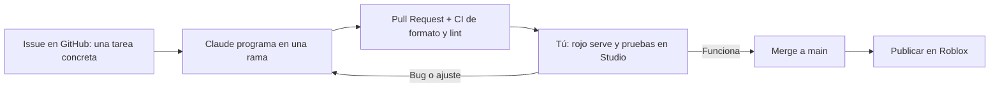
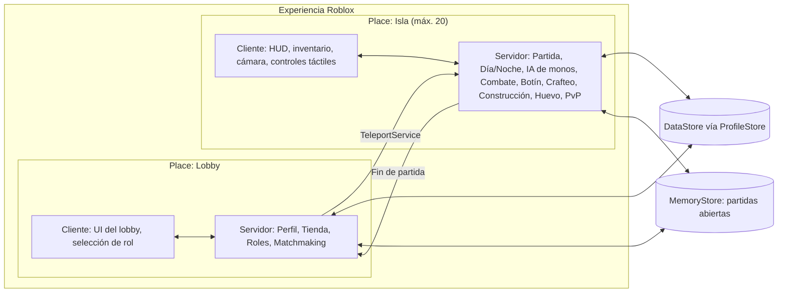
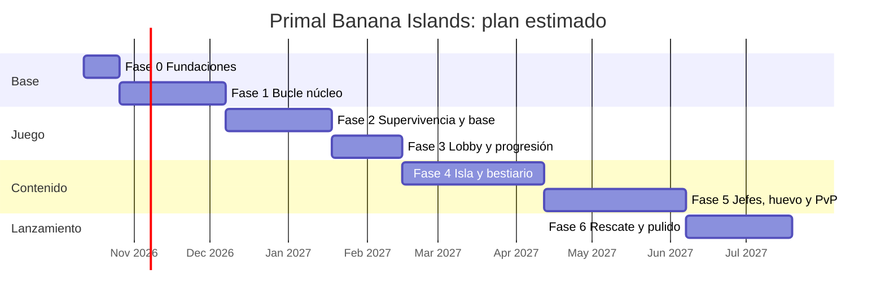

# Primal Banana Islands: plan de trabajo por fases

> Basado en el [GDD v0.2](GDD.md).
> **Contexto:** una sola persona con experiencia básica en Studio y **5–15 h/semana**. Claude escribe el código en el repo.
> **Principio:** cada fase termina con **algo jugable** y se prueba con gente real antes de pasar a la siguiente.

---

## 1. Cómo trabajamos



### Reparto de responsabilidades

| Claude (en el repo) | Tú (en Roblox Studio y la web de Roblox) |
|---|---|
| Todo el código Luau (servidor, cliente, UI) | Instalar herramientas y conectar Rojo |
| Datos de balance (especies, botín, recetas) | Esculpir el terreno y montar el mapa |
| Configuración de herramientas y CI | Colocar modelos del Creator Store |
| Documentación y guías paso a paso | Subir animaciones, sonidos e imágenes a tu cuenta |
| Revisar bugs a partir de tus reportes | **Probar** y decidir qué es divertido |
| | Publicar, y crear gamepasses y productos |

> **Código en Git, mapa en Roblox.** Los scripts viven en el repo y se sincronizan con Rojo. El terreno y el mapa viven en el archivo del *place* (con historial de versiones de Roblox). Los modelos clave se exportan de vez en cuando a `assets/` como `.rbxm`.

---

## 2. Stack técnico

| Herramienta | Para qué |
|---|---|
| **Roblox Studio** | Editor del juego, mapa y pruebas |
| **VS Code + Luau LSP** | Editar código con autocompletado |
| **Rojo** | Sincroniza el código del repo con Studio |
| **Rokit** | Instala versiones fijas de las herramientas (`rokit.toml`) |
| **Wally** | Gestor de paquetes de Roblox (se añade en la Fase 2, con ProfileStore) |
| **StyLua / Selene** | Formato automático y detección de errores (en CI) |
| **ProfileStore** | Guardado seguro de datos del jugador (moneda, XP, mascotas) |
| **GitHub Actions** | Comprueba formato y lint en cada Pull Request |

**Decisiones de arquitectura:**

- **Una experiencia con 2 places:** `Lobby` (inicio) e `Isla` (partida, máximo 20).
- **Servidor autoritativo:** el cliente solo pide ("quiero atacar"); el servidor valida y aplica.
- **Sin frameworks pesados.** Usamos un patrón simple de *Services* (servidor) y *Controllers* (cliente) con `Init` y `Start`.
- **Basado en datos:** especies, recetas, botín y tiempos están en módulos de `Config`. Para balancear basta con cambiar números.
- **Red centralizada:** un único módulo `Remotes` define todos los eventos cliente-servidor.

### Arquitectura



### Estructura del repositorio

```
monkey_island_2026/
├─ docs/                      # GDD, plan y guía de instalación (SETUP.md)
├─ src/
│  ├─ shared/                 # → ReplicatedStorage.Shared (cliente y servidor)
│  │  ├─ Config.luau          #   Configuración central y balance
│  │  ├─ Remotes.luau         #   Todos los eventos de red
│  │  ├─ Loader.luau          #   Carga Services/Controllers (Init → Start)
│  │  └─ UI/                  #   Piezas de interfaz (botones, mensajes)
│  ├─ serverShared/           # → ServerScriptService.ServerShared (solo servidor, ambos places)
│  ├─ combat/                 # → ServerScriptService.Combat: armas, habilidades, combos y estados,
│  │                          #   compartidos por la Isla y la arena; CombatRules = reglas de cada place
│  ├─ combatClient/           # → ReplicatedStorage.CombatClient: controles y efectos del combate
│  │                          #   (armas, habilidades, esquiva, números, cómic), en la Isla y la arena
│  ├─ lobby/
│  │  ├─ server/Services/     # Lógica del servidor del Lobby
│  │  └─ client/Controllers/  # Interfaz y controles del Lobby
│  ├─ island/
│  │  ├─ server/Services/     # Lógica del servidor de la Isla
│  │  ├─ client/Controllers/  # HUD y controles de la Isla
│  │  └─ tools/               # → ServerStorage.Tools: MapBuilder (generador de la isla), Equilibrio
│  └─ dunas/
│     ├─ server/Services/     # Partida de la arena: equipos, banderas, reaparición, Ámbar
│     ├─ server/World/        # ArenaBuilder (mapa de la arena) y FlagModel
│     └─ client/Controllers/  # HUD, ventana previa y resultados de la arena
├─ lobby.project.json         # Proyecto Rojo del Lobby (puerto 34872)
├─ island.project.json        # Proyecto Rojo de la Isla (puerto 34873)
├─ dunas.project.json         # Proyecto Rojo de la Isla de Dunas (puerto 34874)
├─ sourcemap.project.json     # Solo para el autocompletado de VS Code
├─ rokit.toml                 # Versiones de herramientas
├─ selene.toml / stylua.toml  # Lint y formato
├─ .vscode/                   # Extensiones y ajustes recomendados
└─ .github/                   # CI: formato, lint y build en cada push
```

Más adelante se añadirán `wally.toml` (paquetes, Fase 2) y `assets/` (modelos exportados de referencia).

---

## 3. Fases

### Fase 0: Fundaciones (1–2 semanas)

**Objetivo:** que puedas cambiar código en el repo y verlo en Studio, y viajar del Lobby a la Isla.

**Tú** (sigue la guía [SETUP.md](SETUP.md)):
- [x] Instalar Roblox Studio, VS Code, GitHub Desktop y Rokit, y clonar el repo
- [x] Instalar las herramientas (`rokit install`) y el plugin de Rojo
- [x] Crear la experiencia en Roblox con 2 places: **Lobby** (inicio) e **Isla**
- [x] Copiar los IDs de los places a `Config.luau` y poner la Isla en 20 jugadores *(20-10-2026: el juego pasa a ser para grupos de amigos; hay que bajarla a **5**, ver [SETUP.md](SETUP.md) paso 7)*
- [x] Sincronizar con Rojo y publicar ambos places
- [x] Probar el viaje Lobby ↔ Isla en el juego publicado *(hizo falta poner la experiencia en Público y publicar la Isla)*

✅ **Fase 0 completada.**

**Claude:**
- [x] Estructura del repo: 2 proyectos Rojo + código compartido
- [x] `rokit.toml` (Rojo 7.7.1, StyLua 2.3.1, Selene 0.30.0)
- [x] CI en GitHub Actions: formato, lint y build en cada push
- [x] Módulo `Config` central (duración del día, jefes, baliza, viajes…)
- [x] Patrón *Services*/*Controllers* (`Loader`) y módulo `Remotes`
- [x] Botones de prueba "Ir a la Isla" y "Volver al Lobby" (TeleportService con reintentos y límite de peticiones)
- [x] Guía paso a paso en `docs/SETUP.md`, pensada para nivel básico

**Criterio de salida:** editas un número en `Config`, se ve en Studio y el botón del Lobby te lleva a la Isla publicada.

---

### Fase 1: Prototipo del bucle núcleo, "Sobrevivir el día 1" (4–6 semanas)

**Objetivo:** responder a la pregunta más importante: **¿es divertido salir, recolectar, pelear y volver?** Se hace con arte provisional (*greybox*).

Se entrega en partes pequeñas, cada una probable en Studio:

| Entrega | Contenido | Estado |
|---|---|---|
| **1.1** | Ciclo día/noche + Basecamp como zona segura | ✅ Probada en Studio |
| **1.2** | Recolección (árboles, rocas, arbustos) + HUD de inventario | ✅ Probada |
| **1.3** | Barra rápida + combate: machete, honda (gasta piedras) y esquiva, muñecos de práctica | ✅ Probada |
| **1.4** | IA de monos v1: mono ardilla y aullador rojo (aullido y refuerzos), botín, reaparición al amanecer | ✅ Probada |
| **1.5** | Caído → reanimación → Espíritu (mochila, marcas) → reaparición al amanecer | ✅ Probada |
| **1.6** | Mesa de trabajo con 7 recetas: antorcha, venda, hacha y pico de piedra, lanza, garrote y chaleco | ✅ Probada |

- [x] Generador de la isla provisional `MapBuilder`: terreno con colinas en todos los biomas, selva densa, palmeras, volcán activo, Basecamp de 170 studs con empalizada de estacas, portones y antorchas, recursos, guaridas y límites *(Claude)*
- [ ] Generar la isla en Studio, probarla y retocarla *(tú; ver [MAPA.md](MAPA.md))*
- [x] Ciclo día/noche configurable (10+7) con avisos de amanecer, atardecer y "anochece en 60 s" *(1.1)*
- [x] Basecamp como zona segura: pieza `BasecampZone` + indicador en el HUD *(1.1)*
- [x] Recolección: árboles, rocas y arbustos → madera, piedra, fibra (con regeneración) *(1.2)*
- [x] Inventario básico: materiales en el HUD *(1.2)*
- [x] Barra rápida para herramientas y armas: la mochila nativa de Roblox (teclas 1–9, táctil y mando) *(1.3)*
- [x] Combate en 3ª persona: machete (cuerpo a cuerpo), honda (distancia, gasta piedras, ayuda de puntería en móvil) y esquiva (Q / B / botón táctil), validados en el servidor *(1.3)*
- [x] IA de monos v1 (máquina de estados) con **2 especies**: mono ardilla (grupo rápido) y aullador rojo (grito que llama refuerzos) *(1.4)*
- [x] Tablas de botín basadas en datos (`Shared/Data/Monkeys.luau`) *(1.4)*
- [x] Caído → reanimación → Espíritu → reaparición al amanecer *(1.5)*
- [x] Mesa de trabajo con 5–8 recetas *(1.6: 7 recetas en `Shared/Data/Recipes.luau`)*

**Criterio de salida:** 4–6 amigos juegan 30 min seguidos. Se anota qué fue divertido y qué no, y se ajusta antes de seguir.

**Ajustes tras la primera prueba (2 jugadores):**

- [x] Cada jugador empieza con **hacha y pico de madera**. Árboles y rocas se trabajan **golpeándolos con la herramienta equipada** (la tecla E ya no tala ni pica). En la mesa de trabajo se **mejoran** a hacha y pico de piedra.
- [x] Más monos (18 grupos de mono ardilla y 14 de aulladores) y **repoblación continua**: un grupo con bajas recupera un mono cada 45 s si no hay jugadores cerca.
- [x] El Espíritu ya no espera al amanecer: reaparece a los **45 s**, +30 s por cada caída del mismo día (máximo 3 min).
- [x] Talar a golpes se siente bien. Cada árbol se tala de una vez (8 de potencia: 8 golpes con el hacha de madera, 4 con la de piedra), da 6 de madera (+2 con la de piedra) y **cae** antes de desaparecer.
- [x] El Espíritu solo marca enemigos (antes también árboles y rocas).
- [ ] Probar los ajustes *(tú)*

---

### Fase 2: Supervivencia y Basecamp (4–6 semanas)

Igual que la Fase 1, se entrega en partes pequeñas, cada una probable en Studio:

| Entrega | Contenido | Estado |
|---|---|---|
| **2.1** | Hambre, sed y estamina; correr; comer; cocinar en la hoguera; beber en el río | ✅ Código listo, falta tu prueba |
| **2.2** | Construcción por cuadrícula con martillo: núcleo compartido + 20 parcelas; muros, antorcha de pie y cama | ✅ Código listo, falta tu prueba |
| **2.3** | Estaciones construibles: taller del curandero (ungüento, vendas, antídoto) y forja de piedra (machete afilado, lanza, garrote, armadura de hueso) | ✅ Código listo, falta tu prueba |
| **2.4** | Capuchino ladrón (roba y huye; se recupera al derrotarlo) y miedo al fuego (antorchas) | ✅ Código listo, falta tu prueba |
| **2.5** | Asedio nocturno v1: 3 oleadas por noche por los portones, rompen piezas, estacas como trampa, zona de perímetro | ✅ Código listo, falta tu prueba |
| **2.6** | Fiebre del mono v1: mordiscos y carne cruda la suben, vista nublada, daño a 100, antídoto | ✅ Código listo, falta tu prueba |
| **2.7** | Dificultad por día (vida y daño de los monos), derrota (todos caídos de noche), resultados y Ámbar | ✅ Código listo, falta tu prueba |
| **2.8** | Guardado de datos con bloqueo de sesión (módulo propio, como ProfileStore): Ámbar, récord, partidas, XP por rol | ✅ Código listo, falta tu prueba |

- [x] Hambre, sed y estamina; cocinar en la hoguera; agua del río *(2.1)*
- [x] Construcción por cuadrícula (táctil y PC) con **núcleo compartido + parcelas personales** y permisos *(2.2)*
- [x] Estaciones: hoguera, taller del curandero, forja de piedra *(2.1 y 2.3)*
- [x] Monos ladrones (capuchinos) y miedo al fuego *(2.4)*
- [x] Asedio nocturno v1: oleadas hacia el Basecamp, muros, trampas y antorchas *(2.5)*
- [x] Fiebre del mono v1 (mordiscos → fiebre; antídoto básico) *(2.6)*
- [x] Escalado de dificultad por día *(2.7)*
- [x] Derrota del servidor → pantalla de resultados *(2.7)*
- [x] **Guardado de datos** (módulo propio con bloqueo de sesión, como ProfileStore): moneda, récord de días y XP de rol *(2.8)*

**Criterio de salida:** una partida dura 3 o más días con tensión creciente y el progreso se guarda entre sesiones.

---

### Fase 3: Lobby, roles y progresión (3–4 semanas)

| Entrega | Contenido | Estado |
|---|---|---|
| **3.1** | Lobby: cabecera con Ámbar y récord; pestañas Rol, Talentos, Tienda y Grupo | ✅ Código listo, falta tu prueba |
| **3.2** | Roles en la Isla: guerrero, cazador, mago y médico; pasiva, armas propias y 4 habilidades (Z, X, C, V / R1 + A, B, X, Y / botones) | ✅ Código listo, falta tu prueba |
| **3.3** | Talentos (4 por rol, uno por habilidad) y tienda de mejoras con Ámbar | ✅ Código listo, falta tu prueba |
| **3.4** | Grupos de amigos que viajan juntos; partidas en curso; recompensas y tutorial | ✅ Código listo, falta tu prueba |

- [x] Lobby: selector de rol y tienda de mejoras (Ámbar) *(la zona social 3D y la vitrina de mascotas llegan con las mascotas, Fase 5)*
- [x] Roles v1: pasiva + habilidad activa de médico, cazador y recolector
- [x] Árbol de talentos v1 (3 talentos por rol)
- [x] **Roles v2:** nuevo **Guerrero**; el Recolector pasa a **Mago** (su XP se conserva); 3 habilidades activas + 1 definitiva por rol, armas iniciales por rol (garrote de piedra, arco con flechas, bastón mágico) y 4 talentos por rol; las ventajas de recolección pasan a la tienda
- [x] Matchmaking: grupos con amigos al mismo servidor; Roblox mete a los jugadores sueltos en partidas en curso con hueco (y quien entra en una partida terminada vuelve al Lobby)
- [x] Recompensas al terminar la partida: Ámbar y XP del rol (2.7 y 2.8)
- [x] **Tutorial de los primeros minutos** (5 pasos, se puede saltar, solo la primera vez)

**Criterio de salida:** ciclo completo Lobby → Isla → resultados → Lobby, con progreso guardado.

> 💡 **Opción de alfa pública:** al terminar esta fase se puede publicar una alfa abierta para empezar a recoger datos reales de retención mientras se produce el contenido.

---

### Fase 4: La isla completa y el bestiario (6–8 semanas)

- [ ] Mapa completo: playas (límite), selva, ríos y manglar, montañas, cuevas y volcán *(tú, con kits low-poly del Creator Store; la isla generada por `MapBuilder` ya tiene todos los biomas)*
- [x] Todas las especies de categoría 1–3 con su mecánica propia, horario día/noche y respawn diario *(12 especies en `Shared/Data/Monkeys.luau`, cada una en su zona)*
- [x] Tropas con alfa, huida y comportamiento ladrón *(alfa con corona; si muere, la tropa huye)*
- [x] **Bestiario/diario de campo** (UI) que se completa cazando *(J en la Isla y pestaña "Diario" en el Lobby)*
- [x] Armas, armaduras y recetas por nivel; rarezas de botín *(nivel 3 en la forja; 5 rarezas con color)*
- [x] **Optimización (código):** límite de monos activos, "sueño" de la IA y registro de rendimiento
- [ ] **Optimización (tú):** activar StreamingEnabled y probar en móvil de gama baja *(ver [RENDIMIENTO.md](RENDIMIENTO.md))*

**Criterio de salida:** un servidor lleno (5 jugadores desde el 20-10-2026; antes 20) estable en móvil, y cada bioma tiene una razón para visitarlo.

---

### Fase 5: Jefes, huevo, mascotas y PvP (6–8 semanas)

| Entrega | Contenido | Estado |
|---|---|---|
| **5.1** | 4 jefes en sus guaridas, 3 fases, ataques especiales, pieza de baliza y botín legendario | ✅ Código listo, falta tu prueba |
| **5.2** | Huevo misterioso: aviso, portador lento y con PvP, nido, incubación defendida y eclosión | ✅ Código listo, falta tu prueba |
| **5.3** | Mascotas: 13, cinco rarezas, seis tipos de ayuda, 1 activa desde el Lobby | ✅ Código listo, falta tu prueba |
| **5.4** | PvP opt-in con tótem, indicador, recompensa por cabeza y cajas de suministro en las playas | ✅ Código listo, falta tu prueba |
| **5.5** | Clima (lluvia, tormenta con rayos) y erupción del volcán | ✅ Código listo, falta tu prueba |

- [x] 4 jefes de bioma con fases, patrones y botín especial (pieza de baliza garantizada)
- [x] Rotación de jefes: uno cada 2 días (días 2, 4, 6, 8…), y cada uno se queda hasta que lo derrotan o aparece el siguiente
- [x] Evento del huevo: aparición, aviso global, transporte, nido, incubación y eclosión
- [x] Mascotas persistentes: colección, rarezas, 1 activa, tipos de ayuda
- [x] PvP opt-in: tótem, indicador, espera para desactivar, cajas de suministro y recompensa por cabeza
- [x] Clima y eventos: lluvia, tormenta y erupción del volcán

**Criterio de salida:** las partidas generan **momentos memorables** (jefe, huevo, robo) que la gente quiere contar o grabar.

---

### Fase 6: Rescate, pulido y lanzamiento (4–6 semanas)

| Entrega | Contenido | Estado |
|---|---|---|
| **6.1** | Baliza de rescate (4 piezas, desde el día 8) → La Gran Tropa → victoria | ✅ Código listo, falta tu prueba |
| **6.2** | Clasificaciones globales (días y rescates) y pestaña "Ranking" | ✅ Código listo, falta tu prueba |
| **6.3** | Analítica: embudo del tutorial, economía del Ámbar, victorias y derrotas | ✅ Código listo |
| **6.4** | Tienda cosmética con Game Passes (pestaña "Estilo") y servidores privados | ✅ Código listo; faltan los pases *(tú)* |
| **6.5** | Música configurable por situación y sonido de avisos | ✅ Código listo; faltan las pistas *(tú)* |
| **6.6** | Guía de lanzamiento: [LANZAMIENTO.md](LANZAMIENTO.md) | ✅ |

- [x] Baliza de rescate (se puede encender desde el día 8) + noche final "La Gran Tropa" → victoria
- [x] Clasificaciones (días sobrevividos, rescates)
- [x] Sonido y música *(código; los IDs de audio los eliges tú)*; pulido de UI para móvil *(revisar en la beta)*
- [x] Analítica (embudo del tutorial, retención, economía)
- [x] Tienda cosmética (Robux), servidores privados *(código; los pases los creas tú)*
- [ ] Nombre final, icono, miniaturas *(tú; el cuestionario de madurez ya está hecho)*
- [ ] Beta cerrada → **lanzamiento** *(tú; ver [LANZAMIENTO.md](LANZAMIENTO.md))*

---

### Fase 6b: Bucle de retención (octubre de 2026)

Basado en [Bucle central de retencion.txt](Bucle%20central%20de%20retencion.txt) y en la entrevista del 19-oct-2026 (detalles en el GDD §4 "Bucle de retención" y §11). Probado en Studio por partes ([VERIFICACION.md](VERIFICACION.md) §5.2 y §7).

| Entrega | Contenido | Estado |
|---|---|---|
| **R1** | Huevos guardados: perfil v3, rareza al aparecer, mochila de 3 + pendientes | ✅ Probado en Studio |
| **R2** | Nido del Lobby: tu huevo con su temporizador, panel en Mascotas, ceremonia al abrirlo | ✅ Probado en Studio |
| **R3** | Acelerar jugando: −1 h por noche, ruleta del rescate, tope del 50 %, aviso de huevo listo | ✅ Probado en Studio |
| **R4** | Provisiones de partida (se guardan y llegan a la mochila al empezar) | ✅ Probado en Studio |
| **R5** | Calendario de 7 días (ventana al entrar, pestaña Misiones; faltar no reinicia) | ✅ Probado en Studio |
| **R6** | Título "Superviviente de la Isla" gratis, solo al ganar una partida | ✅ Probado en Studio; falta una victoria real |
| **R7** | Misiones diarias (2 generales + 1 del rol), rastreador en la Isla (PC) | ✅ Probado en Studio |

- [ ] Probar con 2 jugadores: los dos se llevan su huevo al defender uno juntos
- [ ] Medir en el juego publicado la retención D1/D7 y cuántos vuelven a abrir su huevo (Analítica: `LoginCalendarDay`, economía `EggDiscard`, `LoginCalendar`, `DailyMission`)

---

### Fase 7: Después del lanzamiento (continuo)

Temporadas con lore, nuevos jefes y eventos, mutadores de partida ("Luna roja", "Temporada de lluvias") y balance basado en datos.

---

### Fase 8: Isla de Dunas, arena PvP (octubre de 2026)

Tercer place: captura la bandera por equipos, de 1v1 a 5v5, con equipamiento propio comprado con Ámbar (diseño en el GDD §12.2, entrevista del 20-10-2026). Probado en Studio con un jugador ([VERIFICACION.md](VERIFICACION.md) §8); falta probarlo con varios jugadores y publicado.

| Entrega | Contenido | Commit | Estado |
|---|---|---|---|
| **D1** | Combate compartido entre places: `src/combat` y `src/combatClient`, con reglas por place en `CombatRules`. La Isla juega igual | `804a2f8` | ✅ Probado en Studio |
| **D2** | Place de Dunas (Rojo 34874), equipos, rol por jugador, partida con espera, cuenta atrás, batalla, muerte súbita y resultados, reaparición, HUD, perfil v4 | `bb38ab1` | ✅ Probado en Studio |
| **D3** | Banderas (robar, capturar, soltar y devolver), portador más lento, Ámbar con tope diario, estadísticas, ranking y revancha | `556e2a9` | ✅ Probado en Studio (un jugador) |
| **D4** | Números de la arena (duelos de 8–10 s), veneno, lento, marcas y combos contra rivales, 24 variantes de equipamiento y su tienda | `3fd7559` | ✅ Probado en Studio (un jugador) |
| **D5** | Lobby: embarcadero con velero, pestaña Arena, cola entre servidores con MemoryStore, cartel de ranking de la arena | `eb18f6c` | ✅ Probado hasta `ReserveServer` (en Studio no se viaja) |
| **D6** | Mapa final de ruinas mayas e iluminación; esquiva y Embestida sin salir volando, efectos de cómic en la arena, cámara al aparecer | `dce4bd9` | ✅ Probado en Studio |
| **D7** | Documentación: GDD §12.2, esta fase y VERIFICACION §8 | — | ✅ |

- [ ] Probar con 2–4 jugadores (*Test → Local Server*): daño entre rivales, curación solo a aliados, devolver la bandera, no puntuar con la propia robada, victoria por abandono
- [ ] Probar publicado: cola y viaje Lobby → Dunas (1v1 con 2 cuentas, grupo de 2 en 2v2), "Volver al Lobby", cobro de Ámbar con tope y ranking
- [ ] Revisar con más jugadores (datos de partidas reales): el duelo de médicos dura 30 s (objetivo 8–10 s); por ahora se deja así (decidido el 20-10-2026)
- [x] Ventana de equipamiento en el teléfono: las tres ranuras en columnas con sus nueve opciones, y la ventana en dos columnas para verlo todo sin desplazarse
- [ ] Antes de publicar: guardar los places del Lobby y de Dunas y **publicar los tres a la vez** (perfil v4: un place con el código viejo borraría el campo `arena`)

---

## 4. Cronograma estimado

Estimación con **5–15 h/semana**: unos **7–10 meses** hasta el lanzamiento. El diagrama usa el escenario medio.



---

## 5. Métricas para cada playtest

| Pregunta | Cómo se mide |
|---|---|
| ¿Se entiende qué hacer? | % de jugadores que salen del Basecamp en los primeros 3 minutos |
| ¿Es divertido? | Tiempo medio de sesión y cuántos llegan a la primera noche |
| ¿Vuelven? | Retención al día siguiente (D1) y a la semana (D7) |
| ¿Es justo? | Causas de caída, PvP vs PvE, y qué monos derriban más |
| ¿Rinde bien? | FPS y memoria en móvil con el servidor lleno (5 jugadores) |

---

## 6. Siguiente paso inmediato

1. **Tú:** verificar las Fases 2 a 6 en Studio y en el juego publicado (lista de pruebas en el mensaje de entrega).
2. **Claude:** corregir lo que salga de esa verificación.
3. **Tú:** probar la arena de Dunas con varios jugadores y publicada ([VERIFICACION.md](VERIFICACION.md) §8, Fase 8).
4. **Tú:** pasos de [LANZAMIENTO.md](LANZAMIENTO.md): música, pases, página del juego, beta cerrada y lanzamiento.
