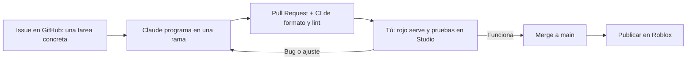
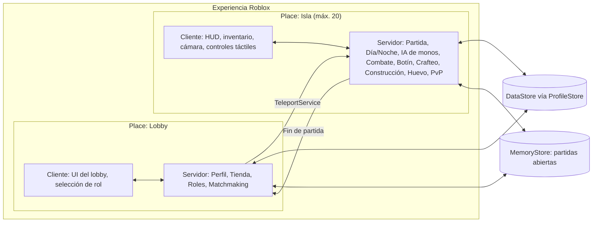
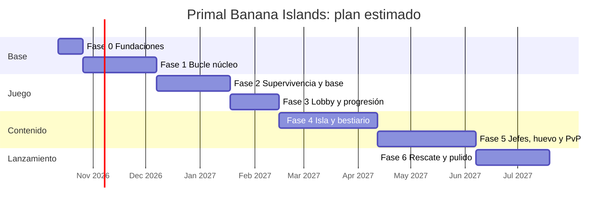

# Primal Banana Islands: plan de trabajo por fases

> Basado en el [GDD v0.2](GDD.md).
> **Contexto:** una sola persona con experiencia básica en Studio y **5–15 h/semana**. Claude escribe el código en el repo.
> **Principio:** cada fase termina con **algo jugable** y se prueba con gente real antes de pasar a la siguiente.

---

## 1. Cómo trabajamos



### Reparto de responsabilidades

| Claude (en el repo) | Tú (en Roblox Studio y la web de Roblox) |
|---|---|
| Todo el código Luau (servidor, cliente, UI) | Instalar herramientas y conectar Rojo |
| Datos de balance (especies, botín, recetas) | Esculpir el terreno y montar el mapa |
| Configuración de herramientas y CI | Colocar modelos del Creator Store |
| Documentación y guías paso a paso | Subir animaciones, sonidos e imágenes a tu cuenta |
| Revisar bugs a partir de tus reportes | **Probar** y decidir qué es divertido |
| | Publicar, y crear gamepasses y productos |

> **Código en Git, mapa en Roblox.** Los scripts viven en el repo y se sincronizan con Rojo. El terreno y el mapa viven en el archivo del *place* (con historial de versiones de Roblox). Los modelos clave se exportan de vez en cuando a `assets/` como `.rbxm`.

---

## 2. Stack técnico

| Herramienta | Para qué |
|---|---|
| **Roblox Studio** | Editor del juego, mapa y pruebas |
| **VS Code + Luau LSP** | Editar código con autocompletado |
| **Rojo** | Sincroniza el código del repo con Studio |
| **Rokit** | Instala versiones fijas de las herramientas (`rokit.toml`) |
| **Wally** | Gestor de paquetes de Roblox (se añade en la Fase 2, con ProfileStore) |
| **StyLua / Selene** | Formato automático y detección de errores (en CI) |
| **ProfileStore** | Guardado seguro de datos del jugador (moneda, XP, mascotas) |
| **GitHub Actions** | Comprueba formato y lint en cada Pull Request |

**Decisiones de arquitectura:**

- **Una experiencia con 2 places:** `Lobby` (inicio) e `Isla` (partida, máximo 20).
- **Servidor autoritativo:** el cliente solo pide ("quiero atacar"); el servidor valida y aplica.
- **Sin frameworks pesados.** Usamos un patrón simple de *Services* (servidor) y *Controllers* (cliente) con `Init` y `Start`.
- **Basado en datos:** especies, recetas, botín y tiempos están en módulos de `Config`. Para balancear basta con cambiar números.
- **Red centralizada:** un único módulo `Remotes` define todos los eventos cliente-servidor.

### Arquitectura



### Estructura del repositorio

```
monkey_island_2026/
├─ docs/                      # GDD, plan y guía de instalación (SETUP.md)
├─ src/
│  ├─ shared/                 # → ReplicatedStorage.Shared (cliente y servidor)
│  │  ├─ Config.luau          #   Configuración central y balance
│  │  ├─ Remotes.luau         #   Todos los eventos de red
│  │  ├─ Loader.luau          #   Carga Services/Controllers (Init → Start)
│  │  └─ UI/                  #   Piezas de interfaz (botones, mensajes)
│  ├─ serverShared/           # → ServerScriptService.ServerShared (solo servidor, ambos places)
│  ├─ combat/                 # → ServerScriptService.Combat: armas, habilidades, combos y estados,
│  │                          #   compartidos por la Isla y la arena; CombatRules = reglas de cada place
│  ├─ combatClient/           # → ReplicatedStorage.CombatClient: controles y efectos del combate
│  │                          #   (armas, habilidades, esquiva, números, cómic), en la Isla y la arena
│  ├─ lobby/
│  │  ├─ server/Services/     # Lógica del servidor del Lobby
│  │  └─ client/Controllers/  # Interfaz y controles del Lobby
│  ├─ island/
│  │  ├─ server/Services/     # Lógica del servidor de la Isla
│  │  ├─ client/Controllers/  # HUD y controles de la Isla
│  │  └─ tools/               # → ServerStorage.Tools: MapBuilder (generador de la isla), Equilibrio
│  └─ dunas/
│     ├─ server/Services/     # Partida de la arena: equipos, banderas, reaparición, Ámbar
│     ├─ server/World/        # ArenaBuilder (mapa de la arena) y FlagModel
│     └─ client/Controllers/  # HUD, ventana previa y resultados de la arena
├─ lobby.project.json         # Proyecto Rojo del Lobby (puerto 34872)
├─ island.project.json        # Proyecto Rojo de la Isla (puerto 34873)
├─ dunas.project.json         # Proyecto Rojo de la Isla de Dunas (puerto 34874)
├─ sourcemap.project.json     # Solo para el autocompletado de VS Code
├─ rokit.toml                 # Versiones de herramientas
├─ selene.toml / stylua.toml  # Lint y formato
├─ .vscode/                   # Extensiones y ajustes recomendados
└─ .github/                   # CI: formato, lint y build en cada push
```

Más adelante se añadirán `wally.toml` (paquetes, Fase 2) y `assets/` (modelos exportados de referencia).

---

## 3. Fases

### Fase 0: Fundaciones (1–2 semanas)

**Objetivo:** que puedas cambiar código en el repo y verlo en Studio, y viajar del Lobby a la Isla.

**Tú** (sigue la guía [SETUP.md](SETUP.md)):
- [x] Instalar Roblox Studio, VS Code, GitHub Desktop y Rokit, y clonar el repo
- [x] Instalar las herramientas (`rokit install`) y el plugin de Rojo
- [x] Crear la experiencia en Roblox con 2 places: **Lobby** (inicio) e **Isla**
- [x] Copiar los IDs de los places a `Config.luau` y poner la Isla en 20 jugadores *(20-10-2026: el juego pasa a ser para grupos de amigos; hay que bajarla a **5**, ver [SETUP.md](SETUP.md) paso 7)*
- [x] Sincronizar con Rojo y publicar ambos places
- [x] Probar el viaje Lobby ↔ Isla en el juego publicado *(hizo falta poner la experiencia en Público y publicar la Isla)*

✅ **Fase 0 completada.**

**Claude:**
- [x] Estructura del repo: 2 proyectos Rojo + código compartido
- [x] `rokit.toml` (Rojo 7.7.1, StyLua 2.3.1, Selene 0.30.0)
- [x] CI en GitHub Actions: formato, lint y build en cada push
- [x] Módulo `Config` central (duración del día, jefes, baliza, viajes…)
- [x] Patrón *Services*/*Controllers* (`Loader`) y módulo `Remotes`
- [x] Botones de prueba "Ir a la Isla" y "Volver al Lobby" (TeleportService con reintentos y límite de peticiones)
- [x] Guía paso a paso en `docs/SETUP.md`, pensada para nivel básico

**Criterio de salida:** editas un número en `Config`, se ve en Studio y el botón del Lobby te lleva a la Isla publicada.

---

### Fase 1: Prototipo del bucle núcleo, "Sobrevivir el día 1" (4–6 semanas)

**Objetivo:** responder a la pregunta más importante: **¿es divertido salir, recolectar, pelear y volver?** Se hace con arte provisional (*greybox*).

Se entrega en partes pequeñas, cada una probable en Studio:

| Entrega | Contenido | Estado |
|---|---|---|
| **1.1** | Ciclo día/noche + Basecamp como zona segura | ✅ Probada en Studio |
| **1.2** | Recolección (árboles, rocas, arbustos) + HUD de inventario | ✅ Probada |
| **1.3** | Barra rápida + combate: machete, honda (gasta piedras) y esquiva, muñecos de práctica | ✅ Probada |
| **1.4** | IA de monos v1: mono ardilla y aullador rojo (aullido y refuerzos), botín, reaparición al amanecer | ✅ Probada |
| **1.5** | Caído → reanimación → Espíritu (mochila, marcas) → reaparición al amanecer | ✅ Probada |
| **1.6** | Mesa de trabajo con 7 recetas: antorcha, venda, hacha y pico de piedra, lanza, garrote y chaleco | ✅ Probada |

- [x] Generador de la isla provisional `MapBuilder`: terreno con colinas en todos los biomas, selva densa, palmeras, volcán activo, Basecamp de 170 studs con empalizada de estacas, portones y antorchas, recursos, guaridas y límites *(Claude)*
- [ ] Generar la isla en Studio, probarla y retocarla *(tú; ver [MAPA.md](MAPA.md))*
- [x] Ciclo día/noche configurable (10+7) con avisos de amanecer, atardecer y "anochece en 60 s" *(1.1)*
- [x] Basecamp como zona segura: pieza `BasecampZone` + indicador en el HUD *(1.1)*
- [x] Recolección: árboles, rocas y arbustos → madera, piedra, fibra (con regeneración) *(1.2)*
- [x] Inventario básico: materiales en el HUD *(1.2)*
- [x] Barra rápida para herramientas y armas: la mochila nativa de Roblox (teclas 1–9, táctil y mando) *(1.3)*
- [x] Combate en 3ª persona: machete (cuerpo a cuerpo), honda (distancia, gasta piedras, ayuda de puntería en móvil) y esquiva (Q / B / botón táctil), validados en el servidor *(1.3)*
- [x] IA de monos v1 (máquina de estados) con **2 especies**: mono ardilla (grupo rápido) y aullador rojo (grito que llama refuerzos) *(1.4)*
- [x] Tablas de botín basadas en datos (`Shared/Data/Monkeys.luau`) *(1.4)*
- [x] Caído → reanimación → Espíritu → reaparición al amanecer *(1.5)*
- [x] Mesa de trabajo con 5–8 recetas *(1.6: 7 recetas en `Shared/Data/Recipes.luau`)*

**Criterio de salida:** 4–6 amigos juegan 30 min seguidos. Se anota qué fue divertido y qué no, y se ajusta antes de seguir.

**Ajustes tras la primera prueba (2 jugadores):**

- [x] Cada jugador empieza con **hacha y pico de madera**. Árboles y rocas se trabajan **golpeándolos con la herramienta equipada** (la tecla E ya no tala ni pica). En la mesa de trabajo se **mejoran** a hacha y pico de piedra.
- [x] Más monos (18 grupos de mono ardilla y 14 de aulladores) y **repoblación continua**: un grupo con bajas recupera un mono cada 45 s si no hay jugadores cerca.
- [x] El Espíritu ya no espera al amanecer: reaparece a los **45 s**, +30 s por cada caída del mismo día (máximo 3 min).
- [x] Talar a golpes se siente bien. Cada árbol se tala de una vez (8 de potencia: 8 golpes con el hacha de madera, 4 con la de piedra), da 6 de madera (+2 con la de piedra) y **cae** antes de desaparecer.
- [x] El Espíritu solo marca enemigos (antes también árboles y rocas).
- [ ] Probar los ajustes *(tú)*

---

### Fase 2: Supervivencia y Basecamp (4–6 semanas)

Igual que la Fase 1, se entrega en partes pequeñas, cada una probable en Studio:

| Entrega | Contenido | Estado |
|---|---|---|
| **2.1** | Hambre, sed y estamina; correr; comer; cocinar en la hoguera; beber en el río | ✅ Código listo, falta tu prueba |
| **2.2** | Construcción por cuadrícula con martillo: núcleo compartido + 20 parcelas; muros, antorcha de pie y cama | ✅ Código listo, falta tu prueba |
| **2.3** | Estaciones construibles: taller del curandero (ungüento, vendas, antídoto) y forja de piedra (machete afilado, lanza, garrote, armadura de hueso) | ✅ Código listo, falta tu prueba |
| **2.4** | Capuchino ladrón (roba y huye; se recupera al derrotarlo) y miedo al fuego (antorchas) | ✅ Código listo, falta tu prueba |
| **2.5** | Asedio nocturno v1: 3 oleadas por noche por los portones, rompen piezas, estacas como trampa, zona de perímetro | ✅ Código listo, falta tu prueba |
| **2.6** | Fiebre del mono v1: mordiscos y carne cruda la suben, vista nublada, daño a 100, antídoto | ✅ Código listo, falta tu prueba |
| **2.7** | Dificultad por día (vida y daño de los monos), derrota (todos caídos de noche), resultados y Ámbar | ✅ Código listo, falta tu prueba |
| **2.8** | Guardado de datos con bloqueo de sesión (módulo propio, como ProfileStore): Ámbar, récord, partidas, XP por rol | ✅ Código listo, falta tu prueba |

- [x] Hambre, sed y estamina; cocinar en la hoguera; agua del río *(2.1)*
- [x] Construcción por cuadrícula (táctil y PC) con **núcleo compartido + parcelas personales** y permisos *(2.2)*
- [x] Estaciones: hoguera, taller del curandero, forja de piedra *(2.1 y 2.3)*
- [x] Monos ladrones (capuchinos) y miedo al fuego *(2.4)*
- [x] Asedio nocturno v1: oleadas hacia el Basecamp, muros, trampas y antorchas *(2.5)*
- [x] Fiebre del mono v1 (mordiscos → fiebre; antídoto básico) *(2.6)*
- [x] Escalado de dificultad por día *(2.7)*
- [x] Derrota del servidor → pantalla de resultados *(2.7)*
- [x] **Guardado de datos** (módulo propio con bloqueo de sesión, como ProfileStore): moneda, récord de días y XP de rol *(2.8)*

**Criterio de salida:** una partida dura 3 o más días con tensión creciente y el progreso se guarda entre sesiones.

---

### Fase 3: Lobby, roles y progresión (3–4 semanas)

| Entrega | Contenido | Estado |
|---|---|---|
| **3.1** | Lobby: cabecera con Ámbar y récord; pestañas Rol, Talentos, Tienda y Grupo | ✅ Código listo, falta tu prueba |
| **3.2** | Roles en la Isla: guerrero, cazador, mago y médico; pasiva, armas propias y 4 habilidades (Z, X, C, V / R1 + A, B, X, Y / botones) | ✅ Código listo, falta tu prueba |
| **3.3** | Talentos (4 por rol, uno por habilidad) y tienda de mejoras con Ámbar | ✅ Código listo, falta tu prueba |
| **3.4** | Grupos de amigos que viajan juntos; partidas en curso; recompensas y tutorial | ✅ Código listo, falta tu prueba |

- [x] Lobby: selector de rol y tienda de mejoras (Ámbar) *(la zona social 3D y la vitrina de mascotas llegan con las mascotas, Fase 5)*
- [x] Roles v1: pasiva + habilidad activa de médico, cazador y recolector
- [x] Árbol de talentos v1 (3 talentos por rol)
- [x] **Roles v2:** nuevo **Guerrero**; el Recolector pasa a **Mago** (su XP se conserva); 3 habilidades activas + 1 definitiva por rol, armas iniciales por rol (garrote de piedra, arco con flechas, bastón mágico) y 4 talentos por rol; las ventajas de recolección pasan a la tienda
- [x] Matchmaking: grupos con amigos al mismo servidor; Roblox mete a los jugadores sueltos en partidas en curso con hueco (y quien entra en una partida terminada vuelve al Lobby)
- [x] Recompensas al terminar la partida: Ámbar y XP del rol (2.7 y 2.8)
- [x] **Tutorial de los primeros minutos** (5 pasos, se puede saltar, solo la primera vez)

**Criterio de salida:** ciclo completo Lobby → Isla → resultados → Lobby, con progreso guardado.

> 💡 **Opción de alfa pública:** al terminar esta fase se puede publicar una alfa abierta para empezar a recoger datos reales de retención mientras se produce el contenido.

---

### Fase 4: La isla completa y el bestiario (6–8 semanas)

- [ ] Mapa completo: playas (límite), selva, ríos y manglar, montañas, cuevas y volcán *(tú, con kits low-poly del Creator Store; la isla generada por `MapBuilder` ya tiene todos los biomas)*
- [x] Todas las especies de categoría 1–3 con su mecánica propia, horario día/noche y respawn diario *(12 especies en `Shared/Data/Monkeys.luau`, cada una en su zona)*
- [x] Tropas con alfa, huida y comportamiento ladrón *(alfa con corona; si muere, la tropa huye)*
- [x] **Bestiario/diario de campo** (UI) que se completa cazando *(J en la Isla y pestaña "Diario" en el Lobby)*
- [x] Armas, armaduras y recetas por nivel; rarezas de botín *(nivel 3 en la forja; 5 rarezas con color)*
- [x] **Optimización (código):** límite de monos activos, "sueño" de la IA y registro de rendimiento
- [ ] **Optimización (tú):** activar StreamingEnabled y probar en móvil de gama baja *(ver [RENDIMIENTO.md](RENDIMIENTO.md))*

**Criterio de salida:** un servidor lleno (5 jugadores desde el 20-10-2026; antes 20) estable en móvil, y cada bioma tiene una razón para visitarlo.

---

### Fase 5: Jefes, huevo, mascotas y PvP (6–8 semanas)

| Entrega | Contenido | Estado |
|---|---|---|
| **5.1** | 4 jefes en sus guaridas, 3 fases, ataques especiales, pieza de baliza y botín legendario | ✅ Código listo, falta tu prueba |
| **5.2** | Huevo misterioso: aviso, portador lento y con PvP, nido, incubación defendida y eclosión | ✅ Código listo, falta tu prueba |
| **5.3** | Mascotas: 13, cinco rarezas, seis tipos de ayuda, 1 activa desde el Lobby | ✅ Código listo, falta tu prueba |
| **5.4** | PvP opt-in con tótem, indicador, recompensa por cabeza y cajas de suministro en las playas | ✅ Código listo, falta tu prueba |
| **5.5** | Clima (lluvia, tormenta con rayos) y erupción del volcán | ✅ Código listo, falta tu prueba |

- [x] 4 jefes de bioma con fases, patrones y botín especial (pieza de baliza garantizada)
- [x] Rotación de jefes: uno cada 2 días (días 2, 4, 6, 8…), y cada uno se queda hasta que lo derrotan o aparece el siguiente
- [x] Evento del huevo: aparición, aviso global, transporte, nido, incubación y eclosión
- [x] Mascotas persistentes: colección, rarezas, 1 activa, tipos de ayuda
- [x] PvP opt-in: tótem, indicador, espera para desactivar, cajas de suministro y recompensa por cabeza
- [x] Clima y eventos: lluvia, tormenta y erupción del volcán

**Criterio de salida:** las partidas generan **momentos memorables** (jefe, huevo, robo) que la gente quiere contar o grabar.

---

### Fase 6: Rescate, pulido y lanzamiento (4–6 semanas)

| Entrega | Contenido | Estado |
|---|---|---|
| **6.1** | Baliza de rescate (4 piezas, desde el día 8) → La Gran Tropa → victoria | ✅ Código listo, falta tu prueba |
| **6.2** | Clasificaciones globales (días y rescates) y pestaña "Ranking" | ✅ Código listo, falta tu prueba |
| **6.3** | Analítica: embudo del tutorial, economía del Ámbar, victorias y derrotas | ✅ Código listo |
| **6.4** | Tienda cosmética con Game Passes (pestaña "Estilo") y servidores privados | ✅ Código listo; faltan los pases *(tú)* |
| **6.5** | Música configurable por situación y sonido de avisos | ✅ Código listo; faltan las pistas *(tú)* |
| **6.6** | Guía de lanzamiento: [LANZAMIENTO.md](LANZAMIENTO.md) | ✅ |

- [x] Baliza de rescate (se puede encender desde el día 8) + noche final "La Gran Tropa" → victoria
- [x] Clasificaciones (días sobrevividos, rescates)
- [x] Sonido y música *(código; los IDs de audio los eliges tú)*; pulido de UI para móvil *(revisar en la beta)*
- [x] Analítica (embudo del tutorial, retención, economía)
- [x] Tienda cosmética (Robux), servidores privados *(código; los pases los creas tú)*
- [ ] Nombre final, icono, miniaturas *(tú; el cuestionario de madurez ya está hecho)*
- [ ] Beta cerrada → **lanzamiento** *(tú; ver [LANZAMIENTO.md](LANZAMIENTO.md))*

---

### Fase 6b: Bucle de retención (octubre de 2026)

Basado en [Bucle central de retencion.txt](Bucle%20central%20de%20retencion.txt) y en la entrevista del 19-oct-2026 (detalles en el GDD §4 "Bucle de retención" y §11). Probado en Studio por partes ([VERIFICACION.md](VERIFICACION.md) §5.2 y §7).

| Entrega | Contenido | Estado |
|---|---|---|
| **R1** | Huevos guardados: perfil v3, rareza al aparecer, mochila de 3 + pendientes | ✅ Probado en Studio |
| **R2** | Nido del Lobby: tu huevo con su temporizador, panel en Mascotas, ceremonia al abrirlo | ✅ Probado en Studio |
| **R3** | Acelerar jugando: −1 h por noche, ruleta del rescate, tope del 50 %, aviso de huevo listo | ✅ Probado en Studio |
| **R4** | Provisiones de partida (se guardan y llegan a la mochila al empezar) | ✅ Probado en Studio |
| **R5** | Calendario de 7 días (ventana al entrar, pestaña Misiones; faltar no reinicia) | ✅ Probado en Studio |
| **R6** | Título "Superviviente de la Isla" gratis, solo al ganar una partida | ✅ Probado en Studio; falta una victoria real |
| **R7** | Misiones diarias (2 generales + 1 del rol), rastreador en la Isla (PC) | ✅ Probado en Studio |

- [ ] Probar con 2 jugadores: los dos se llevan su huevo al defender uno juntos
- [ ] Medir en el juego publicado la retención D1/D7 y cuántos vuelven a abrir su huevo (Analítica: `LoginCalendarDay`, economía `EggDiscard`, `LoginCalendar`, `DailyMission`)

---

### Fase 7: Después del lanzamiento (continuo)

Temporadas con lore, nuevos jefes y eventos, mutadores de partida ("Luna roja", "Temporada de lluvias") y balance basado en datos.

---

### Menú del Lobby por estaciones (20-10-2026)

El menú de 11 pestañas pasa a estaciones en la plaza (roles, nido, Isla de dunas y ranking, cada una con su ventana) y una barra de iconos con el resto. Plan: `C:\Users\jose\.claude\plans\atomic-tumbling-duckling.md`. Comprobación: [VERIFICACION.md](VERIFICACION.md) §9.

| Paso | Qué | Commit | Estado |
|---|---|---|---|
| M0 | Arena del Lobby con la ventaja de cada clase, como en Dunas (`Shared/UI/ArenaRoleCards`) | `ba3db55` | ✅ Probado |
| M1 | Ventanas por estación y barra de iconos con avisos; pastilla del Ámbar; ventanas sin desplazarse y móvil a pantalla completa; aura en el atajo a talentos | `70685d0`, `30f6f66`, `6d1f80c` | ✅ Probado (PC y teléfono del emulador) |
| M2 | Lobby v12: cartel de mascotas con el nido delante, ranking ancho con la arena, cartel y aviso de la Isla de dunas | `c0a7043` | ✅ Probado; **falta guardar el place** |
| M3 | Carteles por jugador (mascotas e Isla de dunas) y recuento de la cola | `a6d3912` | ✅ Probado (la cola real, publicado) |
| M4 | Iconos de las estaciones, contorno al acercarse y guía de la primera vez | `12aa8f8` | ✅ Probado |
| M5 | Documentación | — | ✅ |

### Fase 8: Isla de Dunas, arena PvP (octubre de 2026)

Tercer place: captura la bandera por equipos, de 1v1 a 5v5, con equipamiento propio comprado con Ámbar (diseño en el GDD §12.2, entrevista del 20-10-2026). Probado en Studio con un jugador ([VERIFICACION.md](VERIFICACION.md) §8); falta probarlo con varios jugadores y publicado.

| Entrega | Contenido | Commit | Estado |
|---|---|---|---|
| **D1** | Combate compartido entre places: `src/combat` y `src/combatClient`, con reglas por place en `CombatRules`. La Isla juega igual | `804a2f8` | ✅ Probado en Studio |
| **D2** | Place de Dunas (Rojo 34874), equipos, rol por jugador, partida con espera, cuenta atrás, batalla, muerte súbita y resultados, reaparición, HUD, perfil v4 | `bb38ab1` | ✅ Probado en Studio |
| **D3** | Banderas (robar, capturar, soltar y devolver), portador más lento, Ámbar con tope diario, estadísticas, ranking y revancha | `556e2a9` | ✅ Probado en Studio (un jugador) |
| **D4** | Números de la arena (duelos de 8–10 s), veneno, lento, marcas y combos contra rivales, 24 variantes de equipamiento y su tienda | `3fd7559` | ✅ Probado en Studio (un jugador) |
| **D5** | Lobby: embarcadero con velero, pestaña Arena, cola entre servidores con MemoryStore, cartel de ranking de la arena | `eb18f6c` | ✅ Probado hasta `ReserveServer` (en Studio no se viaja) |
| **D6** | Mapa final de ruinas mayas e iluminación; esquiva y Embestida sin salir volando, efectos de cómic en la arena, cámara al aparecer | `dce4bd9` | ✅ Probado en Studio |
| **D7** | Documentación: GDD §12.2, esta fase y VERIFICACION §8 | — | ✅ |

- [ ] Probar con 2–4 jugadores (*Test → Local Server*): daño entre rivales, curación solo a aliados, devolver la bandera, no puntuar con la propia robada, victoria por abandono
- [ ] Probar publicado: cola y viaje Lobby → Dunas (1v1 con 2 cuentas, grupo de 2 en 2v2), "Volver al Lobby", cobro de Ámbar con tope y ranking
- [ ] Revisar con más jugadores (datos de partidas reales): el duelo de médicos dura 30 s (objetivo 8–10 s); por ahora se deja así (decidido el 20-10-2026)
- [x] Ventana de equipamiento en el teléfono: las tres ranuras en columnas con sus nueve opciones, y la ventana en dos columnas para verlo todo sin desplazarse
- [ ] Antes de publicar: guardar los places del Lobby y de Dunas y **publicar los tres a la vez** (perfil v4: un place con el código viejo borraría el campo `arena`)

---

### Fase 9: Pase de temporada, misiones v2, mitad de partida y cosméticos (octubre de 2026)

Basado en [Sistema de recompensas y retencion.txt](Sistema%20de%20recompensas%20y%20retencion.txt), [battle_pass_30_days.pdf](battle_pass_30_days.pdf), la guía de Roblox para pases de temporada y la entrevista del 20-10-2026. Plan: `C:\Users\jose\.claude\plans\serialized-soaring-biscuit.md`. Cada grupo es un commit y una sesión propia; la economía se mide con la skill `economia-retencion` (calculadora `src/island/tools/Economia.luau`).

Reglas de la entrevista: la premium del pase es **solo cosmética** (Developer Product de 399 R$ por temporada; pack +10 niveles 799; nivel 79); el Ámbar, el tiempo de huevo, las provisiones y los huevos solo salen de la pista gratis y del nivel **ganado jugando**; temporada de 30 días y 30 niveles que se completa con ~20–24 días activos, ×2 de XP la última semana y 7 días de descanso; el calendario de 7 días se queda; "Superviviente de la Isla" sigue siendo solo para quien gana. Temporada 1: "El Despertar del Volcán".

| Grupo | Contenido | Commit | Estado |
|---|---|---|---|
| **G1** | Skill `economia-retencion` y calculadora de la economía (línea base: misiones al 100 % en la primera hora, el habitual gasta el 15 % de su Ámbar, equipo de nivel 3 el día 1) | `857ef5e` | ✅ |
| **G2** | Fundaciones: perfil v5 (`season`, `weekly`, `purchases`, `ownedCosmetics`), compras con recibo (`ServerShared/Purchases`, `ProcessReceipt` en los 3 places), cosméticos con `source`, rareza y huecos por tipo/rol/mascota/rueda de emotes (`Shared/CosmeticSlots`), `Config.Season` y `Config.Shop` | `ca70019` | ✅ |
| **G3** | Pase de temporada: `Data/Seasons` (T1 con premios provisionales: 3 cosméticos gratis y 3 premium), `Shared/SeasonPass` y `ServerShared/SeasonPass` (XP de la Isla, Dunas y misiones con tope de partidas, +10 % con amigos y ×2 la última semana; reclamar; cierre de temporada que entrega lo no reclamado), compras (premium, pack +10, nivel), cartel volcánico del pase en la plaza (Lobby v14) con su "!", ventana sin desplazamiento (`UI/SeasonPassPanel`) y botón 🌋 en la barra, línea de XP en los resultados, sección "Pase" de la calculadora (sin semanales el habitual llega al nivel 24: se cierra con las semanales de G4) | `b0883b0`…`3ccf9f3` | ✅ |
| **G4** | Misiones v2: cada día una fácil, una media (la del rol) y una difícil (avanzar en la partida); 5 semanales de 13 (como mucho una de Dunas) con un extra por las 5; un cambio gratis al día y otro a la semana (`Remotes.RerollMission`); eventos nuevos (llegar a un día, jefe, alfa, especies distintas, rescate, ganar y capturar en Dunas, que empieza a contar); ventana Misiones con pestañas Hoy/Semana y rastreador de la Isla también en el teléfono (fichas en la franja de la barra de Roblox). Calculadora: semanales simuladas por perfil; XP de la Isla 60/día y 150/jefe y diaria fácil 200 para que el casual llegue al nivel 12 y las misiones sean el 65 % de la XP del habitual (termina el día 24); el rastreador de la Isla enseña también las semanales y se pliega | `1b9c370`…`f343d1d` | ✅ |
| **G5** | Equipo ligado a los jefes: cada jefe da 2 de su tesoro a cada participante (no se pierden); el nivel 3 de las armas de rol y la armadura de plata pide la Corona del caudillo (día 4); Forja volcánica con obsidiana (15 vetas en el volcán y la cueva) y nivel 4 (Mazo volcánico, Arco de brasa, Bastón de lava, Cerbatana de azufre, ~+30 % de DPS; Armadura volcánica −65 %) con el Cristal de cueva (día 6); modelos de nivel 4 con hombreras de obsidiana en lava y humo. Gorila de Ceniza 7.000 de vida (sigue en ~3 min). Calculadora: nivel 3 el día 4 y nivel 4 el día 6 (antes, todo el día 1) | `6782ec7` | ✅ |
| **G6** | Contratos de expedición por partida, compartidos por el grupo: 3 contratos (Campamento del náufrago, Diario del naturalista, Ruta del volcán) de 5 pasos que se abren los días 1, 3, 5, 7 y 8 y se pierden al abrir el siguiente; objetivos que crecen con el grupo; cada paso da Ámbar, XP del pase (de partida) y objetos a todos los de la partida; tarjeta bajo el rastreador de misiones (ficha "📜" en el teléfono) y línea en los resultados. Calculadora: el habitual termina el pase el día 23 (antes 24) y el casual llega al nivel 13 | `0adca52` | ✅ |
| **G7** | Eventos de mitad de partida (`MidEventService`, `Data/MidEvents`), cada uno en un día al azar de los suyos, con aviso la víspera al anochecer y línea de estado en el HUD: lluvia tóxica (día 3 o 4: el agua del río y los mordiscos dan fiebre, agua hervida en la hoguera, antídotos y Ungüento del médico), macacos saboteadores (noche 5: van a por trampas, muros y estaciones) y erupción preliminar (día 7: piroclastos en las zonas altas y 2 cajas militares con obsidiana, esquirla de jefe y provisiones que activan el PvP; el paso "Asegurar" del contrato pide abrir una) | `4d97a0d` | ✅ |
| **G8** | Preparar la Gran Tropa: en la noche final la mitad de los mandriles, orangutanes y gorilas de cada oleada va a por la baliza (16.000 de vida; solo la rompen ellos, los demás monos la rodean); si la derriban se corta la señal, no hay rescate esa noche y al amanecer se repara y se puede volver a encender. Tótem guardián (uno por campamento, pide una Perla del río): a 25 studs, −35 % de daño a las piezas y reparación nocturna, −10 % de daño a los jugadores. Las antorchas de pie espantan a los aulladores del asedio y se gastan. Medido en Studio: sin defenderla, la baliza cae al poco de llegar la 5.ª oleada | `908ef85` | ✅ |
| **G9a** | Rareza **Mítico** (por encima de Legendario, solo cosméticos) y regla "cuanto más raro, más detalle"; trajes por rol (`ArmorModels`, ahora en Shared, con `dress` y los atributos `Outfit`/`WeaponSkin` que publica `CosmeticsServer`) y aspectos de arma por rol (`WeaponTools`, en la misma Tool con el nivel 1–4 del arma); los míticos ganan piezas con el nivel de la armadura y del arma en la Isla y se ven enteros en el Lobby y en Dunas; ventana **Armario** (sustituye a Estilo, `UI/WardrobePanel`: avatar 3D que gira, pestañas, rol y tarjetas con borde de rareza); primer par mítico de los dioses de la selva: traje **Rey Gorila Titán** (se gana venciendo de guerrero con la Maza y la Armadura volcánicas, 69→238 piezas, con un motivo propio en la espalda en cada grado: sol, calavera de gorila dorada, ídolo e ídolo con aro solar) y **Maza del Rey Gorila** (Robux, 449 R$; 22→89 piezas) | `62028e6`…`b3f26e0` | ✅ |
| **G9b** | Los otros tres pares míticos, traje (se gana venciendo con el equipo de nivel 4 del rol) y arma (Robux, 449 R$), cada uno con su brillo y su motivo en la espalda en cada grado: **Jaguar Espectral** del cazador (pelaje de jaguar, luz blanca azulada; el espíritu del jaguar sale de la capucha y asoma por el hombro, luna creciente; arco con garras de oro), **Serpiente Emplumada** del mago (escamas turquesa y plumas de quetzal sobre añil, azul de runa; la serpiente enroscada que se alza de perfil, penacho de plumas; báculo con la serpiente que sujeta el cristal) y **Ceiba de la Vida** del médico (corteza con espinas, flores y algodón, verde de curación; el tronco con raíces de contrafuerte que se abre en ramas y copa con colibríes; cerbatana-rama con ramitas) | `f927e2e`, `53f8f4b`, `82b4ed6` | ✅ |
| **G9c** | Skins de mascota (`PetModels` SKINS: paleta que lee `tone`, materiales y piezas propias; las mascotas que comparten modelo llevan **skins de familia**, felinos y perros), con la **Tortuga de Lava** de ejemplo (basalto, placas de lava, volcancito con humo); **marcos** (`UI/PlayerFrames`: bronce y Obsidiana fundida) en el ranking, la ventana Grupo y los resultados de la Isla (fila nueva con el grupo) y de Dunas; **rueda de emotes** (`UI/EmoteWheel`, tecla "." o 😀, junto al ⚙️ en la Isla y en la barra del Lobby; se para al moverte y no deja en combate), con 5 emotes de serie gratis (animaciones de Roblox); el Armario gana las pestañas Mascotas, Marcos y Emotes, y su vista previa junta lo elegido en cada hueco (traje, arma y efectos a la vez) | `5b01fda`, `6ad89ca` | ✅ |
| **G9d** | Tipos baratos para llenar la premium, uno de cada: **estilo de los números** (`UI/NumberStyles`: letra, tres franjas de color y borde en el daño que haces, que también ven los aliados; ejemplo Números de Magma), **estilo de los estallidos** (`ComicBurst` STYLES: colores y palabras de tu golpe, crítico y K.O.; el "OUCH!" sigue rojo; ejemplo Erupción, estrella de basalto con lava dentro) y **decoración del nido** (`Shared/NestDecor`, solo la ve quien la lleva, apoyada en el suelo; ejemplo Nido volcánico); **grados I, II, III** (cosméticos con la misma `line`: se ve el más alto que tienes y el Armario enseña una tarjeta por línea; ejemplo Llama primal, con anillo de llamas desde los pies en el II y brasas, humo y luz en el III); imágenes en `RewardModels.cosmetic` (también las skins de mascota) y pestaña 🎨 Estilos del Armario con números y estallidos en vivo; en el pase provisional, N5, N8, N12, N15 y N30 | `c7d4853`, `7defe2a` | ✅ |
| **G10a** | Tiendas de cosméticos: pestaña **🎨 Cosméticos** en la Tienda del Lobby (`UI/CosmeticShopPanel`), con 4 en Ámbar que rotan cada día y 3 sueltos de Robux que rotan cada lunes (un Developer Product cada uno) y los Game Passes siempre a la venta; rotación común con semilla del día o la semana (`Shared/CosmeticShop`) de la que cada jugador ve lo que aún no tiene, fijada en su perfil (versión 6, `cosmeticShop`) por `CosmeticShopService`; nunca entran premios de la temporada en curso; el Armario dice si algo está hoy en la tienda; la calculadora mide el sumidero, el catálogo y los precios; 5 cosméticos de prueba en Ámbar y los Números Escarcha en Robux | `eec74f8` | ✅ |
| **G10b** | Catálogo de las tiendas, tema "selva y mar" (distinto del volcán de la temporada): 22 cosméticos en Ámbar (19.000 en total; el habitual gasta el 97 % y tiene la tienda entera el día 30) con títulos, estelas por franjas, auras con forma propia (arena, tormenta), marcos, números, estallidos, el nido **Playa de coral** y la skin de familia **Perro pirata** para los tres perros; 6 sueltos de Robux nuevos (99–249 R$, con el nido **Templo dorado**), 11 en la rotación semanal; la tarjeta de un marco enseña tu nombre con él | `81128c4` | ✅ |
| **G11** | Contenido de la Temporada 1: **un premio premium en cada uno de los 30 niveles** (~8 grandes en los niveles clave, el aura que evoluciona en N1/N15/N30 y ~20 pequeños de los tipos baratos) y ~8 cosméticos gratis (G11a trajes y armas ✅, G11b mascotas, marcos y efectos ✅, G11c emotes ✅, G11d los pequeños ✅) | G11a: `1305ccb`, `8c7883b`; G11b: `8f0e0a9`; G11c: `1c1337c`; G11d: `02a7b62` | ✅ |
| **G12** | Calibración final y documentación: la calculadora con todo encendido no da alertas (el habitual termina el pase el día 23 y gasta el 97 % de su Ámbar; el casual llega al nivel 13) y su sección "Reglas de pago" revisa ahora también lo que aún no tiene id (18 productos, todos cosméticos o el pase); prueba de robustez con ritmos más lentos y sesiones más cortas, con sus hallazgos en la skill; nueva línea base; GDD v0.3 (§4 misiones v2 y semanales, §5.4 contratos, eventos y Gran Tropa, §11, §14 con el pase, las tiendas, los cosméticos y las correcciones a la investigación), VERIFICACION §10 paso a paso, LANZAMIENTO (Developer Products a crear con sus precios, fecha de la T1, publicar los tres places a la vez) y hoja "Correcciones" en el Excel del pase | `d9c0a93` | ✅ |

- [x] Crear en el Creator Hub los Developer Products (pase, pack, nivel, cosméticos sueltos) y poner sus ids (G2/G3/G10; los 14, el 22-10-2026)
- [ ] Antes de publicar: **publicar los tres places a la vez** (perfil v5)
- [ ] Poner la fecha de verdad de la Temporada 1 en `Data/Seasons` (hoy, provisional: 19-10-2026) (G3/G12)
- [ ] Guardar y publicar el Lobby con la plaza v14 (cartel volcánico del pase) (G3)
- Decisión del 21-10-2026 (G11a): los trajes y las armas de la Temporada 1 son de **fuego azul y azufre** sobre piedra pómez (la armadura del nivel 4 ya es obsidiana negra con lava naranja) y **ganan piezas con el grado** de la armadura, como los míticos pero en cinco escalones; el machete de obsidiana gratis pasa a ser un aspecto del machete con su propio hueco (`WeaponSkin.Machete`); un par por aprobación. **G11a terminado y aprobado**: par del guerrero (Guardián del Fuego Azul en N5, Maza de Azufre en N3) y hombreras volcánicas de losa con llama en píxeles, `1305ccb`; cazador (Acechador del Fuego Azul en N10, Arco de Azufre en N7), mago (Invocador del Fuego Azul en N20, Bastón de Azufre en N13), médico (Sanador del Fuego Azul en N25, Cerbatana de Azufre en N18) y el Machete de Azufre gratis en N8, `8c7883b`. Sigue el G11b.
- Decisión del 21-10-2026 (G11b): el Jaguar de Magma es de **magma naranja** (basalto, obsidiana y lava, como la Tortuga de Lava), no de fuego azul. **G11b terminado y aprobado** (`8f0e0a9`): premium Estela de fuego azul en N16, Marco de fuego azul en N21, Jaguar de Magma (skin de los tres felinos) en N23 y Marco de Obsidiana fundida en N27; gratis, junto al premio de siempre, Marco de bronce en N4, Tortuga de Lava en N12 y Marco de plata en N22; la Pisada de magma (N11) deja huellas de lava. Quedan 10 niveles premium vacíos (2, 4, 9, 14, 17, 19, 22, 24, 26 y 28) para el G11c (emotes) y el G11d (premios pequeños).
- Decisión del 21-10-2026 (G11c): tres emotes premium con efectos pequeños y uno gratis sin efectos. **G11c terminado y aprobado** (`1c1337c`): premium Grito de gorila en N2 (polvo del pecho, onda de polvo y piedrecitas al rugir), Danza del fuego en N9 (en bucle, llamas azules de bloques en las manos y chispas de azufre al pisar) y Erupción en N17 (grietas de lava y chorro de ceniza y brasas); gratis, junto a las provisiones, Saludo simio en N6. Las animaciones están publicadas (ids en `Data/Cosmetics`) y su fuente es `Data/EmoteAnimations`. La rueda de emotes solo está abierta mientras se mantiene ".". Quedan 7 niveles premium vacíos (4, 14, 19, 22, 24, 26 y 28) para el G11d.
- Decisión del 21-10-2026 (G11d): los siete niveles premium que quedaban, cuatro títulos y tres estilos de fuego azul y azufre. **G11d terminado y aprobado** (`02a7b62`): títulos Hijo del Volcán (N4), Caminante de Ceniza (N19), Domador del Magma (N24) y Guardián de la Llama Azul (N26); Números de fuego azul (N14), Estallido de fuego azul (N22) y el nido Cráter de azufre (N28). Ya hay un premio premium en cada uno de los 30 niveles: **G11 terminado**. Sigue el G12.
- **Fase 9 terminada** (22-10-2026): G1–G12 aprobados y subidos. Queda fuera de Studio lo de las casillas de arriba (Developer Products, fecha de la T1, publicar los tres places a la vez) y medir D1/D7 y la conversión del pase con datos de verdad.
- Decisión del 22-10-2026 (G12): la fecha de la Temporada 1 se queda provisional hasta que se sepa el día de publicar (paso de `docs/LANZAMIENTO.md` §3); las correcciones del Excel van en una hoja nueva "Correcciones" (el PDF es una exportación y no se toca). Los números no cambian: con los ritmos supuestos todo está en sus límites, y lo que salta con ritmos un 30 % más lentos queda apuntado para cuando haya telemetría.
- Decisión del 21-10-2026 (G10): el G10 se reparte en G10a (las tiendas, la rotación y la calculadora) y G10b (el catálogo); en la tienda de Robux van los sueltos que rotan cada semana y, debajo, los Game Passes fijos.
- Decisión del 21-10-2026 (G9): rareza **Mítico** por encima de Legendario, con un traje y un aspecto de arma míticos por rol (tema "dioses de la selva"); el traje se gana (vencer con el equipo de nivel 4 del rol) y el arma se vende suelta en Robux; los míticos crecen con el nivel de la armadura y del arma. El G9 se reparte en 4 sesiones (G9a–G9d).
- Decisión del 21-10-2026: la pista premium lleva **un premio en cada nivel** (solo 3 de 30 se veía vacía y no animaba a comprar). Sin moneda cosmética por ahora ("Brasas" queda para otra temporada, cuando haya tienda y datos de compra).

---

### Fase 10: Combate v2 (octubre de 2026)

Revisión y mejora del combate buscando la **equidad**. Se basa en [Sistema de combate y combos.txt](Sistema%20de%20combate%20y%20combos.txt), el mapa [Sistemas de combate en roblox.png](Sistemas%20de%20combate%20en%20roblox.png), la investigación de referentes (The Strongest Battlegrounds, Deepwoken, juegos de lucha, accesibilidad en móvil, detección en Roblox) y la entrevista del 22-10-2026. Diseño en el GDD §6.5. Plan con los handoffs: `C:\Users\jose\.claude\plans\fizzy-snacking-quiche.md`. Cada grupo es un commit y una sesión. El combate se mide con la skill `combate-roblox` (antes `habilidades-roblox`), con la calculadora `src/island/tools/Equilibrio.luau` (secciones 7 a 10, nuevas). Al cerrar la fase, la comparativa contra la foto inicial (`docs/combate-v2/linea-base.md`) va en `docs/combate-v2/comparativa.md`.

Decisiones de la entrevista:
- Isla y Dunas con el mismo combate.
- Bloqueo + parry + barra de guardia (los imbloqueables la rompen).
- Cadena de 4 golpes en cuerpo a cuerpo y proyectiles reales.
- Evasivo + escalado en PvP + control decreciente sobre los enemigos.
- Una sola ventana de parry para todos, con compensación de ping a favor del defensor.
- Amagos en el golpe y en las habilidades.
- Rebote contra muros, zonas de peligro, coberturas que se rompen y altar en Dunas.
- Aturdido separado de inmovilizado.
- Guardia en F / L2 / botón; Evasivo = esquivar estando aturdido.
- Shift lock de Roblox en Ctrl.
- Sin lock-on; los estilos se documentan y se miden.

| Grupo | Contenido | Commit | Estado |
|---|---|---|---|
| **C1** | Skill `combate-roblox` (renombrada y ampliada: mecánicas, detección, estilos y combos, equidad), números propuestos en `Config` y secciones 7 a 10 de la calculadora con sus límites, foto inicial y GDD §6.5 | `05d7697` | ✅ |
| **C2** | Fundaciones: máquina de estados, aturdido e inmovilizado, estamina del servidor, `Latency`, `Knockback` (la Embestida empuja también a jugadores) y shift lock en Ctrl | `fe480f8` | ✅ |
| **C3** | Detección de impactos unificada (`Combat/Hitbox`: rayos, esferas, cajas, áreas con línea de visión, posiciones rebobinadas). Ningún golpe atraviesa paredes. | `803d208` | ✅ |
| **C4** | Cadena de 4 golpes cuerpo a cuerpo con remate (`Shared/MeleeChain`, tajos `Slash1`–`Slash4`) | `c7cbfa5` | ✅ |
| **C5** | Guardia: bloqueo, parry y rotura; HUD y botón (`Combat/Guard`, `GuardController`, `CombatClient/GuardBar`) | `c4a5552` | ✅ |
| **C6** | Monos y jefes con preparación, control decreciente y muñecos que atacan para practicar (`Combat/EnemyAttack`, `EnemyWindupController`, `Config.ControlDR` en `Status.stun`, muñeco de sparring) | `fa01ab2` | ✅ |
| **C7** | Evasivo, escalado del combo en PvP y telemetría nueva (`Combat/Evasive`, `CombatClient/EvasiveIcon`, `Combat/ComboScaling`, controles PvP con `Config.ControlDR`, `telemetry.mechanic` en la Isla y en Dunas) | `b66465d` | ✅ |
| **C8** | Habilidades con preparación y amagos (`castSeconds` y estado `Casting`, `Combat/Feint` y `CombatClient/Feint`, guardia una vez por uso, sección 10 de `Equilibrio`) | `159671d` | ✅ |
| **C9** | Proyectiles reales (`Combat/Projectiles`, ayuda de puntería `CombatService.aimShot` en studs que adelanta contra monos, tasa de acierto en `Equilibrio` y daños compensados, telemetría `ShotsHit`/`ShotsMissed`) | `9c6b98c` | ✅ |
| **C9b** | Disparo de remate de las armas a distancia (`Shared/RangedChain`, `Config.RangedChain`: cada 4.º disparo seguido, mismo DPS contra uno; el arco atraviesa al primero y da al siguiente, el bastón estalla, la cerbatana cura el doble a un aliado y la honda tambalea a monos pequeños; telemetría `ShotFinishers`) | `1beeb86` | ✅ |
| **C10** | Rebote contra muros (`Combat/Knockback`, `Config.WallBang`: Embestida, Rompehuesos, que ahora aparta, y remate de la cadena; 5 de daño, aturdido 0,5 s, 1,5 s de inmunidad; telemetría `WallBangs`) y zonas de peligro (`Combat/Zones`, `Config.Zones`: hielo de la Nova que ralentiza y hace resbalar, nube del Polvo que se queda, fuego del Meteoro rematado; `ZoneController`) | `2e408bb` | ✅ |
| **C11** | Dunas: coberturas que se rompen (`Combat/Destructibles`, `CoverService`, `Config.Arena.Covers`: estelas y columnas de pie, 100 de piedra, habilidad 25, definitiva 100, remates 20, vuelven a los 45 s; grietas, trozos y polvo en `CoverController`) y altar de la pirámide (`AltarService`, `Config.Arena.Altar`: 6 s para tomarlo, 30 s de definitiva ×2, vuelve a los 75 s; HUD, cartel y resultados). `ArenaBuilder` v5 con barreras en los templos (se salía del mapa) | `ddcae1d` | ✅ |
| **C12** | Claridad, interfaz y aprendizaje: temblor de cámara común con su ajuste (`CombatClient/CameraShake`, `cameraShake`), estallidos ¡PARRY!, ¡GUARDIA ROTA! y ¡CONTRA!, rombos de la cadena a los pies (`ChainPipsController`), sonidos del Creator Store, cadena, guardia y "Controles del combate" en Ajustes, y paso de la guardia en la guía del Lobby (`combatGuideDone`) | `2976926` | ✅ |
| **C13** | Calibración final, documentación y comparativa antes → después: arena sin talentos en la calculadora, Grito de guerra −15 % contra jugadores (`PvPWarCryMultiplier`), daño enlazado del guerrero +15 %, `docs/combate-v2/comparativa.md`, GDD v0.4 y VERIFICACION §11 | `ba5961e` | ✅ |


### Fase 11: Monturas (octubre de 2026)

Una clase nueva de mascota que se monta. La primera es la **Llama Andina** (rara): modelo voxel en `Shared/MountModels` y sus animaciones en `MonkeyAnimationSpecs/Monturas` (galope, rumiar, escupir y saltar). Plan: `C:\Users\jose\.claude\plans\squishy-exploring-toucan.md`.

Decisiones del 23-10-2026:
- Se monta en el Lobby y en la Isla; en Dunas no.
- Se consiguen jugando (huevos), nunca con Robux.
- Viaje rápido: más rápida que correr a pie y sin gastar estamina. Montado no se ataca: atacar, recibir daño, cargar el huevo o caer te desmonta.
- Escupir es un gesto, sin daño.
- La montura es un modelo que cada cliente pega bajo el personaje (como las mascotas que siguen al jugador): el combate sigue apuntando al personaje.

| Grupo | Contenido | Commit | Estado |
|---|---|---|---|
| **M1** | Montar y desmontar en el Lobby y la Isla: perfil (`mounts`, `activeMount`), `ServerShared/MountServer` y remoto `ToggleMount`, `Shared/UI/MountRiders` (montura pegada al jinete con sus animaciones), velocidad de montado, pose `Ride` del jinete, botón Montar (N / R3) y elegir la montura en el Lobby | `125119e` | ✅ |
| **M2** | Conseguirlas jugando: tirada de montura al abrir un huevo de su rareza, ceremonia y lista del nido, GDD y calculadora `Economia` (EggChance 0,5). Con él, el panel de administradores para dar todo a un jugador | `586edf8` | ✅ |
| **M3** | Gesto de escupir montado (remoto `MountSpit`, Y o el botón Escupir, cada 3 s; partículas en el marcador "Escupir") | `6cbf97f` | ✅ |

### Pedidos del 26-10-2026 (tandas)

Diecinueve pedidos agrupados en tandas; cada una es una sesión. Plan con el detalle: `C:\Users\jose\.claude\plans\fluffy-stirring-octopus.md`.

Decisiones: tras ganar, "Seguir sobreviviendo" en la Isla; la montura de los 7 días es una tirada con pesos que se repite en cada ciclo, y una repetida da Ámbar; el Quetzalcóatl planea, no vuela; solo se regalan cosméticos de Robux; el estilo nuevo de V es opcional, no sustituye al actual.

| Tanda | Contenido (puntos del pedido) | Commit | Estado |
|---|---|---|---|
| **T1** | Español latino en todos los textos (15), "pieza" → "estructura" (17), monos alfa: semanal 6 → 20 y diaria 2 → 8, con el ritmo de la calculadora corregido a 0,2/min (18) | `0c92957` | ✅ |
| **T2** | Menú del martillo compacto y confirmación al volver al Lobby (1), emotes de Dunas unificados (2), Armario en 3 columnas (3) | `e514e82` | ✅ (falta ver la ficha del martillo en el emulador de teléfono) |
| **T3** | No volver a comprar lo que ya tienes (5), mascotas únicas y Ámbar por repetida (12), regalar cosméticos (6) | `861d1d1` | ✅ (falta probar el regalo con 2 jugadores; perfil v9: publicar los 3 places a la vez) |
| **T4** | Panel de administración v2: eventos en vivo, anuncio global, dar a todos y más (4). En 5 sub-tandas: T4a base, T4b eventos, T4c moderación, T4d perfil y servidor, T4e admin jefe gigante | T4a `7070501` · T4b `064edae` · T4c `579f0a0` · T4d `32e0be8` · T4e `fb69ba0` | ✅ (falta probar "todos los servidores", un baneo real y el mantenimiento en el juego publicado, la franja de eventos en el teléfono y el gigante con 2 jugadores) |
| **T5** | Montura Jaguar Albino legendaria y patas del perro pirata (7, 11); montura Quetzalcóatl mítica (8). En 2 sub-tandas: T5a jaguar y perro, T5b Quetzalcóatl | T5a `d3cf7ac` · T5b `8053bb3` | ✅ (falta en el teléfono, con 2 jugadores, en el Lobby y publicado: VERIFICACION §14 y §15; remoto nuevo: publicar los 3 places a la vez) |
| **T6** | Bienvenida de pioneros con el calendario y la montura del ciclo de 7 días (9) | `dffa6f5` | ✅ (falta en el teléfono, sin ser pionero, una montura nueva y publicado: VERIFICACION §16; perfil v10: publicar los 3 places a la vez) |
| **T7** | Estilo nuevo para la V de cada rol, que el jugador elige (19) | `d02020f` | ✅ (faltan los efectos en pantalla, 2 jugadores, el teléfono y publicado: VERIFICACION §17; perfil v11: publicar los 3 places a la vez) |
| **T8** | Fase 12: seguir sobreviviendo y parcela permanente en el Basecamp (10); grupos P1–P6 (ver "Fase 12") | P1 `09bc809`, P2 `0757588`, P3 `509281c`, P4 `a648329`, P5 `d5ca5b9`, P6 `8f39c29` | ✅ (falta publicar los 3 places a la vez, perfil v12, y las pruebas de VERIFICACION §18) |
| **T9** | Diseño (solo documentos): Laboratorio en ruinas (13), isla de aventuras (14), juego en inglés (16). Ver "Diseños de T9" | `dcf513c` | ✅ (se construyen en las Fases 13 y 14 y la tanda I1) |

### Fase 12: Victoria y parcela permanente (octubre de 2026)

Tras ganar, la partida puede seguir, y el que gana por primera vez desbloquea una parcela permanente en el Basecamp que viaja con él a cualquier partida. Plan: `C:\Users\jose\.claude\plans\tender-beaming-planet.md`.

Decisiones del 27-10-2026:
- **Seguir sobreviviendo:** al amanecer del rescate se paga todo y se guarda. Cada jugador elige seguir o volver al Lobby (si no elige en 30 s, vuelve). El final de verdad solo paga los días, las bajas y los jefes extra, sin un segundo rescate. El récord de días cuenta el total. La dificultad sigue subiendo y los 4 jefes vuelven cada 2 días sin piezas de baliza. En cada vuelta salen más fuertes los que ya se derrotaron (con victoria o sin ella); uno que aún no se ha derrotado vuelve igual. Nadie nuevo entra en una partida ya ganada.
- **Parcela:** se desbloquea al ganar por primera vez (también para quien ya había ganado antes). Hay 5 huecos de unas 24×24 dentro de la empalizada, en lugar de los 20 pequeños. Al entrar, cada jugador ocupa uno y su parcela se reconstruye. Todos la ven, y solo el dueño la usa. Quien nunca ha ganado recibe un hueco vacío para su cama.
- **Estructuras:** forja, taller del curandero, huerto, cama, cofre, incubadora y nido, con 3 niveles (I/II/III) que se pagan con Ámbar y materiales del cofre. Dan ventajas pequeñas en la partida. El asedio las daña (dejan de funcionar hasta repararlas o hasta el amanecer), pero el nivel guardado nunca baja.
- **Cofre:** guarda materiales y consumibles, nunca equipo ni piezas de baliza. Se deposita en cualquier momento. La parte compartida la puede vaciar cualquiera de la partida, y lo que se coge va al inventario de la partida de quien lo coge. Retirar de la parte compartida guarda primero el perfil del dueño, para que no se pueda duplicar nada.
- Perfil v12 (`plot`): se introduce en P2, y los 3 places se publican a la vez.

| Grupo | Contenido | Commit | Estado |
|---|---|---|---|
| **P1** | "Seguir sobreviviendo": cobro al ganar sin cobrar dos veces, botón y remoto `ChooseContinue`, jefes que vuelven y récord de días total | `09bc809` | ✅ (falta una victoria de verdad, 2 jugadores y publicado: VERIFICACION §18) |
| **P2** | Parcela: perfil v12 con migración, 5 huecos, desbloqueo al ganar con aviso y reconstrucción al entrar | `0757588` | ✅ (falta el asedio contra la parcela y 2 jugadores: VERIFICACION §18) |
| **P3** | Estructuras con 3 niveles (forja, taller, huerto, cama), sus efectos y la ventana "Parcela" | `509281c` | ✅ (precios de prueba, los fija P6; falta el asedio real, la cama al caer, 2 jugadores y el teléfono: VERIFICACION §18) |
| **P4** | Cofre privado y compartido, sin duplicar objetos | `a648329` | ✅ (falta coger de lo compartido con 2 jugadores, el juego publicado y el teléfono: VERIFICACION §18) |
| **P5** | Incubadora (acelera el nido del Lobby y en el nivel III da un segundo hueco) y nido de la parcela (vida y probabilidad de subir la rareza); los 4 fallos de los nidos y soltar el huevo | `d5ca5b9` | ✅ (falta que se vaya el dueño con 2 jugadores, la subida de rareza, el teléfono y el juego publicado: VERIFICACION §18) |
| **P6** | Costes y ritmo en `Economia` y el GDD | `8f39c29` | ✅ (precios 600 / 2.400 / 6.000: las 7 al III el día 46 el intenso y el 105 el grupo de amigos) |

### Diseños de T9 (27-10-2026): fases futuras

T9 dejó escritos tres diseños que se construirán más adelante, cada uno en su fase. Los grupos son tentativos: al empezar cada fase se hace una sesión de plan propia (`EnterPlanMode`) que los fija.

**Fase 13: Laboratorio en ruinas** (cuarto place, shooter por equipos sin roles). Diseño: [LABORATORIO.md](LABORATORIO.md), resumen en el GDD §12.3.

| Grupo | Contenido | Commit | Estado |
|---|---|---|---|
| **L1** | Place nuevo (`laboratorio.project.json`, `Config.PlaceIds.Laboratorio`), `LabCombatRules`, las 4 armas (`Data/LabWeapons`) y la sección del Laboratorio en `Equilibrio`; primera persona (cámara fija, mira y arma en la cámara) | `93c848f` | ✅ (faltan el zoom con el clic derecho, 2 jugadores, el teléfono y publicar el place: VERIFICACION §24) |
| **L2** | Mapa Laboratorio central (`World/LabBuilder`) y el modo de duelo por equipos (con el selector de arma, que suelta el ratón de la primera persona) | `4da1592` | ✅ (faltan el ratón real, 2 jugadores, el teléfono, los resultados de Dunas y publicar el place: VERIFICACION §25) |
| **L3** | Cola con modo y formato (sobre `ArenaQueueService`), embarcadero y cartel del Lobby | `fdc3f7a` | ✅ (faltan 2 jugadores, el juego publicado y el teléfono real: VERIFICACION §26) |
| **L4a** | Todos contra todos y Rondas (cola del Lobby y Laboratorio central) | `bc72a45` | ✅ (faltan 2 jugadores, el cartel y el teléfono reales y el juego publicado: VERIFICACION §27) |
| **L4b** | Mapas Azotea de la torre y Alcantarillas; votación de mapa | — | ⏳ |
| **L5** | Recompensas (Ámbar con tope de 300, XP del pase, skins por bajas, títulos, ranking, misión semanal) en `Economia` y el GDD | — | ⏳ |

**Fase 14: Isla Calavera** (quinto place, mazmorra PvE de 1 a 5). Diseño: [AVENTURAS.md](AVENTURAS.md), resumen en el GDD §7.2.

| Grupo | Contenido | Commit | Estado |
|---|---|---|---|
| **D1** | Place nuevo (`calavera.project.json`, `Config.PlaceIds.Calavera`), `DungeonCombatRules`, entrada con grupo y cola, dificultades, caído y puntos de control | — | ⏳ |
| **D2** | Piso 1 entero: salas, variantes, trampas, acertijos, sala secreta y el Narigudo Carcelero | — | ⏳ |
| **D3** | Piso 2 y el Dril del Suero | — | ⏳ |
| **D4** | Piso 3 y el Gelada Rey Calavera | — | ⏳ |
| **D5** | Botín: huevo mítico (y la mascota mítica nueva), set y armas de la Calavera como planos, cofre de llaves y tope semanal, en `Economia` | — | ⏳ |
| **D6** | Ranking de tiempo y la sección de la mazmorra en `Economia` y el GDD | — | ⏳ |

**Tanda "Idioma inglés"** (GDD §18, plan aprobado el 27-10-2026): `Shared/Strings` con el español como clave, el inglés revisado a mano en `Data/Strings/*` y todos los textos del código pasados a `T()` (también los que llevan números dentro). Al terminar la I1e, el usuario cambia el idioma de origen a inglés en Creator Hub, sube `build/localization_*.csv` uno a uno (90 filas cada uno: Creator Hub se corta hacia las 100) y activa la traducción automática. Cada parte cierra con una página de revisión es | en.

| Tanda | Contenido | Commit | Estado |
|---|---|---|---|
| **I1a** | Base: `Shared/Strings`, `UI/Localizer` (carteles, `ProximityPrompt`, herramientas), ajuste de idioma, `Notify` con argumentos, `tools/strings.py` en el CI; la UI de `src/shared` y `CombatClient` | cc56baa | ✅ |
| **I1b** | La Isla: `src/island/**` (HUD, Basecamp, crafteo, misiones, faro, sus `Notify`) | a8d38c8 | ✅ |
| **I1c** | El Lobby y `serverShared`: `src/lobby/**`, carteles de `LobbyBuilder`, pase, compras, retención, moderación | cec2cfd | ✅ |
| **I1d** | Dunas y el combate: `src/dunas/**`, `src/combat/**` (`ArenaBuilder` no tiene carteles con texto) | 63186da | ✅ (sin probar en Studio: `VERIFICACION.md` §22) |
| **I1e** | El contenido de `Data/*` (nombres y descripciones) y el CSV para Creator Hub | e849fd8 | ✅ (sin probar en la Isla, el teléfono ni publicado: `VERIFICACION.md` §23) |

---

## 4. Cronograma estimado

Estimación con **5–15 h/semana**: unos **7–10 meses** hasta el lanzamiento. El diagrama usa el escenario medio.



---

## 5. Métricas para cada playtest

| Pregunta | Cómo se mide |
|---|---|
| ¿Se entiende qué hacer? | % de jugadores que salen del Basecamp en los primeros 3 minutos |
| ¿Es divertido? | Tiempo medio de sesión y cuántos llegan a la primera noche |
| ¿Vuelven? | Retención al día siguiente (D1) y a la semana (D7) |
| ¿Es justo? | Causas de caída, PvP vs PvE, y qué monos derriban más |
| ¿Rinde bien? | FPS y memoria en móvil con el servidor lleno (5 jugadores) |

---

## 6. Siguiente paso inmediato

1. **Tú:** verificar las Fases 2 a 6 en Studio y en el juego publicado (lista de pruebas en el mensaje de entrega).
2. **Claude:** corregir lo que salga de esa verificación.
3. **Tú:** probar la arena de Dunas con varios jugadores y publicada ([VERIFICACION.md](VERIFICACION.md) §8, Fase 8).
4. **Tú:** pasos de [LANZAMIENTO.md](LANZAMIENTO.md): música, pases, página del juego, beta cerrada y lanzamiento.
