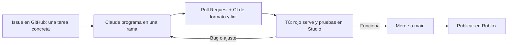
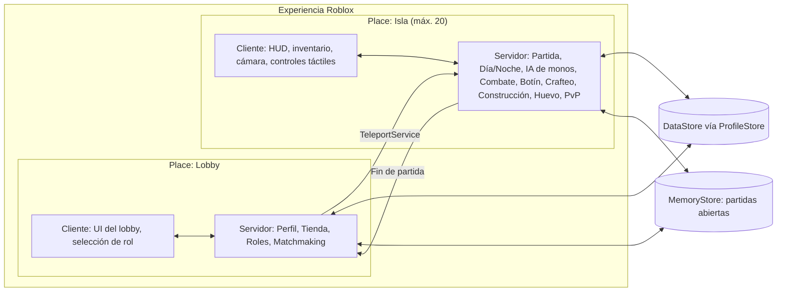

# Primal Banana Island: plan de trabajo por fases

> Basado en el [GDD v0.2](GDD.md).
> **Contexto:** una sola persona con experiencia básica en Studio y **5–15 h/semana**. Claude escribe el código en el repo.
> **Principio:** cada fase termina con **algo jugable** y se prueba con gente real antes de pasar a la siguiente.

---

## 1. Cómo trabajamos



### Reparto de responsabilidades

| Claude (en el repo) | Tú (en Roblox Studio y la web de Roblox) |
|---|---|
| Todo el código Luau (servidor, cliente, UI) | Instalar herramientas y conectar Rojo |
| Datos de balance (especies, botín, recetas) | Esculpir el terreno y montar el mapa |
| Configuración de herramientas y CI | Colocar modelos del Creator Store |
| Documentación y guías paso a paso | Subir animaciones, sonidos e imágenes a tu cuenta |
| Revisar bugs a partir de tus reportes | **Probar** y decidir qué es divertido |
| | Publicar, y crear gamepasses y productos |

> **Código en Git, mapa en Roblox.** Los scripts viven en el repo y se sincronizan con Rojo. El terreno y el mapa viven en el archivo del *place* (con historial de versiones de Roblox). Los modelos clave se exportan de vez en cuando a `assets/` como `.rbxm`.

---

## 2. Stack técnico

| Herramienta | Para qué |
|---|---|
| **Roblox Studio** | Editor del juego, mapa y pruebas |
| **VS Code + Luau LSP** | Editar código con autocompletado |
| **Rojo** | Sincroniza el código del repo con Studio |
| **Rokit** | Instala versiones fijas de las herramientas (`rokit.toml`) |
| **Wally** | Gestor de paquetes de Roblox (se añade en la Fase 2, con ProfileStore) |
| **StyLua / Selene** | Formato automático y detección de errores (en CI) |
| **ProfileStore** | Guardado seguro de datos del jugador (moneda, XP, mascotas) |
| **GitHub Actions** | Comprueba formato y lint en cada Pull Request |

**Decisiones de arquitectura:**

- **Una experiencia con 2 places:** `Lobby` (inicio) e `Isla` (partida, máximo 20).
- **Servidor autoritativo:** el cliente solo pide ("quiero atacar"); el servidor valida y aplica.
- **Sin frameworks pesados.** Usamos un patrón simple de *Services* (servidor) y *Controllers* (cliente) con `Init` y `Start`.
- **Basado en datos:** especies, recetas, botín y tiempos están en módulos de `Config`. Para balancear basta con cambiar números.
- **Red centralizada:** un único módulo `Remotes` define todos los eventos cliente-servidor.

### Arquitectura



### Estructura del repositorio

```
monkey_island_2026/
├─ docs/                      # GDD, plan y guía de instalación (SETUP.md)
├─ src/
│  ├─ shared/                 # → ReplicatedStorage.Shared (cliente y servidor)
│  │  ├─ Config.luau          #   Configuración central y balance
│  │  ├─ Remotes.luau         #   Todos los eventos de red
│  │  ├─ Loader.luau          #   Carga Services/Controllers (Init → Start)
│  │  └─ UI/                  #   Piezas de interfaz (botones, mensajes)
│  ├─ serverShared/           # → ServerScriptService.ServerShared (solo servidor, ambos places)
│  ├─ lobby/
│  │  ├─ server/Services/     # Lógica del servidor del Lobby
│  │  └─ client/Controllers/  # Interfaz y controles del Lobby
│  └─ island/
│     ├─ server/Services/     # Lógica del servidor de la Isla
│     └─ client/Controllers/  # HUD y controles de la Isla
├─ lobby.project.json         # Proyecto Rojo del Lobby (puerto 34872)
├─ island.project.json        # Proyecto Rojo de la Isla (puerto 34873)
├─ sourcemap.project.json     # Solo para el autocompletado de VS Code
├─ rokit.toml                 # Versiones de herramientas
├─ selene.toml / stylua.toml  # Lint y formato
├─ .vscode/                   # Extensiones y ajustes recomendados
└─ .github/                   # CI: formato, lint y build en cada push
```

Más adelante se añadirán `wally.toml` (paquetes, Fase 2) y `assets/` (modelos exportados de referencia).

---

## 3. Fases

### Fase 0: Fundaciones (1–2 semanas)

**Objetivo:** que puedas cambiar código en el repo y verlo en Studio, y viajar del Lobby a la Isla.

**Tú** (sigue la guía [SETUP.md](SETUP.md)):
- [x] Instalar Roblox Studio, VS Code, GitHub Desktop y Rokit, y clonar el repo
- [x] Instalar las herramientas (`rokit install`) y el plugin de Rojo
- [x] Crear la experiencia en Roblox con 2 places: **Lobby** (inicio) e **Isla**
- [x] Copiar los IDs de los places a `Config.luau` y poner la Isla en 20 jugadores
- [x] Sincronizar con Rojo y publicar ambos places
- [ ] Probar el viaje Lobby ↔ Isla en el juego publicado *(pendiente: Roblox lo bloquea mientras la experiencia sea privada, "This game is not published (Unauthorized)")*

**Claude:**
- [x] Estructura del repo: 2 proyectos Rojo + código compartido
- [x] `rokit.toml` (Rojo 7.7.1, StyLua 2.3.1, Selene 0.30.0)
- [x] CI en GitHub Actions: formato, lint y build en cada push
- [x] Módulo `Config` central (duración del día, jefes, baliza, viajes…)
- [x] Patrón *Services*/*Controllers* (`Loader`) y módulo `Remotes`
- [x] Botones de prueba "Ir a la Isla" y "Volver al Lobby" (TeleportService con reintentos y límite de peticiones)
- [x] Guía paso a paso en `docs/SETUP.md`, pensada para nivel básico

**Criterio de salida:** editas un número en `Config`, se ve en Studio y el botón del Lobby te lleva a la Isla publicada.

---

### Fase 1: Prototipo del bucle núcleo, "Sobrevivir el día 1" (4–6 semanas)

**Objetivo:** responder a la pregunta más importante: **¿es divertido salir, recolectar, pelear y volver?** Se hace con arte provisional (*greybox*).

Se entrega en partes pequeñas, cada una probable en Studio:

| Entrega | Contenido | Estado |
|---|---|---|
| **1.1** | Ciclo día/noche + Basecamp como zona segura | ✅ Probada en Studio |
| **1.2** | Recolección (árboles, rocas, arbustos) + HUD de inventario | ✅ Código listo, falta tu prueba |
| **1.3** | Barra rápida + combate: machete, honda y esquiva | Pendiente |
| **1.4** | IA de monos v1: mono ardilla y aullador rojo, botín | Pendiente |
| **1.5** | Caído → reanimación → Espíritu → reaparición | Pendiente |
| **1.6** | Mesa de trabajo y recetas | Pendiente |

- [ ] Isla pequeña provisional: Basecamp + un trozo de selva + un río *(tú; ver [MAPA.md](MAPA.md))*
- [x] Ciclo día/noche configurable (10+7) con avisos de amanecer, atardecer y "anochece en 60 s" *(1.1)*
- [x] Basecamp como zona segura: pieza `BasecampZone` + indicador en el HUD *(1.1)*
- [x] Recolección: árboles, rocas y arbustos → madera, piedra, fibra (con regeneración) *(1.2)*
- [x] Inventario básico: materiales en el HUD *(1.2)*
- [ ] Barra rápida para herramientas y armas (táctil y teclado) *(1.3)*
- [ ] Combate en 3ª persona: machete (cuerpo a cuerpo), honda (distancia) y esquiva, validados en el servidor
- [ ] IA de monos v1 (máquina de estados) con **2 especies**: mono ardilla (grupo rápido) y aullador rojo (grito que llama refuerzos)
- [ ] Tablas de botín basadas en datos
- [ ] Caído → reanimación → Espíritu → reaparición al amanecer
- [ ] Mesa de trabajo con 5–8 recetas

**Criterio de salida:** 4–6 amigos juegan 30 min seguidos. Se anota qué fue divertido y qué no, y se ajusta antes de seguir.

---

### Fase 2: Supervivencia y Basecamp (4–6 semanas)

- [ ] Hambre, sed y estamina; cocinar en la hoguera; agua del río
- [ ] Construcción por cuadrícula (táctil y PC) con **núcleo compartido + parcelas personales** y permisos
- [ ] Estaciones: hoguera, taller del curandero, forja de piedra
- [ ] Monos ladrones (capuchinos) y miedo al fuego
- [ ] Asedio nocturno v1: oleadas hacia el Basecamp, muros, trampas y antorchas
- [ ] Fiebre del mono v1 (mordiscos → fiebre; antídoto básico)
- [ ] Escalado de dificultad por día
- [ ] Derrota del servidor → pantalla de resultados
- [ ] **Guardado de datos** con ProfileStore: moneda, récord de días y XP de rol

**Criterio de salida:** una partida dura 3 o más días con tensión creciente y el progreso se guarda entre sesiones.

---

### Fase 3: Lobby, roles y progresión (3–4 semanas)

- [ ] Lobby: zona social, selector de rol, tienda de mejoras (Ámbar) y vitrina de mascotas
- [ ] Roles v1: pasiva + habilidad activa de médico, cazador y recolector
- [ ] Árbol de talentos v1 (3–5 talentos por rol)
- [ ] Matchmaking: entrar con amigos al mismo servidor y unirse a partidas en curso con hueco
- [ ] Recompensas al terminar la partida
- [ ] **Tutorial de los primeros 5 minutos.** Es clave para retener jugadores en Roblox.

**Criterio de salida:** ciclo completo Lobby → Isla → resultados → Lobby, con progreso guardado.

> 💡 **Opción de alfa pública:** al terminar esta fase se puede publicar una alfa abierta para empezar a recoger datos reales de retención mientras se produce el contenido.

---

### Fase 4: La isla completa y el bestiario (6–8 semanas)

- [ ] Mapa completo: playas (límite), selva, ríos y manglar, montañas, cuevas y volcán *(tú, con kits low-poly del Creator Store)*
- [ ] Todas las especies de categoría 1–3 con su mecánica propia, horario día/noche y respawn diario
- [ ] Tropas con alfa, huida y comportamiento ladrón
- [ ] **Bestiario/diario de campo** (UI) que se completa cazando
- [ ] Armas, armaduras y recetas por nivel; rarezas de botín
- [ ] **Optimización:** límite de monos activos, "sueño" de la IA, StreamingEnabled y pruebas en móvil de gama baja

**Criterio de salida:** un servidor de 20 jugadores estable en móvil, y cada bioma tiene una razón para visitarlo.

---

### Fase 5: Jefes, huevo, mascotas y PvP (6–8 semanas)

- [ ] 4 jefes de bioma con fases, patrones y botín especial (pieza de baliza garantizada)
- [ ] Rotación de jefes: uno cada 2 días (días 2, 4, 6, 8…), y cada uno se queda hasta que lo derrotan o aparece el siguiente
- [ ] Evento del huevo: aparición, aviso global, transporte, nido, incubación y eclosión
- [ ] Mascotas persistentes: colección, rarezas, 1 activa, tipos de ayuda
- [ ] PvP opt-in: tótem, indicador, espera para desactivar, cajas de suministro y recompensa por cabeza
- [ ] Clima y eventos: lluvia, tormenta y erupción del volcán

**Criterio de salida:** las partidas generan **momentos memorables** (jefe, huevo, robo) que la gente quiere contar o grabar.

---

### Fase 6: Rescate, pulido y lanzamiento (4–6 semanas)

- [ ] Baliza de rescate (se puede encender desde el día 8) + noche final "La Gran Tropa" → victoria
- [ ] Clasificaciones (días sobrevividos, rescates)
- [ ] Pulido de UI para móvil, sonido, música y efectos
- [ ] Analítica (embudo del tutorial, retención, economía)
- [ ] Tienda cosmética (Robux), servidores privados
- [ ] Nombre final, icono, miniaturas y cuestionario de madurez de contenido
- [ ] Beta cerrada → **lanzamiento**

---

### Fase 7: Después del lanzamiento (continuo)

Temporadas con lore, nuevos jefes y eventos, mutadores de partida ("Luna roja", "Temporada de lluvias") y balance basado en datos.

---

## 4. Cronograma estimado

Estimación con **5–15 h/semana**: unos **7–10 meses** hasta el lanzamiento. El diagrama usa el escenario medio.


---

## 5. Métricas para cada playtest

| Pregunta | Cómo se mide |
|---|---|
| ¿Se entiende qué hacer? | % de jugadores que salen del Basecamp en los primeros 3 minutos |
| ¿Es divertido? | Tiempo medio de sesión y cuántos llegan a la primera noche |
| ¿Vuelven? | Retención al día siguiente (D1) y a la semana (D7) |
| ¿Es justo? | Causas de caída, PvP vs PvE, y qué monos derriban más |
| ¿Rinde bien? | FPS y memoria en móvil con 20 jugadores |

---

## 6. Siguiente paso inmediato

1. **Tú:** hacer pública la experiencia para desbloquear el viaje Lobby ↔ Isla, y probar la entrega 1.2 en Studio.
2. **Claude:** entrega 1.3 (barra rápida y combate).
