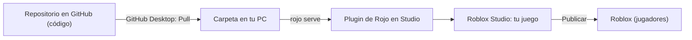

# Guía de instalación (Fase 0)

Esta guía te lleva desde cero hasta tener el **Lobby** y la **Isla** funcionando y conectados, con el código del repositorio sincronizado en Roblox Studio.

> ⏱️ Tiempo estimado: 1 a 2 horas la primera vez.
> 💡 Si un paso falla, copia el mensaje de error y pásamelo: lo resolvemos juntos.

---

## Cómo funciona todo junto



- El **código** vive en GitHub. Yo lo escribo y tú lo descargas con *Pull*.
- **Rojo** copia ese código dentro de Studio automáticamente.
- El **mapa** (terreno, modelos) lo construyes en Studio y se guarda en Roblox, no en GitHub.

> ⚠️ **No edites en Studio los scripts que vienen del repositorio** (las carpetas `Shared`, `ServerShared`, `Server` y `Client`). Rojo los sobrescribe y perderías los cambios. Los cambios de código se hacen en el repo.

---

## Paso 1: Instalar los programas

| Programa | Para qué | Descarga |
|---|---|---|
| **Roblox Studio** | Editor del juego | https://create.roblox.com/ (botón "Start Creating") |
| **VS Code** | Ver y editar el código | https://code.visualstudio.com/ |
| **GitHub Desktop** | Descargar el código del repo sin usar comandos | https://desktop.github.com/ |
| **Rokit** | Instala Rojo, StyLua y Selene en las versiones del proyecto | https://github.com/rojo-rbx/rokit |

**Instalar Rokit:**

- **Windows:** abre PowerShell y ejecuta el instalador oficial:
  ```powershell
  Invoke-RestMethod https://raw.githubusercontent.com/rojo-rbx/rokit/main/scripts/install.ps1 | Invoke-Expression
  ```
  Si falla, en https://github.com/rojo-rbx/rokit/releases descarga el `.zip` que termina en `windows-x86_64.zip`, descomprímelo y haz **doble clic en `rokit.exe`**: se instala solo.
- **Mac:** abre la Terminal y ejecuta:
  ```
  curl -sSf https://raw.githubusercontent.com/rojo-rbx/rokit/main/scripts/install.sh | bash
  ```

Después **cierra por completo VS Code y GitHub Desktop** y vuelve a abrirlos. Si abres VS Code desde GitHub Desktop, hereda el PATH que tenía GitHub Desktop, así que hay que reiniciar los dos. Comprueba que funciona con `rokit --version`.

> 💡 **Atajo en Windows** para usar Rokit en la terminal que ya tienes abierta, sin reiniciar nada:
> ```powershell
> $env:Path += ";$env:USERPROFILE\.rokit\bin"
> ```

---

## Paso 2: Descargar el repositorio

1. Abre **GitHub Desktop** e inicia sesión con tu cuenta de GitHub.
2. **File → Clone repository** → elige `Discosofia/Monkey_Island_2026` → **Clone**.
3. Arriba, en **Current branch**, elige la rama con los últimos cambios (por ahora `claude/monkey-island-roblox-design-ro2mg4`).
4. Pulsa **Open in Visual Studio Code**.
5. VS Code te ofrecerá instalar las **extensiones recomendadas** (Rojo, Luau, StyLua, Selene). Acepta.

---

## Paso 3: Instalar las herramientas del proyecto

En VS Code abre una terminal (**Terminal → New Terminal**) y ejecuta:

```
rokit install
```

Si pregunta si confías en las herramientas (*trust*), responde que sí. Comprueba que funciona con:

```
rojo --version
```

Debería mostrar `Rojo 7.7.1`.

---

## Paso 4: Instalar el plugin de Rojo en Studio

En la misma terminal, **dentro de la carpeta del proyecto**, ejecuta:

```
rojo plugin install
```

Abre Roblox Studio, o ciérralo del todo y vuelve a abrirlo. Debería aparecer un botón **Rojo** en la pestaña **Plugins**.

> ⚠️ El plugin de Studio y el `rojo` de la terminal deben ser de la **misma versión**. Este comando instala el plugin que corresponde a la versión del proyecto y sustituye cualquier otro (por ejemplo, el de otro proyecto). **Repítelo cada vez que cambie la versión de Rojo en `rokit.toml`.**

---

## Paso 5: Crear la experiencia con sus places

1. En Studio: **New → Baseplate**.
2. **File → Publish to Roblox** → **Create new experience** → nombre: `Primal Banana Islands`. Este primer place es el **Lobby** (el lugar de inicio).
3. Crea el segundo place, la **Isla**:
   1. **Archivo → Nuevo** (o, en la pantalla de inicio, **Baseplate**) para abrir un baseplate nuevo.
   2. **Archivo → Publicar en Roblox como…** (*Publish to Roblox As…*).
   3. Elige la experiencia **Primal Banana Islands**.
   4. Elige la opción de **añadirlo como lugar nuevo** (*Add as a new place*). ⚠️ **No** elijas el lugar que ya existe: ese es el Lobby y lo sobrescribirías.
   5. Ponle de nombre `🍌Isla de monos🐒(survival)` y pulsa **Crear**. El de la arena PvP se llama `🎖️Isla de dunas☠️(PvP)`, y el del shooter por equipos (Fase 13), `🧪Laboratorio en ruinas🏴‍☠️(PvP)`: se crean igual. Si ya los tenías como `Isla` e `Isla de Dunas`, cámbiales el nombre en el [Creator Hub](https://create.roblox.com/dashboard/creations): tu experiencia → **Places** → el place → **Configurar** → **Nombre**. Son los de `Config.PlaceNames`; si Roblox rechaza algún emoji, quítalo.
   - Alternativa: en el panel **Gestor de recursos** (*Asset Manager*) → **Proyecto** → **Primal Banana Islands**, haz clic derecho y busca **agregar lugar nuevo** (*Add New Place*). La interfaz de Roblox cambia a menudo: si no ves ninguna de las dos opciones, mándame una captura.
4. (Opcional) Para no confundirlos, cambia el nombre del primer place a `Lobby`. Studio le pone uno por defecto, como "Lugar de tu usuario".

---

## Paso 6: Copiar los IDs de los places al código

Cada place tiene un número de ID. El código lo necesita para viajar del Lobby a la Isla.

1. Abre el place **Lobby** en Studio.
2. En la **barra de comandos** (la barra larga de la parte de abajo de Studio que dice *"Ejecutar un comando con Ctrl↵…"*; si no la ves, ábrela desde el menú **Ventana**) escribe esto y pulsa **Ctrl+Enter**:
   ```lua
   print(game.PlaceId)
   ```
3. Copia el número que aparece en la ventana **Output**.
4. Repite lo mismo con los demás places (**Isla**, **Isla de dunas**, **Laboratorio en ruinas**).
5. Pon los números en `src/shared/Config.luau`:
   ```lua
   PlaceIds = {
   	Lobby = 1234567890, -- tu número
   	Island = 9876543210, -- tu número
   	Dunas = …, -- tu número
   	Laboratorio = …, -- tu número (0 mientras no exista)
   },
   ```
6. Guarda el archivo. Si quieres que quede guardado en el repo, pásame los IDs y los subo yo (no son secretos).

---

## Paso 7: Tamaño del servidor de cada place

Cada place tiene su propio tamaño de servidor y lo decide Roblox, no el código. Lo más directo: en Studio, **Archivo → Configuración del juego → Lugares**, que lleva a la página del Creator Hub con el **máximo de jugadores** de cada lugar (también se llega desde el [Creator Hub](https://create.roblox.com/dashboard/creations): tu experiencia → **Configuraciones → Lugares** → el lugar). *Emparejamiento personalizado* no es: ahí se reparte a los jugadores entre servidores, no cuántos caben.

En Studio, `Players.MaxPlayers` da 60 aunque el lugar tenga otro tamaño: es el valor por defecto de Studio. El que cuenta es el de esa página.

| Place | Max Players | Por qué |
|---|---|---|
| Lobby | **20** | Es donde se juntan los jugadores y se forman los grupos. |
| 🍌Isla de monos🐒(survival) | **5** | Una partida es para un grupo de amigos (hasta 5, el tamaño máximo de un grupo del Lobby, `Config.Party.MaxSize`). *(Hasta el 20-10-2026 eran 20.)* |
| 🎖️Isla de dunas☠️(PvP) | **10** | Para el 5v5 (`Config.Arena.MaxFormat`). Cada partida va a un servidor reservado, que también tiene este tamaño como máximo. |
| 🧪Laboratorio en ruinas🏴‍☠️(PvP) | **10** | Para el 5v5 y el todos contra todos de 10 (docs/LABORATORIO.md §3). |

`Config.Match.MaxPlayers` solo lo apunta (ningún código lo usa): si cambias un tamaño, cámbialo aquí y en Roblox.

---

## Paso 8: Sincronizar el código con Rojo

Hay un proyecto de Rojo para cada place:

| Place | Comando (en la terminal de VS Code) | Puerto |
|---|---|---|
| Lobby | `rojo serve lobby.project.json` | 34872 |
| Isla | `rojo serve island.project.json` | 34873 |
| Isla de dunas | `rojo serve dunas.project.json` | 34874 |
| Laboratorio en ruinas | `rojo serve laboratorio.project.json` | 34875 |

1. Abre el place **Lobby** en Studio.
2. En VS Code ejecuta `rojo serve lobby.project.json` y deja la terminal abierta.
3. En Studio: **Plugins → Rojo → Connect**. Revisa que el puerto sea **34872** y conecta.
4. Aparecerán las carpetas `Shared` (en ReplicatedStorage), `ServerShared` y `Server` (en ServerScriptService) y `Client` (en StarterPlayer → StarterPlayerScripts).
5. **File → Publish to Roblox** para guardar el place con el código.
6. Repite con la **Isla**: ábrela en Studio, ejecuta `rojo serve island.project.json`, conecta usando el puerto **34873** y publica. Igual con Dunas (34874) y el Laboratorio (34875).

---

## Paso 9: Probar

**En Studio (botón Play):**
- **Lobby:** verás el título *Primal Banana Islands* y el botón **🍌 Ir a la Isla de monos 🐒**. Al pulsarlo aparecerá el mensaje *"Los viajes no funcionan en Studio…"*. Es normal: Roblox no permite viajar entre places desde Studio.
- **Isla:** verás arriba el reloj (*"Día 1 · ☀️ 10:00"*), el indicador *"🏕️ Basecamp: zona segura"* y el botón **Volver al Lobby**. Abajo a la izquierda, solo en Studio, el botón **⏩ Saltar fase** para probar la noche sin esperar.
- **Salida (Output):** al arrancar, cada servidor escribe *"[Teleporter] Places de esta experiencia: …"* con el nombre y el ID real de cada place. Sirve para comprobar los IDs del paso 6.

**En el juego publicado** (desde la web de Roblox o la app, entrando a tu experiencia):
- Pulsa **Ir a la Isla**: deberías viajar a la Isla.
- Pulsa **Volver al Lobby**: deberías volver.

**Prueba de sincronización:** con Rojo conectado, cambia en `Config.luau` el valor `DayLengthSeconds = 10 * 60` por `12 * 60` y guarda. En la Isla, al darle a Play, el reloj empezará en *12:00*. Después vuelve a dejarlo en `10 * 60`.

✅ **Criterio de salida de la Fase 0:** todo lo anterior funciona.

---

## Rutina de trabajo diaria

1. **GitHub Desktop → Fetch origin → Pull** para bajar los últimos cambios.
2. `rojo serve <proyecto>.project.json` y conectar en Studio.
3. Probar en Studio y, si hace falta, publicar.
4. Contarme qué funcionó, qué no y qué se siente raro. Con eso preparo el siguiente cambio.

---

## Problemas comunes

| Problema | Solución |
|---|---|
| `rojo` "no se reconoce como nombre de un cmdlet…" | Ejecuta `rokit --version`. **Si funciona**, falta el paso 3: ejecuta `rokit install` en la carpeta del proyecto. **Si tampoco se reconoce**, ve a la fila siguiente. |
| `rokit` "no se reconoce como nombre de un cmdlet…" | Rokit no está instalado o la terminal no lo ve. Repite el paso 1 y luego usa el atajo `$env:Path += ";$env:USERPROFILE\.rokit\bin"` en esa terminal. Para que quede fijo, cierra VS Code **y** GitHub Desktop y vuelve a abrirlos. |
| `rojo serve` falla con *"error binding to 127.0.0.1:34872"* / *"Solo se permite un uso de cada dirección de socket"* (os error 10048) | Hay otro `rojo serve` abierto con el mismo puerto (por ejemplo, de otro proyecto). Ciérralo con `Ctrl+C` en su terminal. Si no lo encuentras, en PowerShell mira quién usa el puerto con `Get-Process -Id (Get-NetTCPConnection -LocalPort 34872 -State Listen).OwningProcess`. Si el nombre es `rojo`, ciérralo con `Stop-Process -Id (Get-NetTCPConnection -LocalPort 34872 -State Listen).OwningProcess` (para la Isla, usa 34873). |
| Rojo no conecta | Comprueba que `rojo serve` sigue abierto y que el puerto del plugin coincide (34872 Lobby, 34873 Isla). |
| Al conectar sale *"ApiContext: attempt to index number with 'protocolVersion'"* u otro error de versión o protocolo | El plugin de Studio y el `rojo` de la terminal son de versiones distintas. En la carpeta del proyecto ejecuta `rokit install`, comprueba con `rojo --version` que coincide con `rokit.toml` y ejecuta `rojo plugin install`. Luego cierra Studio del todo y vuelve a abrirlo. |
| Studio ofrece conectar a **otro proyecto** (*"Project 'X' is serving at localhost:34872"*) | Es un `rojo serve` de otro proyecto tuyo que sigue abierto. Pulsa **Dismiss** (no conectes: metería el código de ese proyecto en este juego) y cierra esa terminal o páralo con `Ctrl+C`. Si no lo paras, `rojo serve lobby.project.json` fallará porque el puerto 34872 está ocupado. |
| *"Falta configurar el ID de…"* | No se completó el paso 6. |
| El botón de viaje no hace nada en el juego publicado | Revisa que **ambos** places estén publicados con el código (paso 8) y que los IDs del paso 6 sean correctos. |
| *"Error en la teletransportación: se intentó teletransportarse a un lugar que está restringido (Código de error: 773)"* | Abre la consola **F9** → pestaña **Server** y busca el motivo. **"This game is not published (Unauthorized)"**: la experiencia es **privada** y Roblox no deja viajar entre sus places. En el [Creator Hub](https://create.roblox.com/dashboard/creations) completa el **cuestionario de madurez** de la experiencia y ponla **pública**. **Otro motivo:** busca la línea *"[Teleporter] Places de esta experiencia"* y comprueba que los IDs de `Config.PlaceIds` coinciden. |
| *"Infinite yield possible on ReplicatedStorage:WaitForChild("Remotes")"* | El código del servidor no se cargó. Revisa que la carpeta `Server` exista en ServerScriptService (paso 8). |

---

## Guardado de datos (Fase 2.8)

El juego guarda el Ámbar, el récord de días y la XP de cada jugador con **DataStore**.

- **En el juego publicado** funciona sin hacer nada.
- **En Studio**, para probarlo: *Archivo → Configuración del juego → Seguridad → Habilitar acceso de Studio a los servicios de API* (*Enable Studio Access to API Services*), en el place del **Lobby** y en el de la **Isla**. Sin eso, el juego funciona igual pero con datos temporales, y la Salida muestra *"[PlayerData] … juega con datos temporales"*.
- Para empezar de cero en pruebas, cambia `Config.Data.StoreName` (por ejemplo a `PlayerData_v2`).
